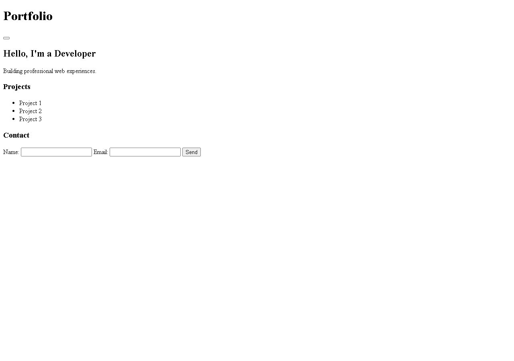

# Autonomous repair evidence — 2026-10-24 IST

Current continuation: [Report A — original acceptance](../../docs/autonomous-repair-acceptance.md), [Report B — disabled WebMCP experiment](../../docs/webmcp-assessment-2026-10-27.md), [bounded statement recovery](bounded-statement-recovery.json), [single-owner planning proof](single-owner-plan-recovery.json). Latest affected regression:186 passed; GUI and full release acceptance remain open.

Release acceptance remains **OPEN**. Read the [repair report and acceptance matrix](../../docs/autonomous-repair-2026-10-24.md).

- [Controlled search acceptance](search-acceptance.json): Jarvis completed the real existing-project modification; 12 independent API/CLI/integrity probes and nine original/generated unit tests passed. Only `notes.py` changed among existing files. Scope is the controlled Notes API, with the additional helper's sample-data CLI limitation recorded; this is not fresh-app creation or verified-reuse proof.
- [Real 8,192-context observation](context-8192-observation.json): installed Qwen3.5 9B consumed 4,637 prompt tokens and completed with ten admitted GPU layers. Highest sampled whole-device use was 2,087 MiB under the existing 3,850 MiB ceiling. A temporary policy probe preceded the saved configuration update; this is capacity evidence, not a delivery-speed benchmark.
- [Actual React validation failure](react-validation-observation.json): generated dashboard checks found missing local Vite, an unsupported interactive test script and a failing browser assertion. Its plan had no real application HTML entry. A read-only recheck of that actual plan confirmed the repaired guard rejects the test-page substitute; source hashes stayed unchanged during recheck. This is failed generation/validation evidence, not a working React app or an installation request.
- [Actual GUI startup failure](gui-validation-observation.json): one bounded launch of the preserved generated calculator exited with `TclError: Layout danger not found`. Its saved keyboard test also replaces the application's binding. The new draft guard rejects that actual test; all six planned source hashes stayed unchanged during this diagnostic. No screenshot, source repair or promotion is claimed.
- [Application entrypoint gap](application-entry-observation.json): actual baseline request generated an arithmetic library with failing unit tests and no runnable entrypoint. The new contract rejects that actual plan; original source/tests were untouched by the recheck.
- [GUI repair-copy provenance](gui-repair-copy-provenance.json): six exact files from a later failed Jarvis GUI run were copied for a new production Jarvis repair task. Per-file hashes/byte counts link the copy to its generated source. No application implementation was authored or edited by the supervisor, and copying is not acceptance/promotion.

- [Campaign summary](campaign-summary.json): actual production command/project/workload IDs, selected model, retained completion diagnostics, executable checks, file-save counts, failed attempts, preserved prior campaign outcomes, supervised cancellation and original workload hashes. Existing-project runs have their own mode/scope and fresh before/after hash comparison. No acceptance application source is authored by the supervisor. Source saves inside worker worktrees are partial generation, not successful delivery.
- [Resource sample](resource-sample.json): one whole-system observation during concurrent regression/local inference; not peak VRAM, per-process overhead or a controlled before/after benchmark.
- [Toolchain inventory](toolchain-inventory.json): bounded existing interpreter/PATH/app-local package inspection, without installations or an exhaustive machine-wide dependency search.
- Local detailed evidence is retained under `app/.jarvis-runtime/autonomous-repair/<run-id>/`: `campaign.json`, `events.jsonl`, native workload immutable checkpoints/index errors, raw model outputs/metadata, tools/file journals, original tests and partial source. These ignored directories can contain user source and should not be published indiscriminately.
- Regression logs are local `.jarvis-runtime/repair-*.log`. The original full run was interrupted after 2,520 recorded outcomes; the remainder ran separately. Three full-campaign failures passed in their complete module rerun (145 passes). This does not establish a clean, single full-suite run or physical voice/desktop/overnight acceptance.

Refresh summaries with `python scripts/verification/report_autonomous_repair.py` from `app/`. The real generation harness is `scripts/verification/verify_autonomous_repair.py`; its requests go through the existing Engine/Actions/intake/scheduler/model/coding paths and never supply target application implementation files.

## Actual partial markup previews

Chrome rendered Jarvis-generated markup on 2026-10-24. CSS and JavaScript were deliberately suppressed by the markup-component check. These are unstyled component evidence, not a finished portfolio, design mockup or upstream reference image. [Exact source paths and image hashes](preview-provenance.json).

[Actual mobile markup-only render](portfolio-markup-mobile.png).

- [GUI continuation input provenance](gui-repair-copy2-provenance.json): partial generated implementation copied unchanged; two frozen tests explicitly restored from original bytes after Git checkout line-ending conversion. Raw failed worker retained. This is controlled repair preparation, not promotion/acceptance.

- [Live snapshot byte observation](live-snapshot-byte-observation.json): both original frozen-test SHA256 values match inside the new production worker; snapshot transport evidence only.

- [Retained CLI repair input](cli-repair-copy-provenance.json): seven exact Jarvis-generated files; both frozen tests match first confirmed saves. No supervisor implementation or test edits. Controlled copying is not promotion or fresh-creation acceptance.

- [Independent fresh CLI acceptance](cli-acceptance.json):15 real-process probes and5 original tests PASS, unchanged source and native save hashes. Product source changed during generation; full-release/source-stable recovery acceptance remains open.
- [Production verification copy](cli-production-verification-copy.json): exact copy of accepted CLI; Jarvis may add one new subprocess-test module while preserving every existing file. Original accepted project stays unchanged.
- [Preserved partial CLI checkpoint](cli-checkpoint-provenance.json): complete immutable validation workspace with11/13 original tests passing, selected before later library regressions. No mixed snapshots, app edits or acceptance claim.
