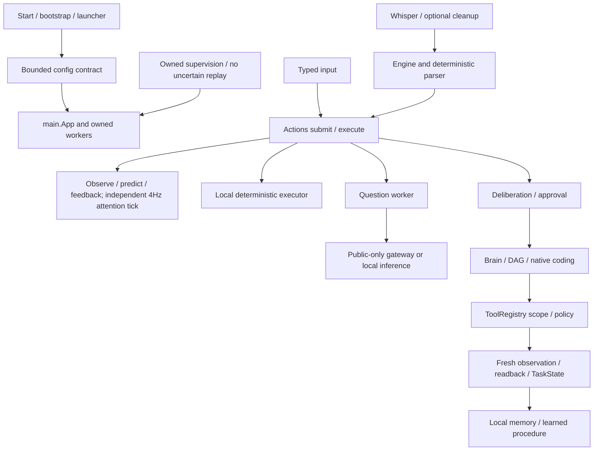

# Architecture inventory — 2026-10-15 IST
<!-- architecture audit 2026-10-15 -->

**Module audit completed with operational gaps explicitly retained.** All 32 catalog IDs passed their owned-fixture assertions; this is not an all-system live certification. The underlying map is dated 2026-10-14 and wording corrections are dated 2026-10-15. No uncommitted work was discarded; branch remains `codex/jarvis-prove-fix-audit`.

[Source symbols and imports](source-inventory.json), [every map table claim](claim-matrix.json), [census](capability-census.json), [actual watchdog bindings](health-bindings.json), [exact case results](tests.jsonl), [environment conflicts](dependency-checks.json). Counts distinguish source-present, prerequisite-gated, missing and live-unverified states. Registry specs contain real dispatch bindings, while unavailable account tools stay conditional; no unknown guide can create a callable handler.

## Dependency graph and runtime branches

| Claim / subsystem | Actual implementation / configuration | Evidence / operational status |
| --- | --- | --- |
| Speech input / cleanup | engine.py, voice_input.py, command_cleanup.py; whisper/command_cleanup flags | Transcript→fake launch tested; microphone and speech recognition accuracy NOT RUN |
| Cognition / memory | cognition.py and context_hub.py; cognition.enabled/cycle_hz; 200-entry queues/7 attention slots | Existing regression plus source symbols; all models/tools are not executed on the 4Hz tick |
| Question / privacy | knowledge_worker.handle_request, HybridGateway.decide, cloud_policy.classify; groq public-only | Fake public provider success/429/timeout and private local fallback passed; no real Groq inference |
| Deliberation / DAG | actions._form_task_opinion, deliberation.decide, brain.run, dag_execution.Executor | Destructive typed task halts before planning; DAG cancellation fixtures pass; complex live model planning NOT RUN |
| ToolRegistry / UIA / browser | tools.py fixed specs; execution_adapters.PROVIDERS; browser_automation transport | 107 specs; fake fresh click/readback passed; native UIA was previously BLOCKED; browser live fixture evidence remains separately dated |
| Skills / learning | SkillMemory, RepoLearner, AbilityForge, SelfEvolution; explicit activation approval | 10 readable bundled guides, one missing guide, 210 Hermes manifest rows, public DeerFlow census; proposal test cannot install or execute unapproved package ability |
| Memory / document retrieval | obsidian_memory, conversation_memory, memory_curator, file_knowledge | Adapters/source/test paths exist; private vault/document contents not inspected or exported; retrieval faithfulness not certified |
| Coding / LocalGithub | native_coding.run -> codex_workload.localgithub; brain.coding_backend=jarvis | Real owned fixture Git assembly, independent Python checks and worker receipt passed; no user checkout writes/pushes |
| F5 / GPU | speech/f5_speech and gpu_scheduler; speech.engine=f5 | Separate torch environment, not Ollama; configured readiness passes; no new audio-quality or VRAM contention measurements |
| Gmail / WhatsApp / remote integrations | gmail_api/gmail_writes, whatsapp, mcp_bridge/toolkits; conditional credentials/scopes | Account-facing schemas and no-replay tests in regression; live sends/account writes never run; no complete provider certification |
| Realtime / Gods Eye | realtime_catalog/realtime_sources and gods_eye modules | 82 registrations, not 82 healthy live endpoints; source/existing tests present; actual feeds not all queried |
| DeerFlow / Hermes / Harness / REA | deerflow, hermes, harness, rea_tools; Hermes planner off/Harness on | Named adapters/source exist; optional prerequisites reported; live planner/REA fidelity NOT RUN |
| Services / recovery | main.Watchdog.register, launcher heartbeat/OwnedApplication, recovery.restart_thread | 22 manifest names; actual watchdog bindings listed independently. No proof every owned thread has a watchdog; Cog tick registration gap noted |

## Exact entry-point case bindings

| Case | Code / binding | Executed node | Scope |
| --- | --- | --- | --- |
| JRV-01-001 | [engine.Engine.feed](../../../../jarvis/engine.py#L65), [commands.parse](../../../../jarvis/commands.py#L67), [actions.Actions.execute](../../../../jarvis/actions.py#L1018) | `tests.test_architecture_audit::test_JRV_01_001_wake_to_fake_launch_and_readback` | owned fixtures; live integration separate |
| JRV-01-002 | [actions.Actions._form_task_opinion](../../../../jarvis/actions.py#L636), [deliberation.Deliberation.decide](../../../../jarvis/deliberation.py#L225), [brain.Brain.run](../../../../jarvis/brain.py#L928) | `tests.test_architecture_audit::test_JRV_01_002_task_proposal_stops_before_planner` | owned fixtures; live integration separate |
| JRV-01-003 | [knowledge_worker.handle_request](../../../../jarvis/knowledge_worker.py#L410), [hybrid_inference.HybridGateway.decide](../../../../jarvis/hybrid_inference.py#L85), [groq_adapter.GroqAdapter](../../../../jarvis/groq_adapter.py#L22) | `tests.test_architecture_audit::test_public_question_boundaries[JRV-01-003-ok]` | owned fixtures; live integration separate |
| JRV-01-004 | [cloud_policy.classify](../../../../jarvis/cloud_policy.py#L78), [knowledge_worker.handle_request](../../../../jarvis/knowledge_worker.py#L410) | `tests.test_architecture_audit::test_private_question_and_telemetry[JRV-01-004]` | owned fixtures; live integration separate |
| JRV-01-005 | [tools.ToolRegistry.execute](../../../../jarvis/tools.py#L105), [brain.Brain.observe](../../../../jarvis/brain.py#L820) | `tests.test_architecture_audit::test_JRV_01_005_registry_click_requires_grounding_and_fresh_readback` | owned fixtures; live integration separate |
| JRV-01-006 | [native_coding.run](../../../../jarvis/native_coding.py#L119), [codex_workload.localgithub](../../../../jarvis/codex_workload.py#L25) | `tests.test_architecture_audit::test_reviewed_architecture_cases[JRV-01-006-tests.test_native_coding-NativeCoding-test_native_localgithub_assembles_single_worker_after_real_checks]` | owned fixtures; live integration separate |
| JRV-01-007 | [self_evolution.SelfEvolution](../../../../jarvis/self_evolution.py#L161), [repo_abilities.AbilityForge](../../../../jarvis/repo_abilities.py#L262) | `tests.test_architecture_audit::test_JRV_01_007_idle_research_cannot_promote_an_unapproved_ability` | owned fixtures; live integration separate |
| JRV-01-008 | [recovery.restart_thread](../../../../jarvis/recovery.py#L44), [task_state.TaskState](../../../../jarvis/task_state.py#L21) | `tests.test_architecture_audit::test_reviewed_architecture_cases[JRV-01-008-tests.test_recovery-RecoveryTests-test_dead_worker_restarts_without_replaying_queued_actions]` | owned fixtures; live integration separate |
| JRV-01-009 | [config_contract.load_config](../../../../jarvis/config_contract.py#L15), [launcher.preflight](../../../../jarvis/launcher.py#L73) | `tests.test_architecture_audit::test_JRV_01_009_unknown_root_configuration_warns` | owned fixtures; live integration separate |
| JRV-01-010 | [commands.parse](../../../../jarvis/commands.py#L67), [intent_catalog.match](../../../../jarvis/intent_catalog.py#L678) | `tests.test_architecture_audit::test_reviewed_architecture_cases[JRV-01-010-tests.test_intent_testbook-TestbookTests-test_every_scenario_and_its_three_phrasings_reach_the_expected_intent]` | owned fixtures; live integration separate |
| JRV-01-011 | [launcher.check_imports](../../../../jarvis/launcher.py#L392) | `tests.test_architecture_audit::test_JRV_01_011_interpreters_and_conflicts_are_enumerated` | owned fixtures; live integration separate |
| JRV-01-012 | [tools.ToolRegistry.catalog](../../../../jarvis/tools.py#L64), [toolkits.status](../../../../jarvis/toolkits.py#L80) | `tests.test_architecture_audit::test_JRV_01_012_registry_inventory_is_not_live_capability_proof` | owned fixtures; live integration separate |
| JRV-01-013 | [tools.ToolRegistry.execute](../../../../jarvis/tools.py#L105), [config_contract.load_config](../../../../jarvis/config_contract.py#L15), [runtime_health.RuntimeHealth](../../../../jarvis/runtime_health.py#L10) | `tests.test_architecture_audit::test_service_failures_are_explicit_and_private[JRV-01-013-offline]` | owned fixtures; live integration separate |
| JRV-01-014 | [tools.ToolRegistry.execute](../../../../jarvis/tools.py#L105), [config_contract.load_config](../../../../jarvis/config_contract.py#L15), [runtime_health.RuntimeHealth](../../../../jarvis/runtime_health.py#L10) | `tests.test_architecture_audit::test_reviewed_architecture_cases[JRV-01-014-tests.test_launcher_readiness-LauncherReadinessTests-test_timeout_is_reported_as_incomplete_not_missing_dependencies]` | owned fixtures; live integration separate |
| JRV-01-015 | [tools.ToolRegistry.execute](../../../../jarvis/tools.py#L105), [config_contract.load_config](../../../../jarvis/config_contract.py#L15), [runtime_health.RuntimeHealth](../../../../jarvis/runtime_health.py#L10) | `tests.test_architecture_audit::test_service_failures_are_explicit_and_private[JRV-01-015-malformed]` | owned fixtures; live integration separate |
| JRV-01-016 | [tools.ToolRegistry.execute](../../../../jarvis/tools.py#L105), [config_contract.load_config](../../../../jarvis/config_contract.py#L15), [runtime_health.RuntimeHealth](../../../../jarvis/runtime_health.py#L10) | `tests.test_architecture_audit::test_JRV_01_016_optional_dependency_is_not_reported_ready` | owned fixtures; live integration separate |
| JRV-01-017 | [tools.ToolRegistry.execute](../../../../jarvis/tools.py#L105), [config_contract.load_config](../../../../jarvis/config_contract.py#L15), [runtime_health.RuntimeHealth](../../../../jarvis/runtime_health.py#L10) | `tests.test_architecture_audit::test_JRV_01_017_five_way_trace_isolation_twenty_rounds` | owned fixtures; live integration separate |
| JRV-01-018 | [tools.ToolRegistry.execute](../../../../jarvis/tools.py#L105), [config_contract.load_config](../../../../jarvis/config_contract.py#L15), [runtime_health.RuntimeHealth](../../../../jarvis/runtime_health.py#L10) | `tests.test_architecture_audit::test_reviewed_architecture_cases[JRV-01-018-tests.test_task_recovery-TaskRecoveryTests-test_cancel_before_recovery_never_calls_planner]` | owned fixtures; live integration separate |
| JRV-01-019 | [tools.ToolRegistry.execute](../../../../jarvis/tools.py#L105), [config_contract.load_config](../../../../jarvis/config_contract.py#L15), [runtime_health.RuntimeHealth](../../../../jarvis/runtime_health.py#L10) | `tests.test_architecture_audit::test_reviewed_architecture_cases[JRV-01-019-tests.test_task_state-TaskStateTests-test_restart_marks_unfinished_task_and_preserves_checkpoints]` | owned fixtures; live integration separate |
| JRV-01-020 | [tools.ToolRegistry.execute](../../../../jarvis/tools.py#L105), [config_contract.load_config](../../../../jarvis/config_contract.py#L15), [runtime_health.RuntimeHealth](../../../../jarvis/runtime_health.py#L10) | `tests.test_architecture_audit::test_JRV_01_020_hostile_metadata_is_not_an_instruction_or_envelope_override` | owned fixtures; live integration separate |
| JRV-01-021 | [tools.ToolRegistry.execute](../../../../jarvis/tools.py#L105), [config_contract.load_config](../../../../jarvis/config_contract.py#L15), [runtime_health.RuntimeHealth](../../../../jarvis/runtime_health.py#L10) | `tests.test_architecture_audit::test_private_question_and_telemetry[JRV-01-021]` | owned fixtures; live integration separate |
| JRV-01-022 | [tools.ToolRegistry.execute](../../../../jarvis/tools.py#L105), [config_contract.load_config](../../../../jarvis/config_contract.py#L15), [runtime_health.RuntimeHealth](../../../../jarvis/runtime_health.py#L10) | `tests.test_architecture_audit::test_JRV_01_022_unicode_exact_targets_remain_data` | owned fixtures; live integration separate |
| JRV-01-023 | [tools.ToolRegistry.execute](../../../../jarvis/tools.py#L105), [config_contract.load_config](../../../../jarvis/config_contract.py#L15), [runtime_health.RuntimeHealth](../../../../jarvis/runtime_health.py#L10) | `tests.test_architecture_audit::test_JRV_01_023_negation_cannot_launch` | owned fixtures; live integration separate |
| JRV-01-024 | [tools.ToolRegistry.execute](../../../../jarvis/tools.py#L105), [config_contract.load_config](../../../../jarvis/config_contract.py#L15), [runtime_health.RuntimeHealth](../../../../jarvis/runtime_health.py#L10) | `tests.test_architecture_audit::test_reviewed_architecture_cases[JRV-01-024-tests.test_task_recovery-TaskRecoveryTests-test_missing_control_uses_fresh_alternative_and_records_failure]` | owned fixtures; live integration separate |
| JRV-01-025 | [tools.ToolRegistry.execute](../../../../jarvis/tools.py#L105), [config_contract.load_config](../../../../jarvis/config_contract.py#L15), [runtime_health.RuntimeHealth](../../../../jarvis/runtime_health.py#L10) | `tests.test_architecture_audit::test_JRV_01_025_pressure_does_not_enable_model_or_effect_retries` | owned fixtures; live integration separate |
| JRV-01-026 | [tools.ToolRegistry.execute](../../../../jarvis/tools.py#L105), [config_contract.load_config](../../../../jarvis/config_contract.py#L15), [runtime_health.RuntimeHealth](../../../../jarvis/runtime_health.py#L10) | `tests.test_architecture_audit::test_reviewed_architecture_cases[JRV-01-026-tests.test_task_recovery-TaskRecoveryTests-test_repeat_cannot_bypass_block_by_changing_unused_fields]` | owned fixtures; live integration separate |
| JRV-01-027 | [tools.ToolRegistry.execute](../../../../jarvis/tools.py#L105), [config_contract.load_config](../../../../jarvis/config_contract.py#L15), [runtime_health.RuntimeHealth](../../../../jarvis/runtime_health.py#L10) | `tests.test_architecture_audit::test_JRV_01_027_five_cold_twenty_warm_are_actual_measurements` | owned fixtures; live integration separate |
| JRV-01-028 | [tools.ToolRegistry.execute](../../../../jarvis/tools.py#L105), [config_contract.load_config](../../../../jarvis/config_contract.py#L15), [runtime_health.RuntimeHealth](../../../../jarvis/runtime_health.py#L10) | `tests.test_architecture_audit::test_JRV_01_028_forged_tool_approval_does_not_replace_real_permission` | owned fixtures; live integration separate |
| JRV-01-029 | [tools.ToolRegistry.execute](../../../../jarvis/tools.py#L105), [config_contract.load_config](../../../../jarvis/config_contract.py#L15), [runtime_health.RuntimeHealth](../../../../jarvis/runtime_health.py#L10) | `tests.test_architecture_audit::test_JRV_01_029_malformed_configuration_fails_before_services` | owned fixtures; live integration separate |
| JRV-01-030 | [tools.ToolRegistry.execute](../../../../jarvis/tools.py#L105), [config_contract.load_config](../../../../jarvis/config_contract.py#L15), [runtime_health.RuntimeHealth](../../../../jarvis/runtime_health.py#L10) | `tests.test_architecture_audit::test_reviewed_architecture_cases[JRV-01-030-tests.test_task_recovery-TaskRecoveryTests-test_tool_exception_is_uncertain_and_never_replayed]` | owned fixtures; live integration separate |
| JRV-01-031 | [tools.ToolRegistry.execute](../../../../jarvis/tools.py#L105), [config_contract.load_config](../../../../jarvis/config_contract.py#L15), [runtime_health.RuntimeHealth](../../../../jarvis/runtime_health.py#L10) | `tests.test_architecture_audit::test_JRV_01_031_oversized_configuration_is_bounded` | owned fixtures; live integration separate |
| JRV-01-032 | [tools.ToolRegistry.execute](../../../../jarvis/tools.py#L105), [config_contract.load_config](../../../../jarvis/config_contract.py#L15), [runtime_health.RuntimeHealth](../../../../jarvis/runtime_health.py#L10) | `tests.test_architecture_audit::test_JRV_01_032_lifecycle_metadata_does_not_store_extra_payload` | owned fixtures; live integration separate |

## Gaps not hidden by the map

- `repository-assimilation` has a directory but no readable SKILL.md; no guide was fabricated or installed merely to satisfy a count.
- Manifest names alone do not prove watchdog registration/current health. Cognition persistence is registered only while the tick thread is alive; a separate tick-thread restart binding is not present in this main registration block. Review module02/32 before claiming universal recovery.
- AbilityForge uses host subprocess/audit-hook isolation for generated abilities, unlike Docker repository skills. This remains a security release concern; no arbitrary learned code was executed here.
- Seven venv dependency checks passed; DeerFlow and Hermes checks are BLOCKED because `pip` is absent. Enumeration passed by honestly preserving these statuses, not declaring those environments conflict-free.
- Main Python3.10.6 is on an upstream end-of-life branch. Compatible interpreter/environment migration is deferred to module34; none were installed in this audit.
- Actual microphone/STT/TTS, live account sends, GUI correctness, learned-code escape resistance and all endpoint/model quality remain unverified.
