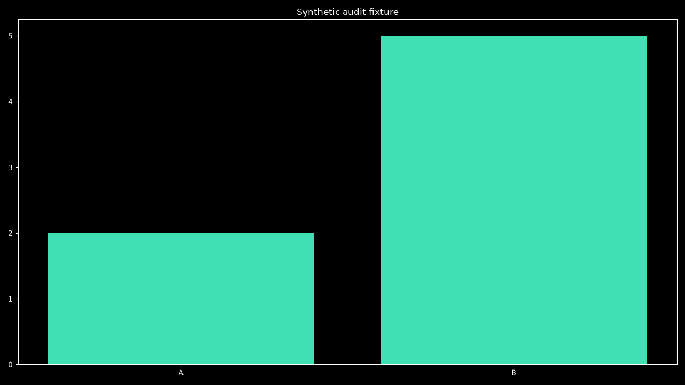

# Prompt 28 sandbox/DeerFlow audit — 2026-10-16 IST

**PARTIAL: 20 catalog fixture PASS / 12 BLOCKED.**

Mock-based Docker, worker, restart and transport faults; isolated files/checkpoints; five concurrent writes × 20 rounds and an owned checkpoint-crash child. Separately, nine actual owned ephemeral containers used the installed reviewed image: synthetic 2+2/UID/isolation, all seven literal media recipes, and a nonzero exit with stop/no-replay and cleanup. Stock narration ran CPU ONNX with existing assets and was not played. No Desktop startup/restart, image pull/build, dependency installation, account operation, personal input mount, public research query, LLM inference, audible playback or GPU workload. Only the attested fixture containers were removed; generated files were preserved. Historical measurements and artwork remain dated; no new GUI screenshot is claimed.

| Claim | Actual entry/source | Executed evidence and limit |
| --- | --- | --- |
| Research tools | ToolRegistry → deerflow.execute/request → owned deerflow_worker → scoped observe | 7 registered tools; 23 public guides; real harness registration/discovery, mocked worker faults and existing source-receipt assertions; no new live model/public research trial |
| Network separation | worker research/web_research/sandbox allowlists; SandboxJob.create | Public web route omits local project context; Docker NetworkMode=none inspected. No account/browser/host-exec tools in the research adapter; semantic prompt/approval gaps remain |
| Isolation | SandboxJob.create → RepositorySandbox.cli → local Linux Docker | Actual UID 65534, root read-only, no network, capabilities dropped, no-new-privileges, 2 GiB RAM/swap, 128 PID limit; mounts inspected against allowed destinations, no Docker socket; no hostile-daemon guarantee |
| Mounts | SandboxJob._local/create/stage_inputs/path | Reparse/link checks include application/job/skills/model ancestors; explicit copied inputs and no project mount; fake linked ancestor rejected before run. Not atomic handle-based containment against a hostile host mutating directories |
| Identity | immutable image ID, new state.container_id, owned() | New jobs pin full Docker ID; exec/kill/remove target inspected ID; replaced-ID test refuses. Legacy checkpoints without container_id still use image/label/name attestation |
| Budgets and recovery | execute/observe/_checkpoint/save; DockerService | Pending attempted/uncertain checkpoint fences different commands after restart; locked writes use exclusive create and shared 20-effect budget; 512K-character checkpoint bound and schema validation. Daemon startup remains existing managed behavior, not a new lazy-start policy |
| Timeouts/nonzero | Linux timeout + bounded Docker CLI + uncertainty checkpoint | Injected timeout kills attested owned job; real exit 7 stops its container, retains uncertainty and refuses replay; cleanup inspected. Complete logs/daemon-outage recovery remain incomplete |
| Media | deerflow_media.validate/execute/verify_artifacts | All 7 installed literal recipes exercised; chart PNG 1280×720, malformed PNG rejected. PNG uses Pillow structure checks; WAV PCM readback, bounded PPTX ZIP/CRC checks; PDF/MP4 envelope checks alone do not prove pages/codecs/frames |
| Outputs | SandboxJob.inventory → actual files; parent artifact_evidence | Bounded deterministic lexical traversal preserves first 200 paths/sizes, platform ordering and link exclusions; directory/depth/traversal budgets. Actual file evidence remains distinct from model prose |
| Lifecycle | owned worker/OwnedJob; DockerService; close/reap_orphans | Existing Start/Stop/bootstrap/launcher/recovery interfaces unchanged; no shared-engine stop, personal config edit, dependency or new service. Aggregate admission and cross-process job locks are not added |

Synthetic chart generated and inspected on 2026-10-16; not a desktop screenshot or model performance result.

- **JRV-28-005 BLOCKED:** Offline confinement is tested, but untrusted-repository installer provenance and a separate explicit approval event are not enforced by a dedicated sandbox installer gate.
- **JRV-28-008 BLOCKED:** Wrong PNG structure and missing optional runtime are refused; all seven installed literal recipes were exercised. Uniform per-renderer missing-module/font/codec/voice readiness probes and precise unavailable-capability diagnostics are not implemented.
- **JRV-28-009 BLOCKED:** Per-container CPU limits are configured and RAM/PID limits inspected. No cross-process admission quota for multiple DeerFlow research/render jobs; each job still requests 2 CPUs/2 GiB independently.
- **JRV-28-010 BLOCKED:** Failed/unobserved sources cannot authorize a matching receipt. HTTP-200 paywalls, teaser text and incomplete extraction lack a comprehensive paywall/content-availability classifier.
- **JRV-28-012 BLOCKED:** Unknown/failed/mismatched source-call citations are rejected by existing tests. Resolved citation IDs do not verify claim entailment, source quality or factual correctness.
- **JRV-28-015 BLOCKED:** Non-object worker JSON now returns a controlled protocol error, and checkpoint/media validation is stronger. A complete typed schema for result/receipt/source/artifact/tool data is absent.
- **JRV-28-021 BLOCKED:** No host credential env or project mount is offered to the tested container, and public research omits the project field. No full fake-secret/cloud/Groq/telemetry/cache oracle; commands/diagnostics and selected input copies may contain private content locally.
- **JRV-28-023 BLOCKED:** Cancellation is deterministic, but there is no complete semantic negation oracle for natural-language research/sandbox goals. A model’s interpretation of “do not run X” is not a permission guarantee.
- **JRV-28-025 BLOCKED:** Per-container limits and bounded filesystem fixtures pass; no full host RAM-pressure/GPU-allocation failure versus responsive core-command test. No GPU workload ran.
- **JRV-28-027 BLOCKED:** A/B measures 20 warm and five initial inventory iterations with tracemalloc. Not five cold processes/full harness/container jobs with RSS/VRAM, TTFT/audio or general research/render latency.
- **JRV-28-030 BLOCKED:** Owned worker cancellation and real nonzero-container failure are covered. Full daemon/worker disconnect/crash recovery with task provenance, durable cleanup retry and cross-process leases remains incomplete.
- **JRV-28-032 BLOCKED:** Job IDs, state, image/container identity and output hashes exist. Raw command/diagnostic/error files and full model/research traces lack a complete private-data redaction/correlation/readback oracle.

[Report](../../final-report.md) · [Assertions](cases-and-contracts.xml) · [Container receipt](container-fixture.json) · [Other recipe receipts](renderer-fixtures.json) · [Diff](source.patch)
