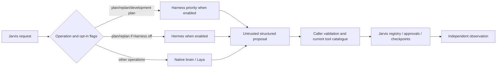

# Prompt 30 optional-planner audit — 2026-10-16 IST

**PARTIAL: 22 catalog fixture PASS / 10 BLOCKED.**

Deterministic planner/provider mocks; actual scoped reads of synthetic source; hash-checked public Hermes guide reads; five concurrent fixture requests × 20 rounds; actual owned Python JSONL worker echo, crash/restart and 100 response-isolation checks. No optional planner model inference, generated script installation, paid API, real desktop action, account operation, private recording or GPU workload ran. Model and SDK proposals remain distinct from real action or outcome proof. Launcher readiness may boot its already-installed owned check-only SDK transport; it is not a model accuracy test.

| Documented claim | Source/entry and executed evidence | Limit |
| --- | --- | --- |
| Planner selection | BrainClient.request/_request → HarnessClient before HermesClient for plan/replan and scoped development code_plan | next_step, ordinary code_plan, code_edit, choose, decide and verify retain native routes; enabled Harness is not proof every task uses it |
| Hermes opt-in and guides | hermes.settings/validate_proposal + HermesSkills manifest/hashes | Disabled planner yields no HermesClient calls; 210 public guides remain discoverable/readable within explicit budgets; no helper script is executed |
| Trust boundary | validate_proposal → validate_plan → ToolRegistry; validate_agent_response → AgentSession | Unknown/unadvertised tools, duplicate/failed/completed action keys and invalid read calls refuse before dispatch; all execution stays with Jarvis |
| Configuration | planner_settings.settings → client and Harness worker; model_selection.required_models | Strict boolean flags, finite deadlines 10–180 Hermes / 10–300 Harness, bounded model names and recognized selector; enabled Harness model now included in readiness requirements |
| Laya | BrainClient._request_once choose + brain_worker.Models.predict | Missing checkpoint asks clarification without launch; missing import/file returns unavailable; unrelated native inference no longer requires Laya checkpoint. No new ranking-accuracy test |
| Concurrency and shutdown | Per-client request RLock; cancellable wait; bounded stdio reader | One response queue owner per client; eight pending messages and 8M-character protocol cap; dead worker detected even if EOF sentinel was dropped under backpressure. Separate clients lack shared task lease |
| Runtime disable | Effective cancel callback and flag recheck before returning optional result | In-flight disabled result discarded/cancelled; next explicit request takes current route; no new fallback executor |
| Recovery | Existing bounded one inference retry; original _on_code guard; TaskState pending uncertainty | Owned worker crash retries only inference; simulated uncertain external effect remains pending/paused. No external effect is executed by the fixture worker |
| Prompt/data boundary | Restricted Harness agent catalogue, profile IDs, structured parse, real readback | Malicious source remains data in tested read session; forged approval cannot expand read-only scope. Full cloud/log/semantic-accuracy oracle remains incomplete |
| Upstream isolation | harness_worker ACTIVE profile + OwnedJob; Hermes submit_jarvis_plan only; local Ollama adapters | Installed check-only readiness is narrower than model/SDK end-to-end privacy, trace and host-environment confinement |

- **JRV-30-007 BLOCKED:** The tested adapters keep private fixture text on local inference routes, but no complete SDK/host-environment/cloud request oracle proves that arbitrary private harness context cannot leak.
- **JRV-30-008 BLOCKED:** Step/action and protocol limits reject oversized plans; no complete token-overflow compaction and checkpoint-resume acceptance oracle across all optional planners.
- **JRV-30-009 BLOCKED:** Historical comparisons keep Hermes disabled and the current Harness SDK is pinned. No new matched live-model accuracy/latency trials establish a harness outcome advantage or a production downgrade threshold.
- **JRV-30-010 BLOCKED:** One BrainClient now serializes its stdio requests, but independent Brain/BrainClient instances sharing one TaskState lack a common task-generation lease.
- **JRV-30-021 BLOCKED:** No full fake-secret/Groq/telemetry/log/cache oracle. Upstream runtime environment and raw local Harness event exports can contain private task context.
- **JRV-30-023 BLOCKED:** Plan validation and real execution permissions are tested; no complete semantic do-X versus do-not-do-X model accuracy oracle.
- **JRV-30-024 BLOCKED:** Current registry and caller validations remain in force; no atomic observation/task-generation receipt binds all optional-planner proposals to execution across independent clients.
- **JRV-30-025 BLOCKED:** No host RAM-pressure/GPU-allocation failure experiment against concurrent core responsiveness. Fixtures use no GPU/model inference.
- **JRV-30-027 BLOCKED:** Schema-copy A/B uses20 warm+5 initial batches; no five cold full-planner processes with RSS/VRAM/TTFT/first-audio and matched live outcome accuracy.
- **JRV-30-032 BLOCKED:** Local task/turn IDs and failure events exist; complete optional-SDK trace correlation, secret redaction and retention/readback guarantees remain incomplete.

[Report](../../final-report.md) · [Case assertions](cases-and-contracts.xml) · [Diff](source.patch)
