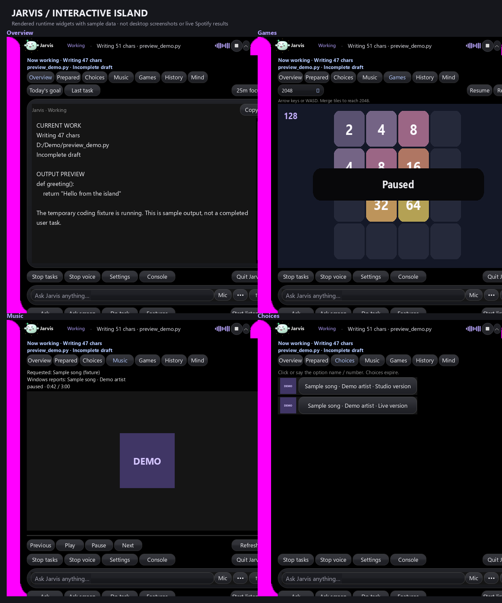

# Prompt 31 independent audit — 2026-10-19 IST

The original scripts/verification/verify_island_desk.py failed its denial assertion because it calls decide(False) without the token now required by the repaired API. This is a stale verification harness call, not a permission bypass. Original output and preview files remain in this run's root.

An audit copy changes only that call to decide(False, displayed_token); all readiness/denial assertions remain unchanged. [Native readback](native-current-protocol/native-island.json): result available True; all recorded checks true True. No source file was edited by Codex. The checked-in verification script needs a maintainer update for the API.

Current rendered preview from owned offscreen runtime widgets and authored data; not a desktop screenshot, live Spotify result or completed user task. Pink regions are the exporter's transparency key; the montage crops card edges. These artifacts do not prove native edge quality or 200-percent usability. Artwork is the repository's existing Pip/game/UI renderer; no upstream reference artwork is relabeled as a new screenshot.
