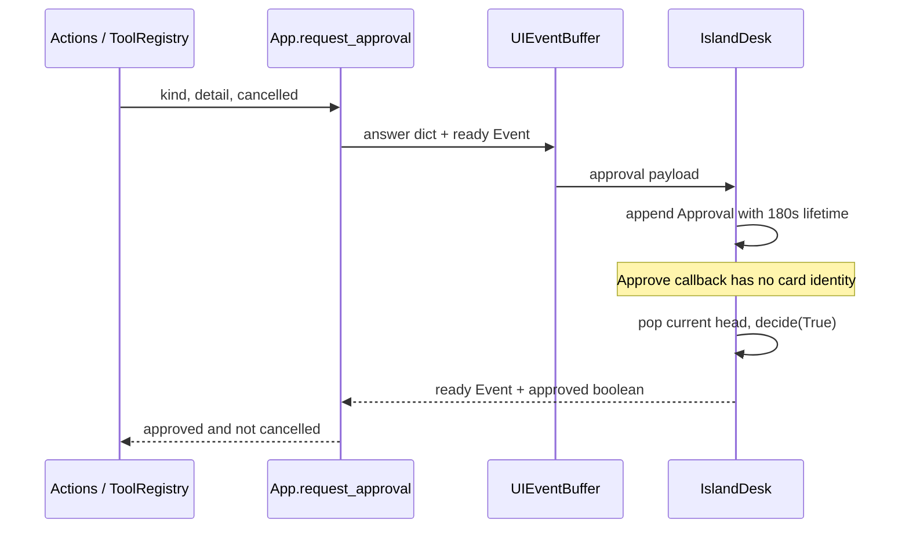
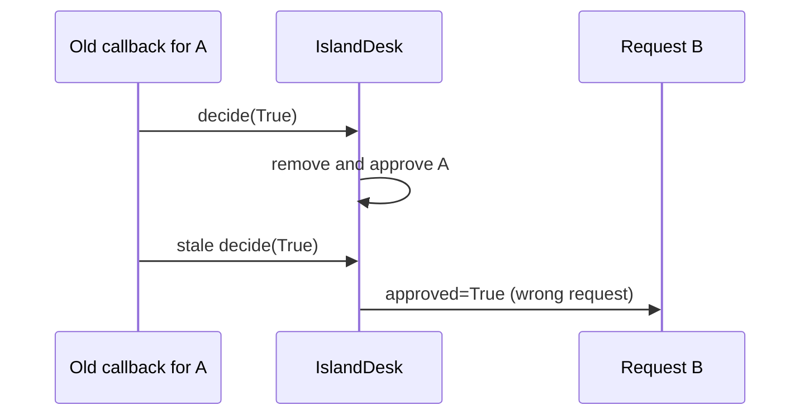

# Prompt 31 audit — 2026-10-19 IST

Actual current flow:

Failure sequence:

[Synthetic queue event trace](event-trace.json) preserves five terminal events; it is not a render/readback recording. Real GUI focus, secure-input, 200-percent scaling and process-crash evidence remain BLOCKED. Existing test XML contains fixture widget/readback assertions, accurately separate from full live acceptance.
