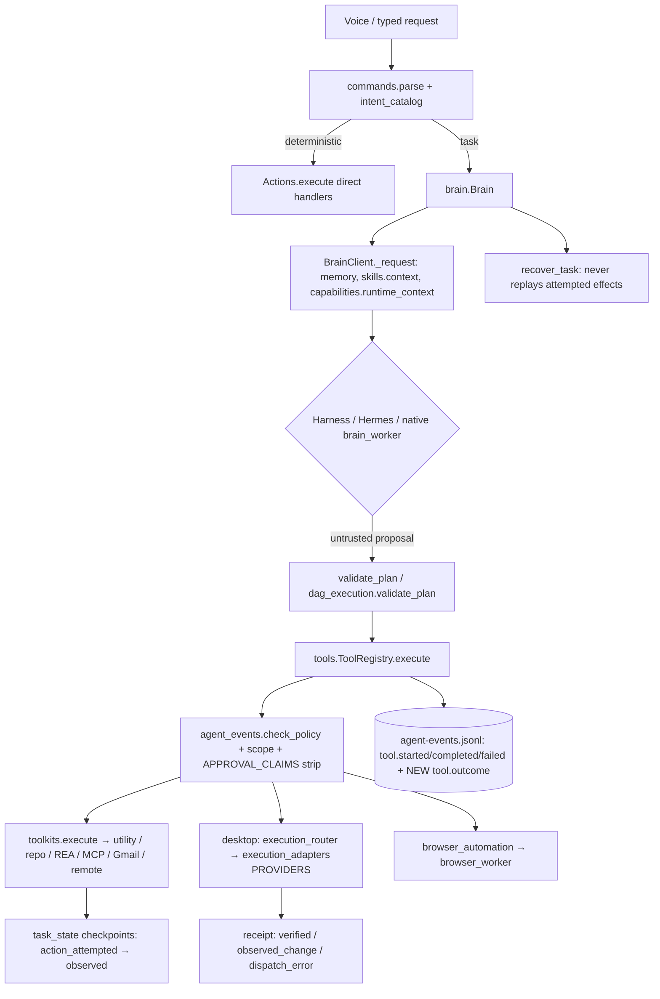
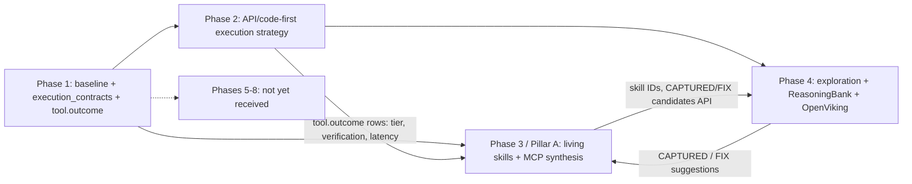

# Phase 1 — Architecture inventory and upgrade dependency map

Date: 2026-10-17 IST. Branch `claude`. Source inspected at commit `5b52737` plus the Phase 1 changes listed in [files-changed.txt](files-changed.txt) and [defects.md](defects.md).
Every statement below cites source that was read or a check that was executed in this phase. Documentation claims
that were not re-executed are labelled as such.

## 1. Inventory (measured from the checkout)

| Item | Count / fact | How obtained |
| --- | --- | --- |
| Application modules (`app/jarvis/*.py`, excluding `_vendor`) | 231 modules, 55,923 lines | `find jarvis -name '*.py'`, `wc -l` |
| Modules importable in the main `.venv` (Python 3.10.6) | 229 / 231 | [module-imports-before.json](module-imports-before.json): every module imported in its own subprocess |
| Modules that need their own interpreter | `jarvis.deerflow_model` (imports in `.venv-deerflow`: verified), `jarvis.hermes_worker` (needs Hermes `run_agent`, runs in `.venv-hermes`) | Executed import in `.venv-deerflow`; source read for Hermes |
| Byte-compilation of `jarvis/`, `scripts/`, `tests/`, `main.py`, `jarvis_bootstrap.py` | 0 errors | `python -m compileall -q` |
| Undefined names (pyflakes 3.2.0, scratch install, not added to the project) | 3 reports, 0 runtime-reachable faults (D2, D3 below) | pyflakes |
| Broad silent exception handlers (`except Exception: pass`) | 75 in 31 files; none bare | [silent-exception-census.json](silent-exception-census.json) (AST census) |
| ToolRegistry specs | 107 (83 toolkit, 12 desktop, 4 DOM, 3 browser, 3 files, 1 realtime, 1 terminal); 20 require user approval | `jarvis.tools.SPECS` |
| Declared runtime services | 22 in `config/runtime_manifest.json` | manifest |
| Bundled skills | 11 folders, 10 loadable `SKILL.md` (`repository-assimilation` has none) | `skills/`, SkillMemory load in baseline |
| Test files / collected tests | 165 `tests/test_*.py`; 3,321 collected at baseline | pytest JUnit |
| Python environments present | `.venv`, `.venv-brain`, `.venv-deerflow`, `.venv-f5`, `.venv-harness`, `.venv-hermes`, `.venv-hermes-bootstrap`, `.venv-skills`, `.venv-training` | directory listing |
| Host software observed (presence only, not live-validated) | Docker Engine 29.8.2 (Linux), Node, VS Code CLI, Ollama, Office 16 Excel/Word, `nvidia-smi`; Blender under `D:\Blender`; Unreal `D:\UE_5.7`, `D:\UE_5.8` | `docker info`, `command -v`, directory listing |

## 2. Execution architecture as implemented (source-verified)

Verified properties (source + existing tests, re-run in this phase):

* **Single executable authority:** all planned tool calls pass `ToolRegistry.execute` (`brain.Brain.dispatch`,
  `hierarchical.adapters`). Toolkit families are merged into one `toolkits.TOOLS` table; there is no second registry.
* **Retry policy:** `BrainClient._request` retries *inference only*, once, when the worker died;
  `dag_execution.Executor` retries only `read_only` tools on `OSError/TimeoutError`; effectful DAG steps are limited to one
  attempt by `validate_plan`; `Brain.recover_task` pauses when an attempted effect is not re-plannable.
* **Approval:** `APPROVAL_CLAIMS` are stripped from proposals; approval comes from `actions._approve` at execution time
  (toolkits external writes, MCP, utility effects).
* **Privacy routing:** `cloud_policy.classify` is deterministic and fail-closed (UNKNOWN stays local); `screen_payload`
  refuses outbound payloads with secret/private markers.

## 3. Duplicate / overlapping subsystems (assessed, not merged)

| Area | Implementations found | Assessment |
| --- | --- | --- |
| Memory | `memory_curator` (facts), `conversation_memory` (episodic SQLite), `obsidian_memory` (vault), `skill_memory` (guides + procedures), `experience_memory` (cases), `cognition` lessons/stats, `memory_index` | Distinct owners per memory kind; overlap is in *retrieval* (each has its own lexical scoring). Phase 4 must add hierarchical retrieval *behind* these interfaces, not a seventh store of the same facts. |
| Skill registries | `skills/` bundled, `custom-skills/`, Obsidian Personal, Hermes guides, DeerFlow guides, repository skills, repo abilities, utility profiles | Single loader for guides (`SkillMemory.refresh`); executables only via ToolRegistry. Phase 3 telemetry must key on stable skill IDs across these roots. |
| Planners | native `brain_worker`, Harness, Hermes, hierarchical DAG, `step_planning` | Selection is explicit in `BrainClient._request`; all outputs are untrusted proposals validated before dispatch. |
| Executors | `execution_adapters.PROVIDERS` (pointer → UFO → Windows-MCP → CUA → OCU → Agent-S patterns), browser worker, toolkits | Ordered preflight fallback with *no post-dispatch fallback*. Phase 2 extends ranking *before* dispatch only. |
| Event logs | `agent-events.jsonl` (tool lifecycle), `repairs.jsonl` (recovery), `task_state.json` checkpoints, cognition `procedures.json` stats, UI telemetry | Phase 1 adds outcome rows to the existing lifecycle log rather than a new log. |

## 4. Upgrade foundation added in Phase 1

`jarvis/execution_contracts.py` + one new event kind in `jarvis/agent_events.py`:

| Contract | Values | Consumer phases |
| --- | --- | --- |
| `METHOD_TIERS` | `api` → `structured` → `gui` | Phase 2 execution-strategy ranking; Phase 4 exploration (prefer API/structured) |
| `IDEMPOTENCY` + `may_replay()` | `read_only`, `idempotent` (replayable); `non_idempotent`, `unknown` (never replayed) | Phase 2 fallback/retry; Phase 3 mutation verification; existing no-replay rule |
| `VERIFICATION` | `verified`, `observed_change`, `unverified`, `failed` | Phase 3 `completed_verified_count`; Phase 4 ReasoningBank lesson evidence |
| `record_outcome()` → `tool.outcome` row | categorical/bounded only; must correlate to a lifecycle `call_id` | Phase 2 emits; Phase 3/4 consume |
| `read_outcomes()` | bounded tail reader that skips malformed rows | Phase 3 skill ranking, Phase 4 lesson extraction |

Design constraints enforced by tests (`tests/test_phase01_baseline.py`): outcome rows cannot carry arguments, content or
credentials; malformed values are dropped and counted; lifecycle rows remain exactly as strict as before; an outcome never
grants approval or triggers a retry.

## 5. Dependency map for the received phase briefs

Only Phases 1–4 have been received in this session. Pillar A is identified by the Phase 2–4 briefs as the
living-skill engine (Phase 3). Phases 5–8 and the scope of Pillars B–D were **not provided**; they are left undefined
here rather than guessed.

| Phase | Must reuse | Must not do | Integration seam |
| --- | --- | --- | --- |
| 2 | `ToolRegistry`, `toolkits.TOOLS`, `execution_router`, `capabilities.rank_tools`, `.venv-skills`, `mcp_bridge` | New registry; post-dispatch fallback; replay of non-idempotent writes | Rank methods before dispatch; emit `tool.outcome` after verification |
| 3 | `SkillMemory.refresh` loader, SQLite for history, `.skill_id` sidecars, `docker_runtime`/DeerFlow sandbox, `mcp_bridge` approval | Trust from model assertion; replacing skill files with telemetry; unrestricted generated code | Consume `read_outcomes`; stable skill IDs; provisional → verified promotion via independent checks |
| 4 | `obsidian_memory`, `experience_memory`, `skill_memory`, `screen_awareness`, idle scheduler, `app_knowledge` | Reorganize or overwrite the vault; treat the cyan cursor or a virtual desktop as a sandbox | Read-only vault indexing into a separate recoverable index; lessons through existing context interfaces |

## 6. Documentation vs. code differences found

| Document claim | Code reality | Action |
| --- | --- | --- |
| `docs/system-map.md` §12: "`python -m jarvis.launcher --check` … interrupted … no fresh readiness status" | Re-run in this phase; see [test-results.md](test-results.md) | Result recorded with date |
| `docs/system-map.md` §6: 10 readable bundled `SKILL.md`; `repository-assimilation` lacks one | Confirmed: SkillMemory loads 10 bundled skills, 0 errors | No change needed |
| `docs/system-map.md` §1: Groq receives public questions only | Confirmed by `cloud_policy.classify` source and 16-case fixture (0 private→public) | No change; fixture is not a live cloud check |
| Regression suite is evidence-preserving | `tests/test_web_development_audit.py` overwrote dated Prompt 22 evidence on every run (D5) | Fixed |
