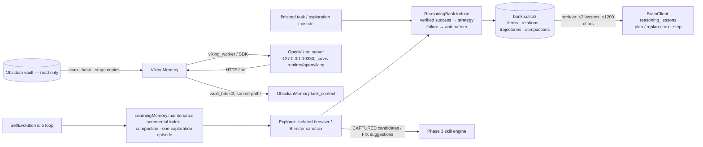

# Phase 4 — Architecture, upstream provenance, licenses, memory schema and exploration safety model

Date 2026-10-18 IST. Branch `claude`. Predecessors: Phase 1 `e847b00`, Phase 2 `16d9b4d`, Phase 3 `6f88033`.

## Upstream sources actually inspected

| Source | Revision | License | Use in Jarvis |
| --- | --- | --- | --- |
| [google-research/reasoning-bank](https://github.com/google-research/reasoning-bank) (paper arXiv 2509.25140v2, Ouyang et al., 2025-09-29) | `ed80611788292ea739f1effd31f16c53823b8a0d` (2026-05-18) | Apache-2.0 | **Adapted design, no code copied.** From `third_party/src/minisweagent/memory/instruction.py` and `memory_management.py`: memory item = Title / one-sentence Description / 1–3-sentence Content; ≤3 items per trajectory; separate success and failure induction; "do not mention specific websites, queries, or string contents"; top-n (≤10) retrieval by cosine over cached embeddings; append consolidation. Upstream embeds with Gemini or Qwen3-Embedding-8B; Jarvis uses local `nomic-embed-text`. `reasoning_bank.parse_items` parses the upstream Markdown format for an optional model summarizer. |
| [volcengine/OpenViking](https://github.com/volcengine/OpenViking) | source `8d28ffcd` (2026-10-16); PyPI `openviking==0.5.0` | **AGPL-3.0** | Installed **unmodified** in a separate environment (`.venv-openviking`, `requirements/openviking.txt`) and run as its own loopback server process. Jarvis never imports it; `jarvis/viking_worker.py` (run by that interpreter) uses the published `openviking_sdk`, and the planner fast path calls the documented `POST /api/v1/search/find` HTTP endpoint. Concepts used: `viking://` URIs, L0 `.abstract.md` / L1 `.overview.md` / L2 source, `add_resource(to=…)` refresh semantics, `processing_mode` (`vectors_only` / `semantic_and_vectors`), `args.parse_mode=no_split`, trusted auth headers. |
| [SunzeY/SEAgent](https://github.com/SunzeY/SEAgent) | `c8887f157352494953b3317047929cf81465defa` (2025-08-07) | README badges: code Apache-2.0, data CC BY-NC 4.0, "research use only"; no LICENSE file | **Design reference only.** The curriculum loop (explore → evaluate → learn → next task) is an original implementation; SEAgent's OSWorld VM environment, models and reward data are not used. |
| [Ollama](https://ollama.com/library/nomic-embed-text) `nomic-embed-text` | pulled 2026-10-17 | Apache-2.0 | Local 768-d embeddings (`jarvis/local_embeddings.py`, OpenViking embedding provider). |

OpenViking AGPL note: Jarvis does not modify or redistribute OpenViking and communicates with it as a separate
network service on 127.0.0.1. Anyone distributing a modified OpenViking or offering it as a network service to others must
review AGPL-3.0 obligations; this phase does neither.

## Components

## ReasoningBank schema (`.jarvis-runtime/reasoning_bank/bank.sqlite3`)

| Table | Fields |
| --- | --- |
| `items` | `id`, `kind` (`strategy`/`anti_pattern`), `title`, `description`, `content`, `conditions_json` (application, version, environment, surface, domain), `evidence_json` (source, task_id, call_ids, verification, trajectory_ref), `failure_conditions_json`, `confidence`, `trust` (`provisional`/`confirmed`/`retracted`), `superseded_by`, `source`, `content_hash` (UNIQUE: dedupe), `embedding` (768 floats), `helpful`, `harmful`, timestamps |
| `relations` | `a`, `b`, `relation` (`contradicts`/`supersedes`), `reason`, `at` |
| `trajectories` | `key` (UNIQUE per source/task/status: idempotent learning), `outcome`, `item_ids_json` |
| `compactions` | report of merged near-duplicates and retired stale items, with provenance |

Rules: success requires independent verification evidence (never a model claim); text is generalized (paths, URLs, emails,
quoted values and long numbers removed) and validated (bounded lengths, no secrets, no raw-log patterns). Retrieval drops
the lower-ranked side of a contradiction, excludes superseded and retracted items, applies condition fit and confidence, and
stops at k items / 1,200 characters. Feedback moves confidence; three harmful uses at low confidence retract an item.

## OpenViking index (`.jarvis-runtime/openviking/`)

* `ov.conf` (generated once; random root key; loopback; trusted auth), `data/` (OpenViking workspace), `server.log`,
  `manifest.json` (+ `.bak`): per vault file `sha256`, `size`, `mtime_ns`, `version`, `uri`, `verified_link`,
  `duplicate_of`, `indexed_at`, `mode`; per directory `uri`, `mode`, `files`; last 20 index reports.
* Excluded from the index: `.obsidian`, `.trash`, hidden folders, `Jarvis Skills` (owned by the Phase 3 skill store — no
  duplicate skill data), `Jarvis Executions` (raw logs), non-Markdown files, files > 2 MB.
* Staging: changed top-level folders are copied to a temporary folder and uploaded; OpenViking never receives the vault
  path itself. Links are verified by comparing the stored L2 text with the source.
* L0/L1 summaries (`semantic_directories`, off by default) are model-generated **hints**: a trial with qwen3.5:0.8b produced
  an abstract claiming content the note did not contain. Results always carry `summary_is_generated` and the source path.
* Recovery: damaged manifest → preserved and links rebuilt; `rebuild()` preserves the old workspace and re-indexes.

## Exploration safety model

| Environment | Isolation basis | Permitted actions | Verification |
| --- | --- | --- | --- |
| `IsolatedBrowserEnv` | Headless Chrome, **new context per episode** (no profile, cookies, storage, downloads, permissions; service workers blocked), every request outside one approved `http://127.0.0.1:<port>` origin aborted and recorded | `click`, `fill` on observed named controls via the existing `browser_worker.Session` | Fresh DOM read of the status region / new controls |
| `BlenderSandboxEnv` | Background Blender (factory settings, scripts disabled) through ToolRegistry `blender_task` in a fresh temporary folder; a sandbox approver allows only `blender_task` writes inside that folder | Fixed create/export templates | Second-process readback; glTF magic bytes |
| Desktop GUI | **Disabled.** No verified disposable VM is configured (VirtualBox absent; Windows Sandbox not confirmable without elevation). The cyan cursor and virtual desktops are not isolation boundaries. | none | — |

Approved applications come from `config.exploration.applications` (default `blender` only). Episodes are rate-limited
(`max_episodes_per_day`), run only from the idle loop with resource gating, and every step checks cancellation. A step
in flight during a crash is recorded as uncertain and never replayed; the next episode starts from a fresh sandbox.
