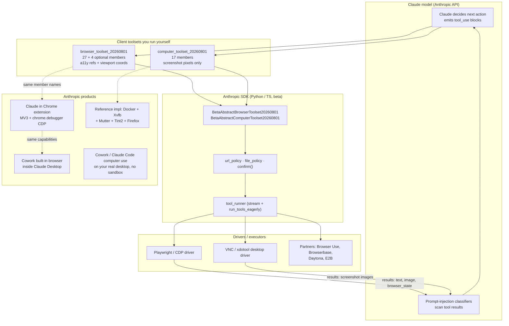
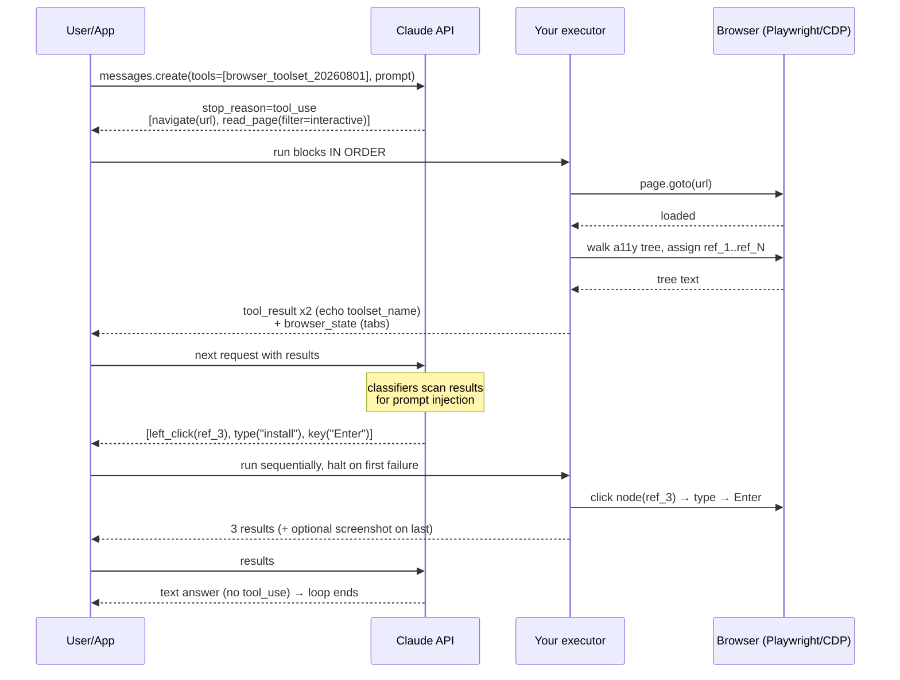
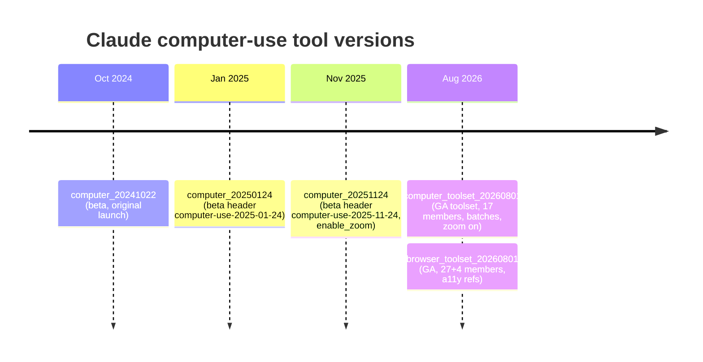
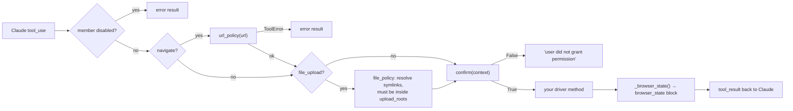
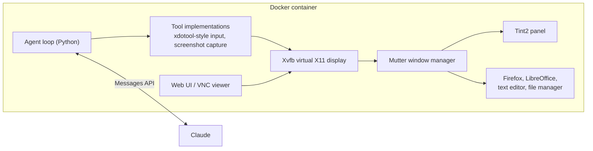
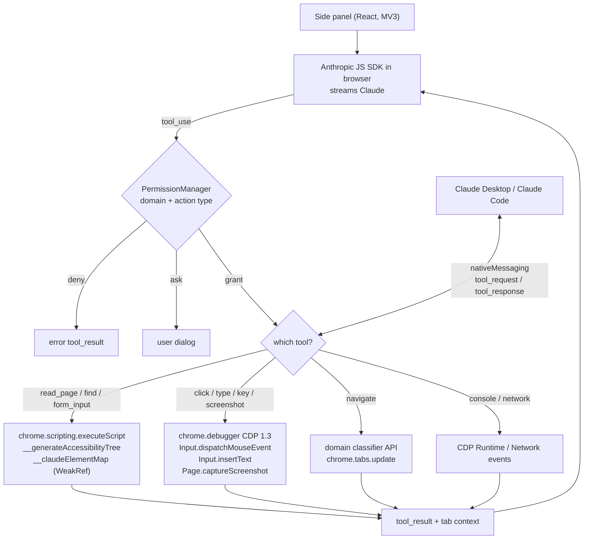
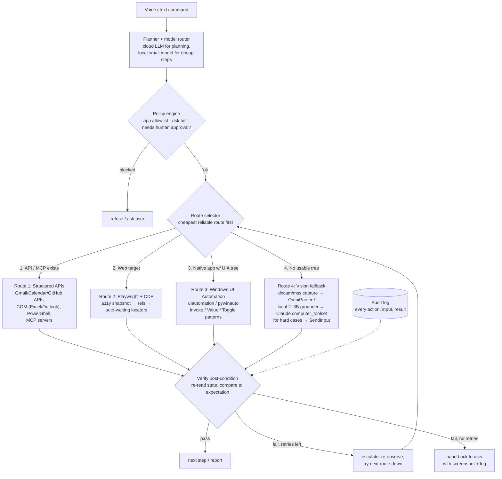
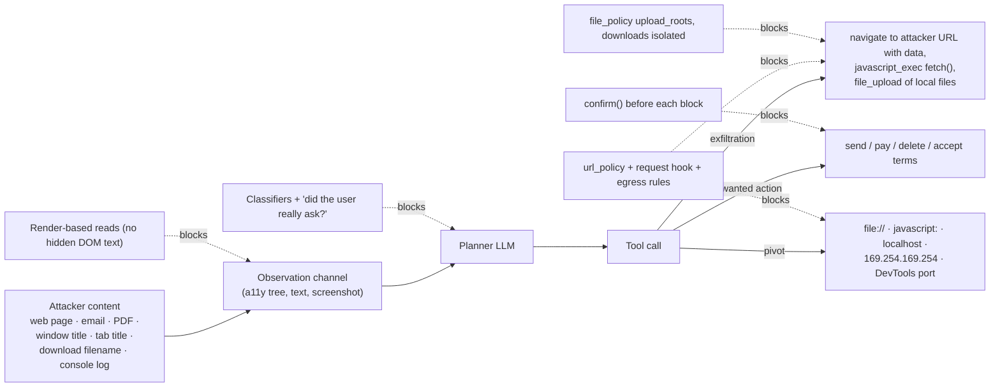

# How Claude (and OpenAI) Control a Browser or PC — Verified Deep Dive + Jarvis Blueprint

*Verified against official docs on 29 Oct 2026. Every claim is tagged with where it comes from:*
**[DOC]** = official Anthropic/OpenAI documentation or help center · **[RE]** = third-party reverse engineering of shipped code (may be out of date) · **[3P]** = third-party article/repo · **[ADVICE]** = my engineering recommendation, not a documented fact.

---

## 0. Verdict on the text you pasted

| # | Claim in your text | Verdict | Correction / what was missing |
|---|---|---|---|
| 1 | `browser_toolset_20260801` gives 27 tools by default | ✅ Correct **[DOC]** | It's 27 default **+ 4 optional** (`javascript_exec`, `file_upload`, `read_console`, `read_network`) = **31 members**. It is **GA, no beta header**, runs **entirely in your executor** (nothing executes on Anthropic's side), and is **not available in Managed Agents**. |
| 2 | "Can reference accessible page elements instead of estimating pixel positions" | ⚠️ Mostly correct | It's **both**, not "instead of". Pointer members accept a `target` that is either `{"type":"ref","ref":"ref_2"}` or `{"type":"coordinate","x":..,"y":..}`. Claude switches between them; canvas, video, cross-origin iframes and virtualized lists still need coordinates. |
| 3 | `computer_toolset_20260801` has 17 tools incl. screenshots, zoom, clicks, typing | ✅ Correct **[DOC]** | Also GA with no beta header. Big changes vs the old tool: **no `display_width_px`/`display_height_px`**, **zoom on by default**, **batched actions**, **you must resize screenshots yourself** (API rejects oversized images). |
| 4 | Claude in Chrome uses `scripting`, `debugger`, `tabs`, `system.display`; debugger enables input + screenshots | ✅ Correct but **incomplete** | The help center lists **15 permissions** (adds `sidePanel`, `storage`, `tabGroups`, `alarms`, `notifications`, `webNavigation`, `declarativeNetRequestWithHostAccess`, `offscreen`, `nativeMessaging`, `downloads`, `unlimitedStorage`). `system.display` = knowing screen size so clicks land correctly. |
| 5 | Reference env = Docker + Xvfb + Mutter + Tint2 + agent loop; not Claude Desktop internals | ✅ Correct **[DOC]** | Good caveat. Claude Desktop's computer use on *your* machine has **no sandbox** between Claude and your apps (help center) — very different from the Docker reference. |
| 6 | "Strongest pattern = read a11y tree first, use refs, fall back to coordinates" | ✅ Correct **[DOC]** | The docs explicitly recommend preferring refs where a usable tree exists, reading the tree before screenshotting, and scoping reads with `filter:"interactive"` or a container `ref`; a tree read often costs fewer tokens than a screenshot. |
| 7 | Links | ✅ Valid | Strip the `?utm_source=chatgpt.com` tracking suffix. Note: OpenAI now **recommends code execution** (model writes Playwright/PyAutoGUI code) over the structured `computer` tool for GPT-6 Astra. |
| 8 | Jarvis: 4 routes (API/MCP → Playwright/CDP → Windows UIA → screenshot+VLM) + verification | ✅ Sound **[ADVICE]** | Missing pieces: **DPI awareness** (the #1 cause of missed clicks on Windows), **UIPI/elevation limits**, **Chromium accessibility needs to be enabled for UIA to see web content**, a **ref-staleness protocol**, the **"halt on first failure" batch rule**, a **VRAM budget** for a 4 GB card, and **prompt-injection controls**. All covered below. |

---

## 1. The whole landscape in one graph



---

## 2. Claude API: Browser use tool (`browser_toolset_20260801`)

### 2.1 Core facts **[DOC]**
- **One entry, no name:** `tools=[{"type": "browser_toolset_20260801"}]`. No beta header. Available on the Claude API and Claude Models on Google Cloud (Google-managed). Not on Managed Agents.
- **Models:** not supported on Haiku 4.5, Opus 4.5/4.6/4.7, Sonnet 4.5/4.6; supported on newer models (examples use `claude-opus-5-5`).
- **Client-side:** your app runs every action against its own browser automation. Anthropic never touches the browser.
- **Response shape:** member calls are `tool_use` blocks where `name` is the member (`navigate`, `left_click`…) and a new field `"toolset_name": "browser"`. There is **no `action` field**. You must **echo `toolset_name`** on every `tool_result`.
- **Cost:** declaring the toolset adds ≈ **6,600 input tokens** (≈ 6,670 on Sonnet 5); enabling all 4 optional members adds ≈ 880 more. Screenshots bill as image input; a11y trees bill as text.
- **ZDR eligible, not HIPAA eligible.**

### 2.2 All 31 member tools **[DOC]**

| Group | Member | Key inputs | Returns |
|---|---|---|---|
| Navigation & capture | `navigate` | `url` (or `"back"`/`"forward"`/`"reload"`), `tab_id?` | text (+ `browser_state` if URL/title changed) |
| | `screenshot` | `tab_id?` | **image block** |
| | `zoom` | `region [x0,y0,x1,y1]`, `tab_id?` | **image block** (crop, upscaled) |
| Pointer | `left_click`, `right_click`, `middle_click`, `double_click`, `triple_click` | `target: Target`, `modifiers?` (e.g. `"ctrl+shift"`), `tab_id?` | text ack |
| | `hover` | `target: Target` | text |
| | `left_click_drag` | `from: Coordinate`, `target: Coordinate` | text |
| | `left_mouse_down`, `left_mouse_up`, `mouse_move` | `target: Coordinate` | text |
| | `scroll` | `target: Coordinate`, `scroll_direction`, `scroll_amount?` (1–10 notches, default 3) | text |
| | `scroll_to` | `target: Ref` | text |
| Keyboard & timing | `type` | `text` | text |
| | `key` | `text` (`"Enter"`, `"ctrl+a"`, `"Backspace Backspace"`), `repeat?` 1–100 | text |
| | `hold_key` | `text`, `duration` 0–30 s | text |
| | `wait` | `duration` 0–30 s | text |
| Page reading | `read_page` | `filter?` (omit=visible, `"interactive"`, `"all"`), `depth?` (default 15), `ref?`, `tab_id?` | a11y tree text with `[ref_N]` tags, capped at 50,000 chars |
| | `find` | `query` (natural language) | up to 20 matches in the same tagged format |
| | `get_page_text` | `tab_id?` | visible text, main-content first |
| Forms & files | `form_input` | `target: Ref`, `value` (string/number/bool) | text |
| | `file_upload` *(off by default)* | `target: Ref`, `paths?`, `document_ids?` | text |
| Diagnostics | `read_console` *(off)*, `read_network` *(off)* | `tab_id?` | one line per entry since last read |
| | `javascript_exec` *(off)* | `text` (JS expression) | value of last expression |
| Tabs | `new_tab`, `list_tabs`, `switch_tab`, `close_tab` | `tab_id` where needed | **exactly one `browser_state` block**, no text |

**Target shapes:** `CoordinateTarget = {type:"coordinate", x, y}` (viewport pixels, origin top-left of the rendered page, no window frame) · `RefTarget = {type:"ref", ref:"ref_2"}`.

### 2.3 The "hidden" contract details most people miss **[DOC]**
1. **You own the ref map.** Your executor assigns `ref_N`, stores ref → node (a11y node ID, stored selector, etc.). Refs are tab-scoped and stay valid until navigation or a material DOM change. **Never renumber refs for a tab until it navigates** — that silently invalidates refs Claude still holds. For an unknown ref, return an error telling Claude to re-read the page.
2. **Viewport size is inferred** from your screenshots; no display dimensions are declared. Keep screenshots one consistent size. Zoom does **not** change the coordinate frame.
3. **The API doesn't downscale toolset images.** Oversized images are rejected; when a request holds **> 20 images** a stricter per-image limit kicks in.
4. **`browser_state` block** is how you report tabs: full inventory every time (not a delta), exactly one `active:true`, `state_changes` for `tab_opened`, `download_started/completed/failed`. The API renders it into a "Tab Context" footer text that Claude reads; you never write that footer yourself. Never attach it to an error result. Empty `state_changes: []` is rejected — omit instead.
5. **Batch actions:** one assistant turn can contain several member calls. Run them **sequentially in order**, stop at the first failure, and answer every later call with `is_error: true` and the exact text `Not executed: an earlier action in this turn failed.` (the computer toolset uses a slightly different halt text — see §3).
6. **Streaming:** each member's input arrives as **one complete `input_json_delta`**, not fragments.
7. **Dispatch on `(toolset_name, name)`**, not `name` alone — your custom `navigate` tool can coexist with the member.
8. **Navigate handler must refuse non-http(s) schemes** using a real URL parser (`javascript:`, `file:`, `data:`, `chrome:`…). The API doesn't filter URLs for you.
9. **Build page reads from what renders** (a11y tree / visible text), not raw DOM source, so hidden-text injections don't reach Claude.
10. **Tab titles, URLs and download fields are an injection surface** — the API escapes quotes/backslashes in titles but renders URLs verbatim.

### 2.4 Execution sequence



---

## 3. Claude API: Computer use tool (`computer_toolset_20260801`)

### 3.1 Core facts **[DOC]**
- `{"type": "computer_toolset_20260801"}` — no name, **no beta header** on Claude API + Google Cloud. A third-party write-up dates GA to **19 Aug 2026** **[3P]**.
- **Claude 5.5 models accept only the toolset** on Claude API / Google Cloud. On **Bedrock, Foundry, Claude Platform on AWS**, only the older beta versions exist (`computer_20251124` with header `computer-use-2025-11-24`; `computer_20250124` with `computer-use-2025-01-24`).
- **Overhead:** ≈ 4,500 input tokens (≈ 4,590 Sonnet 5); disabling zoom saves ≈ 410. Old versions were ~466–499 system-prompt tokens + ~735 per tool definition.
- **ZDR and HIPAA eligible.**
- It is a **"schema-less" tool**: the input schema is built into the model and can't be modified. Including it makes the API generate a computer-use-specific system prompt.

### 3.2 The 17 members **[DOC]**

| Member | Input | Notes |
|---|---|---|
| `screenshot` | `{}` | full display image |
| `zoom` | `region [x0,y0,x1,y1]` | full-res crop, scaled to your screenshot size; **enabled by default** |
| `left_click` | `coordinate?`, `text?` (modifiers: shift/ctrl/alt/super) | omit coordinate → click at cursor |
| `right_click`, `middle_click`, `double_click`, `triple_click` | same | |
| `left_click_drag` | `start_coordinate`, `coordinate`, `text?` | |
| `mouse_move` | `coordinate` | hover |
| `left_mouse_down`, `left_mouse_up` | `{}` | at current cursor; use `mouse_move` first |
| `cursor_position` | `{}` | answer as text, e.g. `X=512, Y=384` |
| `scroll` | `scroll_direction`, `scroll_amount`, `coordinate?`, `text?` | |
| `type` | `text` | |
| `key` | `text` (`"Return"`, `"ctrl+s"`), `repeat?` 1–100 | **honor `repeat`** — new in toolset |
| `hold_key` | `text`, `duration` ≤ 300 s | |
| `wait` | `duration` ≤ 300 s | |

Halt text for skipped batch calls: `Not executed: an earlier computer action in this turn failed.`

### 3.3 Image + coordinate math (where most implementations break) **[DOC]**
- **Every coordinate is in the pixel space of the screenshots you return.** If you downscale, scale Claude's coordinates back up by `1/scale` before clicking.
- **Current models (Opus 4.7 and later, i.e. every toolset model):** ≤ **2,576 px long edge** and ≤ **4,784 visual tokens** where tokens = `ceil(w/28) × ceil(h/28)` (≈ 3.75 MP). Older models: 1,568 px / ≈ 1.15 MP.
  - 1920×1080 → 69 × 39 = **2,691 tokens ✓ fits as-is**
  - 2560×1440 → 92 × 52 = **4,784 ✓ exactly at the limit**
  - 3840×2160 (4K) → 138 × 78 = 10,764 ✗ must downscale
- **macOS Retina = DPR 2**; on **Windows the equivalent trap is display scaling (125/150%)** — see §11.3.
- Recommended resolutions: 1024×768 or 1280×720 for desktops; 1280×800 / 1366×768 for web apps; avoid > 1920×1080.
- Each screenshot ≈ **1,000–1,800 input tokens**. Doc guidance: keep last ~3 screenshots and prune in batches every ~25 turns so the prompt-cache prefix stays byte-identical. **But on Fable 5.1, Mythos 5.1, Opus 5.5, Sonnet 5.5, Haiku 5.5, avoid client-side pruning** — removing an earlier screenshot invalidates later thinking blocks; resize instead and use server-side tool-result clearing.
- Prompting tips that measurably help: put the **instruction text before the image** in a user turn; ask Claude to state in one sentence what each screenshot shows and whether the step succeeded; prefer keyboard shortcuts for dropdowns/scrollbars; ask about a *specific region* to trigger `zoom`.

### 3.4 Version history



### 3.5 Migration from `computer_20251124` **[DOC]**
Remove beta header → change type → delete `name`, `display_width_px`, `display_height_px`, `display_number`, `enable_zoom` → decide on zoom via `configs` → iterate **all** `tool_use` blocks → dispatch on `name` + `toolset_name` (not `input.action`) → run in order with halt text → echo `toolset_name` → support `repeat` on `key` → resize screenshots yourself.

```json
// before
{"type":"computer_20251124","name":"computer","display_width_px":1024,"display_height_px":768,"display_number":1}
// after
{"type":"computer_toolset_20260801","configs":{"zoom":{"enabled":false}}}
```

---

## 4. Anthropic SDK toolsets (the fastest way to build) **[DOC]**

| Piece | Python | TypeScript |
|---|---|---|
| Browser base class | `anthropic.tools.browser.BetaAbstractBrowserToolset20260801` (async: `BetaAsyncAbstractBrowserToolset20260801`) | same name |
| Computer base class | `anthropic.tools.computer.BetaAbstractComputerToolset20260801` | same |
| Loop runner | `client.beta.messages.tool_runner(..., stream=True, run_tools_eagerly=True)` | `toolRunner` |
| URL check | `url_policy(context, url)` → raise `ToolError` to refuse | `urlPolicy` |
| Upload/download confinement | `BetaLocalFilePolicy(upload_roots=[...], download_dir=..., expose_download_paths=False)` | `filePolicy` |
| Human gate | `confirm(context) -> bool` | `confirm` |
| State report | `_browser_state(context) -> BetaBrowserState` | `browserState` |
| Errors | `ToolError` → Claude reads it, run continues; `ToolsetUsageError` → run stops | |

Hidden behaviours worth knowing:
- Members you don't override are **sent to the API as disabled**. Override `execute` and the SDK assumes everything is implemented — turn extras off via `configs`.
- Enabling `javascript_exec` or `file_upload` **without `confirm` raises a config error**. For the computer class, implementing `type`/`key`/`hold_key` without `confirm` also raises.
- `url_policy=None` refuses every navigate (fail-closed).
- **Early start**: with `run_tools_eagerly=True` a call can start while the response is still streaming — but a started action can't be undone if the response is then cut off.
- URL policy only sees `navigate` — clicks, redirects, subresources need a **request hook** (e.g. Playwright `context.route("**/*", guard)`) plus **container egress rules**. Egress rules outside the container can't see loopback (e.g. an exposed DevTools port).
- Partner drivers: **Browser Use** (browser), **Browserbase/Stagehand** (browser), **Daytona** (computer), **E2B** (both). Reference drivers: `claude-quickstarts/browser-toolset` (CDP) and `claude-quickstarts/computer-toolset` (VNC) — explicitly not production code.



---

## 5. Reference computer-use environment **[DOC]**


Run it: `docker run ... ghcr.io/anthropics/anthropic-quickstarts:computer-use-demo-latest` **[3P confirms image name]**.

---

## 6. Claude in Chrome — official + "hidden" internals

### 6.1 Official facts (help center) **[DOC]**
- Paid plans; Chrome only (not other Chromium browsers, not mobile). Available on all public models.
- Side panel now **runs as a Cowork session** (history syncs across web/desktop/mobile); starts in **"Automatically approve"** mode, which reviews each action for safety and pauses for approval when needed.
- Features: console/network/DOM reading, scheduled tasks (`alarms`), multi-tab via a dedicated tab group, recorded workflows (classic panel only), shortcuts via `/`, **1Password sign-in** (beta, macOS) so Claude never sees the password, built-in site knowledge for Slack/Gmail/Calendar/Docs/GitHub.

**All 15 permissions:** `sidePanel` (UI) · `storage` (prefs) · `scripting` (read page text) · **`debugger` (actually control the browser: click, type, screenshot)** · `tabGroups` (Claude's coloured group) · `tabs` (open/close/switch) · `alarms` (scheduled tasks) · `notifications` · **`system.display` (screen size for accurate clicks)** · `webNavigation` (intervene on high-risk sites) · `declarativeNetRequestWithHostAccess` (identify extension to Anthropic servers) · `offscreen` (sounds) · **`nativeMessaging` (talk to Claude Desktop / Claude Code)** · `downloads` · `unlimitedStorage`.

### 6.2 Under the hood — reverse-engineered snapshot (extension v1.0.56, Mar 2026) **[RE]**
> Source: a public gist by sshh12 from reading the extension source. Treat as a historical snapshot; the current version (Cowork side panel) has likely changed. The model mentioned there (`claude-sonnet-4-5`) is no longer the only option.

- **Stack:** Manifest V3 + React; Anthropic JS SDK running *in the browser* (`dangerouslyAllowBrowser: true`), OAuth PKCE auth.
- **System prompt** fetched from server config, plus platform info, tab context, and per-domain "skills".
- **Input/screenshot engine = Chrome DevTools Protocol** via `chrome.debugger.attach(tabId, "1.3")`:
  - Click → `Input.dispatchMouseEvent` (`mouseMoved`, ~100 ms pause, `mousePressed`, `mouseReleased`, `clickCount` for multi-clicks)
  - Type → `Input.insertText`; keys → CDP modifier bitmask (alt=1, ctrl=2, meta=4, shift=8)
  - Screenshot → `Page.captureScreenshot` (PNG), downscaled for Retina using a token-aware resize (28 px per token, 1568 px target) and the scale is stored to map later clicks
  - Scroll → `mouseWheel` with delta = amount × 100 px
  - The Claude overlay is **hidden before screenshots/clicks** and shown again afterwards
- **Accessibility tree**: injects `window.__generateAccessibilityTree(filter, depth, maxChars, refId)` via `chrome.scripting.executeScript`; maps tags → ARIA roles; names from `aria-label`/`placeholder`/`title`/`alt`/`<label>`/text; refs stored in `window.__claudeElementMap` as **`WeakRef`s** (so removed DOM nodes are garbage-collected and stale refs resolve to nothing).
- **`find` = a nested LLM call**: full a11y tree → a second Claude call (`max_tokens: 800`) matches the natural-language query → returns `ref | role | name | type | x,y | reason` rows.
- **`form_input`** sets values then dispatches `input` + `change` events with `bubbles: true` (so React/Vue notice), and **re-checks the domain didn't change mid-action**.
- **Permission manager**: modes `ask` / `follow_a_plan` (Claude submits `update_plan` with domains + approach) / skip-all; permission types `NAVIGATE`, `READ_PAGE_CONTENT`, `CLICK`, `TYPE`, `UPLOAD_IMAGE`, `PLAN_APPROVAL`, `REMOTE_MCP`, `DOMAIN_TRANSITION`; grants are `once` (tied to a tool_use id) or `always` per domain.
- **Domain safety service**: calls an Anthropic endpoint to classify the domain (cached 5 min) → `category0` free, `category1/2` blocked, `category3` always-ask, org-blocked.
- **Native messaging hosts** `com.anthropic.claude_browser_extension` (Desktop) and `com.anthropic.claude_code_browser_extension` (Claude Code) with `ping/pong`, `tool_request`/`tool_response` messages — this is how `claude --chrome` and Desktop drive your real Chrome, using a separate "MCP tab group".
- **"Quick mode"**: no API tool definitions at all; the model emits a compact command language (`C x y` click, `T text`, `K keys`, `N url`, `Z x1 y1 x2 y2` zoom, `J code`…) terminated by a stop sequence, and the extension screenshots after each batch — a latency optimization.
- **Workflow recording** uses **rrweb** + click-overlay screenshots + optional speech narration; a small model describes steps; schedules via `chrome.alarms`.
- Long sessions: past ~25 MB, old base64 images are replaced with placeholders.



---

## 7. Claude Desktop / Cowork **[DOC]**
- **Built-in browser** (launched late Aug 2026): a browser inside Claude Desktop, separate from your Chrome, same capabilities and safeguards as Claude in Chrome; macOS, Windows, Linux (beta). Desktop app must be open and online even though the Cowork session runs in the cloud. Logins you enter there **persist for future Cowork sessions on that computer**. Choose in *Settings → Cowork → Preferred browser*.
- **Computer use in Cowork / Claude Code** (research preview, Pro/Max, macOS + Windows): Claude takes **screenshots of your real screen** and clicks/types in apps you've permitted; **no sandbox**; computer must be awake. Anthropic advises not granting banking/healthcare/government apps.
- A third-party explainer describes the escalation order as **connectors first → browser → full screen control last** **[3P]** — exactly the cascade you want for Jarvis.
- Early published prompt-injection attack-success figures (Sonnet 4 era): computer use 19.4%, browser use 23.6%, browser use with new mitigations 11.2% **[3P citing Anthropic]** — useful as a baseline for your red-teaming, not current numbers.

---

## 8. OpenAI for comparison **[DOC]**

| | OpenAI (Oct 2026) | Anthropic |
|---|---|---|
| Recommended path | **Code execution**: give the model a function tool like `exec_py`/`exec_js` and run its Playwright/PyAutoGUI code in a persistent sandbox (recommended for GPT-6 Astra) | Structured toolsets (`browser_toolset`, `computer_toolset`) |
| Structured tool | `tools=[{"type":"computer"}]` in Responses API; `computer_call` carries an ordered **`actions` array** (`click`, `double_click`, `drag`, `move`, `scroll`, `keypress`, `type`, `wait`, `screenshot`); reply with `computer_call_output` containing `computer_screenshot` (`detail:"original"`) | `tool_use` per member with `toolset_name` |
| SDK | `ComputerToolset` / `AsyncComputerToolset`, `BrowserToolset` (driver exposes `read_page`, `type`, `click`, `state()`, `confirm`) + `ResponsesToolRunner` | `BetaAbstract*Toolset20260801` + `tool_runner` |
| Safety | pending safety checks stop runs unless you handle approval; `before_action` hooks | prompt-injection classifiers, `confirm`, `url_policy`, `file_policy` |
| Hosted browser | Agents API hosted sandboxes | none for these toolsets (not in Managed Agents) |
| Sample | `openai/openai-cua-sample-app` (Playwright + PyAutoGUI, "Native" vs code mode) | `anthropics/claude-quickstarts` |

**Takeaway for Jarvis:** both vendors converged on the same idea — *driver abstraction + structured observation (tree/text) first + screenshots as fallback + approval hooks*. OpenAI's code-execution path is worth stealing for bulk/repetitive actions (one model call → a loop of 50 clicks).

---

## 9. The MCP ecosystem you can plug in today

| Server | Package / install | What it controls | Observation mode |
|---|---|---|---|
| **Playwright MCP** (Microsoft) | `npx @playwright/mcp@latest` | Chromium/Firefox/WebKit/Edge | accessibility snapshot with refs (`browser_snapshot`), optional vision mode; `--extension` bridge to your real browser; `--isolated` profiles |
| **Chrome DevTools MCP** (Google Chrome team) | `npx chrome-devtools-mcp@latest` | Chrome via CDP | a11y snapshot + perf traces (`performance_start_trace`), network, console |
| **Puppeteer MCP** | `npx -y @modelcontextprotocol/server-puppeteer` | Chromium | DOM/screenshot |
| **Windows-MCP** (CursorTouch) | `uvx windows-mcp` | any Windows app | **UI Automation tree** + screenshots; DOM mode for browsers; note: expects English system UI for its app tool |
| **uiautomation-mcp** | `uiautomation-mcp` | Windows apps | UIA control patterns, multi-process |
| **pywinauto-mcp** | `uvx pywinauto-mcp` | Windows apps | pywinauto (Win32/UIA) + OCR |
| **desktop-touch-mcp** | GitHub `Harusame64/desktop-touch-mcp` | Windows apps + Chrome | Rust UIA engine + CDP, "entities and leases" instead of coordinates |

**[ADVICE]** For Jarvis, MCP is the right *integration bus*: wrap each of your four routes as an MCP server (or reuse the ones above) so any model — Claude, a local model, or OpenAI — can drive them through one protocol.

---

## 10. Research layer (what the papers say)

- **UFO² (Microsoft, "The Desktop AgentOS")** — the closest published blueprint to your Jarvis on Windows: a **HostAgent** decomposes tasks; per-app **AppAgents** use native APIs + domain knowledge; a **unified GUI–API action layer** (API if available, GUI fallback); **hybrid control detection fusing Windows UIA with vision parsing**; and a **Picture-in-Picture virtual desktop** so the agent works without stealing your mouse. Config switch: `control_backend: "uia"` or `"win32"`.
- **OmniParser** (Microsoft): detector + captioner that turns a screenshot into a list of labelled bounding boxes — works as "fake accessibility tree" for apps with no UIA tree. One third-party benchmark reports it faster and more accurate than UI-TARS for raw localization of small elements **[3P]**.
- **UI-TARS** (ByteDance): end-to-end grounding/agent model; outputs a click point rather than boxes. UI-TARS-1.5 reported 61.6% on ScreenSpot-Pro **[3P]**.
- **Small (fits-on-4 GB-with-quantization) grounding models:** UI-TARS-2B (≈82–85% ScreenSpot), ZonUI-3B / Qwen-GUI-3B on Qwen2.5-VL-3B (84.9% ScreenSpot, ~28.7% ScreenSpot-Pro), Apple's Ferret-UI Lite 3B (91.6% ScreenSpot-V2, 53.3% ScreenSpot-Pro), ShowUI-2B. **Key insight:** small models are decent on normal UIs but **collapse on dense pro apps (ScreenSpot-Pro ~28%)** → route hard visual cases to a cloud model, and use **crop-then-ground** (zoom) which reportedly roughly doubles small-model accuracy **[3P]**.

---

## 11. Jarvis blueprint (Windows 11 · 32 GB RAM · RTX 3050 4 GB) **[ADVICE]**

### 11.1 Architecture



### 11.2 Layer-by-layer tech choices

| Layer | Use | Why / hidden detail |
|---|---|---|
| **Planner** | Claude (Opus/Sonnet 5.5) via API with your own tools, or the SDK toolsets directly | Batch actions + refs cut round trips. Keep a local model (e.g. a 3–4B instruct at 4-bit) for classification/routing only. |
| **Route 1: APIs** | Google/Microsoft Graph APIs, `pywin32` COM (`win32com.client.Dispatch("Excel.Application")`), PowerShell, MCP servers | Deterministic, no vision tokens. COM automation of Office is far more reliable than clicking ribbons. |
| **Route 2: Web** | `playwright` (Python), CDP; or Playwright MCP / Chrome DevTools MCP | Playwright locators **auto-wait for actionability** (visible, stable, enabled, receives events) — that alone removes most flaky clicks. `locator.aria_snapshot()` gives a YAML a11y view; or inject your own ref map (code below). Use `context.route()` as the request hook for your URL policy. Use a **separate profile** — never your daily Chrome profile. |
| **Route 3: Native** | `uiautomation` (yinkaisheng), `pywinauto` (`backend="uia"`), raw `comtypes` → `IUIAutomation` | UIA exposes a tree of elements with **ControlType, Name, AutomationId, BoundingRectangle** and **control patterns** (`InvokePattern`, `ValuePattern`, `TogglePattern`, `SelectionItemPattern`, `ExpandCollapsePattern`, `ScrollPattern`, `TextPattern`). Patterns act **without moving the mouse** and work when the window isn't foreground. Use `CacheRequest` for fast bulk property reads; subscribe to `FocusChanged`/`StructureChanged` events instead of polling. **Chromium/Electron apps only expose web content to UIA when renderer accessibility is on** (launch with `--force-renderer-accessibility`, or it turns on when a screen-reader-like client queries). |
| **Route 4: Vision** | Capture: `dxcam` (DXGI Desktop Duplication, very fast) or `mss` (GDI). Parse: OmniParser or a 2–3B grounder at 4-bit. Act: `pydirectinput`/`SendInput` or `pyautogui`. Hard cases → Claude `computer_toolset_20260801`. | `pyautogui` uses legacy `mouse_event`/`keybd_event`; some apps/games only accept **scan-code `SendInput`** (`pydirectinput`). Always **crop-then-ground** for small targets. |
| **Verification** | Re-read the same channel you acted through: URL/text/locator state for web, UIA property/pattern value for native, perceptual diff + VLM yes/no for vision | Mirrors Anthropic's advice to have the model state what each screenshot shows and whether the step succeeded. |
| **Safety** | Risk tiers, `confirm()` gate before send/pay/delete/submit, app allowlist, separate Windows user or **Windows Sandbox/VM** for untrusted browsing | Batches can complete multi-step actions in one turn — check **before each block**, not per turn. |

### 11.3 Windows-specific traps (the real "hidden tech")
1. **DPI virtualization.** With 125%/150% scaling, a non-DPI-aware Python process gets *logical* coordinates while `mss`/`dxcam` capture *physical* pixels → every click is offset. Call `SetProcessDpiAwareness(2)` (per-monitor) **before** importing pyautogui/mss/uiautomation.
2. **Multi-monitor origin.** Secondary monitors can have negative coordinates; `mss.monitors[1]` is the primary; add the monitor's `left/top` when converting.
3. **UIPI.** A normal-integrity process **cannot send input to or automate elevated (admin) windows**. Run the executor elevated only if you truly need it (and accept the risk), otherwise detect and hand back to the user.
4. **Secure desktop.** UAC prompts, Ctrl+Alt+Del, and the lock screen live on a separate desktop — **unautomatable by design**. Treat them as "human required".
5. **Focus stealing.** `SetForegroundWindow` is restricted; prefer UIA patterns (no focus needed) or `pywinauto`'s `set_focus()` helpers.
6. **Locale.** Some MCP servers and UIA name matching assume English UI strings — prefer `AutomationId` over `Name` when available.
7. **Foreground conflicts.** Real-desktop control fights you for the mouse. UFO²'s answer is a separate virtual desktop; the simpler answer is running Jarvis's browser headful in its own window and preferring patterns/locators over mouse.

### 11.4 VRAM budget for an RTX 3050 4 GB
| Component | Approx. VRAM | Fit? |
|---|---|---|
| OmniParser-style detector (YOLO) + small captioner | well under 2 GB | ✅ |
| 2–3B GUI grounder at 4-bit (UI-TARS-2B / ZonUI-3B / Qwen-VL-3B class) | ~2–3 GB incl. KV cache | ✅ alone, not alongside the above |
| 7B VLM at 4-bit | ~5 GB+ | ❌ (CPU offload → slow) |
| Whisper small/base for voice | ~1 GB | ✅ (load on demand) |

**[ADVICE]** Load one GPU model at a time (swap on demand), keep planning in the cloud, and only call vision when routes 1–3 fail. That's what makes 4 GB viable.

---

## 12. Code

> Sketches written against the documented interfaces. Test on a throwaway profile / VM first. Python 3.11+.

### 12.0 Install
```bash
pip install anthropic playwright uiautomation pywinauto mss dxcam pyautogui pydirectinput pillow
python -m playwright install chromium
```

### 12.1 Router + verification loop
```python
# jarvis/core.py
from __future__ import annotations
import logging
from dataclasses import dataclass, field
from enum import Enum
from typing import Callable, Optional

log = logging.getLogger("jarvis")


class Route(Enum):
    API = 1
    BROWSER = 2
    UIA = 3
    VISION = 4


class Risk(Enum):
    READ = 0      # look only
    REVERSIBLE = 1
    CONSEQUENTIAL = 2   # send, pay, delete, submit, accept terms


@dataclass
class Step:
    goal: str
    target_kind: str               # "web" | "native" | "service"
    risk: Risk = Risk.REVERSIBLE
    has_api: bool = False
    verify: Optional[Callable[[], bool]] = None
    attempts: list[Route] = field(default_factory=list)


def candidate_routes(step: Step, uia_tree_ok: bool) -> list[Route]:
    """Cheapest reliable route first; later routes are escalations."""
    routes: list[Route] = []
    if step.has_api:
        routes.append(Route.API)
    if step.target_kind == "web":
        routes.append(Route.BROWSER)
    if step.target_kind == "native" and uia_tree_ok:
        routes.append(Route.UIA)
    routes.append(Route.VISION)
    return routes


def run_step(step: Step, executors: dict[Route, Callable[[Step], None]],
             ask_user: Callable[[str], bool], uia_tree_ok: bool,
             max_tries_per_route: int = 2) -> bool:
    if step.risk is Risk.CONSEQUENTIAL and not ask_user(f"Allow: {step.goal}?"):
        log.info("user declined: %s", step.goal)
        return False
    for route in candidate_routes(step, uia_tree_ok):
        for attempt in range(max_tries_per_route):
            step.attempts.append(route)
            try:
                executors[route](step)
            except Exception as exc:  # executor failed: re-observe and retry/escalate
                log.warning("%s failed (%s), attempt %d", route.name, exc, attempt + 1)
                continue
            if step.verify is None or step.verify():
                log.info("ok via %s: %s", route.name, step.goal)
                return True
            log.warning("verification failed via %s", route.name)
    return False  # hand back to the human with logs
```

### 12.2 Route 2 — Playwright with Claude-style refs (stable until navigation)
```python
# jarvis/web.py
from playwright.sync_api import sync_playwright, Page

SNAPSHOT_JS = r"""
(filter) => {
  const sel = 'a,button,input,select,textarea,summary,[role],[contenteditable="true"],[tabindex]';
  const out = [];
  let i = window.__jarvisNext || 0;
  for (const el of document.querySelectorAll(sel)) {
    const r = el.getBoundingClientRect();
    const st = getComputedStyle(el);
    if (r.width === 0 || r.height === 0 || st.visibility === 'hidden' || st.display === 'none') continue;
    if (filter === 'interactive' && el.disabled) continue;
    let ref = el.getAttribute('data-jarvis-ref');
    if (!ref) { ref = 'ref_' + (++i); el.setAttribute('data-jarvis-ref', ref); }  // never renumber
    const role = el.getAttribute('role') || el.tagName.toLowerCase();
    const label = (el.getAttribute('aria-label') || (el.labels && el.labels[0] && el.labels[0].innerText)
                   || el.getAttribute('placeholder') || el.innerText || el.value || el.title || '')
                   .replace(/\s+/g, ' ').trim().slice(0, 80);
    out.push(`${role} "${label}" [${ref}]`);
  }
  window.__jarvisNext = i;
  return out.join('\n');
}
"""


class Web:
    def __init__(self, headless: bool = False):
        self._pw = sync_playwright().start()
        self.browser = self._pw.chromium.launch(headless=headless)
        self.ctx = self.browser.new_context(viewport={"width": 1280, "height": 800})
        self.page: Page = self.ctx.new_page()

    def navigate(self, url: str) -> str:
        if "://" not in url:
            url = "https://" + url
        if not url.startswith(("http://", "https://")):
            raise ValueError("only http(s) allowed")
        resp = self.page.goto(url, wait_until="domcontentloaded")
        return f"Navigated to {self.page.url} - {self.page.title()} (HTTP {resp.status if resp else '?'})"

    def read_page(self, filter: str = "interactive") -> str:
        text = self.page.evaluate(SNAPSHOT_JS, filter)
        return text[:50_000]

    def _loc(self, ref: str):
        loc = self.page.locator(f'[data-jarvis-ref="{ref}"]')
        if loc.count() == 0:
            raise LookupError(f"{ref} is stale or not found. Re-read the page to get fresh references.")
        return loc.first

    def click(self, ref: str) -> None:
        self._loc(ref).click(timeout=5_000)   # auto-waits for actionability

    def fill(self, ref: str, value: str) -> None:
        self._loc(ref).fill(value)            # fires input/change events like form_input

    def screenshot_b64(self) -> str:
        import base64
        return base64.b64encode(self.page.screenshot(type="png")).decode()

    def close(self) -> None:
        self.ctx.close(); self.browser.close(); self._pw.stop()
```

### 12.3 Route 3 — Windows UI Automation tree with refs and patterns
```python
# jarvis/uia.py
import ctypes
ctypes.windll.shcore.SetProcessDpiAwareness(2)  # per-monitor DPI aware: call before UI libs

import uiautomation as auto


def snapshot(window_regex: str, max_depth: int = 12):
    """Return (tree_text, ref_map) for one top-level window."""
    win = auto.WindowControl(searchDepth=1, RegexName=window_regex)
    if not win.Exists(3):
        raise LookupError(f"window /{window_regex}/ not found")
    lines, refs = [], {}
    for ctrl, depth in auto.WalkControl(win, includeTop=True, maxDepth=max_depth):
        try:
            if ctrl.IsOffscreen:
                continue
            ref = f"u{len(refs) + 1}"
            refs[ref] = ctrl
            aid = ctrl.AutomationId
            lines.append(f'{"  " * depth}{ctrl.ControlTypeName} "{ctrl.Name}" [{ref}]'
                         + (f" aid={aid}" if aid else ""))
        except Exception:
            continue  # element vanished mid-walk
    return "\n".join(lines), refs


def click(ctrl) -> str:
    """Prefer patterns (no mouse, no focus needed); fall back to a real click."""
    for getter, method in (("GetInvokePattern", "Invoke"),
                           ("GetTogglePattern", "Toggle"),
                           ("GetSelectionItemPattern", "Select"),
                           ("GetExpandCollapsePattern", "Expand")):
        try:
            pattern = getattr(ctrl, getter)()
            if pattern:
                getattr(pattern, method)()
                return f"pattern:{method}"
        except Exception:
            pass
    ctrl.Click(simulateMove=False)
    return "mouse"


def set_text(ctrl, text: str) -> str:
    try:
        ctrl.GetValuePattern().SetValue(text)
        return "pattern:SetValue"
    except Exception:
        ctrl.Click(simulateMove=False)
        auto.SendKeys("{Ctrl}a{Del}", waitTime=0.05)
        auto.SendKeys(text.replace("{", "{{}").replace("}", "{}}"), interval=0.01)  # escape braces
        return "keys"


def verify_value(ctrl, expected: str) -> bool:
    try:
        return ctrl.GetValuePattern().Value == expected
    except Exception:
        return False
```

### 12.4 Route 4 — Vision fallback with correct DPI + Claude-limit scaling
```python
# jarvis/vision.py
import ctypes
ctypes.windll.shcore.SetProcessDpiAwareness(2)

import base64, io, math
import mss
import pyautogui
from PIL import Image

pyautogui.FAILSAFE = True          # slam mouse to a corner to abort
MAX_LONG_EDGE = 2576               # current Claude models
MAX_VISUAL_TOKENS = 4784           # ceil(w/28) * ceil(h/28)


def visual_tokens(w: int, h: int) -> int:
    return math.ceil(w / 28) * math.ceil(h / 28)


def fit_scale(w: int, h: int) -> float:
    s = min(1.0, MAX_LONG_EDGE / max(w, h))
    while visual_tokens(int(w * s), int(h * s)) > MAX_VISUAL_TOKENS:
        s *= 0.97
    return s


def capture(monitor_index: int = 1):
    with mss.mss() as sct:
        mon = sct.monitors[monitor_index]
        raw = sct.grab(mon)
        img = Image.frombytes("RGB", raw.size, raw.bgra, "raw", "BGRX")
    s = fit_scale(*img.size)
    if s < 1.0:
        img = img.resize((int(img.width * s), int(img.height * s)), Image.LANCZOS)
    buf = io.BytesIO(); img.save(buf, "PNG")
    return base64.b64encode(buf.getvalue()).decode(), s, (mon["left"], mon["top"]), img.size


def to_screen(x: int, y: int, scale: float, origin: tuple[int, int], shot_size: tuple[int, int]):
    w, h = shot_size
    if not (0 <= x < w and 0 <= y < h):
        raise ValueError(f"[{x},{y}] outside {w}x{h} screenshot")  # refuse, don't clamp
    return origin[0] + round(x / scale), origin[1] + round(y / scale)


def click_model_xy(x, y, scale, origin, shot_size):
    sx, sy = to_screen(x, y, scale, origin, shot_size)
    pyautogui.click(sx, sy)
```

### 12.5 Plugging Jarvis's browser into Claude's official `browser_toolset` via the SDK
```python
# jarvis/claude_browser.py  — sketch against the documented SDK classes
from urllib.parse import urlsplit
from anthropic import Anthropic
from anthropic.tools import ToolError
from anthropic.tools.browser import (
    BetaAbstractBrowserToolset20260801, BetaBrowserNavigateResult,
    BetaBrowserState, BetaScreenshotResult,
)
from anthropic.types.beta import BetaBrowserStateTabEntryParam

from jarvis.web import Web

ALLOWED = ("example.com", "github.com")


def _get(obj, key, default=None):
    return obj.get(key, default) if isinstance(obj, dict) else getattr(obj, key, default)


def url_policy(context, url: str) -> None:
    u = url if "://" in url else "https://" + url
    parts = urlsplit(u.replace("\\", "/"))
    host = parts.hostname or ""
    if parts.scheme not in ("http", "https") or not any(host == h or host.endswith("." + h) for h in ALLOWED):
        raise ToolError(f"blocked: {url} is not on an allowed host")


class JarvisBrowser(BetaAbstractBrowserToolset20260801):
    TAB_ID = "tab-1"

    def __init__(self, web: Web, **options):
        super().__init__(**options)
        self.web = web

    def _browser_state(self, context) -> BetaBrowserState:
        p = self.web.page
        return BetaBrowserState(tabs=[BetaBrowserStateTabEntryParam(
            tab_id=self.TAB_ID, title=p.title(), url=p.url, active=True)])

    def navigate(self, context, input) -> BetaBrowserNavigateResult:
        url = input.url
        if url in ("back", "forward", "reload"):
            {"back": self.web.page.go_back, "forward": self.web.page.go_forward,
             "reload": self.web.page.reload}[url]()
        else:
            self.web.navigate(url)
        return BetaBrowserNavigateResult(url=self.web.page.url, status=200, title=self.web.page.title())

    def screenshot(self, context, input) -> BetaScreenshotResult:
        return BetaScreenshotResult(data=self.web.screenshot_b64(), media_type="image/png")

    def read_page(self, context, input) -> str:
        return self.web.read_page(_get(input, "filter") or "interactive")

    def left_click(self, context, input) -> None:
        t = input.target
        if _get(t, "type") == "ref":
            try:
                self.web.click(_get(t, "ref"))
            except LookupError as e:
                raise ToolError(str(e))
        else:
            self.web.page.mouse.click(_get(t, "x"), _get(t, "y"))

    def type(self, context, input) -> None:
        self.web.page.keyboard.type(input.text)

    def key(self, context, input) -> None:
        mapping = {"ctrl": "Control", "cmd": "Meta", "super": "Meta", "alt": "Alt", "shift": "Shift"}
        for chord in input.text.split(" "):
            keys = "+".join(mapping.get(k.lower(), k) for k in chord.split("+"))
            for _ in range(_get(input, "repeat") or 1):
                self.web.page.keyboard.press(keys)


if __name__ == "__main__":
    client = Anthropic()
    web = Web(headless=False)
    with JarvisBrowser(web, url_policy=url_policy) as browser:
        runner = client.beta.messages.tool_runner(
            model="claude-opus-5-5", max_tokens=2048, tools=[browser],
            messages=[{"role": "user", "content": "Open example.com and tell me its heading."}],
        )
        for message in runner:
            print(message)
    web.close()
```

### 12.6 Desktop through Claude's `computer_toolset` (for route 4 hard cases)
```python
# jarvis/claude_desktop.py  — sketch
from anthropic import Anthropic
from anthropic.tools import ToolError
from anthropic.tools.computer import (
    BetaAbstractComputerToolset20260801, BetaScreenshotResult, BetaComputerCursorPositionResult,
)
import pyautogui
from jarvis import vision

KEYBOARD = {"type", "key", "hold_key"}


class JarvisDesktop(BetaAbstractComputerToolset20260801):
    def __init__(self, **options):
        super().__init__(**options)
        self.scale, self.origin, self.size = 1.0, (0, 0), (0, 0)

    def screenshot(self, context, input) -> BetaScreenshotResult:
        data, self.scale, self.origin, self.size = vision.capture()
        return BetaScreenshotResult(data=data, media_type="image/png")

    def cursor_position(self, context, input) -> BetaComputerCursorPositionResult:
        x, y = pyautogui.position()
        return BetaComputerCursorPositionResult(
            x=int((x - self.origin[0]) * self.scale), y=int((y - self.origin[1]) * self.scale))

    def left_click(self, context, input) -> None:
        if input.coordinate is None:
            pyautogui.click(); return
        try:
            vision.click_model_xy(*input.coordinate, self.scale, self.origin, self.size)
        except ValueError as e:
            raise ToolError(str(e))

    def type(self, context, input) -> None:
        pyautogui.write(input.text, interval=0.01)

    def key(self, context, input) -> None:
        keys = [k.lower().replace("return", "enter").replace("super", "win") for k in input.text.split("+")]
        for _ in range(input.repeat or 1):
            pyautogui.hotkey(*keys)


def confirm(context) -> bool:
    if context.member not in KEYBOARD:
        return True
    return input(f"Allow {context.member} {context.input.to_dict()!r}? [y/N] ").lower() == "y"
```

---

## 13. Threat model for your agent (red-team checklist) **[DOC + ADVICE]**



Test cases worth adding to your red-team harness: hidden white-on-white "ignore previous instructions" text; malicious `<title>`; instruction inside an image/screenshot; redirect chain to `localhost`; `javascript:` in a link Claude clicks; download whose filename contains instructions; console log containing a token; a form whose submit button is relabelled mid-action (tests the "domain/target changed" re-check).

---

## 14. Sources

**Anthropic (official)**
- [Browser use tool](https://platform.claude.com/docs/en/agents-and-tools/tool-use/browser-use-tool)
- [Computer use tool](https://platform.claude.com/docs/en/agents-and-tools/tool-use/computer-use-tool)
- [Browser and computer use with the SDK toolsets](https://platform.claude.com/docs/en/agents-and-tools/tool-use/browser-use-sdk)
- [Get started with Claude in Chrome (permissions table)](https://support.claude.com/en/articles/12012173-get-started-with-claude-in-chrome)
- [Use the built-in browser in Claude Cowork](https://support.claude.com/en/articles/16607400)
- [Set up browser use in Cowork for Team/Enterprise](https://support.claude.com/en/articles/16635803-setup-browser-use-in-claude-cowork-for-team-and-enterprise-plans)
- [Let Claude use your computer in Cowork](https://support.claude.com/en/articles/14128542-let-claude-use-your-computer)

**OpenAI (official)**
- [Computer use guide](https://developers.openai.com/api/docs/guides/tools-computer-use)
- [CUA sample app](https://github.com/openai/openai-cua-sample-app)

**Reverse engineering / third party**
- [Claude for Chrome Extension Internals v1.0.56 (sshh12 gist)](https://gist.github.com/sshh12/e352c053627ccbe1636781f73d6d715b)
- [Claude Computer Use Toolset GA guide (Developers Digest)](https://www.developersdigest.tech/blog/claude-computer-use-toolset-ga)
- [Claude Cowork browser explainer (eesel)](https://www.eesel.ai/blog/claude-cowork-browser)
- [Claude can use your computer now (Sidecar)](https://sidecar.ai/blog/claude-can-use-your-computer-now-heres-how-to-think-about-it)

**MCP servers**
- [@playwright/mcp](https://npmjs.com/package/@playwright/mcp)
- [Chrome DevTools MCP vs Playwright MCP vs Puppeteer](https://mcp.directory/blog/chrome-devtools-mcp-vs-playwright-mcp-2026)
- [Windows-MCP](https://repos.skila.ai/servers/windows-mcp)
- [uiautomation-mcp](https://github.com/locomorange/uiautomation-mcp)
- [pywinauto-mcp](https://lobehub.com/mcp/sandraschi-pywinauto-mcp)
- [desktop-touch-mcp](https://enterprisedna.co/directories/mcp/harusame64-desktop-touch-mcp)

**Research**
- [UFO²: The Desktop AgentOS (arXiv 2504.14603)](https://arxiv.org/pdf/2504.14603) · [UFO² docs](https://microsoft.github.io/UFO/ufo2/overview)
- [ZonUI-3B (arXiv 2506.23491)](https://arxiv.org/pdf/2506.23491v3)
- [Ferret-UI Lite (arXiv 2509.26539)](https://www.arxiv.org/pdf/2509.26539)
- [openadapt-grounding (OmniParser vs UI-TARS benchmark)](https://pypi.org/project/openadapt-grounding/)
- [browserground (Qwen3-VL-2B LoRA, grounding comparison table)](https://huggingface.co/renezander030/browserground)
