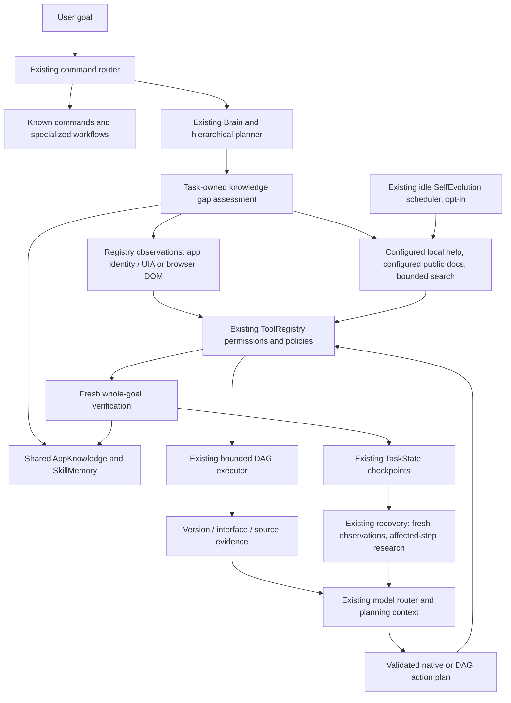

# Integrated knowledge acquisition

<!-- prompt15-audit -->
**App/site knowledge audit — 2026-10-16 IST:** Fresh surface/version and task UUID checks prevent stale context reuse; login observations suppress research/control hints; bounded inputs and numeric public versions fail closed. Source preference uses configured origin, with explicit URL version hints marked stale. Cache lookup warm median 3.52→0.45 ms on synthetic records.
Verification: **2,576 full regression PASS / 32 skips**; **31 Prompt15 catalog PASS / 1 BLOCKED** (plugin identity namespace missing). Launcher **repair_required**. Owned headless browser fixture passed; live accounts/native GUI/model/production readiness remain unverified.
[Evidence, limits and rollback](../artifacts/jarvis-audit/modules/15-app-research/inventory.md).
<!-- /prompt15-audit -->


Implemented 2026-10-14 IST. This extends the existing Jarvis execution authority.
It adds no inference provider, browser, production service, memory database or
automatic executable-code installation. See [validation](learning-validation.md)
for measured coverage and remaining limits.



| Existing component | Extension | Authority retained |
|---|---|---|
| Command parser / specialized workflows | Simple commands bypass acquisition; complex named-app or explicit-public-site feature goals qualify | Existing routing |
| Brain / native conversation | Acquired evidence included on initial and continued planning requests | Existing model/provider policy and tool validation |
| Hierarchical execution | Acquisition before new model DAG planning; cached/literal read plans retain fast paths | Existing schema, resource admission and side-effect rules |
| ToolRegistry | Read-only `application_inspect`; existing read/search/scrape/browser observations reused | Allowed-tools scope and policy hooks |
| UIControls | Read configured executable version; inspect controls only when the actual foreground process matches | Existing UI transport; no launch or guessed executable |
| BrowserAutomation | Read live accessible DOM through existing owned session | Existing browser ownership and permissions |
| AppKnowledge | Bounded capability records in the existing app JSON store | Shared storage; no new DB |
| SkillMemory / Obsidian | Capability guidance in retrieval; existing verified-procedure registration continues | Historical reference; fresh execution and verification required |
| TaskState / recovery | Learning observations and current context attached to existing task | Successful checkpoints retained; no uncertain effect replay |
| SelfEvolution | Optional expired-source refresh in its existing idle job queue | Existing busy/CPU/RAM/cooldown/cancellation budgets; low-battery guard |
| Launcher / recovery / Stop | Configuration validation and manifest registration | Existing lifecycle and quiet recovery |

## Detection and acquisition

Assessment is deterministic. It requires an allowlisted feature and complex-action
term. A named configured app or explicit HTTP(S) website origin supplies the target;
otherwise foreground preparation asks the registered `application_inspect current`
observation to resolve the current configured app from its actual process executable.
Window titles and object names cannot establish application identity. It does not
send every conversation or simple command to research. The
allowlist is in [knowledge_acquisition.py](../jarvis/knowledge_acquisition.py).
Implicit website names, unconfigured applications and arbitrary terminology can
still miss detection; established tools and normal planning remain available.

Before trusting cached app evidence, a new complex task observes the live version
and interface. Only accessible control names/roles are retained. Fields, passwords,
coordinates, runtime control IDs and screenshots are excluded. Matching installed
executables prevents learning from an unrelated foreground app. For apps whose
configured executable launches another binary, explicitly list the GUI binary's
absolute path in `observation_executables`. Blender's existing two app entries
map its launcher to `D:\Blender\blender.exe`; no filename/path is guessed.
This list grants read-only identity recognition, not permission to launch it.

`application_inspect` accepts a configured app name or `current`; it does not select
scene objects or click controls. Invalid object/control names are rejected before
dispatch and returned once to the existing planner for correction. Native correction
messages retain acquired help. Sanitized public search queries are reported to the
island/transcript before dispatch, making research visible.

The acquisition order is compatible shared evidence, configured local `.md`/`.txt`
help, configured public `documentation_url`, then bounded public search/scrape.
Configure `documentation_file` or `documentation_url` on an existing app entry;
local files still need the existing file scope to permit reading them. New feature
groups compare compatible previous feature terms and query only missing terms.
Failure repair narrows research to matching failed-step feature terms when present.
Sources are clipped and treated as untrusted evidence, never instructions.

Queries contain only the configured software name/public hostname, allowlisted
features and observed version. They omit the full goal, project names, paths,
screen contents and field values. Private origins/credentials are rejected; the
existing public-URL validator checks research URLs and DNS addresses. Domain
classification cannot establish that every publicly hosted service is non-sensitive.

Firecrawl is preferred when the application's existing `JARVIS_FIRECRAWL_KEY` is
configured; otherwise its established web tools are used. A connected Codex
Firecrawl plugin does not supply a secret to Jarvis. This upgrade neither exports
connector credentials nor requires a new package. Research during implementation
used the Firecrawl plugin with primary [Playwright locator documentation](https://playwright.dev/python/docs/locators)
and [Windows UI Automation properties](https://learn.microsoft.com/en-us/dotnet/framework/ui-automation/ui-automation-properties-overview).

## Capability and verification records

The existing `.jarvis-runtime/app_knowledge.json` holds `capability:<identity>`
records, limited to 64 targets and 24 feature groups per target. Each record has:

| Field | Meaning |
|---|---|
| identity / feature | Configured app or website origin; normalized feature group |
| version / interface_signature | Observed executable version or unknown; hash of names and roles |
| controls | Bounded accessible names/roles with declarative locator hints |
| sources | URL/type/time, clipped excerpt, environment version, document version certainty, confidence |
| status | discovered, researched, environment_confirmed, verified, invalidated |
| tools | Existing applicable registered tool names intersected with task scope |
| verification / executions | Whole-goal proof source/evidence and verified execution count |
| seen_at | Timestamp used for expiry |

This is a bounded capability index linked to existing tool names and task DAGs,
not a general API ontology or a new graph database. No application API is inferred
merely from a documentation paragraph. Locator hints are references: every action
still needs a fresh accessible control and ordinary tool admission.

`researched` means documents were retrieved. `environment_confirmed` means the
current interface was observed, not that its feature workflow works. Promotion
requires task completion, no recorded failures, and a `goal_verified` checkpoint
with source and evidence. Existing SkillMemory writes a declarative learned
`SKILL.md` only after verified completion. Similarity does not authorize replay,
and mutating procedures remain guidance for fresh plans. Background refresh updates
sources only; it cannot extend an old interface timestamp or manufacture proof.

Unknown app/document versions remain explicitly uncertain. Matching cache metadata
does not prove source instructions match that version. Changes to observed version,
interface signature, policy or TTL require fresh validation. No arbitrary download
can activate itself as a registered tool.

## Configuration and rollback

Current `config/config.json` enables foreground learning, with online research
enabled and background refresh disabled:

```json
{
  "knowledge_acquisition": {
    "enabled": true,
    "online": true,
    "background_refresh": false,
    "max_sources": 2,
    "max_research_per_task": 2,
    "max_seconds": 45,
    "ttl_seconds": 604800
  }
}
```

The acquisition DAG uses at most two concurrent read tasks, no GPU allocation,
32 MB admission estimate per task and one attempt per operation. These are
scheduling estimates rather than a process-memory sandbox. The existing model
router still owns planning/inference and its GPU constraints. Network calls and
model planning can exceed a two-second response goal; acquisition is not real-time.

For offline use set `online` false: local help, live controls and compatible stored
evidence remain usable. To roll back this extension set `enabled` false and restart
Jarvis with the existing Stop/Start launchers. Existing commands, voice, memory,
hierarchical execution and recovery remain available. Optional background refresh
also requires the established SelfEvolution scheduler to be enabled and eligible.

No screen layout changed, so no new screenshot is supplied. Existing artwork and
voice attribution remain in the [application guide](../README.md).

## Files

New runtime modules: `knowledge_acquisition.py`, `application_discovery.py`.
Extended runtime modules: `actions.py`, `app_knowledge.py`, `brain.py`,
`brain_worker.py`, `hierarchical.py`, `native_tools.py`, `skill_memory.py`,
`task_state.py`, `tools.py`, `self_evolution.py`, `launcher.py`.
Configuration: `config/config.json`, `config/runtime_manifest.json`.
Tests and reproducible measurements: `tests/test_knowledge_acquisition.py` and
`scripts/verification/verify_learning*.py`, with owned native/browser helpers.
Documentation: this guide, validation report, app/root README and documentation index.
Earlier voice/conversation/DAG changes in the working tree are preserved.
The follow-up research repair extends native verification with
`--implicit-current-app` and adds `verify_learning_search.py` for real public
search with desktop input disabled.
