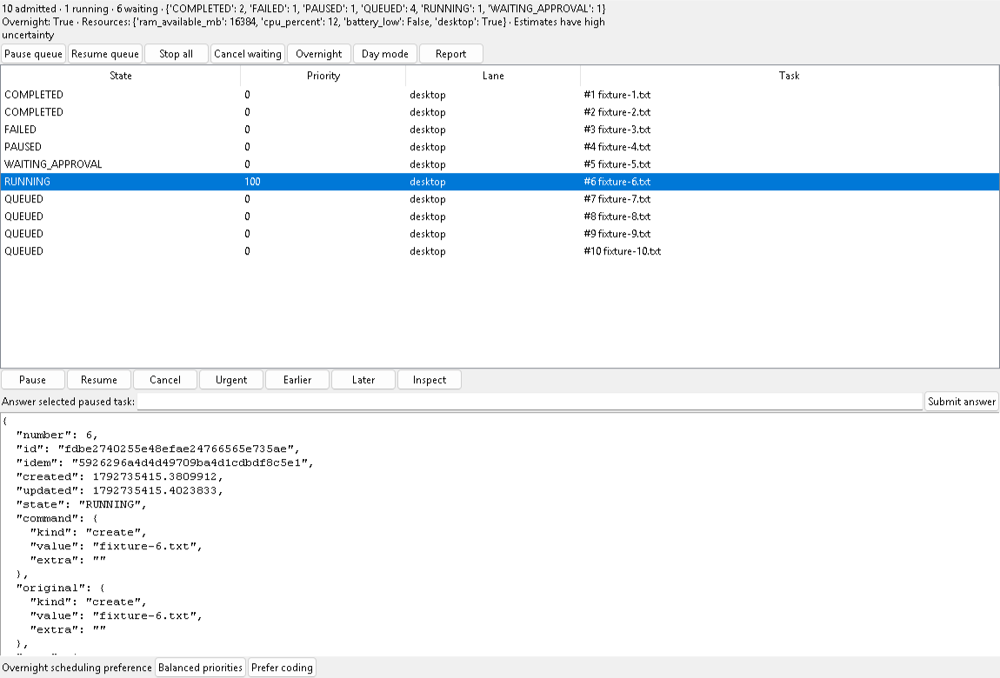
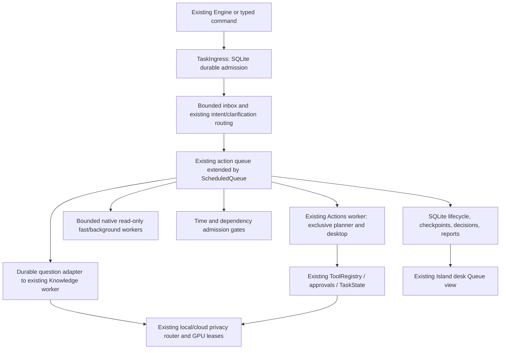

# Continuous intake and durable task scheduling

**Later graph addendum — 2026-10-23 IST:** [context-aware groups, structured DAGs, typed result handoffs, conditions and bounded expansion](workflow-graph.md) now extend this same queue. Its [fresh verification](../artifacts/workflow-graph/README.md) is separate from the queue-only frozen-source results below. Ambiguous links pause, and shared-planner/file mutations remain serialized.

Candidate implemented 2026-10-23 IST on `codex/autonomous-task-queue`. This extends the existing assistant; full unattended release acceptance remains open. The main assistant remains stopped. Explicitly user-started isolated microphone probes ran; the latest verified eight of ten fixture files, with the real preference timeout still pending at Finish. [Voice restoration and physical evidence](voice-profile-restoration.md).



## Follow-up verification and task-bound answers

Final focused check: **335 passed in 35.38 seconds**; [receipt](../artifacts/task-queue/windows-gate-focused-regression.txt). Actual [20-job short overnight-mode batch](../artifacts/task-queue/live-overnight-mixed-batch.json): 17 completed, one deliberate existing-file failure, one dependent blocked and one sensitive command awaiting approval without handler dispatch. All 11 expected files/readback receipts verified; the report matched persisted history. “After the previous task” now uses the nearest earlier work admission, excluding handled queue controls; later burst admissions cannot steal the dependency. Spoken deadline trailing punctuation is accepted.

The [production App/Island integration](../artifacts/task-queue/live-main-app-queue.json) also passed: ten requests entered through its actual typed Entry/`send_input`, ten files completed/reopened, main event drain revealed Queue, its mapped timer resolved automatically and result events retained Queue. This used the real App class with an isolated owned configuration disabling microphone, speech, account features and learning. The ordinary stopped assistant was untouched. A full-panel screenshot attempt was blank and rejected; the image above is correctly labeled as the separate native Queue fixture.

The first physical Windows lock probe exposed an input-desktop-only gate briefly returning available while the session stayed locked. The corrected gate additionally queries Windows WTS active/unlocked flags and fails closed on unknown/API failure. [Actual corrected test](../artifacts/task-queue/live-windows-lock-wts.json): **22.20 seconds locked**, 181 closed-gate observations, no file dispatch while locked, read-only memory check continued, file completed after unlock. Native WTS buffers are released and user/domain fields are not decoded or logged. [Microsoft's session flag contract](https://learn.microsoft.com/en-us/windows/win32/api/wtsapi32/ns-wtsapi32-wtsinfoex_level1_w) documents the state flags and Windows 7 exception. The [original failure](../artifacts/task-queue/live-windows-lock.json) is retained.

The [actual optional execution-state API check](../artifacts/task-queue/live-power-api.json) accepted and released the request on an owned thread. It leaves shipped sleep prevention off and does not certify actual sleep/battery/thermal behavior or all-night endurance.

The [actual mixed queue check](../artifacts/task-queue/live-mixed-intake.json) completed **10/10** jobs: seven created files, two live host memory observations and an actual Knowledge local-time answer. The three independent read-only/question jobs completed while the first file worker was held. A mapped native preference automatically selected Balanced after **20.05 real seconds**; all seven file readback receipts appeared in the report. This uses typed/injected final text and actual host resource gates; it is not physical speech or overnight endurance. Fresh [launcher readiness](../artifacts/task-queue/launcher-restored-services.txt) is ready after explicitly authorized Docker/Ollama startup, with the main microphone kept off.

[Actual process-crash recovery](../artifacts/task-queue/live-process-crash-recovery.json) also passed. An owned child wrote/read back a fixture file and exited before recording completion. A new Actions instance paused the uncertain task, preserved its bytes, refused unsafe resume and completed the separately queued fixture task. This verifies a real process/WAL boundary in owned state; it does not certify account-effect recovery or hardware failures.

The restored earlier voice capture profile passed **323 focused tests in 47.93 seconds**; [receipt](../artifacts/task-queue/restored-voice-regression.txt). Two simultaneous paused planner fixture tasks retained independent saved clarification/source records. `answer task 12: your answer` or the selected Queue row's answer field continues only that task using its saved checkpoint. Folder answers resolve the saved choice before planning. Duplicate/late answers and uncertain-effect continuation are rejected; no original-effect replay is authorized. This does not make arbitrary interrupted operations resumable.

Final decision/presentation follow-up: **327 focused tests passed in 33.91 seconds**; [receipt](../artifacts/task-queue/decision-presentation-regression.txt). New routine questions reveal the native Queue view, while existing approval cards retain precedence. Hidden questions still do not start timers. Streamed/plain background answers preserve the visible Queue view. A late response resolves only the automatic preference and applies it; it cannot execute the user's late alternative as a second branch.

Created-file outcomes now include independent byte readback, path, byte count and SHA-256 in the durable checkpoint. Morning reports group actual lifecycle outcomes, include these file receipts, recorded test evidence, error/recovery events and next actions. Empty test evidence means no test receipt, not that tests passed. Existing tool checkpoints remain available for operations without a specialized file receipt.

The final complete application suite passed **4,054 tests / 150 gated skips / zero failures**, with one existing COM threading warning, in **1,098.25 s (18m 18s)**. [Complete output](../artifacts/task-queue/release-full-regression.txt) · [513 frozen source hashes](../artifacts/task-queue/release-source-inventory.json) · [unchanged-source integrity, exit 0](../artifacts/task-queue/release-source-integrity.json). This closes the final regression gate, separately from hardware/account/endurance release acceptance. An earlier full run had **4,021 passed / 8 failed / 150 skipped**; all eight failures came from the queue approval hook assuming a full App on minimal approval test adapters. Optional Actions lookup fixed them. Interrupted runs for voice restoration and subsequent dependency/presentation fixes are retained as incomplete checkpoints.

The image captures only the owned native QueueView test window. Task names, outcomes, resource values and the approval request are synthetic. No fixture file creation or external tool execution occurred while rendering this image. Separate integration tests do create and independently reopen ten owned temporary fixture files.

## Baseline and integration design

Inspection covered [the system map](system-map.md), [the existing architecture](upgrade-architecture.md), Actions, Engine/Listener, Knowledge, Speech, GPU leases, TaskState, ToolRegistry, approval receipts, the recovery watchdog, cognition/memory and the Island/Pip views. Before this change the action FIFO held 128 transient jobs with per-job cancellation tokens and one action worker. Knowledge, speech, microphone capture/decoding and idle learning already had separate workers. Slow intent classification, memory preparation and write-target capture could run on the submitting thread. A `sleep` command called global cancellation. Existing tool checkpoints survived restart; waiting commands did not.

The preserved previous voice regression was 3,989 passed / 150 gated skips; the fresh pre-change voice baseline passed 53 tests. The first attempted baseline command referenced a nonexistent `test_task_queue.py` and collected no tests; it was corrected. These are regression results, not new live voice evidence.



`task_store.py`, `task_policy.py`, `task_scheduler.py`, `task_ingress.py`, `task_decisions.py` and `island_queue.py` provide queue metadata, policy and adapters. They do not replace Brain, ToolRegistry, the inference scheduler, approval receipts or existing connectors. A queue owner lock reuses the launcher singleton mechanism. A second owner cannot reconcile or dispatch the first owner's task. Recovery begins only after ownership is acquired.

## Admission, scheduling and execution

Normal commands synchronously commit a short SQLite WAL transaction, then return a task UUID and stable displayed task number. Acknowledgement appears in the existing app status. Classification, clarification routing and context preparation run on the ingress worker. The memory buffer holds 64 notifications by default; overflow remains durably `RECEIVED` in SQLite and drains without loss. At 512 nonterminal tasks, admission explicitly rejects new work so the user can retry. It does not acknowledge a discarded command. Approval answers, emergency controls and voice sleep retain their immediate control path.

Task records preserve original instruction, parsed Command, creation/update timestamps, priority, deadline, dependencies, risk/resource/duration estimates, state, retries, outcome, checkpoints and transition history. UI snapshots include all active tasks plus the last 200 historical tasks. The database retains historical rows. Stable event idempotency keys deduplicate a retried admission; repeated instructions with distinct identities remain distinct intentional tasks. Existing Engine final-utterance deduplication remains active.

Validated states include RECEIVED, CLASSIFYING, QUEUED, READY, RUNNING, WAITING_DEPENDENCY, WAITING_APPROVAL, WAITING_USER, PAUSED, RETRY_BACKOFF, VERIFYING, COMPLETED, PARTIAL, FAILED and CANCELLED. Existing conversation/control/clarification paths that do not produce a durable task result are explicitly marked PARTIAL with a routing explanation; they are not counted as completed tool work. Knowledge completion callbacks supply actual question outcomes. Direct action outcomes use the existing handler result; planned work additionally inspects TaskState completion. This does not add independent verification to every existing tool.

Scheduling combines explicit urgency, deterministic urgency cues, deadline slack, duration and unbounded aging. Hard resource/dependency/safety gates are evaluated before priority. Runtime observations update per-command duration estimates; estimates are advisory and have high uncertainty. Urgent work does not kill an in-progress operation. Earlier/Later adjust the selected task's priority; they do not override deadlines or locks. A failed/cancelled/partial dependency blocks dependents instead of being treated as successful. Cycles and unknown dependency IDs are rejected.

| Lane | Actual implementation and limits |
|---|---|
| Fast | One independent worker for the explicit read-only `system_info` / `screen_info` handlers. It does not accept arbitrary generated work. |
| Background | One independent worker for existing read-only `jarvis_status`. General indexing, research, code analysis and tests continue through their existing services or the exclusive planner; they are not newly parallelized. |
| Desktop | Existing action worker. Planner/desktop/app/file mutations share conservative `legacy-actions`, `desktop` and `shared-planner` locks. There are no competing scheduler clicks/keystrokes. |
| Inference | General reasoning/coding shares the existing action worker's mutable planner state. Questions use a separate bounded adapter to Knowledge, with per-task cancellation. Actual GPU residency/offload/privacy/quota policy remains in existing inference services. |
| Scheduled/event | Admission checks `not_before` times and explicit task dependencies; no additional model or busy execution thread is created for a waiting job. Arbitrary external event subscriptions are not implemented. |

Resource admission samples existing psutil RAM/CPU/battery information and requires both an active unlocked Windows WTS session and accessible input desktop. Unknown session/API state defers desktop dispatch. Default RAM reserve is 1,024 MB plus the task estimate; low battery, high CPU or unavailable interactive desktop defers dispatch. Unknown generic workload estimates remain conservative. The new layer does not claim thermal telemetry, disk/network bandwidth admission or exact per-task VRAM accounting; existing GPU leases remain authoritative. Unknown work retains tool-policy risk and existing execution-time permission checks.

## Commands and controls

Use existing typed input, task input or final spoken commands. Examples:

- `Urgent: add this to the queue: open calculator`
- `Do this after the previous task: create file notes`
- `Do this after the coding task finishes: open calculator` (the dependency description must identify one task)
- `In 2 minutes open calculator`
- `Create file notes by 23:59` (supported suffix: local 24-hour HH:MM, next occurrence)
- `Queue these three requests: open calculator; open notepad; create file notes` (semicolon/newline list with matching count)
- `Make task three urgent`, `Cancel task four`, `Pause the Blender task`
- `Pause the queue`, `Resume the queue`, `Cancel everything that hasn't started`
- `Run the queue overnight`, `Day mode`, `Open the morning report`
- `Why did you choose that option?`

The Queue tab uses the same store and scheduler for status, pause/resume/cancel, urgency, Earlier/Later, inspection, overnight/day mode and reports. Inspect shows actual checkpoints, history and decisions. Progress is shown as evidence/state, with no invented percentage. Task numbers are persistent admission numbers, including routed requests, rather than current FIFO positions.

Scheduling wrappers explicitly identify new tasks so they bypass the old short-answer clarification resolver. Ordinary short replies still use the existing clarification/WhatsApp/approval/conversation paths. General language such as arbitrary calendar dates, implicit pronoun dependencies and unconstrained multi-request dictation is not fully parsed by the deterministic scheduling layer; inspect the admitted specification. Ambiguous named dependencies are rejected rather than guessed.

Voice sleep/end-conversation leaves background tasks running. New queued speech interrupts playback without globally cancelling task inference. Explicit corrections/replacements cancel only current legacy action work at its cooperative boundary; specific cancellation reaches its targeted durable task. The existing microphone Stop control retains its broader cancellation semantics. Quit freezes durable admission first, stops owned workers and retains waiting work for restart. No deliberately stopped microphone or deliberately closed user application is restarted by this upgrade.

## Routine choices and approvals

DecisionManager persists question/options, recommendation, confidence, reversibility, selection, justification and presentation time. The configurable timer defaults to 20 seconds and starts only when the Queue view's actual question widgets are mapped. Hidden/unpresented questions do not consume the response window. A transaction resolves a user answer or timeout exactly once; late answers cannot execute a second branch.

Only sufficiently confident (at least 0.85), reversible, nonsensitive preferences can be selected automatically. Insufficient confidence defers; sensitive silence remains WAITING_APPROVAL. No decision record mints an approval receipt. Existing explicit tool approvals still apply at execution. The integrated routine decision is **Overnight scheduling preference**, Balanced priorities versus Prefer coding, which changes advisory priority for future coding dispatch. The generic DecisionManager API is not yet connected to arbitrary planner clarification questions. Sensitive direct command kinds are deferred before overnight dispatch. Generic planned tasks may still reach a real approval card and hold the exclusive planner until the existing approval flow returns; independent observation/question lanes continue.

## Overnight operation, recovery and reports

Overnight mode unpauses eligible scheduling and reports a rough serial duration estimate with uncertainty. It does not guarantee deadlines or completion. The queue works independently of Island visibility while the Jarvis process remains running. It is not a Windows service, logoff-surviving worker, or Codex automation. Quiet hours default to 22:00–08:00 local time and suppress ordinary answer/reply speech while preserving text. Existing urgent sensor notifications retain their path.

`prevent_sleep` defaults to false. When explicitly enabled, the ingress owner thread requests `ES_CONTINUOUS | ES_SYSTEM_REQUIRED`, clears it when overnight mode ends/low battery is observed, and releases it when the owner thread exits. Errors are reported silently through repair events. The API cannot prevent deliberate user sleep and does not bypass locking/authentication or guarantee interactive work on a locked session. See [Microsoft's SetThreadExecutionState contract](https://learn.microsoft.com/en-us/windows/win32/api/winbase/nf-winbase-setthreadexecutionstate), retrieved through Firecrawl on 2026-10-23. The physical sleep/lock gate remains unexecuted; tests mock resource and API outcomes.

The existing watchdog registers durable intake and its owned workers with bounded service repair. Active handlers update cooperative heartbeat metadata. A stale heartbeat is reported without releasing the desktop lock. Task timeout requests cooperative cancellation; it cannot force a blocked native call or kill an in-progress write. A dead worker's task pauses with an uncertain checkpoint and releases ownership only after the thread has ended. Only allowlisted read-only observations retry transient errors, at most three times with exponential delay. Writes, shell commands, sends and desktop effects never automatically retry.

Queued tasks survive restart. CLASSIFYING admissions interrupted around legacy delegation become WAITING_USER. Dispatched tasks become PAUSED with reconciliation required. Pausing a running task stops future cooperative steps; it does not roll back completed effects. Resume is automatic only for tasks that have never dispatched. Started tasks must use their preserved tool checkpoints and the existing resume-task inspection flow; exact arbitrary-task continuation is an open integration gate. This is deliberately different from replaying the original instruction.

When a batch drains to terminal/blocked states, a local JSON report records actual task outcomes/checkpoints, blocked tasks, decisions and resource state. It is saved under `.jarvis-runtime/task-reports/`, indexed in SQLite, and available through the Queue report control after restart. Reports redact the existing credential patterns; the authoritative task database necessarily retains local user instructions and must remain private. Report fields do not infer files, tests or output quality from a task title. Task-specific evidence can be inspected through its stored tool checkpoint. Preserve the database, WAL and owner lock files; never manually delete them during active work.

## Configuration and rollback

The shipped configuration explicitly enables the feature; configurations without a `task_queue` section retain the old queue. Hidden UI verification mode retains its isolated legacy behavior.

```json
"task_queue": {
  "enabled": true,
  "capacity": 512,
  "buffer_size": 64,
  "decision_timeout_seconds": 20,
  "reserve_ram_mb": 1024,
  "max_cpu_percent": 95,
  "quiet_start_hour": 22,
  "quiet_end_hour": 8,
  "prevent_sleep": false
}
```

Optional scheduler defaults are `heartbeat_timeout_seconds: 120` and `task_timeout_seconds: 3600`. No dependency, driver or model installation is needed. Launchers/bootstrap/recovery entry points remain compatible. To roll back, stop Jarvis intentionally, set `task_queue.enabled` to false and restart using the existing launcher. Preserve the queue and reports for inspection; disabled mode does not execute durable pending jobs.

## Dated verification and measured limits

[Focused regression](../artifacts/task-queue/focused-regression.txt): **139 passed**, 13.54 seconds. The [expanded final focused run](../artifacts/task-queue/focused-final-regression.txt), including Groq policy tests after preserving the immediate offline-control path, passed **300 tests in 29.95 seconds**, including WhatsApp, conversation-context and anticipation regressions after explicit queue requests were kept separate from pending free-text prompts. This includes actual Engine → durable ingress → Actions → ten independently reopened temporary files; concurrent queued intake; native Tk controls; real Knowledge worker with mocked public inference and targeted cancellation; cycle/deadline/priority/resource policy; bounded read-only retry; worker death/heartbeat/shutdown; decision boundary timing; redaction; and exclusive queue ownership. Sensitive decisions, desktop availability, battery pressure and Windows execution-state calls use mocks; they are not live hardware/account acceptance.

[Admission benchmark](../artifacts/task-queue/admission-benchmark.json), 200 no-effect synthetic jobs:

| Measurement | Median | Empirical p95 |
|---|---:|---:|
| Previous memory FIFO admission | 0.0045 ms | 0.0050 ms |
| Durable SQLite WAL admission | 0.6600 ms | 1.0791 ms |
| Dispatch with accumulating task history | 0.7794 ms | 1.0192 ms |

All 200 synthetic outcomes persisted COMPLETED. The run took 0.993 s. Sampled process RSS before/after was 21.52/24.02 MB, not peak memory. Database plus WAL before close was 4,488,768 bytes. Durability adds overhead; this is not a speech/UI/inference or end-to-end speedup claim. This measurement preceded final refinements. The [final-source repeat](../artifacts/task-queue/admission-benchmark-final.json), run while the full regression process was active, recorded WAL admission median/p95 **0.6621/0.9406 ms**, dispatch **0.7332/0.8977 ms**, FIFO **0.0037/0.0039 ms**, **200/200 persisted outcomes**, 0.948 s wall time and sampled RSS **21.65→23.95 MB**. These observations do not establish a causal improvement over the earlier checkpoint or peak/endurance limits.

[Actual installed local-model probes](../artifacts/task-queue/model-benchmark.json) used the configured Qwen3.5 0.8B and 9B through existing GPU admission, three public JSON prompts each. Both matched **3/3**. Median wall time was **3.446 / 9.428 seconds**; first requests **6.992 / 26.810 seconds**. Cold/loading/handoff/lease wait are included. There is no reliable p95, scheduler-classification accuracy claim, heavy-model coexistence certification or task-quality acceptance. No cloud request or download was made.

[Launcher check](../artifacts/task-queue/launcher-check.txt): ready, no missing/incomplete components. The complete final-source suite and source-integrity receipt are tracked in [the evidence index](../artifacts/task-queue/README.md). Earlier interrupted full runs are preserved as incomplete checkpoints, not passes. One full checkpoint exposed the offline-control bypass regression; the real control path was fixed and its focused policy tests passed.

Open release gates: physical rapid speech/barge-in with real tasks; human UI usability and account connectors; physical sleep/battery/thermal behavior; extended overnight endurance and sustained resource contention; general parallel background coding/research/test isolation; arbitrary planner routine-decision integration; arbitrary uncertain-effect reconciliation and rollback; exhaustive natural scheduling language; exact interrupted-task resume/rollback. Historical multilingual voice failures in [the cumulative handoff](CLAUDE_HANDOFF.md) remain open. These limits must not be inferred closed from regression or model readiness checks.
