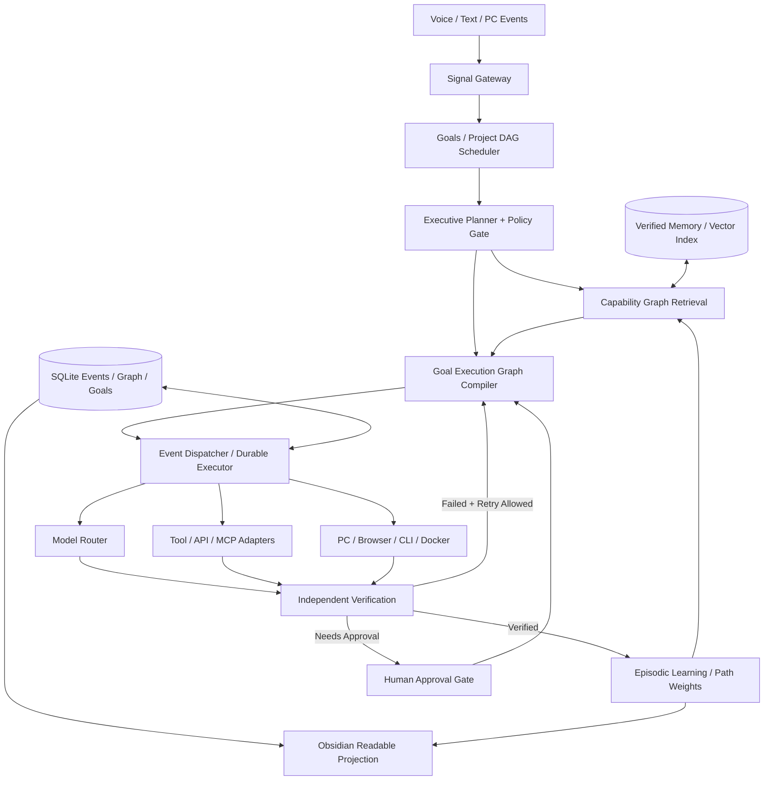

# JARVIS Neural Execution Brain
## Implementation-Ready Architecture and Migration Plan (2026-11-02)

**Status:** Research-grounded design and integration plan. **Not installed into the Jarvis repository.** No repository checkout or live device tests were available for this plan.

## 0. Executive decision

Implement a **Brain-Inspired Neuro-Symbolic Execution Graph (BNEG)**: a sparse, typed, event-driven **capability graph** backed by persistent task state, a graph-based planner/executor, and bounded outcome-based routing updates. Do **not** implement a literal spiking-neural-network CPU/GPU brain as the production task orchestrator. Keep the existing Jarvis models and tools. Implement compatibility adapters and progressive migration rather than a wholesale rewrite.

Three different graphs must remain conceptually separate:

1. **Capability graph (long-lived):** What Jarvis can do, which inputs/outputs capabilities support, what depends on what, permissions, runtime environments, known outcomes.
2. **Execution graph (per goal):** The concrete task graph compiled from a request, with typed outputs, conditionals, parallel branches, bounded repair cycles, task state, and approvals.
3. **Learning graph (long-lived):** Measured preference among *pre-approved, type-compatible* execution alternatives. No algorithm may infer permission from past success.

Obsidian remains a **readable projection** of the underlying graph and skill/process memory, not the runtime, executor, or source of truth for live graph wiring.

## 1. Principles and biological analogy

| Brain analogy | Software equivalent | Important limitation |
|---|---|---|
| Neuron | Typed capability node (function/tool/MCP call/model step/skill/memory operation/sensor) | A software node is not a simulated biological neuron |
| Synapse | Directional, typed, guarded connection with optional outcome statistics | Usage correlation is not enough to authorize data flow |
| Neural spike | Event/signal envelope carrying a reference to typed data | Not a biological action potential |
| Cortex | Planner, verifier, reasoning models and project-context retrieval | These remain conventional programs/LLMs |
| Basal ganglia | Fast policy engine choosing among eligible actions/routes | Eligibility is determined by hard policy first |
| Hippocampus | Episode/task traces plus consolidation into reusable patterns | Store provenance and expiry; don't ingest unverified errors as truth |
| Working memory | Per-goal blackboard / bounded state | Not free-form global mutable state |
| Motor system | Tool/MCP/PC/browser/code execution adapters | Real side effects need authorization |
| Error/prediction signal | Structured result with verifier evidence | A successful API call is not evidence the user goal succeeded |

### Connections

- **One-way:** `research.result -> planner.context`; `coder.patch -> tester.input`.
- **Two-way communication:** represent as **two separately declared directed links**, each with its own data contract and policy: `executor -> verifier` plus `verifier -> executor` feedback; or `planner -> coder` plus `coder -> planner` clarification.
- **Conditional:** only activate when a typed predicate holds (`compile_failed`, `needs_login`, `contains_secret`, `user_approved`).
- **Parallel:** independent branches can run simultaneously within resource and concurrency budgets.
- **Inhibitory/gating:** not a negative-weight permission trick; explicit deny, approval-required, conflict lock, rate limit, quota, and timeout gates.
- **Plasticity:** update route preferences only for already allowed, compatible edges and after verified outcomes.
- **Pruning:** disable long-unused, unhealthy, redundant candidate edges while keeping audit and rollback history.

Avoid an all-to-all mesh of tools. Build a **sparse, discoverable graph** using schemas, dependencies, affinity, and empirical success. Tool pairs that are merely often co-used are not necessarily connected.

## 2. Example end-to-end live execution

User: "Find the latest documentation, fix my Unreal Engine plugin, run the tests, and tell me what changed."

1. `speech/text.ingest` emits `goal.created` with text, goal_id, priority, provenance, privacy.
2. `intent.classify` emits `goal.understood` without invoking a large model when deterministic parsing is sufficient.
3. `context.retrieve` queries project specs and verified memories; `capabilities.retrieve` finds *allowed* candidates and prerequisites (web research, repo reader, source editor, UE build/test, reporting).
4. `plan.compile` builds a goal-specific DAG with parallel read-only research and repository inspection, then coding and tests.
5. Tool adapters execute; signals carry artifact references, hashes, provenance, and status (not unlimited raw text).
6. `verifier` compares the result against user acceptance criteria; a compile failure emits `verification.failed`.
7. The signal activates `diagnose -> targeted_repair -> rerun_test` within a capped retry budget and approved permissions. A missing capability/unclear requirement activates a question or pause, not blind action.
8. Success creates `goal.verified`; the episode store saves trace, metrics, source links, and test evidence.
9. Learned routing statistics adjust only eligible routes. A recurring, proven path may be proposed as a versioned workflow template after review/tests.
10. Obsidian receives a **generated summary and graph snapshot**; its backlinks do not execute the workflow.

A new user order can arrive during this workflow; the existing scheduler queues/groups it by project and dependency and can execute unrelated work concurrently.

## 3. Reference architecture



**Runtime source of truth** is the SQLite-backed capability/task/trace store. The image/graph UI is a consumer of it, not a source of authorization.

## 4. Node and edge contracts

A node is **registered code**, not arbitrary LLM-generated text. At minimum:

```yaml
node_id: tool.browser.search@v1
kind: tool                  # sensor | model | tool | mcp | memory | skill | workflow | verifier
capability: web.research
provider: existing_browser_adapter
input_schema: SearchRequestV1
output_schema: SearchResultV1
runtime: local_or_network
privilege: read_external
privacy: public_data_only
side_effect_class: read_only
requirements: [network_available]
resource_cost: {gpu_vram_mb: 0, network: true}
timeout_ms: 20000
concurrency_limit: 2
version: 1
healthcheck: browser_search_health
```

```yaml
edge_id: web.search_to_source.summarize@v1
from: tool.browser.search@v1
on_event: tool.succeeded
out_port: search_results
in_port: verified_sources
required_types: [SearchResultV1]
condition: source_count > 0
mode: dataflow          # dataflow | feedback | dependency | conditional
permission: read_external
policy: must_pass_pii_and_provenance_check
max_hops: 4
learnable_preference: true
```

The dispatcher enforces output/input compatibility, capability grants, policy, environment availability, budget, and dependency completion before delivering a signal. One-way and two-way connections use the same edge implementation; bidirectional behavior simply needs two independently checked edge records.

### Signal/event envelope

```json
{
  "event_id": "uuid",
  "type": "tool.succeeded",
  "goal_id": "goal-2026-001",
  "task_id": "task-007",
  "source_node": "tool.repo.read@v1",
  "target_capability": "code.modify",
  "payload_ref": "artifact://sha256/...",
  "input_schema": "RepoInspectionV1",
  "causal_parent_event_id": "uuid",
  "graph_version": 12,
  "privacy": "local_private",
  "approval_scope": "read_repository",
  "timestamp_utc": "2026-11-02T00:00:00Z",
  "deadline_utc": null,
  "attempt": 1,
  "max_attempts": 3,
  "idempotency_key": "goal-2026-001:task-007:read:v1",
  "evidence_refs": ["artifact://sha256/..."]
}
```

Signals reference large artifacts instead of copying them through every edge. Persist event issuance before actual tool side effects and record tool outcomes. A retry after a crash must use idempotency checks or explicit reconciliation for non-idempotent actions (e.g., send email, delete files, purchases).

## 5. Learning and adaptive pathways

**Two score types:**

- **Eligibility (hard):** `(authorized AND input_compatible AND prerequisite_ready AND privacy_allowed AND approval_granted_if_required AND resource_available)`; not learnable.
- **Preference (soft):** amongst eligible routes, rank by empirical verified success, task-specific latency, monetary/token cost, reliability, and explicit user preferences.

Suggested score (tune using benchmark data, not arbitrary universal constants):

`score(edge | task_context) = verified_success_estimate + task_fit - latency_penalty - resource_penalty - risk_penalty`

Start with priors and *verified* counts of successes and failures in contextual buckets (task class, tool version, environment). A Beta-Bernoulli estimate is suitable for binary success; p50/p95 latency comes from observed timings. Test contextual bandits only **after** baseline observability exists, using shadow decisions and offline replay before any live updates.

For example, a browser task may have three possible routes: direct browser automation, site-specific API/MCP, or screenshot/vision control. Jarvis can favor an available sanctioned API where its measured accuracy is higher while using screen control where no compatible API exists.

**Never strengthen a connection based solely on co-activation.** A failed path may have been used repeatedly. Never let learned preferences create new side-effect privileges, bypass approval, exfiltrate local content to cloud models, or modify safety boundaries. Require human-reviewed graph snapshots, rollback, and versioned routes.

## 6. Existing Jarvis integration map

| Existing subsystem | Integration decision |
|---|---|
| Qwen local model router, cloud fallbacks | Keep provider policies/quotas; wrap model invocation as capability nodes; graph cannot bypass privacy or rate limits |
| Voice wake word, streaming STT, TTS | Emit/consume typed events; progressive TTS not held hostage by a complete workflow |
| Current planner/researcher/coder/tester | Wrap as nodes and composite skills; gradually shift orchestration into graph executor |
| Queue, project grouping, DAG scheduler | Remains system of record for goals, priorities, dependencies; per-goal execution graph is compiled beneath it |
| Docker/code tests/worktrees | Adapters with sandbox, ACL, snapshots, resource locks, and verified exit/result semantics |
| MCP / Spotify / Blender / YouTube / web | Register schemas from discovery, map to stable canonical capabilities, enforce permissions, monitor health |
| Project intelligence + semantic memory | Expose `memory.search`, `memory.read_verified`, `memory.commit_episode`; source provenance required |
| Obsidian vault | One-way generated markdown snapshots and opt-in curated facts; never execute wiki links |
| Dynamic island/Electron/React | Show live active nodes, animated signals, approvals, blocked nodes, failures, audit and rollback |
| iPhone spatial input (future/optional) | Sensor nodes emitting spatial observations after user-authorized connection; no need to enable in phase 1 |

Do not change existing interfaces until integration tests and rollback are ready. Build adapters at the edge of existing components.

## 7. Recommended stack for Windows 11, Ryzen 7, 32 GB RAM, RTX 3050 4 GB

**Start small, local-first:**

- Python 3.11+ (match current Jarvis version), `pydantic` for typed event and tool contracts.
- `asyncio` queues/event dispatcher plus SQLite WAL event journal/task ledger; ensure durable outbox, idempotency and transactional state transitions.
- `rustworkx` for graph traversal if performance warrants; `networkx` for initial legibility if already installed.
- Existing vector/semantic embeddings + SQLite FTS5 for candidate retrieval; combine with dependency expansion instead of searching an unbounded complete graph.
- Existing Jarvis scheduler and code test tools; optionally LangGraph checkpointers/conditional nodes **only if** this aligns with the repo architecture; do not adopt a second parallel orchestrator.
- React Flow or Cytoscape.js for graph visualization attached to a read-only live event stream.
- No Neo4j/Kafka/Redis/Temporal server unless measured scaling or recovery gaps justify them. Temporal is an optional durability solution later, not a prerequisite.
- No production spiking-neural-network inference/training layer: it adds complexity without giving a robust tool execution contract on this hardware.

GPU budget is left for the existing local LLM residency policy; graph traversal and event passing should remain CPU-native and avoid extra LLM calls.

## 8. Migration phases with exit gates

### Phase 0 — Audit and baseline (no behavior change)

1. Inventory project modules, tool API contracts, MCP servers and schemas, current schedulers, approval gates, LLM router, memory stores, dependencies, crash recovery and logs.
2. Capture 30+ representative real scenarios: browser clicks, repository coding, bug fixing, web research, Spotify/YouTube/Blender connectors, parallel tasks, voice interruption, privacy-sensitive tasks.
3. Record baseline task success (independently verified), end-to-end p50/p95 latency, number of model calls, wasted tool retries, memory use, GPU residency, cold start time, crash-restart correctness.
4. Generate a static graph inventory in read-only mode. Do not alter existing behavior.

**Exit:** All current functional routes mapped; baseline repeatable; feature flag and rollback established.

### Phase 1 — Capability registry and graph (read-only + shadow)

1. Stable node IDs, schemas, capabilities, versions, policy tags, access scopes and health checks.
2. Adapt existing functions and MCP `tools/list` (including pagination and changes) into capability descriptors; validate discovered tools against allowed registry and permissions.
3. Build sparse edges from explicitly verified input/output contracts and prerequisites; never auto-wire arbitrary tool names based only on descriptions.
4. Persist capability graph versions and export a human-readable Obsidian graph snapshot.
5. Shadow-rank tool candidates without running them.

**Exit:** Registered tools 100% schema-valid; no exposure of disallowed tools; shadow routes explainable.

### Phase 2 — Signal bus and one fully executable vertical slice

1. Implement durable signal envelope, dispatcher, per-goal state, artifact refs, typed ports, event logs, outbox, idempotency and retry discipline.
2. Implement compiler for one common workflow: `read-only research -> analysis -> report`.
3. Expand to `repo inspect -> patch in worktree -> test -> verify -> report` with approval gates.
4. Test shutdown/restart at each state and no double execution of non-idempotent actions.
5. Existing workflow remains available as fallback behind a feature flag.

**Exit:** End-to-end real task reaches independently checked result; all transitions auditable; crash restart safe.

### Phase 3 — Full orchestration and executive control

1. Integrate existing grouped task-DAG scheduler (new orders, urgency, resource budgets, dependencies, concurrency).
2. Add parallel path handling and merge barriers; single shared locked resource cannot be used concurrently by conflicting tasks.
3. Add bounded feedback cycles: diagnosis, repair, verification, max attempts, stop reason.
4. Wire memory retrieval context, model router, PC control, browser, coding, and MCP adapters.
5. Use deterministic routing for simple tasks and model-based planning only for ambiguous/novel cases.

**Exit:** Comparable success to legacy on regression suite; no permission bypass; no unbounded loops.

### Phase 4 — Adaptation / plasticity

1. Store verified outcomes and latency/cost/resource metrics by task context and tool version.
2. Learn preference weights amongst equivalent eligible routes. Keep frozen policy gates.
3. Shadow evaluation -> offline replay -> limited opt-in live experiments -> rollback on regression.
4. Consolidate repeated, verified successful paths into suggested workflow templates, with test fixtures and user review for state-changing flows.

**Exit:** Statistically defensible improvement on held-out real tasks, no safety regressions, rapid rollback.

### Phase 5 — Live neuron graph interface + Obsidian projection

1. Visualize registered graph, active goal DAG and fired signals separately; default view shows current task's local neighborhood, not thousands of nodes.
2. Color/style by current activity, result, failure, pending approval, and confidence; label signals by type, not raw private payloads.
3. Clicking a node opens contract, source adapter, dependencies, last verified result, and why selected.
4. Add replay/debug trace, reason for skipped route, pause/resume/stop and rollback view.
5. Export versioned markdown to Obsidian as documentation and graph browse, with no backdoor execution.

**Exit:** Every displayed activation corresponds to an actual event and trace; no decorative fake activations.

## 9. Verification matrix

**Functional:** discovery of 100% registered tools, schema-incompatible edges rejected, causal event order, correct branch/merge, prerequisite enforcement, bidirectional feedback, no unintended cycles, unsupported tool graceful fallback, independent goal verification, no invented success.

**Safety:** read/write privilege separation, credentials not in graph UI, no secret payloads to cloud models, high-risk actions need approval, deny overrides learning, prompt injection isolation, user cancel stops descendants, scoped OS/filesystem permissions, project separation.

**Resilience:** lost network, MCP server disconnect, tool timeout, process crash, duplicate signal, task cancellation, tool version change, exhausted quota, Docker down, Windows session locked, restart from journal.

**Performance:** compare legacy vs graph on an identical, reproducible set; p50/p95 first-action and end-to-end latency, tool-call count, cloud token cost, task completion verified by independent script, VRAM/RAM, event journal size, route choice accuracy. Avoid unverified sub-10ms or 90% claims. Establish meaningful targets only after baseline.

**Minimum go/no-go gates:**
- 0 unauthorized side effects in the test suite.
- 0 loops without defined maximum attempts/deadline.
- 100% task transitions with auditable event IDs and reproducible graph versions.
- 100% of graph-selected tool calls validated against typed schemas and granted scopes.
- No statistically significant degradation versus current Jarvis on verified-task accuracy; preference learner must show benefit before production enablement.
- Successful simulated restart recovery for each major task state.

## 10. Suggested repository layout (adapt to actual project)

```
jarvis/
  brain/
    contracts/          # Signal, Node, Edge, Artifact, Task
    registry/           # Tool and MCP capability registration
    graph/              # Persistent capability graph, versioning
    router/             # Eligibility + preference ranking
    compiler/           # Request -> per-goal execution DAG
    runtime/            # Dispatcher, barriers, bounded feedback
    journal/            # SQLite ledger, durable outbox, checkpoints
    learning/           # Metrics and verified route preferences
    policy/             # Permissions, privacy, approvals, budget
    adapters/           # Bridges to *existing* modules
    projection/         # Read-only Obsidian and UI projection
    tests/              # Replay, fault injection, real-world E2E
```

Exact module naming and install locations must be chosen **after** inspecting the actual repo. Do not duplicate any already-working module.

## 11. Ready-to-use coding agent assignment

> Inspect my existing Jarvis repository and implement the attached **JARVIS Neural Execution Brain** architecture as a progressive integration, not a separate chatbot or purely visual graph. Before writing production code, map my current model router, planner, goal/task DAG scheduler, tool registry, MCP/connector base classes, memory, Obsidian integration, approvals, worktrees, Docker sandbox, browser and PC control, Electron/React interface, and tests. Reuse them wherever possible. Produce a repo-specific adapter map and phased task plan. Build a versioned typed capability graph, durable signal bus, guarded event routing, per-goal execution graph compiler, independent verifier, outcome-driven route preference learner, and live UI/Obsidian projections. Start behind a feature flag with read-only/shadow observation and progress to a narrow real working vertical slice. Keep all learned routes subordinate to existing permissions, privacy and approval gates. Distinguish directed dataflow from reverse feedback. Preserve grouped task DAG scheduling, concurrent orders, resource budgets and crash recovery. Every graph activation shown must correspond to an actual event. At each phase run unit, integration, fault injection and independently verified end-to-end tasks. Do not declare success because an API returned OK; confirm user-visible task completion. Repair failures until acceptance criteria pass or report a concrete blocker. Keep the old orchestrator runnable as rollback until parity is demonstrated. Do not claim performance gains without baseline comparison or change existing cloud quota/model policies without authorization. Write updated architecture docs, migration guide, test evidence and a final go/no-go report.

## 12. Research references (retrieved 2026-11-02)

1. ToolNet — directed tool graph and weighted transitions: https://arxiv.org/abs/2403.00839
2. Tool Graph Retriever — tool dependency-aware retrieval: https://arxiv.org/abs/2508.05152
3. GTool — request-specific tool graphs: https://arxiv.org/abs/2508.12725
4. GPTSwarm — LLM agents as optimizable computational graphs (ICML 2024): https://proceedings.mlr.press/v235/zhuge24a.html
5. OpenCog AtomSpace — executable procedures as hypergraph structures: https://wiki.opencog.org/w/AtomSpace
6. Nengo Semantic Pointer Architecture — brain-inspired neural cognitive modeling: https://www.nengo.ai/nengo-spa/v1.3.0/index.html
7. LangGraph conditional edges and checkpointing: https://github.com/langchain-ai/docs/blob/main/src/oss/langgraph/graph-api.mdx and https://github.com/langchain-ai/docs/blob/main/src/oss/langgraph/persistence.mdx
8. Microsoft AutoGen GraphFlow: https://microsoft.github.io/autogen/dev/user-guide/agentchat-user-guide/graph-flow.html
9. Temporal workflow durability/message passing: https://docs.temporal.io/workflows and https://docs.temporal.io/encyclopedia/workflow-message-passing
10. MCP Tools spec (2026-07-28): https://github.com/modelcontextprotocol/modelcontextprotocol/blob/main/docs/specification/2026-07-28/server/tools.mdx
11. Obsidian Graph view docs: https://obsidian.md/help/plugins/graph
12. rustworkx graph library: https://github.com/Qiskit/rustworkx
13. Graphiti temporal knowledge graph: https://www.getzep.com/platform/graphiti/

**Research scope:** This plan synthesizes inspected papers and official docs. Research metrics from papers are not Jarvis benchmarks. Integration and performance remain unverified until the repository is available and tests run.
