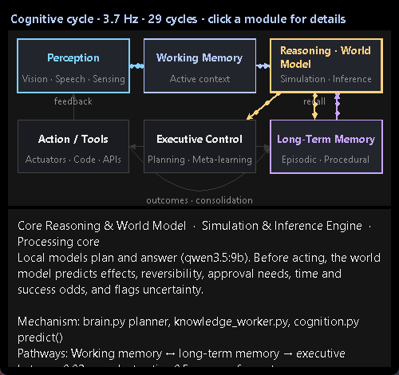

# Cognitive architecture: one perceive → remember → reason → decide → act → learn loop

Updated 2026-10-11 IST. Jarvis is now organised as the six-module cognitive architecture from the "Blueprint for Building J.A.R.V.I.S." diagram. The modules are Multimodal Perception, Working Memory, Long-Term Memory, Core Reasoning & World Model, Executive Control & Meta-Learning, and Action / Tool Output. Every command, sensor event and action result passes through one loop.

Nothing was thrown away. The tools, APIs, skills, memories and coding agents Jarvis already had are wired into the module they belong to, and [`jarvis/cognition.py`](../jarvis/cognition.py) adds what was missing:
- a shared working memory;
- a world model that predicts what an action will do before it runs;
- an executive that can stop and ask;
- learning from outcomes and from your corrections.

## The loop

```
 Perception ──► Working memory ──► Reasoning & world model ◄──► Long-term memory
     ▲                                     │                        ▲   ▲
     │ feedback                            ▼                        │   │ consolidation
     └──────────── Action / tools ◄── Executive control ────────────┘   │
                        └──────────────── outcomes ─────────────────────┘
```

| Module | What it is in Jarvis | Code |
| --- | --- | --- |
| **Multimodal perception** | Speech (faster-whisper) and typed commands; the focused window (vision); background sensors (God's Eye area alerts, weather alerts, WhatsApp messages and calls, repairs); and feedback from every action. Each percept gets a salience score (your words 0.9, alerts 0.7, failures 0.8, focus changes 0.5). | `engine.py`, `voice_input.py`, `main.py` window observer, `gods_eye.py`, `weather_watch.py`, `whatsapp.py` |
| **Working memory** | A bounded workspace: the current goal, the window in focus, the active task, the queue length, any decision waiting on you, the session style, the last action, and seven attention slots. Attention is ranked by salience × recency, and fades over about two minutes. It is added to the live context every answer and plan sees. | `cognition.py` `update_workspace()`, `context_hub.py` `situation()` |
| **Long-term memory** | One `recall()` over three stores. *Episodic:* conversation summaries and the Obsidian activity log. *Declarative:* curated facts. *Procedural:* skills, past task experience, coding lessons, learned GitHub repositories, plus per-action outcome statistics in `.jarvis-runtime/cognition/procedures.json`. | `memory_curator.py`, `conversation_memory.py`, `obsidian_memory.py`, `skill_memory.py`, `experience_memory.py`, `repo_learning.py` |
| **Core reasoning & world model** | Local models plan and answer (`qwen3.5:9b`). Before any action runs, the world model predicts: what it affects (reads only / sends to a person / writes files or memory / operates an app / plays media / moves a view); whether it can be undone; whether it needs your approval; how long it usually takes (learned average); and how often it succeeds (learned, starting at 50/50). It also lists what it's unsure about. | `brain.py`, `knowledge_worker.py`, `cognition.py` `predict()` |
| **Executive control & meta-learning** | Decides whether to go ahead or ask you first. After the action it compares the outcome with the prediction ("surprise") and updates timing and reliability. It treats "no, that's wrong" or "that didn't work" right after an action as a failure. When something fails repeatedly, or you correct it, it writes a lesson to the Obsidian vault and adds it to future context. | `cognition.py` `deliberate()`, `evaluate()`, `feedback()`, `consolidate()`; `task_recovery.py`; approvals |
| **Action / tool output** | Everything Jarvis can do: desktop and app control, writing, media, WhatsApp, Gmail, God's Eye, coding agents, Windows commands and live data providers. Each action runs inside the loop, and its result feeds back into perception. | `actions.py` `execute()` → `cognition.act()` |

The loop runs on its own thread at `cognition.cycle_hz` (default 4 Hz; measured 3.7–3.8 Hz live). Each cycle folds new percepts into working memory, and about once a second it writes `.jarvis-runtime/cognition/state.json`. The diagram's "~20 Hz" is a theoretical target. Jarvis's loop only re-ranks attention between events, so a faster rate would cost CPU without adding anything.

## What changes for you

- **Jarvis won't guess who a message goes to.** "Message him on Telegram saying hi" with nobody recent in context now gets "Before I send anything: it isn't clear who 'him' is. Say it again with their name and I'll go ahead." It only asks for sends whose recipient is just a pronoun, and only when there's no recent conversation, waiting question or running task for the pronoun to refer to. Named recipients go straight through to the usual preview and approval.
- **Ask what an action would do, without doing it.** "What would happen if you send hi to mom on WhatsApp?" runs the world model only. The answer says it sends a message to another person, can't simply be undone, would show a preview and wait for approval, and usually takes about 25 seconds. Nothing is sent.
- **Learning from outcomes.** Every action's time and result are recorded per kind. After three or more runs, predictions use the real success rate, and a kind that keeps failing is flagged ("this kind of action failed 3 of the last 3 times (last: …)").
- **Corrections count.** Saying "no, that's wrong" right after an action marks it as a failure and records a lesson.
- **Shared context.** Answers and task plans see the current goal, the last action, the top attention items and any relevant lessons.

## Say

| Say | What happens |
| --- | --- |
| "What are you thinking?" / "What's in your working memory?" / "What's on your mind?" / "Cognition status" | Loop rate, active modules, goal, active task, what it's waiting on, last outcome, learned reliability and the latest lesson. |
| "What would happen if you …?" / "Predict what would happen if you …" | The world model's prediction for that command. Nothing is executed. |
| "What have you learned from your mistakes?" / "Show the lessons you've learned" | The latest consolidated lessons. |
| "Explain your architecture" / "How do you think?" | A spoken summary of the six modules. |
| "Show your mind" / "Open the mind view" | The island's **Mind** view (also a **Mind** button in the island's navigation). |

## The Mind view

The island's **Mind** view draws the six modules and their pathways, as in the diagram:
- perception → working memory → reasoning ↔ long-term memory;
- reasoning → executive → action;
- action → long-term memory (outcomes and consolidation);
- action → perception (feedback).

A module lights up for 1.5 seconds after it works, and dots flow along the pathways leaving it. The header shows the measured cycle rate. Click a module to see its details:
- its role in Jarvis and the code behind it;
- its pathways;
- its last measured latency, when it was last active, and its event count;
- live contents: the goal and attention items, the last prediction, the last outcome, procedure statistics and lessons.



*Rendered preview, 2026-10-11:* the Mind view shown on its own, in a test window, driven by a live `Actions` instance right after the commands in the live check below. It is not a screenshot of the full running island.

## Settings

`config/config.json`:

```json
"cognition": { "enabled": true, "cycle_hz": 4 }
```

`enabled: false` turns the loop off. Actions then run exactly as before, without predictions, statistics or the send question. The rate is clamped to 0.5–20 Hz.

## Limits

- The world model is a rule-based taxonomy over Jarvis's command kinds, plus learned statistics. It doesn't simulate the screen or the internet. Unmodelled kinds are reported as such ("an action whose effects aren't modelled yet") rather than guessed.
- Success is judged from the action's result: an exception, or a reply starting "I couldn't", "failed", "error", "not available", "nothing was sent" or "cancelled". A wrong result that looks like success only counts as a failure when you correct it.
- Statistics start empty, so predictions say "I don't have enough history yet" until a kind has run three times.
- The send question covers WhatsApp and other messengers with a pronoun-only recipient. Other commands keep their existing clarification and approval steps.
- Lessons are written to the Obsidian activity log as "Jarvis lesson" entries. The in-session list keeps the last 50.

## Verification (2026-10-11 IST)

**Live check through a real `Actions` instance** (UI-verification config; statistics were redirected to a scratch folder so your real runtime wasn't seeded with test runs):
- "Message him on Telegram saying hi" → "Before I send anything: it isn't clear who 'him' is. Say it again with their name and I'll go ahead." Nothing was queued.
- "What would happen if you send hi to mom on WhatsApp?" → sends a message to another person, can't simply be undone, preview and approval first, about 25 seconds, not enough history yet, "I haven't done anything yet."
- "Why can't I see any CCTV in India?" (0.28 s) and "Which repositories have you learned" (0.03 s) ran through `cognition.act()`. Both were recorded as successful procedures.
- "What are you thinking?" → "My cognitive loop is running at 3.7 cycles a second. Active right now: perception, working memory, reasoning, executive, action…" plus the goal and "Last action: repo_list worked in under a second."
- Working memory in the live answer context held the goal, the last action and four attention items.
- Measured module latencies: perception 0.02 ms, working memory 0.05 ms, reasoning 0.02 ms, executive 2.6 ms, action 2.6 ms, long-term recall 15 ms. The loop ran at 3.8 Hz.

**Regression/readiness (not live feature checks):**
- 14 new tests in [`tests/test_cognition.py`](../tests/test_cognition.py) cover predictions, learning and persistence, exceptions, lessons in the vault, corrections, the send question (including through `Actions.submit`), working memory and context, recall, the loop, phrasings, the prediction handler and the Mind view.
- The 800-scenario testbook and its 18,714 permutations still agree.
- See the [regression log](../artifacts/logs/cognition-regression-2026-10-11.log) for the full-suite result. The launcher readiness check reported `ready`.
