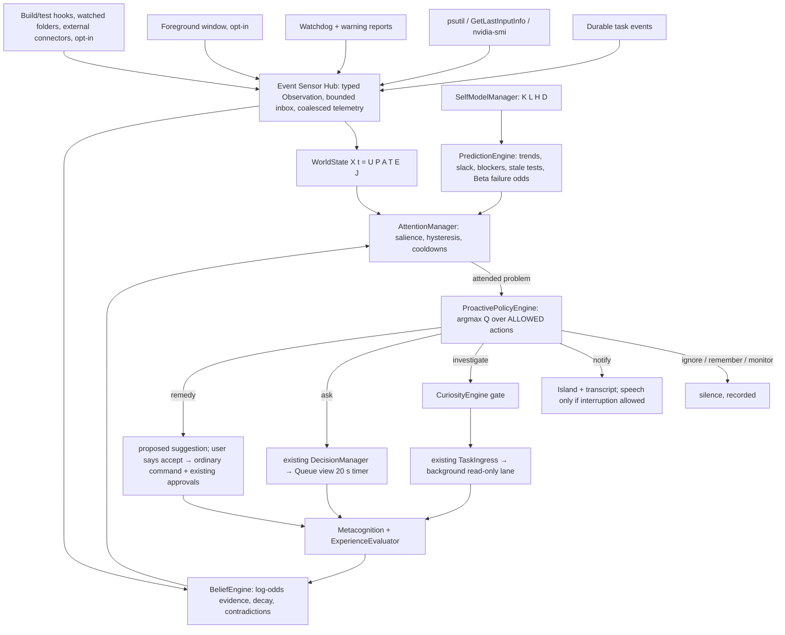

# Cognitive Awareness Engine (JCAE)

Candidate implemented 2026-10-23 IST on `claude/cognitive-awareness`. It is an additive, event-driven layer over the existing assistant, not a rebuild. It approximates some operational functions: situational state, beliefs with uncertainty, attention, self-monitoring, prediction, deciding when to act, and learning from rated outcomes. It does **not** claim consciousness, feelings or sentience, and the code and documentation make no such claim. The "Awareness" states shown on the Island (observing, investigating, predicting …) name the process that is running. They are not emotions.

Full release acceptance remains open. See [Verification](#dated-verification-2026-10-23-ist) and [Open gates](#limitations-and-open-gates).

## What it adds, and what it reuses

The audit covered [the system map](system-map.md), [the cognitive loop](cognitive-architecture.md), [the durable queue](autonomous-task-queue.md), [the workflow graph](workflow-graph.md), Actions/Engine, intent routing, the watchdog, the capability model, GPU status, ReasoningBank/OpenViking/Obsidian memory and the Island Mind/Queue views. The engine reuses these rather than duplicating them:

| Need | Existing component reused | What JCAE adds |
|---|---|---|
| Task execution, locks, lanes, approvals | `TaskIngress` / `ScheduledQueue` / tool approvals | Nothing new. It submits read-only investigations through `TaskIngress.submit`, and the existing scheduler decides when they run |
| 20-second routine choices | `DecisionManager` + Queue view timer | Routine choices created through the same API. Silence decides only reversible, non-sensitive, ≥0.85-confidence options |
| Task events | `TaskStore` durable `events` table | An incremental read-only tail (`seq > last`), resumed after restart |
| Component health | Watchdog services, report events | A self-model that reads them; connector failures from repair/warning reports |
| Memory | Obsidian lessons (`Cognition.consolidate`/`relevant_lessons`), ReasoningBank `lessons`, OpenViking `vault_hits`, procedure statistics | Investigations retrieve these and label them **unverified** |
| Per-action reliability | `Cognition.procedure_stats` (Beta posterior) | Used by the self-model and metacognition |
| Foreground window | `main.remember_external_window` observer | One more consumer of it. The engine records changes only, and only when its sensor is on |
| GPU memory | `gpu_scheduler.memory()` (nvidia-smi) | Sampled every 60 s at most. GPU leases remain authoritative |
| Island / Pip | Mind view, Pip `event()` reactions | A compact awareness strip with controls, and a low-priority *curious* Pip reaction |

There is no second scheduler, memory authority or approval manager. Turn the engine off and ordinary commands, the queue and the six-module cognition loop still work. This is tested.

## How observations become actions



1. **Observation.** Each event becomes a typed `Observation`: id, type, time, source, project/application/task, values, confidence, provenance (`observed`/`inferred`/`user_confirmed`), sensitivity (`public`/`internal`/`private`) and retention (`none`/`session`/`days`). Invalid events are rejected and counted. Repeated low-value telemetry is coalesced, latest value wins. When the inbox is full, the least severe pending event is dropped first. The caller is never blocked. A source that cannot be read leaves its fact *unknown*, and no value is invented.
2. **World state.** `WorldState` keeps each fact with its value, time, source, confidence, TTL and provenance, grouped into U (user), P (computer), A (apps/projects), T (tasks), E (external) and J (Jarvis). A stale fact reads as unknown for decisions. A fresh user-confirmed fact cannot be overwritten by an inference. Change history is bounded.
3. **Beliefs.** `BeliefEngine` applies `b(t+1) = b(t) + log LR`, decaying toward the prior with a half-life, so stale evidence fades. Supporting and contradicting evidence are both kept. Competing hypotheses stay side by side. **Human states are capped at 0.6 unless the user confirms them.** Hours in an app cannot make Jarvis "sure" someone is tired or frustrated.
4. **Severity** comes from the event name's own vocabulary (`failed`/`error`/`crash` → 0.8, `low`/`stale`/`blocked`/`pressure` → 0.6, `changed`/`deadline` → 0.4, `waiting`/`approval` → 0.3, `completed`/`passed` → 0.15). Unseen types such as `connector.calendar.sync.failed` therefore work with no new rule. Events below 0.4 update state only.
5. **Attention.** `S = 0.30R + 0.25U + 0.20N + 0.15C + 0.10G`. Relevance comes from overlap with active goals (user tasks, workflow groups, the cognition goal, the active project). Novelty decays per fingerprint. The coefficients are tunable starting heuristics, normalised at load, and are not empirical constants. Hysteresis (enter 0.45 / exit 0.35), per-problem cooldowns, an hourly interruption budget, quiet hours and focus mode keep alerts from oscillating or repeating. **Salience never authorizes anything.**
6. **Workspace.** `CognitiveWorkspace` holds a bounded set per slot: observations, beliefs, goals, problems, predictions, pending and outcomes. Each consumer gets only its slots, filtered by sensitivity. The planner context (`context_hub`) receives only open-problem subjects and chosen responses, never raw observation values.
7. **Policy.** For an attended problem, `Q(a) = ExpectedBenefit − ExecutionCost − InterruptionCost − RiskCost`, maximised over the **allowed** set:
   - `ignore` (Q = 0), `remember` and `monitor` are always allowed, so silence wins whenever nothing is clearly worth doing.
   - `notify` is allowed unless proactivity is off, the emergency stop is active, or the user rejected that kind of situation.
   - `speak`, `ask` and remedy proposals require autonomy `suggest` or higher.
   - `investigate` requires autonomy `investigate`, a free hourly task budget, a problem that is neither self-generated nor already handled, and the curiosity gate (expected information gain plus goal benefit minus cost).
   - Benefit scales with severity × relevance × confidence and with rated usefulness for that situation. Interruption cost rises when the user is active, and steeply during quiet hours or focus mode.
8. **Execution path.** An investigation is `jarvis_status awareness:investigate:<id>`, admitted with idempotency key `cognitive:<fingerprint>:<window>` and attached to the related task's workflow group. The existing scheduler classifies it as read-only on the background lane, so its locks, resource gates and pause/cancel apply. It reads the durable task store, event history, procedure statistics, component health and recorded changes. Only direct readbacks are stored as verified findings. Memory hits are recorded as unverified hypotheses. The structured result goes through `ScheduledQueue.publish_output`, and the note is shown silently.
9. **Remedies** (for example "run the tests for Jarvis" after a change invalidated a passing test) are never executed by the engine. They become a `proposed` suggestion. `accept suggestion N` submits an ordinary user command, and all existing tool approvals still apply.
10. **Learning.** `MetacognitiveEvaluator` records execution, task and goal success separately. "Handler returned" is not "verified", and neither is "the user's goal was met". `ExperienceEvaluator` keeps Beta(1,1) usefulness per (situation, response):
    - Explicit *helpful* or *wrong* feedback is strong evidence.
    - A plain dismissal counts at 0.4 weight.
    - *Don't suggest that again* suppresses only that situation type.
    - Policy parameters (attention threshold, interruption scale) are versioned, adapt in bounded steps, and roll back automatically if usefulness falls ≥15 points against the previous version.
    - Repeated failures are written as lessons through the existing Obsidian path. No model is trained.

### Recursion and duplicate guards

- Work that the engine submitted (idempotency prefix `cognitive:`) can never trigger another investigation.
- At most `max_tasks_per_hour` (default 3) proactive tasks.
- One open suggestion per problem fingerprint within the cooldown (default 30 min).
- A subject investigated recently is "handled" even when it arrives through another signal, such as a repeated-failure prediction.
- Restart resumes the task-event tail from the persisted sequence, so old events are not re-handled.
- Commands that the engine submits are not attributed to the user. They do not set the cognition goal, user-idle clock or command history, and they cannot answer a waiting WhatsApp/screen prompt.

## Predictions

Each prediction records evidence, horizon, raw and calibrated probability, consequence, suggestion and actual outcome. All forecasters are deterministic or statistical:

| Kind | Method | Outcome resolution |
|---|---|---|
| `resource_exhaustion` | Least-squares RAM trend vs the queue's reserve | Observed below reserve, or horizon passes |
| `resource_shortfall` | Measured free VRAM vs the configured per-GPU-task estimate (`gpu_task_vram_mb`, an estimate rather than a measurement) | Horizon |
| `deadline_risk` | Cumulative estimated work ahead vs deadline, uncertainty widening with workload | Task finishes before/after deadline |
| `dependency_blocker` | Upstream FAILED/CANCELLED/PARTIAL/waiting | Upstream terminal state |
| `stale_verification` | A project changed after its last passing test | Next test result |
| `repeated_failure` | Beta(1,1) failure posterior per task kind | Next attempt |

Calibration uses histogram binning shrunk toward the raw heuristic, `(n·observed + 5·raw)/(n + 5)`, and Brier scores are reported per kind. Until resolved outcomes exist, a probability is labelled **uncalibrated**. Nothing is presented as certain.

**VRAM example (B):** when a low-priority queued GPU task's declared need exceeds measured free VRAM, the engine creates a routine choice through `DecisionManager`: postpone that task 10 minutes, or run as scheduled. It is reversible and non-sensitive. Confidence is ≥0.85 only when free VRAM is below 75 % of the need. Tasks with explicit priority, or a deadline within 30 minutes, are never deferred. The timer starts only when the Queue view presents the question. On timeout the deferral sets `not_before` with an audit event, and the note says it was automatic. A late answer cannot start a second branch.

## Sensors and privacy

| Sensor | Code default | Shipped config | Reads | Persisted |
|---|---|---|---|---|
| `system` | on | on | CPU %, RAM available, battery, disk %, free VRAM | Pressure events only (expire) |
| `tasks` | on | on | Durable task events | No (the task store already holds them) |
| `jarvis` | on | on | Watchdog repairs, warnings, answer errors, model availability | Non-private, expire after `retention_days` |
| `user_presence` | **off** | on | Seconds since last input (no content) | No |
| `foreground_app` | **off** | on | Foreground title + executable on change | Titles never; memory only |
| `files` | **off** | off | mtime scan of `watch_paths` (no contents), build/test hooks | Change/pass/fail events |
| `external` | **off** | off | Connector/alert hooks | Private by default |

Private values stay in memory. They are not persisted, not shown in the snapshot's observation field and not put into planner context. The optional Tier 3 question (`deliberative_reasoning`, **off** by default) includes only the event type, subject and severity, never task instructions, details or titles. It runs as an ordinary scheduler `ask`, so the existing local/cloud routing and privacy policy decide the model. There is no continuous microphone, keystroke or screen recording.

Credentials in report text are redacted with the existing pattern. The engine's own suggestions are never treated as user instructions.

## Computational tiers

- **Tier 1 (always):** rules, counters, thresholds, trends and Beta statistics on one daemon thread. It is woken by events and otherwise polls on intervals: tasks 2 s, system 10 s, GPU 60 s, predictions 15 s, self-model 300 s. A thread-CPU budget (default 2 % of one core over a minute) stretches every interval up to 8×. Under heavy system CPU (>85 %), predictions and scans run 3× less often.
- **Tier 2:** token-overlap relevance and fingerprint correlation. No model call.
- **Tier 3 (opt-in):** a scheduler question through the existing model router. It is used only for an unfamiliar problem with no rated history, and only when `deliberative_reasoning` is enabled.

## Commands

| Say or type | Effect |
|---|---|
| "What can you currently do?" | Registered tools, how many need approval, installed local models (probed, or "unknown"), component health |
| "What are your limitations?" | Probed limitations: missing configured models, disabled connectors, approval-required kinds, locked-desktop limit |
| "Why did that fail?" | Last failed task's stored outcome, the belief about its kind, and investigation findings, if any |
| "Which connector is broken?" | Failing/recovering components and connectors with last errors |
| "How confident are you in that result?" | Execution vs verified task success vs unknown goal success for the last finished task |
| "Why did you suggest that?" | The evidence, salience and utility behind the latest suggestion |
| "What are you aware of?" / "What do you predict?" / "Show proactive actions" | Status counters, open predictions with calibration, the last 24 h of proactive actions |
| "Accept suggestion 3" | Queues that suggestion's remedy as an ordinary command; approvals still apply |
| "That suggestion was helpful / wrong" · "Dismiss the suggestion" · "Don't suggest that again" · "Suggestion 3 was wrong" | Feedback (see Learning) |
| "Turn off proactive awareness" / "Resume awareness" | Observe-only / resume |
| "Emergency stop" | No new proactive actions; pending `cognitive:` tasks cancelled at their cooperative boundary |
| "Disable the foreground app sensor" (or `system`, `tasks`, `files`, `presence` …) | Per-sensor toggle, persisted |
| "Focus mode on/off", "Fewer/more suggestions", "Pause/resume exploration", "Clear observations" | Interruption controls and stored-observation removal |

The first six questions previously fell through to free conversation. They now answer from probed state.

The Island **Mind** view has a strip showing:

- operational state, mode and current goal;
- the latest noticed event type;
- the latest suggestion, with any *automatic* marker;
- the top prediction (marked uncalibrated when applicable);
- warnings.

Its buttons are: Proactive on/off, Focus, Pause exploring, Why?, Don't suggest, Clear observations and Stop. Routine choices appear in the existing **Queue** view. Notes go to the transcript (`AWARE` lines) and the status line, and Pip shows a low-priority *curious* reaction. Speech happens only when the interruption policy allows it and quiet hours are not active.

## Configuration and rollback

```json
"awareness": {
  "enabled": true, "autonomy": "investigate", "tick_seconds": 1, "event_queue": 512, "retention_days": 7,
  "cpu_budget_percent": 2, "max_tasks_per_hour": 3, "suggestion_cooldown_seconds": 1800,
  "system_sample_seconds": 10, "gpu_sample_seconds": 60, "predict_seconds": 15, "self_model_seconds": 300,
  "gpu_task_vram_mb": 2048, "reprioritize": true, "decisions": true, "deliberative_reasoning": false, "quiet_hours": true,
  "sensors": {"system": true, "tasks": true, "jarvis": true, "user_presence": true, "foreground_app": true,
              "files": false, "external": false},
  "watch_paths": [],
  "attention": {"weights": {"relevance": 0.30, "urgency": 0.25, "novelty": 0.20, "confidence": 0.15, "goal": 0.10},
                "threshold": 0.45, "cooldown_seconds": 900, "interruptions_per_hour": 6},
  "curiosity": {"daily_budget": 12, "threshold": 0.25, "information_gain_weight": 1.0}
}
```

- `autonomy`: `observe` (notes only), `suggest` (adds questions and proposals) or `investigate` (adds read-only scheduler investigations).
- Quiet hours default to the queue's `quiet_start_hour`/`quiet_end_hour`.
- To watch a project, add its folder to `watch_paths` and enable `files`.
- Runtime toggles persist in `.jarvis-runtime/awareness.sqlite3`.
- No new package, model, driver or service installation is needed. The watchdog registers **Cognitive awareness** with bounded repair (three restarts), and the launcher manifest lists the modules.
- **Rollback:** stop Jarvis normally, set `awareness.enabled` to `false`, and restart. Keep `awareness.sqlite3` for inspection.

## Dated verification (2026-10-23 IST)

These are mechanism checks with simulated events, a controllable clock, the real `TaskIngress`/scheduler/`DecisionManager`, and one end-to-end run through real `Actions`, its ingress worker and the background lane. They do not show usefulness in daily work, physical speech/UI behavior, or account connectors. [Evidence index](../artifacts/cognitive-awareness/README.md).

- New suite [`tests/test_awareness.py`](../tests/test_awareness.py): **36 passed**.
- Baseline before the change (cognition/anticipation/task/workflow subset): **189 passed in 22.58 s** ([receipt](../artifacts/cognitive-awareness/baseline-focused-regression.txt)). The same subset plus the queue, intent, buddy, catalog, architecture and launcher suites after the change: **407 passed in 57.59 s** ([receipt](../artifacts/cognitive-awareness/focused-regression.txt)).
- Complete suite on the final code: **4,141 passed / 150 gated skips / 0 failures** in 16 m 59 s ([receipt](../artifacts/cognitive-awareness/full-regression.txt)).
- The first complete run found **3 failures**, from two real integration bugs: disabled-awareness startup in UI-verification mode, and a Mind view built without the new widgets. Both were fixed before the final run, and that first receipt is kept.
- Launcher: **ready**, no missing or incomplete components ([receipt](../artifacts/cognitive-awareness/launcher-check.txt)).
- **Later correction (2026-10-24):** this change left `Actions._submit` crashing at admission for any Jarvis-generated `code_task`, because `cognition` was assigned only on the user path. Its own investigations used a different path, so the suite above did not catch it. It was found and fixed during the [project-intelligence](project-intelligence.md) work; see that suite's results.

[Benchmark](../artifacts/cognitive-awareness/benchmark.json) (`python scripts/awareness_benchmark.py`, owned temporary state, real psutil/nvidia-smi sampling, model probe replaced by a fixture, 20 s per mode):

| Measurement | Result |
|---|---|
| Queue admission median / p95, engine off | 0.729 / 1.125 ms |
| Queue admission median / p95, engine tailing the queue | 0.716 / 0.950 ms (no measurable regression; not a speedup claim) |
| Engine thread CPU, idle (60 s window incl. startup self-model refresh) | 1.16 % of one core |
| Engine thread CPU, active (~16 events/s: focus changes, task completions/failures) | 0.63 % of one core |
| Observation-to-processing latency, active p50 / p95 | 14.1 / 18.5 ms |
| Event-to-decision latency, 5 trials median / max | 15.7 / 16.1 ms (2 investigations, then 3 silent notes once deduplicated/budgeted) |
| Flood: 50,000 `observe()` calls from 4 threads, p50 / p99 | 0.15 / 2.99 ms; 49,992 coalesced, 1,098 low-severity events shed, drained in 6.8 s |
| After the flood | Engine exceeded its CPU budget and stretched intervals 8×, as designed. Backlog latency p50 rose to ~2 s |
| Whole-process RSS before engine / after all modes | 22.8 → 45.4 MB (includes the queue database; sampled, not peak) |
| Model calls / models loaded / VRAM allocated by this layer | 0 / 0 / none (nvidia-smi read only) |

No baseline exists for proactive usefulness, false-positive or dismissal rates, or calibration in real use. These need weeks of real feedback and are not reported.

### Requested test areas: what is covered

Covered by automated tests:

- **Situational understanding:** schema validation, unknown sources staying unknown, provenance, stale expiry, contradiction, the cap on human-state inference, disabled sensors, private titles never persisted.
- **Proactive behavior:** a relevant failure leading to one investigation in the same goal group, duplicate suppression, staying silent when benefit is low, focus mode, proactivity off, rejected situations, unseen event types and subjects, observed-content injection.
- **Prediction:** RAM trend exhaustion, dependency blocker and deadline risk from the real queue, stale verification after a file change, recorded forecast error, calibration shift after outcomes.
- **Self-model:** a missing configured model, unavailable model probe, connector failure, unknown capability, honest limitations, and confidence that never claims unverified success.
- **Orchestration:** proactive task in the existing scheduler on the read-only background lane, goal-group attachment, budget, recursion guard, restart without replay, emergency stop cancelling pending proactive work.
- **Decisions:** the 20-second timer starts only after presentation, then an automatic reversible deferral; explicit priority is never deferred; a late answer cannot start a second branch; insufficient confidence leads to DEFERRED; remedies require acceptance.
- **Learning:** a dismissal counts as weak evidence and a rejection is specific to its situation; a regressive policy version rolls back; memory reuse is labelled unverified; Tier 3 is opt-in and carries no private detail.
- **Reliability:** a flood is coalesced and bounded; sensor failure is contained; worker restart is bounded; the CPU budget stretches intervals; a disabled engine is inert; the end-to-end real Actions path is tested.

Not covered, and still open:

- Real application-focus detection on the live desktop (only the hook is tested).
- Real build tools emitting `observe_build`. No existing builder calls the hook yet.
- Outdated-procedure detection beyond the existing ReasoningBank's own supersession.
- Experimental procedure promotion and isolated candidate testing for Example D. The engine investigates and proposes; it does not run sandbox experiments.
- VRAM monopolization under real model load.
- Long-duration stability.

## Acceptance examples: current status

| Example | Status |
|---|---|
| A — build failure | Mechanism verified with simulated and real-Actions task failures: investigation → verified readback findings → silent note. A real compiler needs a builder that calls `observe_build` or runs as a queued task. |
| B — VRAM | Mechanism verified with simulated VRAM. The per-task need is a configured estimate. Not checked under live model load. |
| C — stale test | Verified: change after pass → prediction → acceptable proposal → ordinary queued command. |
| D — repeated automation failure | Repeated-failure prediction and investigation of prior recovery events and lessons are verified. Researching, sandbox-testing and proposing a verified fix are **not** implemented. |
| E — unfamiliar situations | Verified on unseen event names through generic severity, salience and policy. This does not show real-world judgement quality. |
| F — overnight | The morning report lists `proactive_tasks`, and an `.awareness.json` companion records proactive actions. A real overnight run with the engine on has **not** been performed. |

## Limitations and open gates

- Live desktop, voice and UI behavior of the awareness strip and notifications has not been checked. No screenshot has been taken.
- Real-use calibration, usefulness and false-positive rates are unknown. The weights are untuned heuristics.
- The engine observes queue events and Jarvis reports. It does not see compiler output, IDE diagnostics, calendars or messages until a connector calls its hooks (`observe_build`, `observe_external`).
- Investigations gather evidence and do not repair anything. Proposed remedies require the user.
- Foreground titles drive project relevance only when they contain a known project name (from workflow groups or `watch_paths`).
- An in-flight Ollama model probe can delay this worker for up to ~10 s every five minutes, but never other Jarvis work.
- The six-module [cognitive loop](cognitive-architecture.md) still runs independently. JCAE complements it and does not replace it.
