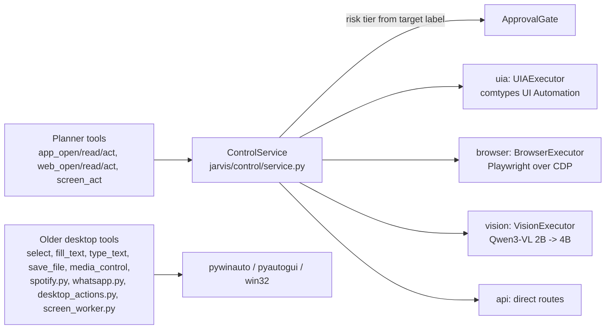

# PC and web control today (before agent-desktop / agent-browser)

Date: 2026-11-02. Read-only trace of branch `control/agent-desktop-migration` before the new backends. Paths are relative to `app/`.

## The seam

- `RouteExecutor` (`control/executor.py`) is the contract: `observe`, `act(Action) -> ActionResult`, `probe`, `verify`, `cancel`, `health_check`, `close`.
- `ControlService` turns planner strings into typed `Action`s and classifies risk from the target's own label: a click on "Send" or "Delete" is Tier 2 and asks first. It streams progress to the island and returns compact JSON plus fresh refs.
- Nothing is retried after input was sent (`ControlError.executed`).
- Reads go to the planner as text lines `Kind "name" [ref] extras`. No screenshot goes to a model unless the vision route is chosen. Vision runs on this PC only (loopback enforced).

## One PC task, end to end: "type hello in Notepad and save it as a.txt in my test folder"

1. The planner (qwen3.5:9b, native tool calling) calls `app_open notepad`, which goes to `ControlService.app_open`.
2. `UIAExecutor.launch` starts `notepad.exe` (only the allow-listed apps: notepad, calculator, explorer, paint) and waits for a new window. Windows 11 Notepad restores old tabs, so the service presses `ctrl+n` and checks that a fresh empty tab exists.
3. `read_window` builds a UIA cache tree (about 25 levels) and returns lines such as `Document "Text editor" [u12] focused`.
4. The planner calls `app_act type`. UIA focuses the window, which steals the foreground, sends `SendInput` keystrokes, and reads the editor back (`typed_intact`).
5. The planner calls `app_act save_as`. The service sends `ctrl+shift+s`, waits for the "File name" Edit and the Save button, sets the value, invokes Save, and verifies the file on disk.
6. Model calls: one plan, then one call per step (each about 5 tok/s on the 9B). Screenshots sent: 0.

## One web task, end to end: "open example.com and tell me the heading"

1. `web_open example.com` reaches `ControlService.web_open`. `Policy.check_url` checks the URL, then `BrowserExecutor` (Playwright, Jarvis's own Chrome profile in `.jarvis-runtime/test-browser-profile`) navigates and re-checks every frame's final URL.
2. `read_page` walks the CDP accessibility tree and returns `heading "Example Domain" [ref_3]` and `text "..."` lines (at most 9,000 characters to the planner).
3. Actions go by ref through Playwright mouse and keyboard. Consequential targets ask first, and passwords are never filled.

## Retry and verification today

- Fixed and condition waits (upgrade-v2 flags), a title guard before typing, value read-back after `set_value`, and disk read-back after Save As.
- No automatic retry after input was sent. Stale refs need a fresh read by the planner.
