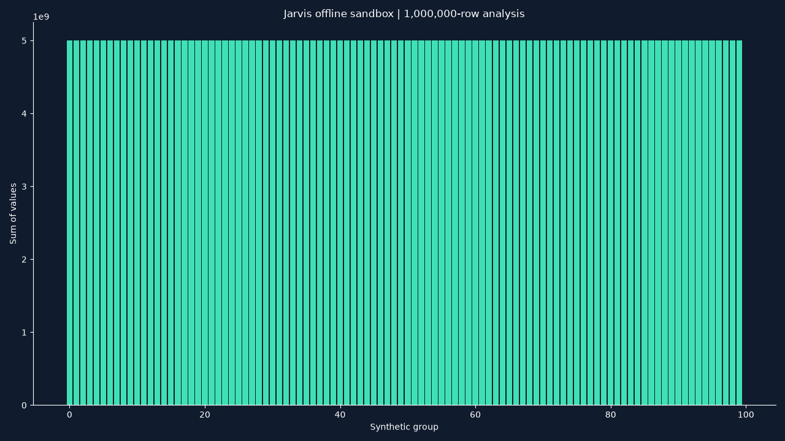

# DeerFlow sandbox and free media — 2026-10-14 IST

Jarvis now offers the real DeerFlow harness a confined Linux workspace for requested
coding, data analysis and artifact creation. Its existing Windows voice, desktop,
research and skill tools remain available. This extends the
[research integration and comparison](deerflow.md); it does not establish AGI,
universal correctness or peak performance on every task.

## Startup and recovery

[Start Jarvis.cmd](<../Start Jarvis.cmd>) delegates startup to the hidden supervisor.
The supervisor starts Docker Desktop in the background when the local Linux engine
is unavailable. The main application's watchdog monitors it during use and attempts
bounded, silent startup with backoff. Configuration is
`docker_runtime.enabled`, `recovery: "start_only"` and
`leave_shared_engine_running_on_quit: true` in
[config.json](../config/config.json). Repair status uses the transcript and ignored
`.jarvis-runtime/repairs.jsonl`.

Quit/Stop ends Jarvis recovery. It leaves the shared Docker engine and other people's
containers running. A severely hung Desktop/backend can require manual repair:
Jarvis does not forcibly restart Docker or kill shared workloads. Attested abandoned
Jarvis job containers are cleaned up only after their exact owner process has died.
Uncertain commands/writes pause with saved checkpoints; recovery never repeats them.

**Docker launcher-lock repair (2026-10-14 IST):** A user-supplied screenshot showed
`Error: acquiring launcher lock: open : The system cannot find the file specified.`
Jarvis's previous Desktop launch used the repository-command environment, which
omitted Windows profile variables. The Desktop-only environment now preserves
`LOCALAPPDATA`, `APPDATA` and `USERPROFILE` plus related Windows directory/account
names; arbitrary API-key/auth environment variables remain excluded. Confined
sandbox CLI environments are unchanged. Missing required Windows profile variables
prevent launch rather than knowingly starting Desktop with invalid paths.

A process-shared Jarvis startup lock now coalesces simultaneous supervisor/watchdog
starts. Startup checks the CLI return code and has a bounded readiness deadline.
There is no Docker data reset, lock-file deletion, shared-engine restart or killing
of user containers. The fix takes effect on the next Jarvis restart. The initial
read-only check for this repair found Docker and Ollama available and readiness
`ready`; Groq was enabled by the user but remained untested live. A full cold Desktop
boot was not forced while its shared engine was already running. Regression results
for this follow-up: 485 selected offline tests passed, including profile-variable,
secret-exclusion, missing-profile, cross-owner locking and launch-coalescing checks.

## Setup and isolation

From `app/`, after the [DeerFlow environment setup](deerflow.md#use):

```powershell
.venv/Scripts/python.exe -m scripts.setup.setup_deerflow_sandbox
.venv/Scripts/python.exe -m jarvis.launcher --check
```

Docker Desktop must support its local Linux engine. Image
`jarvis-deerflow-runtime:1` has a pinned Python base and recorded Python package
versions. Building requires internet to retrieve the base/packages; task execution
is offline. Apt packages are not version-frozen, so future builds need verification.
The [runtime manifest](../config/runtime_manifest.json) records the tested image ID.
The tiny build context includes only runtime dependency files, never account files.

Each job runs as UID 65534 with no network, read-only root, no added capabilities,
no privilege escalation, no Docker socket, no host project mount and no credentials.
Limits are 2 CPUs, 2 GB RAM/swap combined, 128 processes, 128 open files, 64 MB per
file and 256 MB temporary storage. A parent monitor stops the attested container
when workspace/output usage exceeds 256 MB or 1,000 files; this polling monitor
can overshoot and is not a filesystem quota. `/tmp` permits execution for the
local speech library's shared-library loading, while remaining confined to the job.

Only that job's workspace/output folders are writable. Public upstream skill guides
and the two existing Kokoro voice files are mounted read-only. The tool accepts up
to ten explicit relative data/source/media inputs, copied into a read-only uploads
folder, with a combined 64 MB budget. Hidden, credential-named, linked and escaping
paths are refused. Original inputs are preserved. Generic files may still contain
private content; select inputs intentionally. Nothing is uploaded to a service.

Commands have a maximum 120-second execution deadline, twenty-command budget and
an outer sandbox task deadline up to 600 seconds. Outputs/checkpoints stay in ignored
`.jarvis-runtime/deerflow/jobs/<job-id>/`; owned container cleanup preserves files.
The final tool result lists actual output files and bounded JSON readback. Model
prose is retained separately as local `model-report.json`; creating a file alone
does not prove its claims correct.

## Free capabilities

`deerflow_sandbox_task` accepts a bounded goal plus optional `folder` project and
`content` JSON such as `{"inputs":["data.csv"]}`. Ask for named artifacts and
explicit acceptance checks, for example: “Use DeerFlow sandbox to summarize
data.csv and create report.pdf and chart.png; verify totals against the CSV.”
The local Qwen model must still choose and execute the tools successfully.

`deerflow_free_media` uses literal JSON specs and reviewed offline renderers,
without model inference or API credentials:

| `value` | Example `content` | Output |
| --- | --- | --- |
| `chart` | `{"title":"Sales","labels":["A","B"],"values":[2,5]}` | PNG bar chart |
| `poster` | `{"title":"Launch","text":"Coming soon"}` | PNG text poster |
| `pdf` | `{"title":"Report","text":"Observed results"}` | PDF report |
| `slides` | `{"slides":[{"title":"Results","text":"Observed results"}]}` | PPTX |
| `video` | `{"title":"Launch","text":"Coming soon","duration":6}` | Short text-card MP4 |
| `music` | `{"duration":6}` | Procedural instrumental WAV |
| `narration` | `{"text":"Hello from Jarvis","voice":"am_michael"}` | Local Kokoro WAV |

Short video/music duration is 1–30 seconds; slides allow 1–10 bounded title/text
slides. Stock narration voices include `am_michael`, `af_heart` and `bf_emma`, using
existing model files. Renderers use [Matplotlib's static backend](https://matplotlib.org/stable/users/explain/backends.html),
Pillow, ReportLab, [python-pptx](https://python-pptx.readthedocs.io/en/latest/),
[FFmpeg](https://ffmpeg.org/ffmpeg-filters.html) and
[kokoro-onnx](https://github.com/thewh1teagle/kokoro-onnx). Upstream MIT attribution
is retained in the [source manifest](../integrations/deerflow/source-manifest.json)
and [license](../integrations/deerflow/LICENSE).

These are local document/graphics, text-card video, procedural music and speech
capabilities. Photoreal diffusion, cinematic generated video, commercial music
services and account publishing are not included. Account/provider setup is deferred
at the user's request. Existing secrets/runtime directories remain ignored; no new
login credentials or paid API keys were added.

## Actual verification

All measurements below were taken locally on 2026-10-14 IST and have limited scope:

| Check | Observed result |
| --- | --- |
| Offline stress fixture | 1,000,000 rows; exact sum and SQL cross-check; seven CSV/chart/document/audio/video artifacts verified |
| Stress timing | 3.203 s measured fixture processing; 8.86 s original total job wall time |
| Stress memory | 273.6 MiB Python-process peak RSS, excluding whole container/child peak |
| Synthetic ML fixture | 0.9985 held-out classifier accuracy; not Jarvis reasoning accuracy |
| Literal free-media registry path | 7/7 recipes passed; approximately 1.7–3.0 s each, narration 7.719 s |
| Actual Qwen 4B → DeerFlow → Docker | Requested JSON and PNG created; sum of squares 1–10,000 verified as 333,383,335,000; 364.562 s |
| Synthetic input staging | Read-only mount verified, UID 65534, original CSV unchanged |
| Controlled container failure | Only owned container killed mid-command; one dispatch recorded, uncertain result retained, repeat refused |
| Regression/readiness | 209 selected mock-based tests passed; launcher check reported `ready` |

The model-driven test was slow and its final prose included a contradictory number
despite the correct JSON. Delivery therefore uses actual file evidence. The heavy
fixture uses a reviewed deterministic script; its speed is not model task speed.
The stress test used the initial image, before adding natural Kokoro narration;
all seven media recipes and the model/input checks used the extended image. The
initial stdout parser failure was fixed by independently inspecting completed
outputs without rerunning the command. Earlier empty-script/protocol attempts and
the first failed speech attempt are preserved in the report directory. The speech
failure was fixed by permitting confined temporary shared-library loading.

Evidence: [stress](../artifacts/reports/deerflow-sandbox-stress.json),
[seven free recipes](../artifacts/reports/deerflow-free-media.json),
[model task](../artifacts/reports/deerflow-sandbox-live.json),
[input isolation](../artifacts/reports/deerflow-sandbox-inputs.json),
[failure recovery](../artifacts/reports/deerflow-sandbox-fault.json),
[final verification record](../artifacts/reports/deerflow-sandbox-verification.json).
Docker startup/outage/backoff/Stop logic was tested with injected faults. The entire
Docker Desktop backend was not deliberately stopped because a shared OpenWebUI
container was running; it remained healthy. Full GUI/microphone startup was not
tested in this extension.



This is an actual rendered synthetic load-test artifact, not a desktop screenshot
or a polished presentation preview. It was generated by the tracked
[stress fixture](../scripts/verification/deerflow_stress_program.py).

Reproduce controlled checks from `app/`:

```powershell
.venv/Scripts/python.exe -m scripts.verification.verify_deerflow_free_media
.venv/Scripts/python.exe -m scripts.verification.verify_deerflow_stress
.venv/Scripts/python.exe -m scripts.verification.verify_deerflow_sandbox
.venv/Scripts/python.exe -m scripts.verification.verify_deerflow_sandbox_fault
```

These create owned test jobs and preserve local outputs; the fault check affects
only its own test container. They make no account calls or shared-engine restart.
