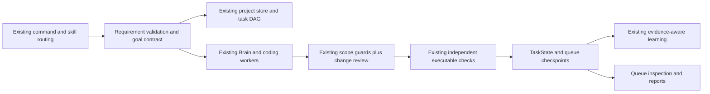

# Engineering Judgment & Goal Assurance — 2026-10-24 IST

EJGAE extends existing Jarvis decision and execution paths. It introduces no planner, executor, scheduler, permission authority, database, service or dependency. Start/Stop/bootstrap/recovery and the user's restored voice profile are preserved. Current implementation and verification status are in the [evidence index](../artifacts/engineering-judgment/README.md) and [cumulative handoff](CLAUDE_HANDOFF.md).



## Source and conditional guidance

Reviewed [multica-ai/andrej-karpathy-skills at commit 2c606141936f1eeef17fa3043a72095b4765b9c2](https://github.com/multica-ai/andrej-karpathy-skills/tree/2c606141936f1eeef17fa3043a72095b4765b9c2). All seven requested files are archived with exact SHA-256 hashes in [the review](../artifacts/engineering-judgment/upstream-review.json). The plugin identifies its implementation author as `forrestchang`; Karpathy's observations are the inspiration, with no personal authorship or maintenance claim. Version metadata is 1.0.0. Upstream declares MIT in its README, skill and plugin; the pinned tree has no root LICENSE. The [copied skill](../skills/karpathy-guidelines/SKILL.md) retains all supplied license/attribution metadata, with an [explicit notice](../skills/karpathy-guidelines/NOTICE.md). No remote installer was executed.

The existing `SkillMemory` catalog now contains 12 builtin guides. `karpathy-guidelines` is selected only for deterministic engineering intent, alongside at most one other relevant existing guide. It contributes a compact summary and an inspectable selection reason/source commit. The complete guide remains available through existing skill inspection. Ordinary opening, media and other trivial commands do not receive engineering analysis or another model call. Blender/document/research work can use domain goal checks without coding-specific test instructions.

All skill text remains untrusted guidance. It cannot declare permissions, change privacy routing, waive approvals or write outside the existing selected workspace. Disabling the feature also suppresses automatic and explicit activation of this guide; its catalog entry and history remain intact.

## Policies and evidence

- `RequirementValidationPolicy` retains the original objective, confirmed requirements, repository facts, unknowns and hypotheses separately. Material missing purpose/destination/performance targets and explicit conflicts produce a tunable uncertainty/impact signal, labelled as a heuristic rather than a calibrated probability. Matching existing project requirements are consulted before asking again. Existing PIRAE questions, confirmed decisions and 20-second routine choices remain authoritative.
- `SimplicityEvaluator` rejects infeasible, speculative and unauthorized candidates before comparing configured costs. Hard requirements cannot be traded away for a lower score. A confirmed feasible user choice is respected. Cost estimates are advisory assumptions, not measured reliability claims. Existing transactional, concurrency, recovery and privacy safeguards remain necessary complexity.
- `ChangeScopeGuardian` preserves before/after working-file hashes, expected files and requirement-related reasons. It uses existing scoped-path validation, refuses metadata/runtime/reference targets, diagnoses unrelated changes, formatting-only edits and possibly unused new imports. It never stashes, restores, deletes, commits, pushes or merges. Diff size is diagnostic, not the sole rejection rule. Existing atomic write, read-before-edit, unchanged-source and public-interface checks remain in place.
- `GoalContractGenerator` records the goal/version, project, required behavior, constraints, assumptions, artifacts, acceptance methods, test commands, permissions and completion state. A saved file or syntax pass does not prove functional acceptance. `GoalAssurance` binds actual host executable-check results and source hashes; all acceptance criteria plus scope must pass before a coding goal is verified. Source changes after testing invalidate that acceptance. Interrupted running contracts become blocked and require fresh inspection without effect replay.

Filesystem review is bounded to 2,000 regular files, 1 MB/file and 8 MB total hashed content. Git metadata, environments, build/cache/runtime folders and linked paths are excluded; an exceeded budget is explicitly incomplete. This is not a claim of an exhaustive audit of every file in a large repository. Existing hard workspace/security controls continue to apply independently.

Persisted engineering metadata is capped at 64,000 JSON characters through the existing bounded-request validator. Oversized/invalid metadata is refused; large-project contract compaction beyond these limits is not implemented. This resource boundary also applies in advisory mode.

## Bindings and limits

| Existing path | EJGAE binding |
|---|---|
| Actions / BrainClient / model router | Applicable goals receive compact internal context through existing memory fields; existing routing chooses models. No new classifier or model service. |
| Coder / native FileSession | Per-thread contract, prewrite proposal tracking and post-change scope review. Existing guards still authorize every operation. |
| Independent `validate_project` | Actual executable results and source identities supply behavior/regression evidence. Protected tests and test-before-implementation rules stay intact. |
| Native repair loop | Enforced engineering budget caps the existing loop. For a ready scoped assignment, a confirmed source save immediately invokes the existing independent verifier, avoiding a redundant model finish turn. Failed checks feed the existing bounded repair path. This immediate check applies to enforced engineering work; advisory retains the previous completion protocol. Uncertain writes remain non-replayable; no second repair loop. |
| ProjectIntelligence / ProjectStore | Contract follows spec version; revised requirements supersede old acceptance. Existing impact analysis updates only affected DAG tasks and preserves other progress. |
| TaskState / TaskIngress / scheduler | Structured contract is mirrored in existing checkpoints. Morning reports list engineering goal status separately from transport/task completion. |
| Cognitive Awareness Engine | Existing investigation suggestions retain evidence/goal assessment. Raw observations are distinguished from confirmed source-backed evidence and cannot authorize repair. No new proactive task generator and no new consent grant. |
| Skill/experience learning, ReasoningBank, Obsidian, OpenViking | Existing pipeline is reused. Only complete stored host acceptance, source identity and scope proof can project a goal-verification checkpoint into the learning view. Bare verified labels and incomplete goals cannot become successful procedures; the original task audit remains intact. Retrieval keeps its existing freshness/privacy policy. |
| Skill evolution | Compact guidance enters the existing candidate author. Under the feature, a larger FIX is evaluated through observed defect, unchanged tool bindings and existing validation instead of rejected solely by line count; candidate/provisional promotion gates remain. |
| Dynamic Island / Pip | Existing Queue inspection displays stored requirements, decisions, changed paths and checks. Existing progress events/animations remain; no new geometry or competing panel. |

External Codex/Claude child processes continue using their existing permissions and Git/worktree boundaries. EJGAE parent records do not grant authority to those children. Cross-process/workload-component scope attribution is conservative: a binding that cannot correlate its verified source to the owning root remains incomplete, especially in enforced mode. General parallel coding isolation, arbitrary semantic requirement understanding and live connector account behavior are not established by deterministic policy tests.

The native binding enforces an attempt budget and supplies diagnosed check failures to the existing loop. The separate repair-policy API tests distinct strategies, but the native loop does not prove semantic novelty of every strategy. That stronger acceptance gate remains open. Simplicity coverage/costs are proposed heuristics, not proof that an architecture satisfies the user's requirements; executable acceptance remains independent.

## Configuration and explanations

`config/config.json` adds `engineering_judgment`:

```json
{
  "enabled": true,
  "mode": "advisory",
  "max_repair_attempts": 2,
  "clarification_threshold": 0.4,
  "prompt_characters": 1800,
  "weights": {
    "complexity": 1,
    "maintenance": 1,
    "integration_risk": 2,
    "runtime_overhead": 1,
    "verification_cost": 1
  }
}
```

Missing or disabled configuration preserves previous execution and independent security. Advisory mode records gaps without granting permission or silently claiming verification. Enforced mode can stop before an essential ambiguous change and refuses completion without the required actual checks; it never undoes or retries an uncertain effect. The deployment starts in advisory mode. Global enforcement is not automatically enabled from a small benchmark; validate the intended backend/workload first.

Ask “What assumptions did you make?”, “What exactly did you modify?”, “How do you know the task is complete?”, “Why did you choose that approach?” or “Is there a simpler solution?” Responses read stored contract/decision/check metadata locally, without reconstructing or inventing private reasoning.

## Verification

The pre-change baseline is [360 passes / one gated skip](../artifacts/engineering-judgment/baseline-focused.txt), with a [source snapshot](../artifacts/engineering-judgment/baseline-source.json). Five actual scoped edits using stubbed model output preserved unrelated user notes and used one model call each. This is not live model intelligence or speech latency. [Current receipts and performance scope](../artifacts/engineering-judgment/README.md) distinguish deterministic fixtures, real executable checks, local-model checks, readiness and still-unexecuted physical/account/overnight gates.

Final regression: **4,268 passed / 150 skipped / zero failures**, one existing COM warning, 1,383.89 seconds; all 804 frozen files unchanged. Launcher readiness passed. The strict owned native-coding fixture passed two linked goals with five actual local-model calls and current executable/scope proof; the saved verified task passed current ReasoningBank induction and idempotency. These are bounded integration results. The [release summary](../artifacts/engineering-judgment/release-summary.json) retains broader unimplemented/unverified gates, including general cross-process source attribution, semantic strategy novelty, account operations, physical speech/duplex and overnight endurance.
