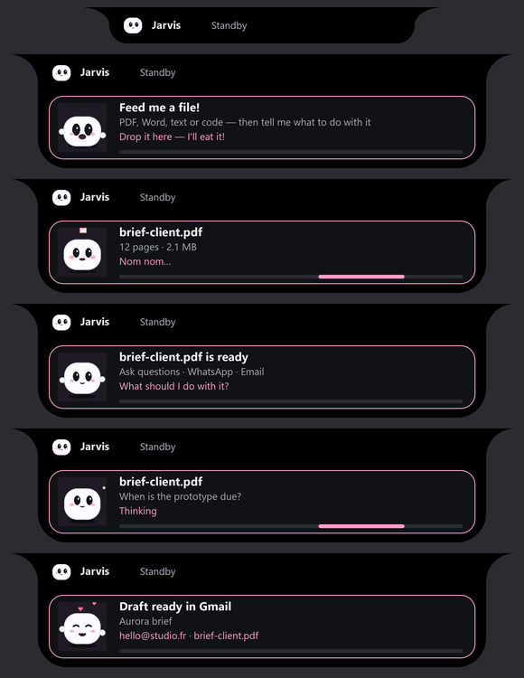
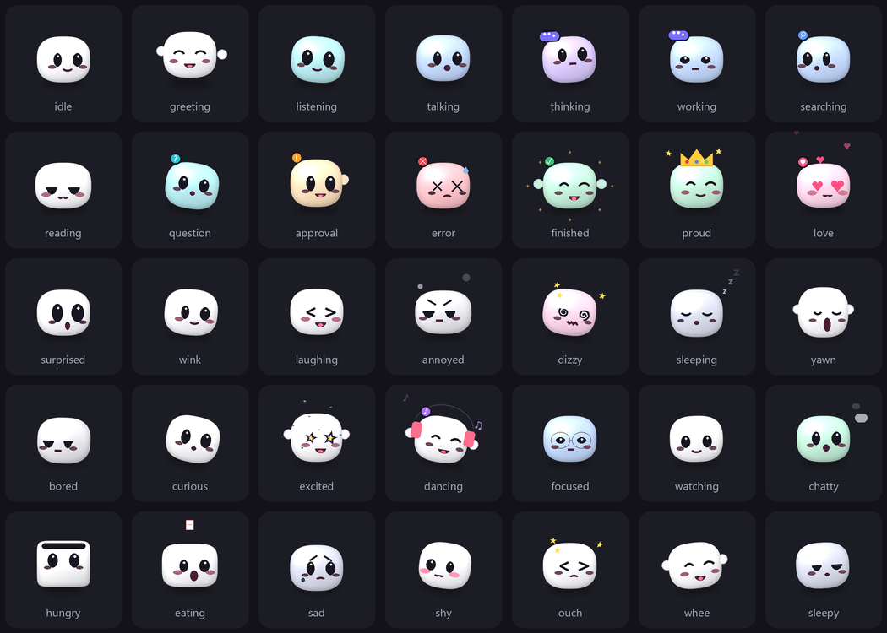

# Pip: drop a file on the island, then ask about it, WhatsApp it or email it

<!-- prompt17-audit -->
**Document audit — 2026-10-16 IST:** Bounded extraction/context, multilingual tokenization, stale-source checks, atomic session writes and drop admission guards added. Warm BM25 lookup p50/p95 **0.8772/0.9154 → 0.0550/0.0591 ms** on 1,500 identical chunks; top5 IDs/pages/text identical; scores match to 10 decimal places.
Verification: **2,654 full regression PASS / 40 skips**; **28 Prompt 17 catalog PASS /4 BLOCKED**. Cross-document conflicts, semantic citation faithfulness, hard parser resource isolation and operation traces remain incomplete. Launcher **repair_required**. Installed pypdf 6.20.0 predates the 6.20.1 cyclic-tree security fix; no dependency installation performed.
[Evidence, limitations and rollback](../artifacts/jarvis-audit/modules/17-rag-documents/inventory.md).
<!-- /prompt17-audit -->

Updated 2026-10-12 IST. The island now has a little friend, **Pip**, who lives where the "J" badge used to be. Drop a
PDF or any other file on the island: Pip eats it, and asks whether you want to ask questions about it, send it on
WhatsApp, or send it by email.

*Rendered preview (2026-10-12) from the island's own drawing code, with sample text: the compact bar, then the
hungry, eating, ready, thinking and done cards. Not a screenshot.*

## Pip (fully interactive since 2026-10-12)

*Rendered preview (2026-10-12) of every emotion at one moment of its animation. Each one moves differently.*

**How Pip is drawn** ([island_buddy.py](../jarvis/island_buddy.py)):

- **Body:** a superellipse marshmallow, |x/rx|^2.7 + |y/ry|^2.7 = 1. It's shaded with light from the top left, a
  specular highlight, a rim shadow and a soft floor shadow, and tinted for each emotion.
- **Eyes:** glossy and placed on a sphere, so looking left, right, up or down moves them as if Pip turned its head.
- **Details:** eyelids, mouths, blush, little arms and a status badge (… ? ! ♥ ♪ ✓ ✕ ⌕).
- **Particles:** hearts, sparks, zzz, notes, sweat, tears, confetti, steam, orbiting stars and a falling page.
- **Outfits:** glasses, sunglasses, headphones, beanie, santa hat, witch hat, party hat, crown and bow.

Every emotion is its own animation: hops, shakes, sways, squashes, spins, waves and blinks. Colours blend smoothly
from one emotion to the next. One Pip costs about 3 ms to draw.

**What Pip feels, and why** ([buddy_engine.py](../jarvis/buddy_engine.py)): the emotion is chosen every frame.
Higher rows win.

| Trigger | Emotion |
| --- | --- |
| You click Pip | Boop: surprised, then laughing. Clicking anywhere else on the island still opens the panel. |
| You double-click Pip | Love: heart eyes, floating hearts. |
| 4 quick clicks, then 7 | Dizzy (spiral eyes, wobble), then ouch (squashed by a slap, stars). |
| You drag the island | Whee. |
| You hover over Pip | Curious: head tilt, looks at you. |
| A file is dragged over the island | Hungry: Pip turns into a box with an open lid. |
| A file is dropped | Eating: chomps as a page falls in. Then the drop card's steps: reading, question, sending, finished, sad. |
| An approval card or a question waits | Approval (amber, "!") or question (cyan, "?"). |
| Jarvis speaks | Talking, with the mouth moving. |
| You speak | Listening, cyan, leaning in. |
| Jarvis thinks or works | Thinking (purple, "…") or working (blue, "…"). |
| Errors, finished actions | Error (red, shake, x eyes) or finished (green, sparks). |
| A WhatsApp message or call | Surprised, or excited. |
| Repository learning | Searching, then proud (with a crown). |
| Weather alerts | Sad. |
| Music playing (Spotify or YouTube card, or Spotify in front) | Dancing with headphones and notes. |
| The app in front (checked every 2 s) | Code or terminal: focused, with glasses. Video: watching. Chat apps: chatty. Documents: reading. |
| No keyboard or mouse for 5 minutes, then 15 | Bored, then sleeping. Late at night it falls asleep sooner, in a beanie. |
| You come back after a break | Greeting: waves both arms. |
| Its own mood | Energy drains while awake and refills while asleep. Affection grows with boops and pets and fades slowly. Boredom builds when nothing happens. These make Pip sleepy, bored or shy, and a random fidget (wink, curious look, yawn, little dance, laugh, shy) plays every 15–40 seconds. |

Its eyes follow your mouse pointer anywhere on the screen. Outfits also follow the date: a witch hat from 25 October,
a santa hat in December, a party hat on 1 January.

Settings: `ui.buddy` (false brings back the "J" badge); `buddy.bored_after_seconds` (300) and
`buddy.sleep_after_seconds` (900). Pip can never stop the island from starting: if its brain fails, the island runs
without it.

**Checked (2026-10-12 IST, `tests/test_buddy.py`, 15 tests):**

- All 35 emotions render.
- Every pair of emotions looks different.
- Every emotion moves over time.
- Each outfit changes the picture, and the eyes follow the pointer.
- The brain's reactions and priorities (boop, love, dizzy, ouch, whee, hungry, eating, the card steps, approval,
  question, talking, thinking, working, error, finished, WhatsApp, repository learning, music) are tested.
- The app categories, boredom, sleep and the welcome back are tested, as are fidgets, shyness and the date outfits.
- On the real `Island` class: clicking Pip boops it without opening the panel, clicking elsewhere still opens the
  panel, a double-click pets it, and Jarvis's warnings reach it.
- Drawing a frame costs about 0.5 ms in the bar and 12 ms on a card.
- Full suite: 1,595 tests passed with one skip (`artifacts/logs/pip-regression-2026-10-12.log`); readiness `ready`.
- Jarvis was restarted with it at 09:57 IST and stayed healthy.

Like the island itself, Pip is excluded from screen capture, so there is no live screenshot.

**Typed and spoken requests failing, fixed (2026-10-12, 10:34 IST).** After the 09:57 restart, questions failed with
"Could not finish answer", and a request was left pending until Jarvis was stopped at 10:10. Windows logged no
crash.

- **Cause.** The question worker waits up to 3 seconds for its context step. A cold context model takes longer than
  that right after a restart. The wait caught `TimeoutError`, but on Python 3.10 a future raises
  `concurrent.futures.TimeoutError`, which is a different class until Python 3.11. So the timeout ended the whole
  answer. This code predates Pip; restarts simply made it show.
- **Fix.** [knowledge.py](../jarvis/knowledge.py) catches both, and answers without the extra context.
- **Kept as a test.** `tests/test_knowledge.py` covers it; the test fails without the fix.
- **Checked:**
  - Through the real actions: questions ("what time is it", "hello", sums, a joke) and tasks (create a file, list
    abilities, list documents, the queue) all worked.
  - Through the real hidden UI (`send_input`, typed): the island ran at 20 fps idle and up to 122 fps while busy,
    with no hidden Tk callback errors.
  - In full normal mode, with the drop target and Pip's screen sensing on: Pip showed working, then talking.
- **Regression:** 1,596 tests passed with one skip; readiness `ready`.

## Dropping a file

Drag files from Explorer (or anywhere) onto the island. Windows reports the drop with `WM_DROPFILES`, which
[file_drop.py](../jarvis/file_drop.py) receives by subclassing the island's windows. Up to five files are taken at
once; folders are refused. While you drag over the island, Pip gets hungry; it can only tell from the held mouse
button and the pointer position, because Windows reports the drop itself, not the hover.

The flow runs on its own thread, so a long task never delays it. Every question appears on the island, and you can
answer it in any of three ways:

- click an option;
- say it, for example "email", "WhatsApp", "ask questions", "nothing";
- type it in the island's new answer box.

While a question that takes words is waiting (a contact, an address, a message), what you say is passed through
whole: "hello at studio dot fr" or a dictated message is never mistaken for a command. "Cancel" and "stop" still
cancel.

Pip first reads the file, then asks **"brief-client.pdf is ready. What should I do with it?"**:

| You choose | What happens |
| --- | --- |
| **Ask questions about it** | The file is indexed (see below) and gets the focus: questions about it go to it for the rest of the session. |
| **Send it on WhatsApp** | It asks "Who should I send it to?" (a saved contact name; it asks which one if several match), then "Add a message with it? Type or say it — or say no." It shows a preview to approve (or say a different message). Then it opens the chat, pastes the file (the same as Copy in Explorer), types your message as the caption, presses Enter once, and confirms the message appeared. |
| **Send it by email** | It asks "Who is the email for?". Say or type an address ("hello at studio dot fr" works), or say **no one** to leave it blank. A bare name gets asked once more, because Gmail access has no contacts. Then it asks "What should the email say?" in your own words, or "you write it". The local model writes the subject and body, and Jarvis saves a **Gmail draft** with the file attached. It never sends the email; you send it from Gmail. |
| **Nothing for now** | The file stays in session memory: "ask the pdf …" works later. |

Files without readable text (images, archives, scanned PDFs) can still be sent; "Ask questions" is then left out of
the choices, and Pip says why.

## Questions: LightRAG-style or GraphRAG-style ([documents.py](../jarvis/documents.py))

The file is read page by page (PDF through `pypdf`; Word `.docx`; text, Markdown, CSV, HTML and code files) and split
into paragraph-aware chunks of about 1,200 characters that remember their page. The mode is chosen by size and
context:

- **LightRAG-style** (short documents, under 40,000 characters, roughly 15 pages, with few recurring names):
  - chunks ranked with BM25;
  - a graph of recurring names and key terms, linked when they appear in the same chunk;
  - no model involved, ready in about a second.
- **GraphRAG-style** (longer documents, or 60+ recurring names):
  - the light index is built first, so you can ask right away;
  - in the background, the local model (`qwen3.5:9b`, at research priority, so your own requests come first) reads up
    to 12 chunks, starting with the ones richest in names;
  - it extracts entities (with type and description) and relations, and merges them into a knowledge graph.

To answer, Jarvis takes the best-ranked chunks plus the graph neighbourhood of the entities your question names
(their descriptions, their relations, and the chunks they appear in). The model answers only from those, cites pages
like "(p. 2)", and says when something isn't in the document.

These are Jarvis's own local implementations of the two approaches. No embedding model is installed on this PC, so
ranking is lexical. They are not the upstream LightRAG or GraphRAG libraries, which would need an embedding model and
much heavier dependencies.

**Which questions go to the document.** While a document has the focus, a question goes to it when it mentions the
document ("in this pdf", "the file", "it") or matches its content strongly; anything else (the weather, for example)
gets a normal answer. The focus ends with "done with the pdf", after 30 minutes without a question about it, or when
Jarvis closes.

| Say | Does |
| --- | --- |
| "ask the pdf what the budget is" / "in the document, who is the contact" / "what does the pdf say about the deadline" | Ask the open (or most recent) document. |
| "done with the pdf" / "close the document" | Ends its session and saves it to memory. |
| "what documents do you remember" | Lists saved and session documents. |
| "load the document brief client" / "bring back the pdf brief client" | Brings a saved document back for questions ("open file …" still opens files in Windows). |

## Memory

- **Session.** The index lives in memory. A crash-safe copy is kept in `.jarvis-runtime/documents/session/`; if
  Jarvis crashes, it is saved at the next start.
- **Long-term.** When the session ends, the index is saved to `.jarvis-runtime/documents/<id>/index.json`, with an
  entry in `index.json`. An Obsidian note goes into the vault's `Jarvis Documents/`: summary, key entities, the
  questions you asked, the mode, and graph size.
- **Reconnecting.** Dropping the same file again reuses its saved index ("I remember this one"), including earlier
  questions. "Load the document …" brings it back by name.

## Settings

`config/config.json`:

| Key | Default | Purpose |
| --- | --- | --- |
| `documents.enabled` | `true` | Dropping files on the island, and document questions. |
| `documents.model` | `qwen3.5:9b` | Answers, graph extraction, summaries and email writing. |
| `documents.graph_threshold_chars` | `40000` | Text size at which GraphRAG-style indexing is used. |
| `documents.graph_max_chunks` | `12` | Chunks the model reads to build the graph. |
| `documents.focus_minutes` | `30` | How long questions keep going to a document without one about it. |
| `ui.buddy` | `true` | Pip in the island (false: the old "J" badge). |

New dependency: `pypdf==6.20.0` (pure Python), in [requirements/runtime.txt](../requirements/runtime.txt) and the
runtime manifest.

## Verification

Checked on this PC on 2026-10-12 IST. The live runs used a temporary memory folder, not the real vault.

**Real PDF, real local model.** The PDF was "Attention Is All You Need" (arXiv 1706.03762, 15 pages, 2.2 MB).

| Check | Result |
| --- | --- |
| Reading and indexing | 1.5 s: 51 chunks. It chose GraphRAG-style mode, because the paper has 73 recurring names. |
| "What is the BLEU score of the big Transformer on English-to-German?" | "28.4 … (p. 8)": correct, 35 s. |
| "How many attention heads does the base model use, and what is d_model?" | "8 … d_model is 512", quoting page 5: correct, 43 s. |
| "What does the paper say about the weather in Paris?" | It said the document doesn't cover it. |
| Graph, first attempt | **Failed silently:** all 8 model-read chunks produced nothing, because the JSON exceeded the 700-token output limit. Fixed: at most 8 entities and relations, short descriptions, 1,600 tokens. |
| Graph, second attempt | Worked, but filled up with cited authors, because "richest in names" picked the bibliography pages. Fixed: reference lists are down-weighted, and the opening is preferred. |
| Graph after both fixes | 4 chunks in 210 s added entities such as Transformer, Multi-Head Attention (method), BLEU (metric), Google, WMT 2014 and "28.4 BLEU", and relations such as "Transformer — achieves score — 28.4 BLEU". |
| Graph-assisted answer | "How does multi-head attention work?" used those facts. The answer was accurate, in plain spoken text, and took 23 s. Earlier answers had contained Markdown and LaTeX; the prompt now forbids them. |
| Memory | The summary was written, and "done" saved the Obsidian note (GraphRAG-style, 73 recurring names). A new library reconnected to the same file with all 3 questions remembered. |

Answer times of 23–117 s depend on load. The slowest ones ran while the graph extraction and the live Jarvis were
using the model at the same time.

**Drop, flow and island** (`tests/test_documents.py`, 16 tests):

- **A real drop.** A real `WM_DROPFILES`, with a genuine drop handle built in-process, was sent to a real Tk window
  with the drop target installed, and the file path arrived. Late window messages after `close()` first raised
  errors; that's fixed.
- **The whole flow, with scripted answers:**
  - Ask: indexes the file and focuses it.
  - WhatsApp: asks for the contact, then for an optional message ("no" means no message), then sends.
  - Email: an address, "no one" (blank), or a bare name (asked again) lead to the Gmail draft with the file
    attached.
  - Image files: the ask choice is not offered.
- **Spoken answers:** sentences pass through whole while a question waits, and "cancel" still cancels.
- **Island:** every Pip mood and card renders.
- **Phrase clash:** "open the document …" first clashed with the existing "open file …" command (found by the full
  suite). Loading a saved document now uses "load", "use" or "bring back".

**Crash on the first real drop, fixed (09:01–09:13).** The first real drops on the running island crashed Jarvis.
Windows logged two `pythonw.exe` fail-fast aborts (`0xc0000409`, `ucrtbase.dll`) at 09:01 and 09:03, and the
launcher restarted Jarvis each time.

- **Cause.** The drop handler scheduled its follow-up with `root.after()` from inside the Windows message that Tk was
  dispatching. That nested Tk call cleared tkinter's saved thread state, and the next Tk callback aborted the process.
- **Reproduced.** A drop posted into a running Tk event loop in a separate process failed 3 of 3 times with
  `Fatal Python error: PyEval_RestoreThread … thread state is NULL`. The earlier test had missed this because it
  sent the drop while no event loop was running.
- **Fix.** The handler now only queues the file paths. The island's frame loop collects them on its next frame, and
  the same check passes 3 of 3.
- **Kept as a test.** The reproduction is now a permanent regression test (`tests/fixtures/drop_in_mainloop.py`).

**Readiness and regression.** Full suite after the crash fix: 1,580 tests passed with one skip
(`artifacts/logs/file-buddy-regression-2026-10-12.log`); `python -m jarvis.launcher --check` reported `ready`.
Jarvis was restarted with the feature (running again at 09:13 IST with the crash fix). Its island is excluded from screen capture by design,
so no live screenshot exists; the image above is a labelled render.

**Not checked live:**

- Dragging a file from Explorer onto the running island. That needs a person; the drop target itself is checked
  with a real Windows drop message above.
- A real WhatsApp send of a file. It sends to a real person, so it waits for the user's go-ahead. The paste-and-send
  steps (clipboard `CF_HDROP` paste into WhatsApp Desktop, then Enter) are therefore untested against the real app.
- A real Gmail draft. It writes to the user's mailbox. The message itself, with the attachment, is checked in the
  tests.

## Limits

- Scanned PDFs (images of pages) have no text to read; OCR is not wired into this flow.
- The WhatsApp attachment is sent by pasting into the chat and pressing Enter once, then reading the chat back. If the
  read-back can't confirm it, Jarvis says so and never sends again by itself.
- Email recipients must be addresses; there is no contact lookup.
- Ranking is lexical: a question phrased very differently from the document's wording can miss the right passage.
  The graph and the page excerpts reduce this but don't remove it.
