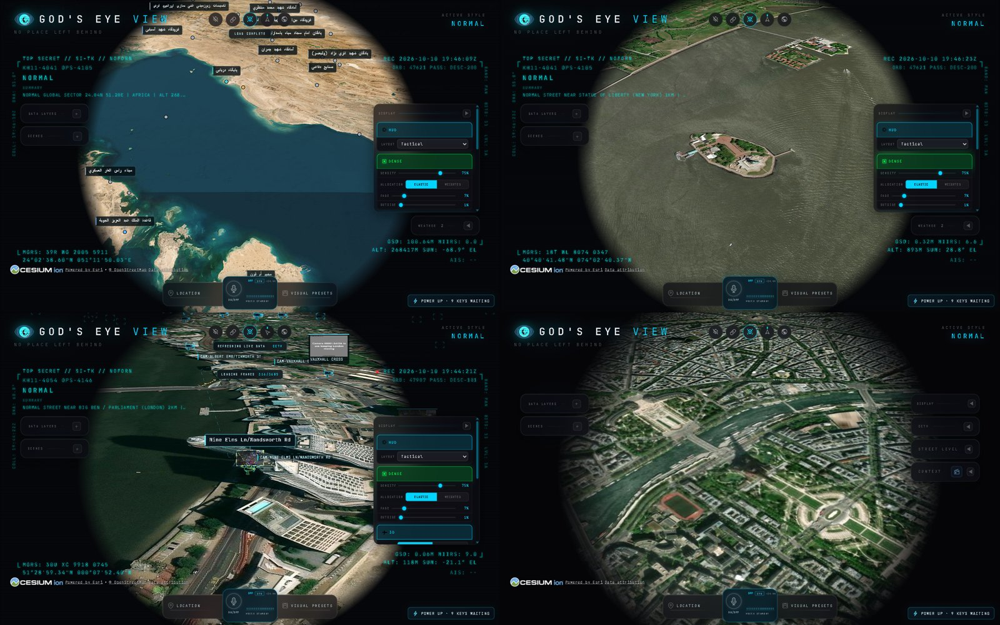
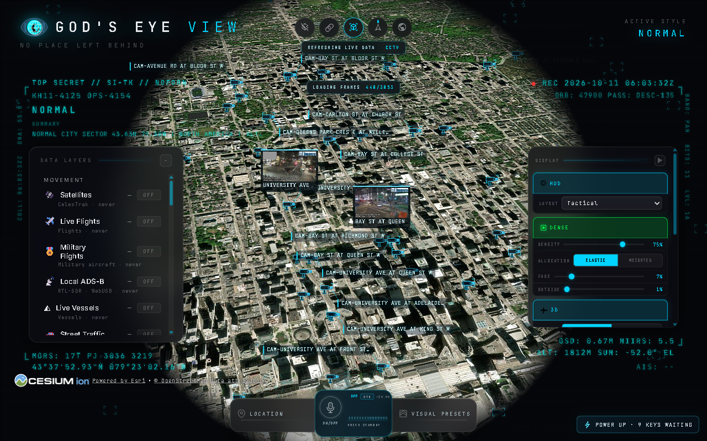

# God's Eye View inside Jarvis

Updated 2026-10-11 IST. [God's Eye View](https://github.com/bilawalsidhu/gods-eye-view) (Bilawal Sidhu, MIT license) was already bundled in `integrations/gods-eye-view-src/gods-eye-view-main`, but it only opened on request and Jarvis never used it. It's now updated, starts with Jarvis, feeds a background thread whose data Jarvis uses in answers and alerts, and Jarvis drives it by voice.

*Live screenshots of the God's Eye page taken by Jarvis's browser during testing (2026-10-11). Views of the user's own area are not included.*

## Update

"Update God's Eye" (and the updater used on 2026-10-11) downloads the newest upstream `main`, swaps the source in place and keeps `node_modules`, `.env`, caches and logs. The previous source goes to a dated `….backup-*` folder, and `npm ci` runs only if the lockfile changed. The swap moves folder contents rather than renaming the folder (an open shell or editor blocks a rename), and it reverses itself if any step fails. The bundled copy went from the 2026-09-24 snapshot to commit `591f299d` (2026-10-10), with dependencies reinstalled (170 packages). The installed commit is recorded in `jarvis-gods-eye.json`.

## How Jarvis drives it

God's Eye runs on its local Vite server (`http://127.0.0.1:4173`), which serves the app's own source modules. Jarvis opens it in its own Chrome window. It then builds an action runner in the page from God's Eye's voice module (`src/voice/gevActions.js`) and the objects the app publishes on `window.__godsEyeView`. These are the same actions God's Eye's paid voice agent calls (`fly_to_location`, `set_layer_visibility`, `set_visual_style`, `set_hud`, `control_cctv`, `annotate_map`, `fly_route`, `frame_overhead`, `control_cockpit`, …), but no OpenAI key is needed, and the God's Eye source isn't modified.

Places are geocoded with OpenStreetMap Nominatim, ranked by importance, so seas, regions and landmarks work ("the Persian Gulf", "Eiffel Tower"); God's Eye's geocoder and Open-Meteo are fallbacks. The camera height fits what you asked for, from a close view of a landmark to about 450 km for a military region or 900 km for weather. Jarvis checks that the camera really arrived and re-flies once at the same height if it didn't. The welcome dialog is dismissed with "Explore manually". A new request turns off the layers Jarvis turned on for the previous one; layers you toggled yourself stay.

| Say | God's Eye does |
| --- | --- |
| "Show me the Eiffel Tower" / "take me to Tokyo" / "show me Paris in satellite view" | Flies there in high-resolution satellite imagery. |
| "Show me New York with the cameras around it" / "show cameras in London" | Flies there, turns on CCTV and focuses the nearest camera (live frames and view cone). |
| "Show flights near me" / "show flights overhead" | Jumps to your location (IP-based), turns on live flights and your local SDR layer. |
| "Show military over the Persian Gulf" / "show military flights near me" | Flies to the region, turns on military flights and mapped installations. |
| "What's the weather doing" / "show rain in Mumbai" / "show cyclones" | Turns on rain radar and lightning (or cyclones and cloud imagery) and keeps the view on that area. |
| "What's the traffic like in London" | Turns on street traffic (needs a TomTom key; see limits). |
| "Show fires / earthquakes / ships / satellites / launches / data centers / dams / submarine cables / bases near X" | Turns on that layer at that place. |
| "Show me the route from Vadodara to Ahmedabad" | Draws the driving route in amber and flies the camera along it. |
| "Switch to thermal / FLIR", "night vision", "noir", "retro", "normal"; "switch to cyber radar" / "tactical" | Visual style or HUD layout. |
| "Update God's Eye" / "God's Eye status" | Updates the app / reads the background cache. |

## Runtime absorption and alerts

Once Jarvis has started, a side thread polls God's Eye's own server every minute for a 25-mile (40 km) radius around you. It also starts the server if it isn't running. Each poll covers:

- **Aircraft** (`/api/flights`): count, the nearest ones, low traffic under 1,500 m, and emergency squawks 7700 (emergency), 7600 (radio failure) and 7500 (hijack).
- **Military aircraft** (`/api/military`, adsb.lol): those nearby and any declaring an emergency.
- **Your local SDR receiver** (`/api/local-receivers/aircraft`), when one is configured.
- **Cyclone tracks** (`/api/cyclones`).
- **Wildfire perimeters** (`/api/fire-perimeters`).
- **Current weather** (`/api/weather-effects`), plus the regional brief and headlines (`/api/regional-brief`).
- **Earthquakes** (USGS, magnitude 2.5+ within 400 km).
- **Whether live traffic is connected.**

The cache is saved to `.jarvis-runtime/gods-eye-cache.json`.

**Alerts** are spoken and shown on the island (amber radar card), once per event every 6 hours:
- an emergency squawk within 40 km;
- a military aircraft declaring an emergency within 120 km;
- a military aircraft below 3,000 m within 15 km;
- a cyclone track within 400 km;
- a wildfire perimeter within 80 km.

**Answers from the cache come first.** "Why is it so loud outside?", "why am I hearing sirens?", "what plane is that overhead?", "any helicopters overhead?" and "what's happening around me?" are answered from this cache, never by a web search. The answer covers low aircraft (callsign, distance, direction and height), military aircraft, emergencies, fires, thunderstorms, nearby earthquakes, or that nothing unusual is around. Every other question and task plan also sees a short God's Eye summary in Jarvis's situation snapshot.

## What needs keys or hardware (honest limits)

God's Eye runs keyless here; its own panel shows "9 keys waiting". Without keys:

- **Photorealistic 3D cities** need a Google Maps key; Jarvis uses God's Eye's keyless Esri satellite imagery instead.
- **Live street traffic** (TomTom) needs a TomTom key; traffic questions say so.
- **NASA FIRMS active fires** need a FIRMS key (`/api/firms` answers 503 without one). Fire perimeters (NIFC WFIGS) work but cover the US only.
- **Cyclone tracks** come from NOAA NHC/CPHC: Atlantic and eastern/central Pacific, not the Indian Ocean.
- **Rain radar:** God's Eye labels its keyless rain-radar product as US coverage; lightning and cloud imagery are separate layers.
- **Local SDR (1090/978 MHz)** needs an RTL-SDR receiver configured in God's Eye; none is set up on this PC, so that layer stays empty.
- **CCTV** depends on God's Eye's camera catalogue (traffic cameras from public agencies, not private CCTV). See "Live cameras: Toronto, Mississauga, Brampton and India" below. ALPR (Flock/Axon) is US-focused.
- **Night vision** is mapped to God's Eye's "surveillance" style; there is no separate NVG style. FLIR/Iron Bow is its "thermal" style.
- Social-video embedding, A/B imagery comparison boxes and director storytelling exist in God's Eye's own UI. Jarvis doesn't drive them by voice yet; Jarvis can draw routes and annotations.

## Live cameras: Toronto, Mississauga, Brampton and India

Updated 2026-10-11 IST. God's Eye's live catalogue covers London, Austin and parts of Texas, California, Calgary, British Columbia, Delaware, New South Wales, Finland, Estonia and Norway. Toronto, Mississauga and Brampton were empty because 511on.ca now requires a developer key for its camera list, so God's Eye's keyless Ontario source fails ("Invalid Key", HTTP 400). There is no India source: Indian traffic and police cameras aren't published as open live feeds.

[`jarvis/gods_eye_cameras.py`](../jarvis/gods_eye_cameras.py) now builds an extra camera pack that God's Eye reads through its own `CCTV_SOURCES_FILE` setting:
- **Toronto (keyless):** City of Toronto open data, 336 intersection cameras. These are still frames refreshed every few minutes; the one tested was 7 minutes old.
- **Ontario 511 (needs your free key):** sign up at 511on.ca, request a developer key and save it as `secrets/ontario511.json` (`{"api_key": "..."}`). This adds the 400-series highway cameras through Toronto, Mississauga (401, 403, 410, QEW) and Brampton (410), using the official API. Jarvis doesn't use 511on.ca's internal map endpoints to get around the key.

The pack lives in `.jarvis-runtime/gods-eye/`, outside God's Eye's source, so "update God's Eye" keeps it. God's Eye's `.env` gets `CCTV_SOURCES_FILE`, plus `CCTV_FORCE_AUSTIN=1` (otherwise a file pack would switch God's Eye's own live packs off), `CCTV_MAX_SOURCES=5000` (its ceiling; 4,000 would trim the others) and `CCTV_ONTARIO_ENABLED=0` (the broken keyless source). Other `.env` lines are kept. The pack is rebuilt daily when God's Eye starts.

| Say | What happens |
| --- | --- |
| "Show traffic cameras in Toronto" / "show cameras in Mississauga" / "find cameras near Brampton" | Flies there, turns on CCTV and focuses the nearest camera with a live frame. |
| "Show all available camera locations around this city" / "open the nearest CCTV camera feed" | Same, at the current view. |
| "Refresh God's Eye cameras" / "add cameras for Mississauga and Brampton" | Rebuilds the pack (with Ontario 511 if the key is saved) and restarts God's Eye's server to load it. |
| "Why can't I see any CCTV in Toronto or India?" | Explains the coverage and how many Toronto and Ontario 511 cameras are loaded. |

Live on 2026-10-11:
- After "refresh God's Eye cameras", God's Eye's catalogue had all 336 Toronto cameras.
- A frame came back through God's Eye's camera proxy (camera `to-8001`, York St at Bremner Blvd, 110 KB JPEG).
- "Show traffic cameras in Toronto" opened downtown Toronto with the camera markers and live frames.
- Brampton and India still have none: Brampton needs the Ontario 511 key, and India has no source.

Keys go in God's Eye's Provider Settings (its own `.env`), never in Jarvis's config.

## Settings (`config/config.json` → `gods_eye`)

| Key | Default | Purpose |
| --- | --- | --- |
| `enabled` | `true` | God's Eye integration and the side thread. |
| `autostart` | `true` | Start the God's Eye server with Jarvis. |
| `radius_km` | `40` | Watch radius (25 miles). |
| `poll_seconds` | `60` | Side-thread interval. |

## Verification (2026-10-11 IST, this PC)

| Check | Result |
| --- | --- |
| Update | 2026-09-24 snapshot → `591f299d` (2026-10-10); `npm ci` added 170 packages; the server started and its APIs answered. |
| Voice actions | Flights, military, military installations and CCTV layers turned on and off; view state read back. |
| "show me the Eiffel Tower" | Satellite view of Paris with the tower's shadow at the centre (screenshot). |
| "show cameras in London" | CCTV on, nearest Transport for London camera focused with its view cone and live frame. |
| "show military over the Persian Gulf" | About 268 km view of the Gulf with mapped installations labelled. Two bugs were fixed first: the geocoder had returned a Los Angeles restaurant named "Persian Gulf", and a re-fly without altitude had dropped the camera to street level. |
| "what's the weather doing" / "show flights near me" | Rain radar and lightning on with a regional view (about 555 km); live flights and the local SDR layer on at about 35 km over your area. |
| "switch to thermal view" | FLIR style applied. |
| "show me the route from Vadodara to Ahmedabad" | Amber driving route "Route to Ahmedabad — 109 km" drawn and flown. |
| Side thread | One poll in about 11 s: location found, aircraft within 40 km (for example an IndiGo flight at 11,270 m, 22.7 km south-east), 105 military aircraft worldwide, none near, 3 Atlantic/Pacific storms far away, calm weather, no TomTom key. |
| "why is it so loud outside" / "why am I hearing sirens" / "what plane is that overhead" | Answered from the cache: nothing unusual / no fires or emergencies and traffic not connected / the nearest flight with its distance and height. |

Regression and readiness (2026-10-11 IST): **1,477 tests ran, all passed with one skip** (`artifacts/logs/gods-eye-regression-2026-10-11.log`), and `python -m jarvis.launcher --check` reported `ready`. `tests/test_gods_eye.py` covers command parsing (and that existing commands are untouched), the aircraft, military, cyclone and weather cache, alert rules and announce-once, local-first answers, action building (layer replacement, styles, routes), the updater's swap, local-state preservation and reinstall, and the island card.

No real alert fired during testing: no emergency squawk, low military aircraft, cyclone or fire was near you. The alert path is covered by unit tests with sample data.
