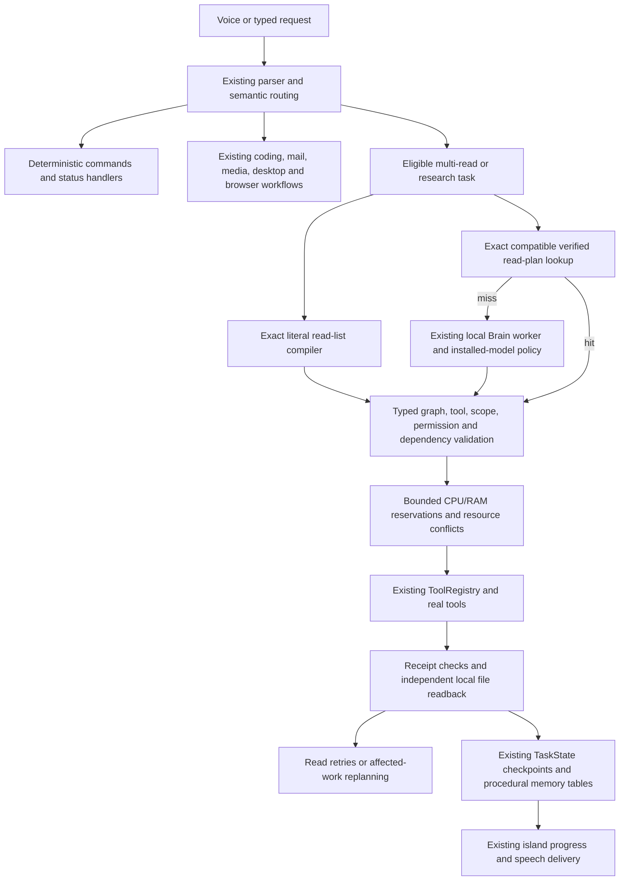

# Hierarchical execution upgrade

## Audit follow-up — 2026-10-15 IST

[Prompt10 evidence](../artifacts/jarvis-audit/modules/10-dag-planning/inventory.md)
tests the real validator, scheduler, cache and TaskState boundaries with isolated
data and fake external effects. Effects serialize within one Executor regardless
of resource labels; reads still overlap when their resources permit it. This is
not a cross-process/global write lock or a new production email DAG adapter.

Restored reads carry a SHA-256 binding over the exact step and resolved arguments
and must pass fresh verification. Legacy rows without a binding run fresh.
Descendants restore only after their prerequisites verify in the current run;
if upstream data changes, dependent results run fresh instead of reusing a stale
summary. An out-of-order descendant may conservatively rerun.
Effectful checkpoints still refuse replay. Production DAG writes require the
current task UUID, with another identity check at tool authorization. Direct
legacy callers may omit the optional `task_id`; they do not receive that guard.
Typed output mismatches prevent downstream dispatch. Oversized/deep JSON is
bounded before serialization. Errors retain exception categories, excluding
payload-bearing exception messages; execution/progress have run UUIDs. Actual
results and graphs stay in local task checkpoints and may contain private data.

Malformed/oversized cached JSON becomes a miss; cache candidates are validated
before reuse. New recognized credential-bearing goals/graphs are omitted from
templates. Existing local rows are not retrospectively scrubbed. Source digests
are reused only while device/inode, size, modification and ctime timestamps
match; reads detect a changing source file. This is metadata invalidation, not a
defense against an actor restoring or forging filesystem metadata. Windows
ctime represents creation time, so it is not an independent content-change log.
Fingerprints also include configured model labels and additional policy/state
source files. Warm reads avoid hashing unchanged source contents; cold calls
cost more. See the paired measurements rather than assuming universal speedups.

Existing capability guards and per-action consent remain authoritative. The
generic compose→approval→send fixture uses fake effects; real mail stays on its
specialized path. Partial progress is retained, not automatically undone.
Cancellation drains owned threads and cannot forcibly stop an uncooperative
backend. Live accounts, GUI consent, GPU pressure, model planning quality and
multi-hour soak acceptance were not performed by the fixture suite.

Updated 2026-10-14 IST on `codex/hierarchical-dag-upgrade`. This is an in-place
upgrade. Existing commands, models, integrations, memories and environments are
retained. The supplied attachment contained requirements, not reference source
code; this implementation follows those requirements using the actual repository.

## Request flow and preservation

The application still starts through `Start Jarvis.cmd`, `jarvis_bootstrap.py`,
`jarvis.launcher` and `main.py`. `Actions` owns command execution; `Brain` retains
its incremental native tool loop. The new path is considered after Gmail/coding
specialization and before desktop observation. Simple commands bypass it.
Battery status and “show CPU usage” use existing `system_info` routing without
LLM inference; quick CPU reporting samples 100 ms and does not scan all processes.
Existing more detailed CPU requests retain their process breakdown.

| Existing system / actual implementation | Reference capability | Integration |
|---|---|---|
| `commands.py`, `phrasing.py`, `intent_catalog.py`, `Actions.submit` | Reflex/semantic routing | Reused; exact read lists compile to graphs without a model. Ambiguous “read my notes” remains unresolved. |
| `brain.py`, `brain_worker.py`, `native_tools.py`, `step_planning.py` | Structured hierarchical planning | Added a local schema-constrained `dag_plan` operation, bounded repair and graph validation. Existing native one-step/Hermes/Harness planners remain available. |
| `task_graph.py` | Dependencies | Preserved legacy sequential validator; new graph validator accepts forward dependencies and detects cycles. |
| `agent_tools.read_batch` | Parallel local reads | Already existed for four independent reads; DAG execution extends this to dependent workflows, typed references and checkpoints. Nested batch tools are not scheduled. |
| `tools.ToolRegistry`, `toolkits.py`, `agent_events.py` | Real tool dispatch and policies | Reused unchanged, including allowlists, deny hooks, scopes, approvals and metadata audit events. |
| `task_state.py`, `task_recovery.py`, `recovery.py`, `task_queue.py` | Durable state, bounded recovery and priorities | Extended TaskState with DAG state; existing action queues/watchdogs/shutdown retained. |
| `model_selection.py`, `ollama_models.py`, `gpu_scheduler.py`, `inference_limits.py` | Model selection and resource admission | Preserved installed configured planner/coder/vision selection, backend checks, leases and deadlines. DAG tool work reserves no GPU; low RAM/high CPU/low battery reduce its concurrency. |
| `hybrid_inference.py`, `cloud_policy.py`, `cloud_quota.py`, `groq_adapter.py` | Cloud routing and budgets | Preserved; DAG planning is local and does not send task/file context to cloud providers. |
| `conversation_memory.py`, `memory_curator.py`, `obsidian_memory.py`, `skill_memory.py`, `experience_memory.py` | Episodic/procedural memory | Preserved. New procedural cache tables extend `conversations.sqlite3`; no memory database is replaced. |
| `coder.py`, `native_coding.py`, `development*.py`, Codex/Claude/Hermes/Harness bridges | Coding/projects/build/test workflows | Remain specialized executors with their existing validation/approval rules. |
| `browser_automation.py`, `ui_controls.py`, `execution_router.py`, `visual_fallback.py`, Windows command adapters | Browser/Windows automation | Remain serialized, freshly observed specialized paths; no stale-control DAG replay. |
| `mcp_bridge.py`, repository skills, utility workers, REA, DeerFlow, God's Eye | Connected/specialized systems | Retained. DAG exposes read-only status/discovery and registered read tools, not unrestricted MCP calls or specialized mutations. |
| `engine.py`, `audio.py`, `whisper_backend.py`, `speech.py`, F5/Piper workers, `island*.py` | Voice, interruption and progress | Existing workers/UI remain independent of task execution; DAG progress uses existing `plan` events. No acoustic regression claim. |
| `intent_handlers.py`, `weather_watch.py`, `anticipation.py`, `self_evolution.py` | Alarms/reminders/status/background work | Preserved existing services, queue priority and idle policies. |

The baseline artifact contains an AST/import/symbol/hash inventory of **517**
first-party Python files under application code, verification scripts and tests.
This is recursive source inventory, not exhaustive live testing of every external
integration. Upstream checkouts, model caches, environments and private runtime
records were not treated as application source or copied into reports.

## What the new executor actually supports

Graphs have 1–40 unique steps and respect the existing configured action budget.
Retry attempts count against admission limits. Each step declares a registered
tool, typed arguments, explicit dependencies, expected result, permission,
resource reservation, timeout and retry policy. Trusted tool metadata determines
read/write classification; model declarations cannot grant permissions.

Validation rejects unknown tools, extra/missing fields, bad types, duplicate IDs,
cycles, absent dependencies, invalid references, impossible reservations and
effect retries before dispatch. Literal arguments pass existing policy/scope
checks during whole-graph admission and again immediately before execution.
Effectful arguments cannot use result references. Result references are typed
objects with explicit dictionary/list lookup paths, never string interpolation,
shell expansion or executable code. Each task owns its results.

Read-only adapters include local reads/search, repository maps/instructions,
skills, Git status/diff/log, registered public web/GitHub reads, memory search,
resource queries and tool/status discovery. `create_file`, `modify_file` and
`append_file` use existing literal user-text and destination checks. File writes
serialize against file reads/writes. Inferred deletes, arbitrary terminal commands,
UI clicks and unrestricted MCP calls stay outside this path. Missing configuration
or capabilities fail rather than simulate success.

Independent reads overlap in a task-owned thread pool (default three, maximum
four). This fits existing synchronous transports without introducing another
runtime service. Reservations are admission estimates, not OS memory limits:
CPU budget four, RAM budget 256 MiB, GPU budget zero for tool work. Model inference
still uses the existing GPU lease mechanism and F5 headroom. Low available RAM,
high measured CPU load or unplugged battery below 20% reduces concurrency to one.

Verification checks response shape/error status. Local reads compare fresh file
contents; local writes retain existing independent readback and add a fresh
content check. Web/Git results are transport/shape-checked reference material;
this does not establish factual truth, completeness, relevance or semantic goal
completion. The response states this distinction. A generated plan can still
omit requested work even when it is structurally valid.

Summary, analysis, comparison, explanation and research requests pass bounded
task observations to the existing registered local `think` tool after verified
execution. This preserves semantic response generation instead of claiming that
raw retrieved data is an analysis. The solver receives the complete goal and a
valid JSON context of explicitly excerpted observations, with no external-action
tools. Existing deny hooks and allowed-tool scopes still apply. This costs one
additional model call/action and can be slow or inaccurate; it is not independent
factual verification. Plain read/report tasks return verified contents directly.

Transient read failures get bounded retries with exponential backoff. A failed
read-only graph may receive one affected-work replan, retaining successful
observations and rejecting repeated completed tool/argument identities. Any
effectful graph failure pauses instead of replanning around uncertain effects.
There is no promised rollback for irreversible operations.

Deadlines request cooperative cancellation and drain owned workers before
returning. Python threads cannot forcibly terminate an uncooperative adapter;
existing backend timeouts remain the hard outer bounds. Stop can therefore wait
for a backend's bounded timeout. No worker is abandoned and no timed-out effect
is retried. No early actions run from an incomplete model plan.

## Checkpoints, caching and rollback

`TaskState.update_dag` writes the graph, statuses, attempts, verified results and
timings into the existing atomically replaced task record. A running effect is
persisted before dispatch. Restart marks the task interrupted. Explicit resume
may reuse a matching read-only graph; completed local file reads are revalidated
against current contents, and other observations run fresh. Any prior DAG effect,
including a completed write, blocks automatic replay and asks for inspection.
Temporary outputs are task state, separate from reusable procedural templates.

`dag_macros` stores only successful read-only graph templates for exact trimmed
goals. It retains at most 64 entries with a one-day validity window, hit/success
counts, and a fingerprint covering schemas, trusted metadata, code versions,
feature settings and file/project scope. Every reused graph is revalidated and
executed with fresh arguments/policy checks; results are never an answer cache.
Similarity scores do not authorize execution. No effectful macro is cached.

LangGraph was assessed against the existing TaskState/queue/watchdog requirements.
The standard-library scheduler and existing persistent state provide these bounded
transitions without a second orchestration framework. LangGraph was not installed
or benchmarked; there is no comparative framework performance claim.

In [config.json](../config/config.json), set
`brain.hierarchical_execution.enabled` to **false**, then restart Jarvis to restore
the original planner path. `parallel_reads: false` runs this path serially;
`macro_cache: false` disables template lookup/storage. `max_repairs` and
`max_replans` accept 0–2. No files, memories, models or environments need removal.
The launchers validate these settings. The change is isolated on the upgrade
branch; earlier uncommitted voice/conversation work was preserved.

## File-level changes

| File | Purpose |
|---|---|
| [dag_execution.py](../jarvis/dag_execution.py), [hierarchical.py](../jarvis/hierarchical.py) | Typed graph model/validator, bounded scheduler, real adapters, template cache and compatibility routing. |
| [brain.py](../jarvis/brain.py), [brain_worker.py](../jarvis/brain_worker.py) | Eligible task routing and existing-worker schema planning/deadline integration. |
| [task_state.py](../jarvis/task_state.py), [launcher.py](../jarvis/launcher.py) | Atomic DAG checkpoints, safe restart blockers and configuration admission. |
| [intent_catalog.py](../jarvis/intent_catalog.py), [intent_handlers.py](../jarvis/intent_handlers.py) | Deterministic battery and quick CPU status. |
| [config.json](../config/config.json), [runtime_manifest.json](../config/runtime_manifest.json) | Feature flags, declared modules, scope and rollback. |
| [test_hierarchical.py](../tests/test_hierarchical.py) | Safety, concurrency, references, real-file integration, fault recovery, cache/restart and thread cleanup tests. |
| [verify_hierarchical.py](../scripts/verification/verify_hierarchical.py), [verify_hierarchical_live.py](../scripts/verification/verify_hierarchical_live.py) | Original/upgraded measurements and actual installed-planner/file execution check. |
| Application/root README, documentation index and this guide | Architecture, preservation, evidence, limitations and rollback. |

No application source was removed, no Python dependency added, and no new
always-running service installed. Existing environments, credentials, recordings,
model downloads and memories were preserved.

## Research sources

Firecrawl retrieved the primary [ReWOO paper](https://arxiv.org/abs/2305.18323),
[Python task/concurrency documentation](https://docs.python.org/3/library/asyncio-task.html),
[LangGraph persistence documentation](https://docs.langchain.com/oss/python/langgraph/persistence),
and [Ollama structured outputs](https://docs.ollama.com/capabilities/structured-outputs).
The latter distinguishes supported local schema decoding from unsupported cloud
structured outputs. This adapter uses the existing local Ollama interface; it
does not assume all cloud providers support the same API. Constrained output still
requires deterministic validation. No fetched executable code was installed.

See [benchmark and validation report](hierarchical-benchmarks.md) for dated results
and production limits.
