# Parallel Code Intelligence & Design Engine (PCIDE)

Candidate implemented 2026-10-24 IST on `claude/parallel-code-intelligence`. It upgrades the **existing** coding stack:

- the native Jarvis/Qwen worker through `codex_workload`;
- the shared `coding_context` guidance;
- `RepoLearner`'s GitHub session;
- the durable task queue;
- project intelligence;
- the Mind view.

It adds memory-first reuse, parallel research, guarded external code, concrete design specifications, rendered visual QA and verified code memory. It is not a new coding agent, scheduler, memory authority or approval path, and it makes no model calls of its own. Full release acceptance remains open (see [Verification](#dated-verification-2026-10-24-ist)).

**Cloud model (Groq):** the audit found Groq wired only to public standalone questions. The coding backend is native Jarvis/Qwen (`brain.coding_backend: jarvis`), no coding module calls the Groq gateway, and the only coding-related cloud path (`cloud_architect`) is disabled in config. As instructed, **the cloud model was not changed**.

## Audit: what existed and what changed

| Need | Existing component | Gap | Change |
|---|---|---|---|
| Public repository research | `RepoLearner` (GitHub search, license/commit pinning, symbol extraction, vault notes) | Ran **synchronously, up to 240 s, before** every `code_task`; summarization uses the LLM | With PCIDE on, only saved knowledge is read before coding. Online research is a queued task on a new research lane, using RepoLearner's HTTP session without the LLM step |
| Guidance to coders | `agent_context.coding_context()` (read by `coder`, `codex_workload`, `native_coding`) | No component memory, no project-symbol reuse, no design tokens | New `code_intelligence` field: validated candidates, dependency policy, design spec |
| Mid-task information | Native worker turn loop | None | Newly validated candidates are appended **between tool turns** as data |
| Verified results | `codex_workload` `receipt.json` (`status`, `validation.passed`, `changed`) | Never turned into reusable knowledge | `after_coding` promotes test-covered components with evidence |
| Design | `development_design.specification` (one fixed palette) | No style translation, no reuse of an existing design system | `design_intel.VisualDesignResearchManager` |
| Browser checks | `codex_browser_check` (Playwright via `channel='chrome'`) | No multi-viewport, contrast, focus, reduced-motion or baseline gate | `DesignQualityGate` (same Chrome channel) |
| Scheduler | Durable queue with fast/background/question/legacy lanes | No lane for long network research | `research` lane, its own worker thread and `code-research` lock |

## Flow

```mermaid
flowchart LR
    U[Coding request or project plan] --> P[prepare: plan intents]
    P --> L[Local now: project symbols + verified memory]
    P -->|queued| R[research lane task code_research]
    L --> G[coding_context guidance]
    G --> C[Existing coder / Qwen workers start immediately]
    R --> S[Code + UI research workers, bounded pool]
    S --> V[Guard: license, static scan, install scripts, dependency policy]
    V --> K[Ranker + UI selector]
    K --> B[ResearchBroker: durable candidates + events]
    B -->|between tool turns| C
    C --> X[receipt.json: checks passed]
    X --> M[VerifiedCodeMemory: project-scoped PROJECT_VERIFIED]
    M -->|user: save for future projects| RU[global REUSABLE]
```



1. **Search planning** (`CodeSearchPlanner`). The requirement is split into feature phrases. Each phrase maps to specific UI concepts (navigation, chart, card, table, form, dialog; animation and theme are modifiers) and to behavior concepts (telemetry, search, realtime, persistence, files, scheduling, parsing). Behavior concepts expand to the **smallest fitting strategy set**: for example, "fast file search" yields SQLite FTS5 and BM25, and vector search only when the request mentions semantic or similar matching. Queries are deduplicated and capped by budget, and use GitHub qualifiers (`stars:>=20 archived:false language:…`).
2. **Memory-first lookup** (`ResearchRunner.local`). It searches the current project's symbol index (Python AST; JS/TS patterns; cached by mtime), then the verified code library, using BM25 plus exact name/symbol hits, coverage and reliability. Visible scopes are global plus the current project's own; another project's private code is never returned unless you ask for it.
3. **Parallel research** (`ResearchRunner.external`) runs on the queue's **research lane**, alongside the coding worker. Coding never waits for it.
   - GitHub searches and repository inspection use a bounded thread pool, with no LLM.
   - Each repository is read at a **pinned commit**: metadata, the license file, the tree, and the most relevant source files plus `package.json`. Every candidate keeps its source URL, commit and blob links.
   - UI research starts from a discovery catalog (shadcn/ui, Magic UI, React Bits, Motion, Aceternity UI, 21st.dev). **Licenses are never assumed:** they are read from the repository at research time. Sites without a public repository are recorded as *reference only*, with per-component terms to be checked on the site.
   - Budgets: queries 4, repositories 6, files 20, 3 MB, 90 s, concurrency 3, 0 LLM calls.
   - Responses are cached for 7 days.
   - A network failure or GitHub rate limit stops further requests and records the reason. Local results remain available.
4. **Guard** (`ExternalCodeIntegrationGuard`). Hard gates:
   - **License:** copying requires a permissive SPDX license (MIT, Apache-2.0, BSD-2/3, ISC, 0BSD, Zlib, Unlicense, CC0) **and** a license file. Missing, ambiguous, copyleft and other licenses mean reference only.
   - **Install scripts** (`preinstall`/`install`/`postinstall`/`prepare`) are never run and reject the candidate.
   - **Credential-like values** and **obfuscated payloads** reject the candidate.
   - **Wrong framework** rejects the candidate.
   - **Project dependency policy**, derived from explicit project requirements: "no external animation library" rejects Motion/GSAP/react-spring and similar; "offline" rejects network clients and network access; "no new dependencies" rejects anything not already present.

   Dynamic execution, process spawning, network access, file writes, telemetry and embedded instructions are recorded as findings. Retrieved text is data, never instructions. Security advisories are reported as **not checked**, since there is no offline advisory database.
5. **Ranking** (`CodeCandidateRanker`). It runs after the hard gates: `0.25·FunctionalFit + 0.20·Compatibility + 0.15·Verification + 0.15·Maintainability + 0.10·Performance + 0.10·IntegrationEase + 0.05·Context`. For UI candidates it adds visual consistency, accessibility and motion quality (whether reduced motion is supported, and whether animations use transforms or layout properties). Reference-only candidates are discounted. The weights are illustrative heuristics. Stars and appearance are not evidence of correctness.
6. **Handoff** (`ResearchBroker`, SQLite). Research tasks and candidates are durable, and consumers wake on a condition variable instead of polling the web.
   - Candidate states: `FOUND → VALIDATED/REJECTED → DELIVERED → ADOPTED/DECLINED/DISCARDED`.
   - Research tasks from an older project spec version become `OBSOLETE` and their candidates `DISCARDED`. Cancellation discards them too, and late arrivals are ignored.
   - The native worker receives new candidates once, between tool turns, labelled "use only if they improve unfinished work, keep checked code". **Research never edits files.** The coder keeps file ownership, and working checked code is not replaced because a newer candidate appeared.
7. **Promotion** (`after_coding`). After a coding run, Jarvis reads its `receipt.json`/`result.json`. Only when status is passed **and** validation passed does it consider changed source files (40 KB or less) whose symbols are exercised by the run's passing tests.
   - Qualifying files become **project-scoped** memory items, moving `INSPECTED → LICENSE_CHECKED → COMPATIBLE → SANDBOX_TESTED → PROJECT_VERIFIED`. Each step records evidence.
   - Delivered memory candidates whose symbols appear in the verified changed files get a recorded successful use.
   - Untested files are not promoted, and credential-like content is refused.
8. **Global reuse** happens only when you say "save this component for future projects". That makes a global `REUSABLE` copy and a `Jarvis Code Library/` vault note, which feeds the existing Obsidian/OpenViking retrieval; the SQLite library stays authoritative.
9. **Cross-project reuse.** "Use something similar in my other project" offers the current project's verified components to the named project, with no new external research. Each component is checked against the target's framework and policy, then adapted and re-tested there.
10. **Staleness.** A recorded major dependency version that differs from the target project's marks the item `STALE`. States are forward-only on evidence; `STALE` and `REJECTED` can be reached from any state, and stale items must be re-verified in a project before they can be reused.

## Design specification and quality gate

- **Design direction.** `VisualDesignResearchManager` maps style words to one direction (futuristic/HUD, premium/SaaS, playful, minimal). Each direction comes with:
  - an explicit palette, typography scale and numeric font;
  - radii, an elevation rule, spacing and breakpoints;
  - interaction states;
  - motion tokens (durations, easing, spring; transform/opacity only; reduced-motion behavior);
  - WCAG AA rules;
  - **restraint rules**. For example, futuristic means one interactive accent, monospace live values, and glow only on the active element.

  An explicit avoid list bans generic purple-blue gradients, identical cards, glassmorphism everywhere and random glow. If the project already has CSS tokens, those values are reused and extended.
- **Component choice.** `UIComponentSelector` prefers the project's own design system and discounts candidates from unrelated libraries, so the result stays one coherent system.
- **Static checks** (`DesignQualityGate.static`) look for:
  - animations without a reduced-motion path;
  - animated layout properties;
  - several infinite animations;
  - focus outlines removed without `:focus-visible`;
  - placeholder content;
  - unlabelled icon buttons;
  - leftover `console.log`;
  - too many hard-coded colours;
  - token contrast below 4.5:1.
- **Render checks** (`DesignQualityGate.render`). Headless Chrome (the same channel as Jarvis's existing checks; bundled Chromium as fallback) loads the entry in three viewports: desktop (light and dark), tablet and mobile. It records:
  - console and page errors, and failed requests;
  - horizontal overflow, computed text contrast and clipped text;
  - accessible names;
  - keyboard Tab focus visibility;
  - animations still running with reduced motion requested;
  - layout-shift;
  - full-page screenshots.

  Baseline comparison is **advisory** (changed-pixel fraction); screenshots alone are not proof of quality.
- **Project intelligence integration.** Software projects with a UI get a **Design quality review** step after tests. Its defects become at most `max_design_iterations` (default 2) **targeted fix tasks** ("fix only these verified defects, keeping approved design decisions and functionality") followed by a re-check. Interface requirements' acceptance results cite the render status. A desktop Tk app has no HTML entry, so its render is **NOT_RUN** and only static checks apply; this is reported, not passed.

## Project intelligence and requirement changes

- **Research timing.** One research pass per spec version is admitted when the plan is made, so it runs while setup and other tasks proceed.
- **Requirement changes.** A new requirement version marks older research obsolete and starts a targeted new pass. For example, "make the dock more animated" refines the existing dock requirement ("A floating navigation dock — make the dock more animated") instead of replacing it.
- **Dependency policy.** "Actually, don't use any external animation library" becomes an explicit constraint. PCIDE's policy then rejects animation-library candidates, and the existing project-intelligence conformance review runs.
- **Modify fix.** When a change mentions something that both the objective and a specific requirement contain, project intelligence now updates the specific requirement instead of asking which one you meant.

## Commands

| Say | Effect |
|---|---|
| "Use an existing component for this", "Search your memory before writing new code" | Memory-first preference (the default), persisted |
| "Find a better animated navbar", "Find examples of this animation", "Check GitHub for an implementation of …", "Use the best compatible open-source library" | Targeted research for the active project (local now, online on the research lane) |
| "Don't add unnecessary dependencies" | Project constraint (project intelligence), which also sets the PCIDE dependency policy |
| "Show me which code you reused", "Where did you find this component?", "Verify the license", "Compare these two implementations" | Answers from recorded candidates and memory: origin, commit, license gate, dependencies, history |
| "Save this verified component for future projects" | Project-verified → global REUSABLE |
| "Show the code library", "Disable / enable / remove X from the code library" | Inspect and control the library |
| "Improve the design but keep the existing functionality", "Run a design check" | Rendered design QA for the active project |
| "Use something similar in my other project" | Offer verified components to the other registered project without new external research |

These patterns require a code or UI noun ("find a better restaurant" is unaffected). The 800-scenario phrasing testbook still passes.

The **Mind** view's code-intelligence strip shows the research state, usable/rejected counts, the best candidate with its license status, and library size. Progress phases go through the existing coding status line. Raw search results are never listed.

## Configuration and rollback

```json
"pcide": {
  "enabled": true, "online_research": true, "visual_qa": true, "max_design_iterations": 2, "cache_days": 7,
  "research_budget": {"queries": 4, "repositories": 6, "files": 20, "bytes": 3000000, "seconds": 90, "concurrency": 3}
}
```

- Storage: `.jarvis-runtime/code-memory/library.sqlite3` (plus permitted source copies), `.jarvis-runtime/code-intel.sqlite3` (research, candidates, cache, metrics), and `.jarvis-runtime/pcide-preferences.json`.
- Unauthenticated GitHub API calls are limited per IP; configure RepoLearner's GitHub token to raise the limit.
- No package, model, driver or browser was installed.
- **Rollback:** set `pcide.enabled` to `false`. The previous synchronous `repo_learner.prepare` path returns, and nothing else changes.

## Dynamic Island input and choice cards (same change)

- **Typed commands:** Enter, the send button, Ask, Do task and Ask screen now **clear the box after sending**. Up/Down recall your last 50 commands. Preview is a dry-run and keeps its text.
- **Choice cards** disappear once answered, by click **or by voice**. Previously they could stay because several sources stay pending by design; YouTube results, for instance, are kept for "play the next one". `island_choices.dismiss` records the answered card's token: a click dismisses it after its choice resolves, a spoken list pick in `_resolve_reply` dismisses it, and so does a YouTube `play_result`. Control choices dismiss only after their live-window revalidation. The underlying context stays, and a fresh list gets a new token, so it shows again.
- **Card motion:** cards enter as a staggered ease-out slide (45 ms apart, about 150 ms each), with an accent edge that lights on hover. On selection the chosen option shows ✓, the others slide away, the chosen one follows, and a fading "Selected · …" confirms the choice. A voice answer or expiry collapses the card with "Answered." A double click is ignored, and any superseded animation stops at its next frame.

## Dated verification (2026-10-24 IST)

[Evidence index](../artifacts/code-intelligence/README.md).

- `tests/test_pcide.py` (18 tests). The GitHub HTTP layer is a recorded fixture. Rendering uses headless Chrome on real fixture pages. They cover:
  - memory states, dedupe, license-gated storage, project privacy, secret refusal and staleness;
  - the symbol index and project facts;
  - the planner choosing a minimal strategy;
  - guard hard gates, including injected instructions and install scripts;
  - ranker gates;
  - memory-first preparation without network, research on the research lane while a coding task is RUNNING, the event-driven wait and one-time handoff with pinned-commit evidence;
  - cache, budgets, network failure, rate-limit stop, dependency policy and missing license;
  - cancellation, obsolescence, worker crash and restart persistence;
  - concrete design specs and token reuse, design-system coherence, and a passing page against a defective page (overflow, contrast, label, console, reduced motion);
  - promotion only from a passing receipt with tests, then save → reusable;
  - second-project reuse with zero new requests;
  - research per spec version, refinement and policy through project intelligence;
  - natural-language routing;
  - repeat research passes.
- Island tests (5 new in `tests/test_island_desk.py`): click confirm-and-leave without the card returning; a voice answer dismisses with animation; a fresh list shows again; the YouTube card goes while results remain; the typed box clears and Up/Down recall works.
- Focused regression across coding backends, queue, project, awareness, intent testbook, Island and media: **617 passed / 14 gated skips** ([receipt](../artifacts/code-intelligence/focused-regression.txt)).
- The first complete run had **3 failures**, from robustness defects in the new Island input and choice-dismissal code (stub apps, Mock attributes, sparse Actions objects). All three were fixed.
- Complete suite on the final code: **4,291 passed / 150 gated skips / 0 failures** in 19 m 25 s ([receipt](../artifacts/code-intelligence/full-regression.txt)). Launcher **ready** ([receipt](../artifacts/code-intelligence/launcher-check.txt)).

[Benchmark](../artifacts/code-intelligence/benchmark.json) (`python scripts/pcide_benchmark.py --live`; recorded GitHub fixtures with 120 ms simulated request latency, owned temporary state):

| Measurement | Result |
|---|---|
| Memory-first `prepare` (500-item library, 302-file project), median / first | 362 / 517 ms (an earlier version measured 1,257 ms median; fixed by reading source only for returned results and walking the project once) |
| Research wall time, concurrency 1 → 3 | 2.98 → 1.44 s (about 2× from parallel search and inspection) |
| Cached repeat | 0.17 s |
| Coding start delay, before → after | ≈1.44 s (synchronous research, same simulated network) → 0.26 s (local lookup only). The real previous path could wait up to its 240 s budget, including LLM summarization |
| Design gate on a fixture page (6 renders, 4 screenshots) | PASS in 4.2 s |
| Model calls by PCIDE | 0 |
| **Live GitHub research** | **BLOCKED.** The unauthenticated core API rate limit for this IP was exhausted (HTTP 403, 0 remaining). The engine stopped after the first rate-limited responses and recorded the reason. No live candidate quality is claimed |

## Limitations and open gates

- **Not exercised:** the real Qwen coding agent consuming candidates and design specs, live GitHub/UI-site research (rate-limited here), real React/Vite projects building and rendering, real npm installs, and an overnight run.
- **Fixed defects:** two real defects were found and fixed during this work — duplicate candidate IDs across research passes, and memory-first latency.
- **Mid-task handoff:** wired into the native worker's turn loop, but only tested at the broker/engine level. A live coding session receiving a candidate has not been observed.
- **Security:** checks are static. There is no vulnerability database, and nothing is executed from candidates.
- **Ranking:** heuristic weights, not calibrated.
- **Design QA:** rendered checks need an HTML entry (`index.html`, `dist/`, `build/`, `public/`, `src/`) or a URL. Desktop Tk/Qt apps get static checks only (render NOT_RUN). Visual quality beyond measurable checks is not judged.
- **Not used:** Tree-sitter and embeddings are not installed, so symbol extraction uses Python AST and JS/TS patterns. Semantic retrieval of saved components goes through the existing vault/OpenViking notes.
- **Island animations** are tested for behavior in Tk; their smoothness has not been checked live on screen, and no screenshot was taken.
