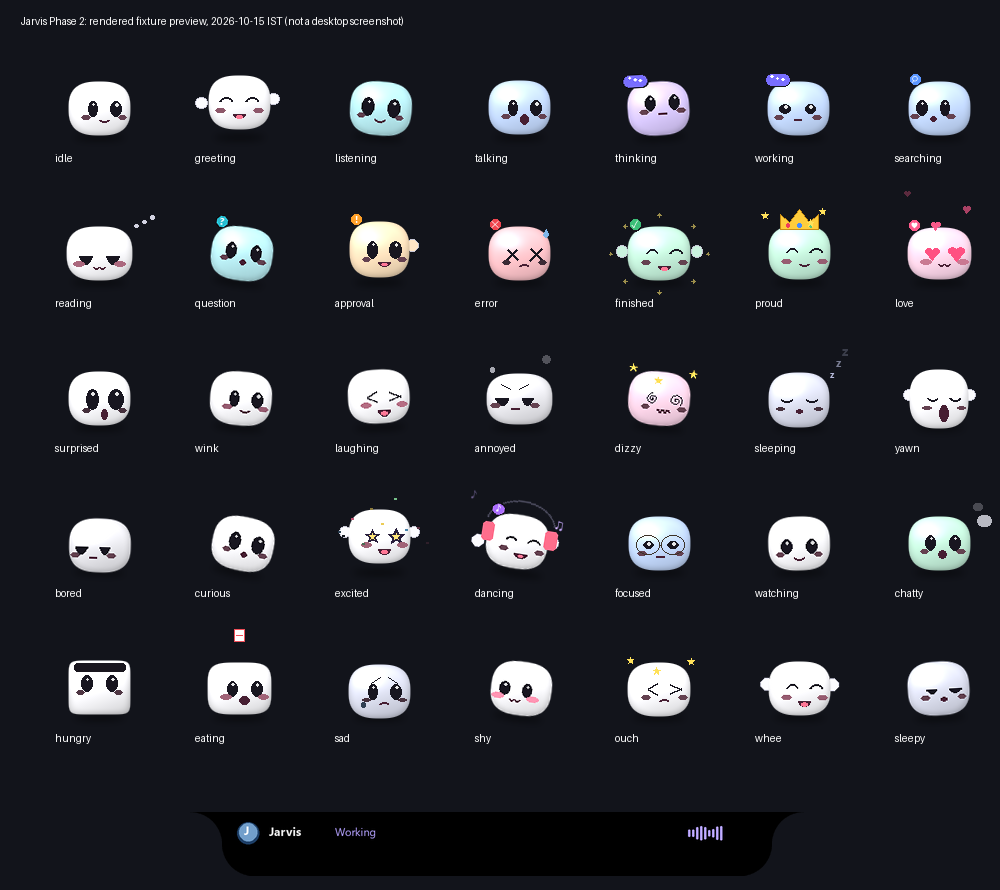

# GPU, models, voice and UI upgrade — 2026-10-15 IST

The [verification report](../artifacts/phase2_gpu_voice_verified.md) separates
fixture proofs, live local synthesis/model checks, sampled VRAM and unmet targets.
The release does **not** meet the requested 500 ms F5 first-audio target.

## Runtime changes

- New owned Ollama servers inherit Flash Attention, `q8_0` KV cache, at most two
  loaded models, one parallel request per model and a 4096 default context. An
  existing shared server is not restarted or reconfigured by changing a client
  environment. Launcher children and `ensure_server` use the same settings.
- Native Ollama requests have explicit context limits: 4096 for normal models,
  1024 for `qwen2.5:0.5b` and `qwen3.5:0.8b`. The old forced 16K minimum is removed.
  `gpu_scheduler.context_limit` and `helper_context_limit` can raise those limits
  when longer tasks require them; larger contexts reduce GPU admission. Shorter
  contexts may truncate long prompts at the provider; no accuracy improvement is
  claimed from a smaller context. Legacy `/v1` aliases retain their Modelfile
  context and fail admission if their estimated footprint does not fit.
- `gpu_scheduler.vram_ceiling_mb` defaults to 3850 MiB. Existing headroom and the
  effective F5 speech reserve still apply. Helpers normally run on CPU; queued
  Ollama ordering remains planner > coding > question > cleanup. Cache handoffs
  unload only an identified Jarvis cache, never an arbitrary shared model.
- F5 and CUDA Whisper participate in the process-shared lease queue for loading
  and inference, with speech and recognition above Ollama turns. Lazy Whisper
  decoding remains inside its lease. Queued recognition cancellation observes
  Stop. Active native kernels cannot be forcibly preempted. Estimated admission
  and sampled VRAM do not guarantee allocator peaks or prevent allocations by
  other applications after observation.
- Workers remain warm during their owned sessions. Capture and F5/Kokoro playback
  use bounded `multiprocessing.shared_memory` PCM pools with explicit cleanup and
  backpressure. Metadata/locks remain in each owning process; these are not an
  untrusted cross-process PCM protocol. Generated audio already avoided temporary
  WAV files; the configured F5 reference WAV remains required. Playback uses 20 ms
  blocks with bounded copies and locking, not zero-overhead callbacks.
- Existing CPU Silero VAD gates recognition; silence tests allow only intentional
  CUDA warmup. F5 expands English numbers, currencies, identifiers, paths and
  selected math symbols in speech text only. This is text expansion, not a new
  phoneme model or a CJK pronunciation guarantee. Opening text can use a 6–8-word
  clause or eight words with lookahead; remaining text is retained.
- A failed F5/Kokoro sentence can select the next installed backend only when the
  worker confirms no PCM was committed and the parent observed no commitment.
  After audible/uncertain output, the transcript remains and the sentence is not
  replayed. Cold fallback startup is not instantaneous.
- Push-to-Write checks `SendInput` counts, forwards physical Alt-up when masking
  fails, invalidates stale hold timers and clears internal state at Stop. Live
  Notepad/VS Code modifier-state verification remains separate from injected faults.
- UI snapshots coalesce before a roughly 60 Hz (16 ms) drain; each drain has a
  cooperative 6 ms batch budget. Final, cancel, approval and media events retain
  ordering. Mind refresh retains its 10 Hz cadence and displays bounded DAG node
  states without waiting on cognition/checkpoint locks. This does not certify
  60 on-screen FPS or bound the duration of one Tk callback.

No new packages or long-running services were added. Existing launchers, owned
workers, silent recovery and intentional microphone/Stop semantics are retained.

## Verification commands

Run from `app/` with the main environment:

```powershell
.venv/Scripts/python.exe -m pytest tests/test_phase2_gpu_models_voice_ui.py
.venv/Scripts/python.exe -m scripts.verification.phase2_gpu_voice_probe
$env:JARVIS_PHASE2_EVIDENCE = 'artifacts/phase2-live-evidence.json'
.venv/Scripts/python.exe -m pytest tests/test_phase2_gpu_models_voice_ui.py
.venv/Scripts/python.exe -m jarvis.launcher --check
```

The default suite explicitly skips live gates. Supplying live evidence evaluates
acceptance gates and deliberately fails unmet targets. The live runner uses
synthetic text/PCM, existing weights, offline Hugging Face loading, and no cloud
inference or microphone capture. It starts Ollama only if unavailable, disables
cloud/pruning for that owned server, preserves the normal model store, and stops
only its own server. It does not install models or test account actions. On this
host sandbox sockets fail with WinError 10013; live Ollama and existing WinRT
fixture subprocesses required execution outside that restriction.

The [sampled trace](../artifacts/phase2-vram-trace.csv) is device usage, not framework
allocator instrumentation. Synthetic Whisper silence is not a continuous human
voice recording. Full acoustic overlap, native hung-kernel recovery, live editor
hotkeys and on-screen UI acceptance remain open.

## Rendered preview



This uses existing Pip/island renderers and does not change the artwork. Source
and reference attribution remain in the [Pip guide](file-buddy.md) and
[island guide](dynamic-island.md).

## Compatibility and rollback

Use normal Stop/Start launchers to load changes after reviewing readiness. No
running Jarvis desktop session was restarted by these checks. Revert only Phase 2
edits and new module imports together, preserving unrelated workspace changes.
Revert `audio.py`/`kokoro_speech.py` with `pcm_ring.py`; reverting a consumer alone
leaves incompatible buffer metadata. No user files, weights, recordings or
credentials need deletion. Historical audits retain their original source scope.
