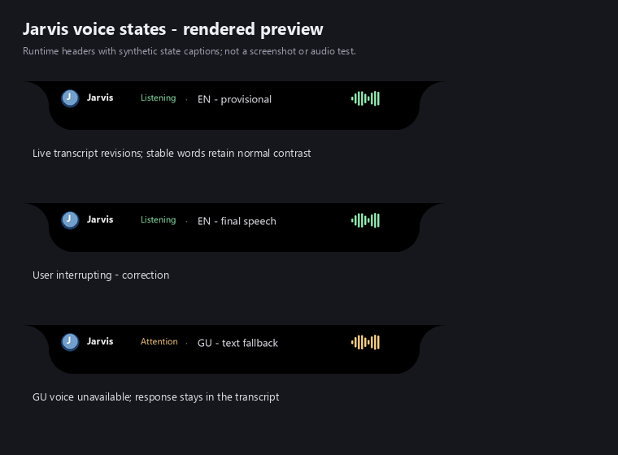

# Incremental voice upgrade — 2026-10-23 IST

Implementation candidate on `codex/realtime-multilingual-voice`; **full release acceptance remains open**. [Pre-change architecture](realtime-voice-baseline.md) and [cumulative acceptance handoff](CLAUDE_HANDOFF.md) distinguish implemented policies from acoustic validation.

## Architecture and behavior

The existing microphone callback, shared PCM pool, Silero consumer, one Whisper decoder, Engine, Actions/Knowledge generations, speech workers, Dynamic Island and Pip remain in place. No dependency, driver, cloud audio service or competing conversation manager was added. Two optional local ASR models were downloaded only after separate user approvals; neither replaced the configured English ASR because Gujarati acceptance failed.

- Capture defaults to 32 ms frames. The existing PCM queue is bounded to 100 frames; its shared PCM pool remains bounded. Overflow stops listening rather than executing stale work. Existing watchdog/recovery respects deliberate microphone stops. VAD retains approximately its previous 10 Hz evaluation rate to avoid tripling inference cost with smaller frames.
- Existing overlapping 20 s Whisper windows with 4 s overlap remain **rolling-window inference, not native streaming ASR**. Partials coalesce in the existing bounded decode queue; finals/window boundaries remain ordered. A 120 s utterance limit stops unbounded noise/speech instead of committing an arbitrary command. Existing push-to-write finalization remains separate.
- `voice_transcript` events carry session/utterance IDs, monotonic timestamps, revision numbers, PROVISIONAL/STABLE/FINAL state, original text, a common-prefix replacement offset/suffix and stable prefix. Stability means agreement between adjacent hypotheses; it can still be corrected. Only FINAL speech authorizes effects.
- All Engine effects, including opening apps, now wait for final speech. Stable partials prepare only a local command category, without network/model/tool calls or privacy bypass. Existing final-command cleanup, planner, connectors, approvals and effect checks still own execution.
- Endpoint modes are fast (0.5 s), balanced (configured silence, normally 0.8 s) and careful (1.4 s). Unstable speech waits at least 1.1 s; trailing conjunctions/hesitation and writing wait at least 1.8 s. This bounded heuristic cannot infer every intended mid-sentence pause. It does not promise that arbitrary long hesitations stay one command.
- `voice.full_duplex` adds committed no-wake interruptions in explicit **headphone mode** while the existing Engine is awake. Capture already runs during inference/playback. Speaker mode retains wake-word gating and textual echo rejection. There is **no acoustic AEC, verified double-talk separation or playback-reference noise cancellation**. Do not claim loudspeaker full-duplex acceptance.
- STOP/PAUSE silence output and cancel answer generation; CANCEL/CORRECTION/REPLACEMENT also use existing cooperative Actions cancellation. FOLLOW-UP/CONTINUATION retain tool work and conversation history. RESUME repeats the last available response text from its beginning, without replaying tools; exact sample-position pause/resume is not implemented. Irreversible effects are neither reversed nor automatically retried. Native calls stop only at their existing cancellation boundaries.
- Worker response generations fence producer events and queued UI responses. Canceled intent classification cannot submit its result after its generation changes. Response stream snapshots retain coalescing and replacement barriers. This does not forcibly abort already-running native kernels or remote providers.
- Lightweight scripts/romanized markers and ASR language/probability support en/hi/gu/fr metadata. Configurable confidence and consecutive-vote hysteresis retain ambiguous context. Whole-command multilingual opening aliases use the existing `open` schema; complex mixed speech follows the existing final router with its original transcript. Script/intent fixtures are not proof of acoustic accuracy.
- Persistent response preferences add Gujarati/French to the existing settings selector. While awake, committed “answer in French”/Hindi/Gujarati/English and “reply in the same language”/“enable automatic language” update the same settings. Local/general chat and permitted public-cloud answers use a shared language instruction. Cloud privacy/quota rules remain authoritative. A separate “prefer English for technical explanations” policy and segment-level synthesis switching remain unimplemented.
- Installed Piper models are discovered from their local language metadata and model files. Existing English Kokoro/F5 and Hindi Piper remain in use. Inspection of the installed Kokoro style bank also found `ff_siwis`; French now reuses that voice with French phonemization and without English text normalization. Missing language voices (currently Gujarati) preserve text and warn once per runtime. `speech.missing_voice_fallback="notice_en"` optionally speaks an English availability notice once; the default `"text"` does not pronounce unsupported text through an English voice.
- Island/answer-view transcript suffixes update in place with provisional words muted and stable words at normal contrast. The existing header shows language/state, and Pip reacts to interruptions. No private desktop image or recording was collected.

## Configuration and rollback

Existing `config/config.json` remains authoritative. Shipped settings retain English ASR and disable no-wake duplex until explicitly configured for headphones:

```json
{
  "whisper": {
    "frame_ms": 32,
    "streaming_enabled": true,
    "partial_interval_seconds": 1.0,
    "adaptive_endpointing": true,
    "endpoint_mode": "balanced",
    "silence_seconds": 0.8,
    "max_utterance_seconds": 120,
    "language": "en",
    "language_confidence": 0.8,
    "language_confirmations": 2
  },
  "voice": {
    "full_duplex": {"enabled": false, "barge_in": true, "audio_mode": "speakers"}
  }
}
```

For an approved, existing local multilingual Whisper model, set the existing `model_path`, `whisper.model`, `repo` and `language="auto"` together. The configured `medium.en` and archived `small.en` models are English-only; selecting auto cannot add language capability to them. Startup exposes that limitation and retains English decoding. Separately approved multilingual `medium` and `large-v3-turbo` assets are now installed and verified, but they remain optional and unselected after failed Gujarati testing. Do not activate them on the strength of their declared language list alone.

To try headphone no-wake interruption, use `enabled=true` and `audio_mode="headphones"`. Its interruption latency includes ASR finalization; the under-300-ms detection and under-150-ms playback-stop targets are unaccepted. Do not use this mode to imply tested speaker isolation.

To restore the older capture/endpoint behavior, set `frame_ms=100`, `streaming_enabled=false`, `adaptive_endpointing=false`, and `voice.full_duplex.enabled=false`; retain the selected voices/model. Final-only effect safety remains enabled. `Start Jarvis.cmd`, `Stop Jarvis.cmd`, bootstrap, launcher and recovery APIs are preserved. No additional long-running service requires recovery registration.

## Evidence

Baseline focused regression: **73 passed, 2 gated skips, 7.29 s**. Extended final focused voice/UI regression checkpoint: **319 passed, 9 gated skips, 19.87 s**; later checks are recorded in the handoff. The corrected core source checkpoint passed the complete application suite: **3,985 passed, 150 gated skips, one existing COM warning, 1,090.88 s**. The later installed-French route and observed decode-loop rejection passed **481 final candidate regressions, 9 gated skips, 26.32 s**. A subsequent complete run on the exact frozen final source passed **3,989 tests / 150 gated skips / one existing COM warning**, **1,099.37 s**. [Final source full-suite output](../artifacts/realtime-voice/release-source-regression.txt) and [source integrity check](../artifacts/realtime-voice/source-integrity-check.json) supersede the earlier checkpoints for regression status. This does not close failed language-quality or physical-audio acceptance gates. [Complete suite](../artifacts/realtime-voice/final-full-regression.txt) · [Final candidate focused suite](../artifacts/realtime-voice/final-candidate-regression.txt). The initial complete run had three failures (two English instruction assertions and a missing legacy romanized Hindi marker); all were fixed and their affected suites passed. A transient Tk initialization failure in an earlier focused run passed in isolation and in the final candidate suite. Do not treat historical green suites as this release's acoustic acceptance.

[Launcher readiness](../artifacts/realtime-voice/launcher-check.json): **ready**, no missing/incomplete configured components. The inspection sandbox initially could not access local Docker/Ollama sockets; the read-only host check passed without changing services or security policies.

The [offline ASR pilot](../artifacts/realtime-voice/asr-pilot.json) uses one [generated public English fixture](../artifacts/realtime-voice/public-fixture.wav), “Jarvis open calculator.”, 2.197 s, with actual production final-decode options. Three samples per configuration, sequential isolated ASR child processes; the application regression suite could run concurrently. This is a small configuration pilot, not an isolated whole-application performance comparison.

| Existing medium.en configuration | Decode p50 / worst | Sampled process RSS | Exact sentence |
|---|---|---|---|
| CPU int8, 4 threads | 5.227 / 5.350 s | 901–906 MB | 3/3 |
| CUDA int8_float16 | 0.461 / 0.761 s | 846–848 MB | 3/3 |

The configured CUDA path is retained. CPU decoding was slower than the fixture's duration, so it is not selected as an automatic streaming fallback. These timings exclude capture/endpointing and do not measure LLM contention, peak RAM/VRAM or idle voice CPU. Three samples do not support a reliable p95; the report deliberately leaves it null. An unprompted initial pilot failed CUDA exact match; a production-options rerun and the final common-fixture run matched 3/3. [Initial attempt](../artifacts/realtime-voice/asr-pilot-initial.json) and [intermediate production-options attempt](../artifacts/realtime-voice/asr-pilot-production-independent.json) are preserved. These are configuration comparisons, not a measured before/after speedup of this upgrade.

Reproduce without capture/playback:

```powershell
.\.venv\Scripts\python.exe -m scripts.verification.benchmark_realtime_voice
.\.venv\Scripts\python.exe -m scripts.verification.verify_realtime_voice_offline
.\.venv\Scripts\python.exe -m pytest tests/test_realtime_voice.py
.\.venv\Scripts\python.exe -m pytest tests
.\.venv\Scripts\python.exe -m jarvis.launcher --check
```

The [offline listener verifier result](../artifacts/realtime-voice/offline-listener.json) exercises the actual decoder/Engine with serial growing windows and an in-memory command sink. It performs no PC action; its measured decode times are not live capture latency. Existing real-device microphone state was not changed.




A [paired headless decoder comparison](../artifacts/realtime-voice/baseline-decode-comparison.json) used the original HEAD Listener decoder versus this candidate with the **same already-loaded** medium.en CUDA model and generated public English fixture, alternating paths, 2 warmups and 12 measured requests/path. Median/empirical p95/worst were **0.455/0.461/0.464 s before** and **0.465/0.545/0.558 s after**. All final commands matched the in-memory sink. The median and tail increased in this small run; no speedup is claimed. Global GPU memory sampled every 200 ms peaked at **1,265 MB**. This comparison excludes actual capture/VAD, UI and LLM contention, so it cannot establish live acoustic latency or the cause of the tail variation.

A separate [existing-scheduler contention pilot](../artifacts/realtime-voice/contention-pilot.json) ran three public 8-token requests through the installed configured 9B planner worker without ASR, then three with one owned medium.en ASR child active. Without ASR: **26.816 s cold, 1.777/1.983 s warm**; with ASR: **9.389 s first handoff, 1.612/1.541 s warm**, all six completed and the ASR child remained alive for the three concurrent calls. Admission changed planner offload from 11 to 10 layers. Sampled global GPU use peaked at **3,446 MB**; the ASR child completed 4 decodes in 14.5 s including intentional 0.5 s pauses. This exposes handoff/queuing latency and does not certify responsive physical audio. The ordered tiny sample, cold/warm differences and different admission settings do not support a causal speedup/nonregression claim or a peak-allocation/OOM guarantee. The existing shared Ollama service was preserved; only owned probe processes stopped.

## Approved multilingual model investigation

The user separately approved both downloads and local tests. Immutable revisions, byte sizes and SHA-256/Git-blob digests are preserved in the [medium receipt](../artifacts/realtime-voice/multilingual-model-download.json) and [turbo receipt](../artifacts/realtime-voice/turbo-model-download.json). Model binaries remain outside Git. Models were loaded sequentially, never as competing resident ASR services. Medium's upstream card declares Apache-2.0; the turbo conversion declares MIT. No package/driver changes were made.

Three public CC-BY-4.0 Google FLEURS test clips per language were retrieved through the MTEB repackaging, totaling about 9.6 MB. [Fixture IDs, references, hashes and attribution](../artifacts/realtime-voice/multilingual-fixtures.json) · [Raw medium results](../artifacts/realtime-voice/multilingual-asr.json) · [Raw turbo results](../artifacts/realtime-voice/turbo-multilingual-asr.json) · [Quality summary](../artifacts/realtime-voice/model-quality-summary.json). The official dataset viewer initially exceeded its scan limit; the repackaged viewer timed out once and then returned the requested rows. No full corpus was downloaded. An initial probe needed an unavailable soundfile module; it was changed to the existing PyAV decoder without installing anything.

| Public human clips (3/language) | Medium weighted WER / correct language | Turbo weighted WER / correct language |
|---|---|---|
| English | 5.5% / 3 of 3 | 6.8% / 3 of 3 |
| Hindi | 33.3% / 3 of 3 | 31.2% / 3 of 3 |
| Gujarati | 170.7% / 1 of 3 | 111.0% / 0 of 3 |
| French | 3.7% / 3 of 3 | 2.8% / 3 of 3 |

WER includes insertions and can exceed 100%. These samples are too small for a general accuracy claim. Gujarati language/script errors, repetition and omissions are release blockers; an [explicit Gujarati diagnostic](../artifacts/realtime-voice/turbo-gujarati-forced.json) also remained poor. The selected runtime model is still English `medium.en`. The optional models expose routing capability, not accepted Gujarati recognition.

Generated English, Hindi and French public fixtures each transcribed exactly with both candidates. Those TTS round-trips are easier than the public human clips and do not supersede their errors. French synthesis uses the already-installed `ff_siwis` style and French phonemization. Gujarati has no verified installed synthesis voice.

Defined mixed tests use generated English/Hindi (37.5% WER) and English/French (62.5% WER), plus a spliced generated-English/public-Gujarati clip (89.7% WER, most Gujarati omitted). The splice uses different speakers and does not certify natural code-switching. [Mixed fixture definitions](../artifacts/realtime-voice/mixed-fixtures.json). These failures are retained rather than counted as accepted mixed-language behavior. Repetitive hypotheses now stop before either Engine effects or dictation writes, with an invitation to repeat.

Reproduce the saved local tests without network access:

```powershell
.\.venv\Scripts\python.exe -m scripts.verification.verify_multilingual_voice --model-path models/faster-whisper-medium --output medium-rerun.json
.\.venv\Scripts\python.exe -m scripts.verification.verify_multilingual_voice --model-path models/faster-whisper-large-v3-turbo --output turbo-rerun.json
```

Neither command downloads assets, captures the microphone, plays sound or executes tools. Raw decoder quality is measured independently of the runtime's rejection filter. See the [fixture notice](../artifacts/realtime-voice/NOTICE.md) for provenance and changes. Physical microphone/speaker, broad mixed-language accuracy, exact pause/resume, practical LLM contention and overall release acceptance remain open.

## Component comparison

| Capability / files | Before | Implemented candidate | Tested / open |
|---|---|---|---|
| Recognition: audio.py, voice_runtime.py, whisper_backend.py | Rolling hypotheses, fixed silence | Revision/stability contract, adaptive endpoints, smaller frames, bounded duration/metrics | Deterministic fixtures and generated English pilot; not native streaming |
| Effects: engine.py | Some opening clauses dispatched from partials | Every external action requires FINAL | Revised and existing command regressions |
| Duplex: voice_input.py, main.py | Concurrent capture; wake-only output interruption | Headphone opt-in no-wake final speech, explicit interruption categories | Fixture policies; physical headphones/speakers open |
| Cancellation: actions.py, knowledge.py, ui_events.py | Existing worker generations/tokens | Worker/UI stale-response fences and canceled intent suppression | Generation/revision/coalescing regressions; native cancellation boundaries remain |
| Multilingual ASR / code switching | Selected .en model | Language metadata/hysteresis, narrow schema aliases; two approved optional multilingual candidates | Actual public en/hi/gu/fr clips measured; Gujarati and mixed-language quality failed acceptance |
| Response language: knowledge_worker.py, natural_conversation.py, hybrid_inference.py, interface.py | English/Hindi instructions/settings | en/hi/gu/fr response settings and automatic same-language instructions | Mocked prompt/routing checks; live conversation quality open |
| TTS: speech.py, voice_registry.py, natural_voice.py | English-configured Kokoro/F5; Hindi Piper; unused French Kokoro vector | Installed capability discovery; existing French ff_siwis route, optional Piper languages, text/notice fallback | Actual French synthesis and synthetic round-trip; Gujarati synthesis unavailable; no broad fluency claim |
| UI: island.py, island_desk.py, buddy_engine.py | Partial string, existing animations | Suffix revisions, provisional styling, language/interruption events | Native Tk fixture and existing UI regressions; preview is rendered |
| Memory / latency | Baseline architecture only, no fresh acoustic distribution | Bounded timing metadata; same ASR and existing scheduler | Configuration pilot above; peak resources, long-run growth, contention and before/after acoustic latency open |
| Existing tools/privacy/permissions | Existing execution system | Existing final router and approvals retained | Full-suite and focused results tracked separately; live integrations not recertified |

## Remaining acceptance gates

1. Gujarati and mixed recognition failed the measured pilot even with two approved models and an explicit-Gujarati diagnostic. Evaluate a suitable Gujarati-capable local engine under separate model/dependency authorization and held-out accuracy/resource gates. Keep the selected working English model until a candidate meets those gates. Expand the tiny public corpus and include natural code-switching, technical terms and numbers.
2. Validate actual headphone and laptop-speaker interruption/false-echo behavior, short speech and double-talk. Acoustic AEC and fast VAD-confirmed ducking remain missing; final-ASR barge-in does not meet the latency targets by construction in all cases.
3. Existing French Kokoro synthesis and routing work on generated public examples; independently evaluate pronunciation and voice transitions. Gujarati still needs a suitable licensed voice under separate authorization, or the documented text fallback. Piper/Kokoro capability metadata alone is not measured fluency.
4. Measure p50/p95/worst first partial, stable, endpoint, playback-stop and complete task latencies; peak CPU/RAM/VRAM; extended queue/memory behavior; sustained main-LLM contention and device disconnect/reconnect on real hardware. The bounded synthetic contention pilot above does not close this gate. No before/after acoustic speedup is established. The [control-policy microbenchmark](../artifacts/realtime-voice/control-policy-benchmark.json) measured assembly/normalization at 6.6/12.5 microseconds p50/p95 before versus assembly plus revision/language/endpoint policy at 33.1/62.0 microseconds after, 4,900 synthetic updates each. This measures local policy overhead only, not ASR, capture, UI or LLM throughput.
5. Finish release-level native/model/tool transaction race tests and direct live multilingual conversation. Exact resumable speech position, universal mid-sentence endpoint semantics, fine-grained per-segment language switching and a technical-English preference are still open.

## Research and model selection

Retrieved via Firecrawl on 2026-10-23:

- [Official faster-whisper implementation/API](https://github.com/SYSTRAN/faster-whisper): local CPU int8, detected language/probability, lazy decoding and separate streaming integrations. Existing CTranslate2/GPU scheduling is reused.
- [UFAL WhisperStreaming](https://github.com/ufal/whisper_streaming): local-agreement approach and newer SimulStreaming alternative. The latter's different Torch backend would add a competing model/runtime footprint; it was not installed or substituted without hardware evidence. Jarvis exposes agreement metadata over its existing windows and does not claim that whole implementation.
- [Official Piper voice catalogue](https://huggingface.co/rhasspy/piper-voices/blob/main/voices.json): French entries are available upstream. No gu_IN entry appeared in the retrieved catalogue; this does not establish that every possible Gujarati TTS implementation is unavailable. Individual voice licenses must be reviewed before optional installation. No unverified model is labeled fluent.

Additional retrieved sources: [converted multilingual medium](https://huggingface.co/Systran/faster-whisper-medium), [upstream medium model card/license](https://huggingface.co/openai/whisper-medium/raw/main/README.md), [turbo conversion](https://huggingface.co/dropbox-dash/faster-whisper-large-v3-turbo), [Kokoro voice capabilities](https://huggingface.co/hexgrad/Kokoro-82M/blob/main/VOICES.md), [Google FLEURS](https://huggingface.co/datasets/google/fleurs), [MTEB FLEURS repackaging](https://huggingface.co/datasets/mteb/fleurs).
