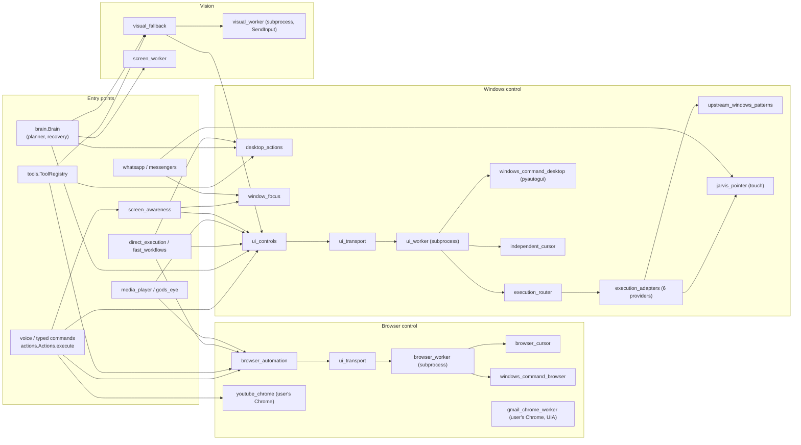

# Migration dependency map (Phase 0)

Date: 2026-10-30, revision `7e7a39a`. Generated from an AST scan of `import` / `from … import` statements and `-m jarvis.<module>` strings across `jarvis/`, `main.py`, `jarvis_bootstrap.py` and `tests/` (script in [rollback.md](rollback.md#reproducing-the-phase-0-evidence)). Method calls were counted with `grep` on `_browser().`, `_ui().`, `ui_controls.`, `browser_automation.` and `visual_fallback.`.

## Graph

## Importers per module (production code)

| Module | Production importers | Test files |
|---|---|---|
| `browser` | actions, browser_automation, browser_worker, utility_tools, youtube_chrome | 2 |
| `browser_automation` | actions | 2 |
| `browser_worker` | browser_automation (+ `-m` string), exploration, ui_transport (`-m` string) | 8 |
| `browser_cursor` | browser_worker, windows_command_browser | 1 |
| `development_browser` | brain_worker, development, development_tools (str) | 2 |
| `gmail_chrome_worker` | utility_tools (str) | 1 |
| `windows_command_browser` | browser_worker | 1 |
| `desktop_actions` | brain, direct_execution, execution_adapters, execution_router, tools, ui_worker | 2 |
| `desktop_tasks` | actions, coder, experience_memory | 3 |
| `ui_worker` | ui_controls (str), ui_transport (str) | 2 |
| `ui_controls` | actions, brain, browser_worker, direct_execution, fast_workflows, grounding, island_artwork, media_ui, screen_awareness, targeting | 8 |
| `visual_fallback` | brain, launcher | 1 |
| `visual_worker` | visual_fallback (+ str) | 1 |
| `screen_worker` | brain (str), knowledge (str) | 2 |
| `screen_awareness` | actions | 2 |
| `jarvis_pointer` | execution_adapters, independent_cursor, messengers, whatsapp | 2 |
| `independent_cursor` | gmail_chrome_worker, ui_worker, visual_worker, windows_command_desktop | 1 |
| `window_focus` | actions, media_player, messengers, screen_awareness, whatsapp, writing | 1 |
| `windows_command_desktop` | ui_worker | 1 |
| `windows_commands` | actions, agent_tools, commands, intent_handlers, windows_command_browser, windows_command_desktop | 3 |
| `execution_router` | demonstration, ui_worker | 4 |
| `execution_adapters` | agent_tools, execution_router, independent_cursor | 5 |
| `upstream_windows_patterns` | execution_adapters | 0 |
| `display` | glass_ui, interface, island, notch_widgets, ui_preview, main | 2 |
| `mcp_bridge` | agent_tools, blender_jobs, mcp_persistent, mcp_synthesis, spotify_host | 5 |
| `mcp_persistent` | mcp_bridge | 1 |
| `webmcp` | — | 1 |

## Method-level call sites into the controllers

| Call | Callers (count) |
|---|---|
| `_browser().request(operation, …)` | actions (2), media_player (2), tools (1), gods_eye (1), fast_workflows (1) |
| `browser_automation.settings / healthy / repair / close` | actions |
| `_ui().execute(command)` | actions (2), brain (1) |
| `_ui()._activate(handle, snapshot, control, verb)` | brain, visual_fallback, media_player, fast_workflows |
| `_ui().runner(request)` | brain (2), visual_fallback (2), media_player (1) |
| `_ui().pending / clear_pending / suggest / live_app` | actions, fast_workflows |
| `ui_controls.healthy / repair / close` | actions (service health) |
| `visual_fallback.prepare / execute / save_file / enabled / last_saved / file_state` | brain, tools |

## Migration order (derived from the graph)

Leaves first, so each step has a passing parity test before its consumers move:

1. Shared primitives with no Jarvis consumers yet: `jarvis/control/` contracts, coordinate module, policy, audit, timing.
2. Route executors behind the existing call shapes: `_browser().request` and `_ui().runner/_activate` become façades over Route 2 / Route 3 (same request/response dicts), so `actions`, `brain`, `media_player`, `fast_workflows`, `gods_eye`, `tools` keep working unchanged during parity tests.
3. Switch `tools.ToolRegistry` and `brain` to the router (typed actions), then remove the façades.
4. Retire: `execution_adapters` duplicates, `upstream_windows_patterns`, `windows_command_desktop` pyautogui path, `visual_worker` capture, `browser_automation`/`browser_worker` generic ops.
5. Not migrated (coding subsystem): `development_browser`, `codex_browser_check`, `pcide`, `exploration`, `design_intel`, `development_learning`, `coding_programs`, `codex_validation`.
