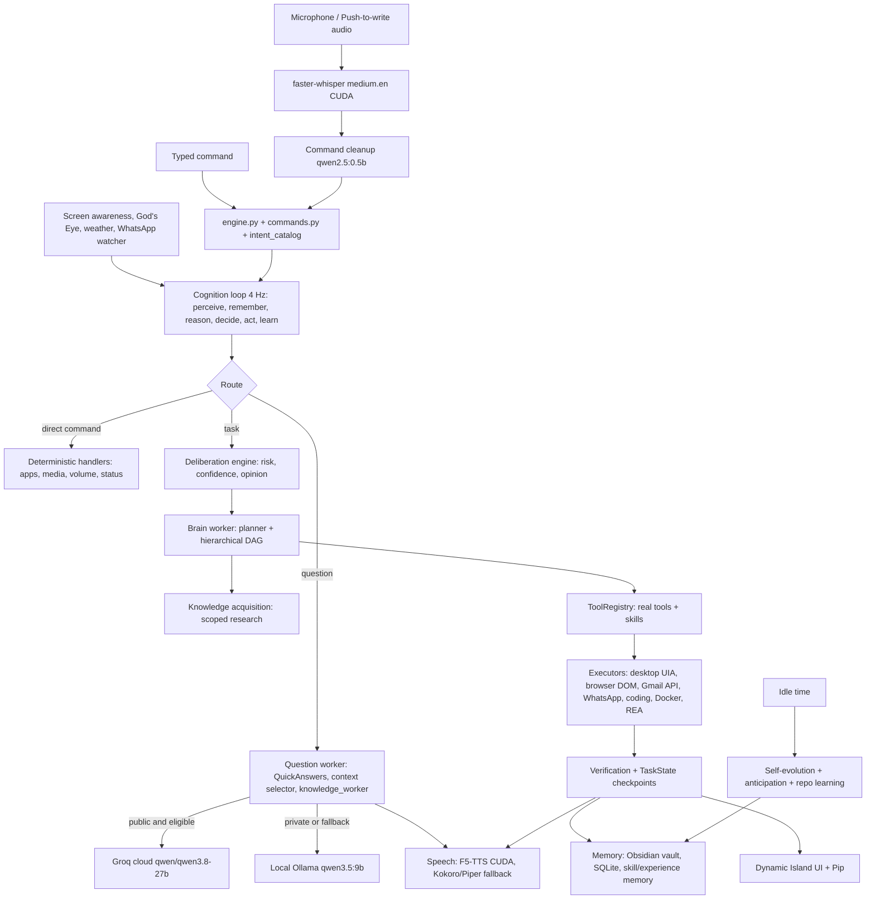
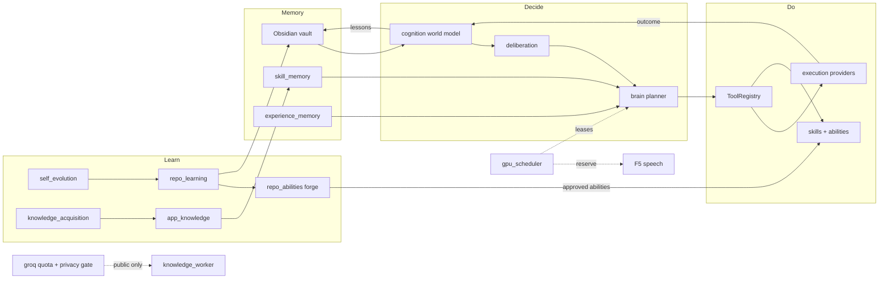

# Jarvis system map

<!-- upgrade-phase05 -->
**Upgrade Phase 5 — 2026-10-18 IST:**
- `cloud_architect.py`: off by default; privacy gate, consent and sandbox verification.
- `demonstration.py`: Show Me Once; `Actions.request_demonstration`, hook process `python -m jarvis.demonstration --hook`.
- `deliberation.classify_failure` + `FailureRouter`: called from `Brain.recover_task`; queues in `.jarvis-runtime/learning-queues/`.

[Design and security model](../artifacts/jarvis-audit/phase-05/security-and-design.md).
<!-- /upgrade-phase05 -->

<!-- upgrade-phase04 -->
**Upgrade Phase 4 — 2026-10-18 IST:** `reasoning_bank.py` (lessons → `BrainClient` `reasoning_lessons`), `viking_memory.py` + `viking_worker.py` (OpenViking vault index → `ObsidianMemory.task_context` `vault_hits`, watchdog service "Hierarchical vault index"), `exploration.py` (isolated curriculum) and `learning_memory.py` (wiring, idle maintenance in `SelfEvolution`). [Architecture and safety model](../artifacts/jarvis-audit/phase-04/architecture-and-provenance.md).
<!-- /upgrade-phase04 -->

<!-- upgrade-phase03 -->
**Upgrade Phase 3 — 2026-10-17 IST:** `skill_store.py` (SQLite history, `.skill_id` identities), `skill_evolution.py` (living ranking, trust, CAPTURED/FIX/DERIVED) and `mcp_synthesis.py` (generated MCP tools in `jarvis-mcp-runtime:1`) extend `SkillMemory`, `mcp_bridge` and the idle `SelfEvolution` loop; ToolRegistry remains the only executor. [Implementation and provenance](../artifacts/jarvis-audit/phase-03/implementation-and-provenance.md).
<!-- /upgrade-phase03 -->

<!-- upgrade-phase02 -->
**Upgrade Phase 2 — 2026-10-17 IST:** `execution_strategy.py` ranks execution methods (API → structured → GUI) from the existing registry and `tool.outcome` evidence; `app_adapters.py` adds Office/PDF/Blender/Unreal/VS Code tools behind `toolkits.TOOLS`; `execution_router` uses `execution_adapters.desktop_order()` (structured UIA first, cyan pointer as fallback). Planner context gains `capability_context.execution_strategy`; `Brain.validate_remaining` rejects GUI steps on named documents while an API/structured method is eligible. [Compatibility matrix](../artifacts/jarvis-audit/phase-02/compatibility-matrix.md).
<!-- /upgrade-phase02 -->

<!-- upgrade-phase01 -->
**Upgrade Phase 1 — 2026-10-17 IST:** Architecture inventory and dependency map re-derived from source; every planned tool call still passes `ToolRegistry.execute`. New metadata-only `tool.outcome` rows (method tier `api`/`structured`/`gui`, idempotency, verification, latency, skill ID) extend the existing `agent-events.jsonl` lifecycle log — no second registry or event bus. Full regression **3,193 passed / 147 skipped / 0 failed**; launcher **ready**. [Inventory, dependency map and limits](../artifacts/jarvis-audit/phase-01/architecture-and-dependency-map.md).
<!-- /upgrade-phase01 -->

<!-- prompt28-audit -->
**Sandbox/DeerFlow audit — 2026-10-16 IST:** Stronger mount/checkpoint/identity/write/timeout guards and media proof added. **20 catalog fixture PASS / 12 BLOCKED**; full regression **3,065 passed / 124 skipped / 0 failures**, launcher **ready**. Owned offline math, all seven literal media recipes and nonzero/no-replay/cleanup fixtures passed; format proof levels vary. General research/source-quality, approval/quota/privacy/resource/recovery and platform patch acceptance remain incomplete.
[Evidence, limitations and rollback](../artifacts/jarvis-audit/modules/28-sandbox-deerflow/inventory.md).
<!-- /prompt28-audit -->

<!-- prompt27-audit -->
**God’s Eye audit — 2026-10-16 IST:** Location opt-outs, primary-flight freshness, honest empty-feed answers, safer camera-pack origins, cancellation and durable notification checkpoints added. **20 catalog fixture PASS / 12 BLOCKED**; full regression **3,036 passed / 112 skipped / 0 failures**, launcher **ready**. Closed-view budgets, complete signal freshness/privacy/schema/renderer acceptance remain incomplete. No live globe/camera/feed validation.
[Evidence, limitations and rollback](../artifacts/jarvis-audit/modules/27-gods-eye/inventory.md).
<!-- /prompt27-audit -->

<!-- prompt26-audit -->
**Realtime/weather audit — 2026-10-16 IST:** Monotonic read cadence, explicit temperature units/source age, timezone/day handling and fail-closed notification checkpoints added. Modelled-hazard suppression is opt-in (default 0); default cadence is preserved. **Prompt 26: 20 fixture PASS / 12 BLOCKED**; full regression **3,005 PASS / 100 skips / 0 failures**, launcher **ready**. 82 registered endpoints constructed with fixtures; no live API, geolocation or alert trial. All-provider freshness/schema/privacy/resource/trace contracts remain incomplete.
[Evidence, limitations and rollback](../artifacts/jarvis-audit/modules/26-realtime-data/inventory.md).
<!-- /prompt26-audit -->

<!-- prompt25-audit -->
**Media audit — 2026-10-16 IST:** Unrelated/ambiguous selection refuses playback; Spotify song/source/artist checks, Unicode matching and uncertain-playback fallback guards added. **16 Prompt25 fixture PASS/16 BLOCKED**; full regression **2,971 PASS/89 skips/0 failures**, launcher **ready**. No live playback/volume trial. Durable event/tab dedupe, full privacy/resource/recovery contracts and pycaw upgrade validation remain incomplete.
[Evidence, limits and rollback](../artifacts/jarvis-audit/modules/25-media/inventory.md).
<!-- /prompt25-audit -->

<!-- prompt24-audit -->
**WhatsApp audit — 2026-10-16 IST:** Fresh recipient/draft checks, expiring serialized approval, bounded request parsing and durable text-send non-replay checkpoints added. **14 Prompt24 fixture PASS /18 BLOCKED**; full regression **2,939 PASS /73 skips /0 failures**, launcher **ready**. No live WhatsApp action. Stable contact IDs, groups, outgoing calls, attachments and complete privacy/resource contracts remain incomplete.
[Evidence and rollback](../artifacts/jarvis-audit/modules/24-whatsapp/inventory.md).
<!-- /prompt24-audit -->

<!-- prompt23-audit -->
**Gmail audit — 2026-10-16 IST:** Approval now refuses False/changed fields, draft writes recheck freshness after approval, and damaged journals fail closed. FileBuddy attachment drafts now require approval and durable non-replay records. **24 Prompt23 fixture PASS /8 BLOCKED**; full regression **2,900 PASS /56 skips /0 failures**, launcher **ready**. No live Gmail trial. Adapter source verification is stale until separately reviewed; account isolation, complete privacy/resource/replay/observability contracts remain incomplete.
[Evidence and rollback](../artifacts/jarvis-audit/modules/23-gmail/inventory.md).
<!-- /prompt23-audit -->

<!-- prompt22-audit -->
**Web/app audit — 2026-10-16 IST:** Strict preview URL/test-plan validation, service-worker/WebSocket isolation and reused health opener added. **18 Prompt22 fixture PASS /14 BLOCKED**. Full regression **2,855 PASS /48 skips /0 failures**; launcher **ready**. Real authored build and isolated headless browser checks passed; HMR, warning classification, safe restart, host confinement, dependency compatibility, crash continuation and complete redaction remain incomplete.
[Evidence and rollback](../artifacts/jarvis-audit/modules/22-web-development/inventory.md).
<!-- /prompt22-audit -->

<!-- prompt21-audit -->
**Native coding audit — 2026-10-16 IST:** Promotion now refuses earlier attempts and uses frozen bytes bound to combined test hashes. Damaged or oversized save journals stop safely. **27 Prompt21 fixture PASS /5 BLOCKED**; full regression **2,827 PASS /41 skips**,0 failures. Conflict resolution, semantic retrieval, dependency rollout, crash continuation and credential-redacted journals remain incomplete. Launcher **ready**; live local-model coding acceptance was not run.
[Evidence and rollback](../artifacts/jarvis-audit/modules/21-native-coding/inventory.md).
<!-- /prompt21-audit -->

<!-- prompt20-audit -->
**Idle evolution audit — 2026-10-16 IST:** Interrupted discovery is recoverable; uncertain learning writes stay in `needs_review`. Daily budgets and a three-attempt cap persist, saver/resource failures defer, and private/negative topics are screened before public discovery. Patches require fresh code/test-bound evaluation and approval; rollback refuses later edits.
Verification: **2,796 full regression PASS /36 skips**; **28 Prompt20 fixture PASS /4 BLOCKED**. Native game preemption, safe automatic write resume, privacy/canary and lockfile rollout remain open. Launcher **repair_required**.
[Evidence, limitations and rollback](../artifacts/jarvis-audit/modules/20-self-evolution/inventory.md).
<!-- /prompt20-audit -->

<!-- prompt19-audit -->
**Ability-forge audit — 2026-10-16 IST:** Review now binds code/version/scope; network runs require fresh approval and a durable non-replay checkpoint. Wrong-type output withdraws the new version and can restore prior approved metadata without execution. Oversized code is rejected before parsing.
Verification: **2,756 full regression PASS /32 skips**; **32 Prompt19 catalog fixture PASS**. Voice abilities use process guard rails, not Docker isolation. Launcher **repair_required**; live model/account/voice acceptance and supported Python migration remain open.
[Evidence, limits and rollback](../artifacts/jarvis-audit/modules/19-ability-forge/inventory.md).
<!-- /prompt19-audit -->

<!-- prompt18-audit -->
**Repository-learning audit — 2026-10-16 IST:** Coding references now pin commits, verify cached excerpt hashes, restrict license-sensitive excerpt transfer, bound downloads/browser checks and screen discovery queries for private markers. Pinned duplicate learning reuses memory; corrupt indexes are preserved. Saved-memory relevance warm p50/p95 **1.2128/1.2665 → 0.6546/0.7882 ms**, identical scores/top3 names on 500 repositories with 80 keywords each.
Verification: **2,706 full regression PASS / 32 skips**; **30 Prompt 18 catalog PASS /2 BLOCKED**. Arbitrary repository behavior validation and durable in-flight job recovery remain incomplete. Derived caching adds cold work/memory; launcher **repair_required**.
[Evidence, limits and rollback](../artifacts/jarvis-audit/modules/18-repo-learning/inventory.md).
<!-- /prompt18-audit -->

<!-- prompt17-audit -->
**Document audit — 2026-10-16 IST:** Bounded extraction/context, multilingual tokenization, stale-source checks, atomic session writes and drop admission guards added. Warm BM25 lookup p50/p95 **0.8772/0.9154 → 0.0550/0.0591 ms** on 1,500 identical chunks; top5 IDs/pages/text identical; scores match to 10 decimal places.
Verification: **2,654 full regression PASS / 40 skips**; **28 Prompt 17 catalog PASS /4 BLOCKED**. Cross-document conflicts, semantic citation faithfulness, hard parser resource isolation and operation traces remain incomplete. Launcher **repair_required**. Installed pypdf 6.20.0 predates the 6.20.1 cyclic-tree security fix; no dependency installation performed.
[Evidence, limitations and rollback](../artifacts/jarvis-audit/modules/17-rag-documents/inventory.md).
<!-- /prompt17-audit -->

<!-- prompt16-audit -->
**Memory audit — 2026-10-16 IST:** Bounded record/model validation, conservative subject/polarity guards, broader secret screening before clipping and Stop/readback guards added. Canonical facts flush before replacement; failed precommit restores RAM. Equivalent500-fact lexical retrieval warm median 15.40→5.40ms with a small temporary allocation increase.
Verification: **2,616 full regression PASS / 36 skips**; **28 Prompt16 catalog PASS /4 BLOCKED**. Global erase, durable unavailable-vault writes, general document freshness and memory lifecycle correlation remain incomplete. Launcher **repair_required**; real vault/model/Obsidian GUI were not tested.
[Evidence, limits and rollback](../artifacts/jarvis-audit/modules/16-memory/inventory.md).
<!-- /prompt16-audit -->

<!-- prompt15-audit -->
**App/site knowledge audit — 2026-10-16 IST:** Fresh surface/version and task UUID checks prevent stale context reuse; login observations suppress research/control hints; bounded inputs and numeric public versions fail closed. Source preference uses configured origin, with explicit URL version hints marked stale. Cache lookup warm median 3.52→0.45 ms on synthetic records.
Verification: **2,576 full regression PASS / 32 skips**; **31 Prompt15 catalog PASS / 1 BLOCKED** (plugin identity namespace missing). Launcher **repair_required**. Owned headless browser fixture passed; live accounts/native GUI/model/production readiness remain unverified.
[Evidence, limits and rollback](../artifacts/jarvis-audit/modules/15-app-research/inventory.md).
<!-- /prompt15-audit -->

<!-- prompt14-audit -->
**2026-10-15 browser audit:** Current DOM summaries include bounded label names,
sign-in heuristics and untrusted metadata; generic role targets wait then require
uniqueness, fresh URL and pinned semantic identity after the cue. Multiple owned
tabs block generic mutations. Download/save and explicit tab selection are not
implemented production capabilities. [Actual headless assertions, metrics and limits](../artifacts/jarvis-audit/modules/14-browser-playwright/inventory.md).
Playwright1.63.0 retained;1.64.0 upstream release recorded without installation.
Historical live measurements below retain original dates; no new public account/GUI trial.
<!-- /prompt14-audit -->

**Latest Phase 2 — 2026-10-15 IST:** [GPU, voice and UI changes](phase2-gpu-voice-ui.md)
add native F5/Whisper inference leases, bounded Ollama contexts, shared-memory PCM,
speech normalization, modifier-state fixes and coalesced UI/Mind DAG telemetry.
[Measured results and remaining gates](../artifacts/phase2_gpu_voice_verified.md)
supersede earlier architecture statements about speech being outside the lease
coordinator. Active kernels still cannot be forcibly preempted; the F5 latency
target remains unmet. Earlier dated audit evidence retains its original scope.

<!-- prompt13-audit -->
**2026-10-15 desktop-control audit:** Current pointer-first order is preserved.
Delayed touch re-admits target geometry/focus/hit-test and visual-point window
guards; thread DPI context is restored. Malformed pointer settings and worker
responses fail closed. Provider errors are categorical and traceable; uncertain
actions are never replayed. [Executed fixture scope, live blockers and tradeoffs](../artifacts/jarvis-audit/modules/13-desktop-control/inventory.md).
Historical images/results below keep their dates; no new live desktop check.
<!-- /prompt13-audit -->

A compact reference to Jarvis as of **2026-10-15 IST**: features,
skills, tools, architecture, workflows, software, repositories and models, and
how they connect. Each line is short; follow the links for details. Dated test
results stay in the linked guides. This page makes no new verification claims.
Architecture wording was corrected after the
[2026-10-15 inventory audit](../artifacts/jarvis-audit/modules/01-architecture-inventory/inventory.md);
the audit records implemented, missing, configured and live-unverified boundaries separately.

**Reading status:** model names below describe configuration, not a fresh installed-model
census. Feature counts and timings belong to their dated source guides. An adapter,
skill or configured service does not establish that its accounts, dependencies or live
workflow work now. This map documents Jarvis; tools available only in the Codex chat
are not automatically installed in Jarvis.

[Prompts 02–04 follow-up — 2026-10-15](../artifacts/jarvis-audit/final-report.md)
adds task identity checks, latest-document clarification, bounded voice ownership
and final-buffer resampling. Its 93 fixture proofs and three acoustic blockers are
separate from the historical feature counts and live service claims below.

[Prompt 05 follow-up — 2026-10-15](../artifacts/jarvis-audit/modules/05-voice-tts/inventory.md)
records pre-submission F5→Kokoro/Piper fallback, bounded speech/Stop ownership,
playback progress and private diagnostic suppression. STT/F5 do not share the
Ollama lease coordinator; live contention and listening acceptability remain open.

---

## 1. Architecture at a glance

**Core idea:** cognition observes inputs and outcomes and refreshes attention at
4 Hz. Commands route immediately to direct handlers, question workers or planned
tasks; execution runs on owned workers, with registry checks and result feedback.
The attention tick does not execute every tool or model call.

The [2026-10-15 perception follow-up](../artifacts/jarvis-audit/modules/02-perception-cognition/inventory.md)
adds stale-window invalidation and tick error/overrun/stall diagnostics. Those
diagnostics alone do not establish hard native parser-hang containment. The
completion pass separately added and tested task UUID agreement and stale-result
rejection. The module ledger distinguishes those fixtures from live acceptance.

---

## 2. Six cognitive modules

Source: [cognitive-architecture.md](cognitive-architecture.md), code in `jarvis/cognition.py`.

| Module | What it does | Main files | Connects to |
| --- | --- | --- | --- |
| Perception | Voice, typed text, focused window, sensor alerts; each gets a salience score | `engine.py`, `voice_input.py`, `screen_awareness.py`, `gods_eye.py`, `weather_watch.py`, `whatsapp.py` | Working memory |
| Working memory | Current goal, active task, queue, 7 attention slots | `cognition.py`, `context_hub.py` | Reasoning, all prompts |
| Long-term memory | Episodic (conversations), declarative (facts), procedural (skills, lessons, repos) | `memory_curator.py`, `conversation_memory.py`, `obsidian_memory.py`, `skill_memory.py`, `experience_memory.py` | Reasoning, deliberation |
| Reasoning + world model | Plans/answers; predicts effects, undo-ability, approval need, time, success rate | `brain.py`, `knowledge_worker.py`, `cognition.predict()` | Executive |
| Executive + meta-learning | Proceed or ask; compares result vs prediction; writes lessons | `cognition.py`, `deliberation.py`, `task_recovery.py` | Action, memory |
| Action / tools | Every real action | `actions.py` → `cognition.act()` | Perception (feedback) |

---

## 3. Models and where each is used

Local language models run in **Ollama**, with partial GPU offload managed by
`gpu_scheduler.py`. Whisper uses CTranslate2, F5 uses its separate PyTorch
environment, and Laya uses the brain environment; they are separate runtimes.
The configured GPU is an RTX 3050 Laptop (4 GB VRAM).
The earlier [2026-10-15 GPU audit](../artifacts/jarvis-audit/modules/08-gpu-scheduler/inventory.md)
adds bounded state validation, unchanged-poll write elimination and conservative
resource admission. At that audit revision F5/Whisper were outside the coordinator.
Phase 2 now shares inference-turn admission; native weights remain runtime-owned
and the speech reserve remains an estimate.

| Model | Role | Config key |
| --- | --- | --- |
| `qwen3.5:9b` | Main brain: planner, coder, decisions, screen reading, answers, memory facts, repo learning, documents | `brain.*`, `knowledge.model`, `memory.long_term.model` |
| `qwen3.5:0.8b` | Context selector; fast butler-style small talk | `context_selector.model`, `knowledge.natural_conversation.model` |
| `qwen2.5:0.5b` | Voice-command cleanup; idle realtime-data reader | `command_cleanup.model`, `realtime.model` |
| `qwen3-coder:30b` | Ability forge (falls back to 9b if RAM is short) | `repo_abilities.model` |
| `jarvis-codex-qwen3.5:9b` | Legacy Codex coding backend model | `brain.codex_model` |
| `qwen3-vl:2b / 4b`, `qwen3.5:4b`, `llama3.2:3b`, `qwen2.5:3b-instruct` | Historically recorded alternatives / earlier experiments; availability needs a fresh Ollama check | — |
| `qwen/qwen3.8-27b` on **Groq** (cloud, free tier) | Optional: public, non-private complex questions only | `groq.*` |
| faster-whisper `medium.en` | Speech-to-text, CUDA int8_float16 | `whisper.*` |
| **F5-TTS** | Main voice, cloned zero-shot from a Jarvis reference clip | `speech.engine: "f5"` |
| Kokoro (`am_michael` + `am_fenrir`), Piper | Earlier/fallback voices | `speech.voice` |
| `convaiinnovations/laya` | Tool/action selector in the brain env | `brain.selector` |
| Qwen2.5-Coder-0.5B + LoRA | Own trained coding/PC adapters (experiment) | `brain.trained_pc_checkpoint` |

**Routing policy:** private data, PC actions and screen content are assigned local
inference. Groq receives a minimal eligible public payload. Quota/policy refusal can
fall back locally; a partial streamed failure retains its cause and is not
automatically replayed. Groq is enabled in this checkout's configuration; this is
not a live cloud check.
2026-10-15 routing audit: policy/quota refusal precedes a blocking metadata wait,
backoff header casing is normalized, invalid usage retains reservations and
route UUIDs correlate with accounting. Common key screening/redaction remains
heuristic. [Current proof and limitations](../artifacts/jarvis-audit/modules/07-model-routing/inventory.md).

---

## 4. Request workflows

### A. Simple command ("open Chrome", "pause", "volume up")
`voice → Whisper → cleanup → commands.parse/intent_catalog → Actions.execute → direct handler`.
Direct routing and execution bypass planning/answer models. Whisper and optional
cleanup inference happen before routing; typed commands can bypass speech processing.

### B. Question ("explain quantum computing")
`Knowledge` checks `QuickAnswers` (instant facts) and prepares bounded context
through `context_selector` when needed → `QuestionClient` → Groq (if public and
eligible) or local 9b → streamed to the island →
phrases streamed to F5 speech → saved to conversation memory.
2026-10-15 audit: private-context fallback cannot initiate public search; selector
cancellation, bounded projection and serialized question transport are covered by
[executed module06 checks](../artifacts/jarvis-audit/modules/06-questions-context/inventory.md).

### C. Task ("find my unread emails", "make this cube a sphere in Blender")
The [2026-10-15 DAG/cache audit](../artifacts/jarvis-audit/modules/10-dag-planning/inventory.md)
adds task UUID checks, exact read-restore binding, per-graph effect serialization
and bounded invalid-cache fallback. Specialized account/UI workflows retain
their existing approval paths. Fixture validation does not certify all tasks.

1. **Deliberation** classifies risk and confidence and decides whether to proceed, recommend or ask.
2. **Knowledge acquisition** researches the app/site if a gap is detected (cached 7 days).
3. **Brain** plans: specialised workflow (Gmail, media, WhatsApp, coding) if one matches, otherwise next-step planning or a **hierarchical DAG** (parallel reads, typed references).
4. **ToolRegistry** dispatches real tools with scope + approval checks.
5. **Verification** checks the result (readback, UIA state, file check). Failed steps get replanned (up to 5 times). Uncertain writes are **never replayed**.
6. **TaskState** checkpoints; cognition records the outcome; lessons go to Obsidian.

### D. Coding task
Repo learning finds/reuses a matching GitHub repo → native Jarvis coding loop
(`coding_backend: "jarvis"`) with Qwen 9b, typed file tools, up to 2 workers →
LocalGithub git assembly → checks/browser validation → approved abilities given as reference code.

### E. Idle time
Anticipation (prepares research), realtime data reader, self-evolution (detects
gaps → learns repos → ability forge builds tested commands → approval card),
repo learning from browsed GitHub pages, memory summarisation.

### F. Background safety
`launcher.py` + `recovery.py` supervise registered services with health checks,
restart controls, and `.jarvis-runtime/repairs.jsonl` logging. The manifest's
service list alone does not prove a current watchdog registration or live health.

---

## 5. Features

| Area | Feature | Guide |
| --- | --- | --- |
| Voice | Wake word "Jarvis", call-style conversation, task queue while talking | [fast-conversation.md](fast-conversation.md) |
| Voice | Push-to-write (hold Left Ctrl + Left Alt), "write …" composed by model | [push-to-write.md](push-to-write.md) |
| Voice | F5-TTS cloned voice, streamed speech, Unicode-safe | [f5-voice.md](f5-voice.md) |
| Voice | Generated butler-style small talk | [natural-conversation.md](natural-conversation.md) |
| Voice | 800-scenario natural phrasing coverage | [natural-language.md](natural-language.md) |
| UI | Dynamic Island glass notch, Mind view, media cards | [dynamic-island.md](dynamic-island.md) |
| UI | Pip buddy: 35 emotions, eats dropped files | [file-buddy.md](file-buddy.md) |
| UI | Jarvis's own cyan cursor and physical clicks | [independent-cursor.md](independent-cursor.md) |
| Desktop | Open 333 catalogued apps, folders, files; Windows commands (493 entries) | [windows-commands.md](windows-commands.md) |
| Desktop | Screen pre-awareness: offers help for the app in front | [screen-awareness.md](screen-awareness.md) |
| Media | YouTube + Spotify search, play, full control | [media-player.md](media-player.md) |
| Messaging | WhatsApp send/reply/call handling with approvals | [whatsapp.md](whatsapp.md) |
| Email | Gmail API: read, draft, send, trash, labels, read aloud | [gmail-api.md](gmail-api.md) |
| Documents | Drop file → LightRAG/GraphRAG Q&A with citations | [file-buddy.md](file-buddy.md) |
| Memory | Long-term facts, conversation summaries, Obsidian vault | [memory-apis-alerts.md](memory-apis-alerts.md) |
| Data | 82 public API adapters, weather alerts every 30 min | [realtime-data.md](realtime-data.md) |
| World | God's Eye globe by voice, configured-radius area alerts (40 km default), traffic cameras | [gods-eye.md](gods-eye.md) |
| Reasoning | Deliberation: opinions, risk tiers, decision ledger | [deliberation-engine.md](deliberation-engine.md) |
| Planning | Hierarchical DAG execution, verified plan cache | [hierarchical-execution.md](hierarchical-execution.md) |
| Learning | Scoped knowledge acquisition before tasks | [autonomous-learning.md](autonomous-learning.md) |
| Learning | Learn GitHub repos → reuse for coding | [repo-learning.md](repo-learning.md) |
| Learning | Turn repos into new tested voice abilities | [repo-abilities.md](repo-abilities.md) |
| Learning | Idle self-evolution, gated self-patching | [self-evolution.md](self-evolution.md) |
| Coding | Native coding workspace, multi-worker, streaming | [native-coding.md](native-coding.md) |
| Coding | Web/app development with previews | [web-app-development.md](web-app-development.md) |
| Reverse eng. | REA ingest → analyse → clone → iterate | [rea-reverse-engineer-clone.md](rea-reverse-engineer-clone.md) |
| Research | DeerFlow source research + 23 skill guides | [deerflow.md](deerflow.md) |
| Sandbox | Docker offline tasks + 7 free media renderers | [deerflow-sandbox.md](deerflow-sandbox.md) |
| Cloud | Optional Groq hybrid with quota + privacy routing | [groq-hybrid.md](groq-hybrid.md) |
| Ops | GPU priority scheduler, crash recovery, launcher readiness | [gpu-priority.md](gpu-priority.md), [CRASH_RECOVERY.md](CRASH_RECOVERY.md) |

---

## 6. Skills

Skills are **guidance + bindings to real tools**; the planner reads them, the
ToolRegistry executes. Unknown tool names never become executable.

| Skill source | What it is | Count / location |
| --- | --- | --- |
| Bundled skills | app-navigation, browser-navigation, file-operations, form-entry, project-coding, reverse-engineer-clone, runtime-questions, spotify-media, web-research, youtube-media | 10 readable SKILL.md files; repository-assimilation directory lacks SKILL.md in this checkout; [`skills/`](../skills/) |
| Personal skills | Your own `SKILL.md` in the Obsidian vault `Jarvis Skills/Personal/` | hot-reloaded |
| Custom skills | `custom-skills/<name>/SKILL.md` | local, ignored by git |
| Hermes guides | Pinned Nous Research Hermes skill references | 210 guides |
| DeerFlow guides | Public DeerFlow skill guides | 23 |
| Utility skills | Reviewed local utilities (format, PDF, OCR, crypto, notebooks…) in `.venv-skills` | Audit recorded 0 offered because source-bound validation was stale (2026-10-15); historical 38 local + 3 mock |
| Repository skills | Python functions from learned repos, run in Docker | approval per call |
| Repo abilities | Voice commands generated from learned repos | approval card |
| Learned procedures | Verified past task steps + per-action success stats | Obsidian + `.jarvis-runtime/cognition/` |

**Selection:** `capabilities.py` ranks skills and tools by task family →
`skill_context` + `capability_context` go to the planner → planner picks tool +
arguments → registry enforces policy.

---

## 7. Tools (ToolRegistry)

| Group | Examples | Executor |
| --- | --- | --- |
| Desktop | open app, click, type_text, focus window, scroll | `desktop_actions.py`, UIA/touch via providers **Jarvis pointer → UFO → Windows-MCP → CUA → Open Computer Use → Agent-S** |
| Browser | DOM inspect, navigate, fill, click | `browser_automation.py` (Playwright), `browser_worker.py` |
| Files | list, read, search, append, open | `tools.py`, `native_tools.py`, SQLite file index |
| Web / research | web_search, scrape_web, DeerFlow research, Firecrawl (optional) | `toolkits.py`, `deerflow.py`, `firecrawl_tools.py` |
| GitHub | search, read file, PRs | `toolkits.py`, `repo_tools.py` |
| Gmail | search, read, draft, send, trash, label | `gmail_api.py`, `gmail_writes.py` |
| Messaging | WhatsApp send/reply/calls | `whatsapp.py`, `messengers.py` |
| Media | YouTube Data API, Spotify desktop + Windows media session | `media_player.py`, `spotify.py` |
| Coding | read/write/patch files, run checks, LocalGithub commit | `native_coding.py`, `coding_*.py` |
| Sandbox | Docker Linux tasks, media renderers | `deerflow_sandbox.py`, `docker_runtime.py` |
| Reverse eng. | REA analyze | `rea_tools.py` |
| Data | 82 realtime APIs | `realtime.py`, `realtime_sources.py` |
| Integrations | MCP, calendar, Jira, Slack (when configured) | `mcp_bridge.py`, `toolkits.py` |
| Introspection | runtime_capabilities, cognition status, predict | `capabilities.py`, `cognition.py` |

SuperAGI toolkit ideas added 37 operations; account-backed ones stay hidden
until configured ([superagi-toolkits.md](superagi-toolkits.md)).

---

## 8. Software and environments

| Software | Use |
| --- | --- |
| Python (7+ venvs) | `.venv` main, `.venv-brain` (laya/transformers), `.venv-f5` (F5-TTS + CUDA torch), `.venv-skills`, `.venv-training`, `.venv-harness`, `.venv-hermes`, `.venv-deerflow` (Py 3.12) |
| Ollama | Local language/vision model serving; speech and Laya use separate runtimes |
| CUDA / NVIDIA libs | Whisper, F5-TTS, partial Qwen offload |
| Docker Desktop (Linux engine) | Repository skills, DeerFlow sandbox; auto-started silently |
| Node.js | REA, DeepSeek Harness |
| Playwright + Chrome | Browser automation, Gmail Chrome adapter |
| Obsidian vault | Long-term memory; installation-specific vault path comes from configuration |
| WhatsApp Desktop, Spotify Desktop, Blender, VS Code… | Controlled apps |
| Key Python packages | faster-whisper, ctranslate2, kokoro-onnx, piper-tts, pywinauto, pywin32, winrt media, pycaw, PyAutoGUI, opencv, pypdf, ddgs, playwright |

Dependencies: [`requirements/`](../requirements/). Services and health checks:
[`config/runtime_manifest.json`](../config/runtime_manifest.json).

**Declared service names (not current health):** interface, microphone, action_worker, question_worker,
speech_worker, brain_inference, ui_automation_worker, browser_automation_worker,
context_selector, realtime_observations, anticipation, island_media_observations,
gods_eye, harness_inference, hermes_inference, development_preview, ollama,
docker_linux_engine.

---

## 9. External repositories used

| Repository | How Jarvis uses it | Status |
| --- | --- | --- |
| ByteDance **DeerFlow** | Embedded research harness, skills, sandbox | Active, `integrations/deer-flow*` |
| Nous Research **Hermes Agent** | Optional planner loop + 210 skill guides | Planner off (`brain.hermes.enabled: false`), guides active |
| DeepSeek **Harness** | Optional agent harness with local Qwen | Enabled (`brain.harness`) |
| **REA** (morluto/rea) | Reverse-engineering analysis via Node CLI | Active, not vendored |
| **God's Eye View** | Globe, flights, cameras, alerts | Active, `integrations/gods-eye-view-src` |
| UFO, Windows-MCP, CUA, Open Computer Use, Agent-S | Desktop execution provider patterns | Adapted, `integrations/execution-*` |
| **Ultron** (ModelScope) | Memory hotness/decay formula | Adapted in `experience.py` |
| **SuperAGI** | Toolkit design | Re-implemented in `toolkits.py` |
| **agenticSeek** | Coder generate/check/feedback loop | Ideas only |
| Microsoft JARVIS, isair-jarvis, jarvis-ui, Memento, UI-TARS | Reference designs | Reference only |
| Codex CLI / Claude Code CLI | Earlier coding backends with local Qwen | Legacy, selectable |
| **LocalGithub** (separate local checkout) | Local git assembly for coding workloads | Configured integration; location is installation-specific |
| Learned GitHub repos (e.g. `trentm/python-markdown2`, `sindresorhus/is`, `mahmoud/boltons`) | Coding reference + new abilities | Stored in Obsidian `Jarvis Repos/` |

Licenses stay with each reference in [`integrations/`](../integrations/).

---

## 10. How the pieces connect

- **Learning feeds tools:** repos learned → abilities forged → approved → appear as skills in the registry.
- **Memory feeds planning:** relevant bounded facts, skills and lessons can enter local plans and answers; public cloud questions exclude private enrichment.
- **Outcomes feed memory:** each action updates success stats; repeated failures become lessons.
- **Deliberation gates actions:** risky or unclear tasks stop and ask before tools run.
- **GPU scheduler budgets inference:** F5/Whisper share native turn admission; Ollama planner/coding/question/cleanup ordering and estimated speech headroom remain. Kernels are not forcibly preempted.
- **Recovery wraps everything:** launcher health checks restart owned workers silently, never replaying uncertain actions.

---

## 11. Safety rules applied everywhere

The [Prompt09 audit](../artifacts/jarvis-audit/modules/09-deliberation/inventory.md)
tests the following as specific fixture boundaries, not universal security proof.
Deliberation is advisory: actual tools enforce per-action approvals. Qualified
consent is not approval, risky ambiguity pauses planning and a bare refusal
cancels. A deterministic unfamiliar-program research gate is still missing.

- Sends, deletes, writes to accounts and new abilities need approval.
- Uncertain external actions are never retried automatically; only reads and inference retry.
- Private data stays local; Groq gets public questions only.
- Built-in commands always win over learned phrases.
- File deletion requires explicit approval; recovery never deletes user files.

---

## 12. Where things live

| Path | Contents |
| --- | --- |
| [`jarvis/`](../jarvis/) | All application modules |
| [`config/`](../config/) | `config.json`, `runtime_manifest.json` |
| [`docs/`](README.md) | Guides (this page included) |
| [`skills/`](../skills/) | Bundled skills |
| [`integrations/`](../integrations/) | Upstream checkouts, profiles, references |
| [`scripts/`](../scripts/) | Setup, models, training, verification, audit |
| [`tests/`](../tests/) | Regression suite |
| [`artifacts/`](../artifacts/) | Reports, media, training runs, generated projects |
| `.jarvis-runtime/` | Runtime state, logs, repairs, cognition stats (ignored) |

Start: [`Start Jarvis.cmd`](<../Start Jarvis.cmd>) · Stop: [`Stop Jarvis.cmd`](<../Stop Jarvis.cmd>) ·
Full guide: [app README](../README.md).

## 13. Workflow → skill → tool → model connections

These are routing summaries, not promises that every integration is ready.

| Request | Skill / context | Tool or worker path | Model / software | Outcome feeds |
| --- | --- | --- | --- | --- |
| Open an app or change a control | app-navigation, form-entry, fresh window observation | commands → Actions → guarded desktop providers | Direct commands need no planner; ambiguous selection can use Qwen/Laya, UIA | Fresh control readback → task state, experience |
| Find and play a video/song | youtube-media, spotify-media | media_commands → media_player → browser/Spotify session | Playwright, Windows media APIs; direct paths bypass planning | Playback check → island card |
| Answer a general question | runtime-questions, bounded relevant memory | Knowledge → QuestionClient → knowledge_worker | Local Qwen 9b or eligible Groq; F5 reads streamed phrases | Answer → island, conversation memory |
| Research a public topic | web-research, DeerFlow guides | registry → web/search/research adapters | Public retrieval + local synthesis; optional providers require setup | Source receipts → answer/research artifact |
| Ask about a dropped PDF/Word file | file-operations, focused document | Pip/file_drop → documents extraction → retrieval | pypdf/DOCX extraction, local Qwen; light index or graph enrichment | Cited answer → document/session memory |
| Draft/send email or WhatsApp | recipient/account context, explicit applicable approval | Gmail API/Chrome adapter or WhatsApp workflow | API/browser/native app; model may compose text | Preview → approved action → receipt/readback |
| Build or edit a project | project-coding, learned repo references | native_coding → typed file/check tools → LocalGithub | Qwen 9b, Python/Node tooling, browser preview | Build/check evidence → project lessons |
| Clone an app/site | reverse-engineer-clone | rea_tools → REA analysis → development/coding | Node REA CLI + local Qwen | Analysis/artifacts → best-effort implementation → checks |
| Learn a new reusable command | repo guidance, capability gap | repo_learning → repo_abilities → review/approval | Configured coder 30b, 9b fallback subject to admission; Docker where required | Tested approved ability → registry discovery |
| Prepare for future work | prior outcomes, app knowledge | anticipation / knowledge acquisition / self-evolution | Small helpers or local Qwen under idle/resource gates | Cached evidence and lessons → later planner context |

**The boundary:** a skill supplies instructions; a model proposes arguments; a
registered tool performs the action; independent checks determine what succeeded.
Reading a repository or adding a Markdown guide alone does not add executable tools.

**Inventory entry points:** [bundled skills](../skills/),
[built-in registry source](../jarvis/tools.py), [capability selection](../jarvis/capabilities.py),
[integration profiles](../integrations/profiles/), [dependency groups](../requirements/),
and [runtime manifest](../config/runtime_manifest.json). The historical
[assistant-session tool inventory](exposed-tool-inventory.json) describes tools exposed
to a separate assistant session on 2026-10-08, not Jarvis's executable registry.

**Documentation review — 2026-10-15 IST:** refreshed against current configuration,
source paths, documentation and audit records; all 65 local Markdown targets resolve,
and the scoped diff whitespace check passed. No new live account, microphone or
desktop action validation was performed. Regression tests were not rerun for this
documentation-only change. `python -m jarvis.launcher --check` was attempted from
`app/` but interrupted after prolonged silent probing; no fresh readiness status
was obtained. Historical readiness results above retain their original scope.
