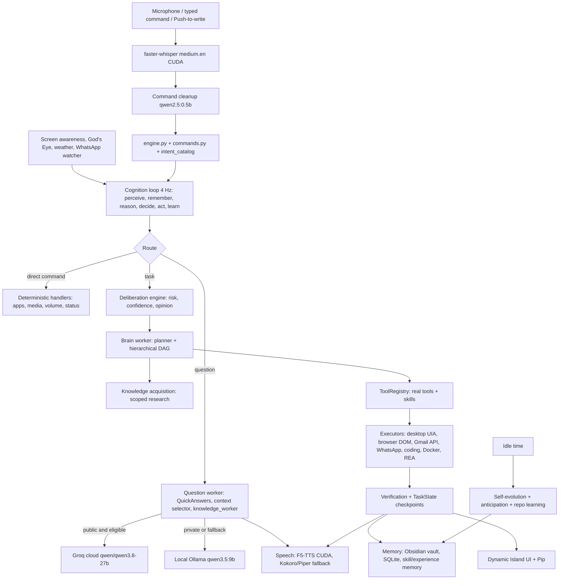

# Jarvis system map

A one-page summary of everything Jarvis has as of **2026-10-14 IST**: features,
skills, tools, architecture, workflows, software, repositories and models, and
how they connect. Each line is short; follow the links for details. Dated test
results stay in the linked guides. This page makes no new verification claims.

---

## 1. Architecture at a glance

**Core idea:** one cognitive loop receives every input, routes it to the cheapest
path that can do it (direct command → question → planned task), runs real tools
behind safety checks, verifies the result, then stores what it learned.

---

## 2. Six cognitive modules

Source: [cognitive-architecture.md](cognitive-architecture.md), code in `jarvis/cognition.py`.

| Module | What it does | Main files | Connects to |
| --- | --- | --- | --- |
| Perception | Voice, typed text, focused window, sensor alerts; each gets a salience score | `engine.py`, `voice_input.py`, `screen_awareness.py`, `gods_eye.py`, `weather_watch.py`, `whatsapp.py` | Working memory |
| Working memory | Current goal, active task, queue, 7 attention slots | `cognition.py`, `context_hub.py` | Reasoning, all prompts |
| Long-term memory | Episodic (conversations), declarative (facts), procedural (skills, lessons, repos) | `memory_curator.py`, `conversation_memory.py`, `obsidian_memory.py`, `skill_memory.py`, `experience_memory.py` | Reasoning, deliberation |
| Reasoning + world model | Plans/answers; predicts effects, undo-ability, approval need, time, success rate | `brain.py`, `knowledge_worker.py`, `cognition.predict()` | Executive |
| Executive + meta-learning | Proceed or ask; compares result vs prediction; writes lessons | `cognition.py`, `deliberation.py`, `task_recovery.py` | Action, memory |
| Action / tools | Every real action | `actions.py` → `cognition.act()` | Perception (feedback) |

---

## 3. Models and where each is used

All local models run in **Ollama** on an RTX 3050 Laptop (4 GB VRAM), with partial
GPU offload managed by `gpu_scheduler.py`.

| Model | Role | Config key |
| --- | --- | --- |
| `qwen3.5:9b` | Main brain: planner, coder, decisions, screen reading, answers, memory facts, repo learning, documents | `brain.*`, `knowledge.model`, `memory.long_term.model` |
| `qwen3.5:0.8b` | Context selector; fast butler-style small talk | `context_selector.model`, `knowledge.natural_conversation.model` |
| `qwen2.5:0.5b` | Voice-command cleanup; idle realtime-data reader | `command_cleanup.model`, `realtime.model` |
| `qwen3-coder:30b` | Ability forge (falls back to 9b if RAM is short) | `repo_abilities.model` |
| `jarvis-codex-qwen3.5:9b` | Legacy Codex coding backend model | `brain.codex_model` |
| `qwen3-vl:2b / 4b`, `qwen3.5:4b`, `llama3.2:3b`, `qwen2.5:3b-instruct` | Installed alternatives / earlier experiments | — |
| `qwen/qwen3.8-27b` on **Groq** (cloud, free tier) | Optional: public, non-private complex questions only | `groq.*` |
| faster-whisper `medium.en` | Speech-to-text, CUDA int8_float16 | `whisper.*` |
| **F5-TTS** | Main voice, cloned zero-shot from a Jarvis reference clip | `speech.engine: "f5"` |
| Kokoro (`am_michael` + `am_fenrir`), Piper | Earlier/fallback voices | `speech.voice` |
| `convaiinnovations/laya` | Tool/action selector in the brain env | `brain.selector` |
| Qwen2.5-Coder-0.5B + LoRA | Own trained coding/PC adapters (experiment) | `brain.trained_pc_checkpoint` |

**Routing rule:** private data, PC actions and screen content never go to the
cloud. Groq gets only a minimal public payload; if quota runs out or it fails,
the same question runs locally.

---

## 4. Request workflows

### A. Simple command ("open Chrome", "pause", "volume up")
`voice → Whisper → cleanup → commands.parse/intent_catalog → Actions.execute → direct handler`. No model call.

### B. Question ("explain quantum computing")
`QuickAnswers` (instant facts) → else `QuestionClient` → `context_selector` picks
memory → Groq (if public and enabled) or local 9b → streamed to the island →
phrases streamed to F5 speech → saved to conversation memory.

### C. Task ("find my unread emails", "make this cube a sphere in Blender")
1. **Deliberation** classifies risk and confidence and decides whether to proceed, recommend or ask.
2. **Knowledge acquisition** researches the app/site if a gap is detected (cached 7 days).
3. **Brain** plans: specialised workflow (Gmail, media, WhatsApp, coding) if one matches, otherwise next-step planning or a **hierarchical DAG** (parallel reads, typed references).
4. **ToolRegistry** dispatches real tools with scope + approval checks.
5. **Verification** checks the result (readback, UIA state, file check). Failed steps get replanned (up to 5 times). Uncertain writes are **never replayed**.
6. **TaskState** checkpoints; cognition records the outcome; lessons go to Obsidian.

### D. Coding task
Repo learning finds/reuses a matching GitHub repo → native Jarvis coding loop
(`coding_backend: "jarvis"`) with Qwen 9b, typed file tools, up to 2 workers →
LocalGithub git assembly → checks/browser validation → approved abilities given as reference code.

### E. Idle time
Anticipation (prepares research), realtime data reader, self-evolution (detects
gaps → learns repos → ability forge builds tested commands → approval card),
repo learning from browsed GitHub pages, memory summarisation.

### F. Background safety
`launcher.py` + `recovery.py` supervise every owned service with health checks,
silent bounded restarts, and `.jarvis-runtime/repairs.jsonl` logging.

---

## 5. Features

| Area | Feature | Guide |
| --- | --- | --- |
| Voice | Wake word "Jarvis", call-style conversation, task queue while talking | [fast-conversation.md](fast-conversation.md) |
| Voice | Push-to-write (hold Left Ctrl + Left Alt), "write …" composed by model | [push-to-write.md](push-to-write.md) |
| Voice | F5-TTS cloned voice, streamed speech, Unicode-safe | [f5-voice.md](f5-voice.md) |
| Voice | Generated butler-style small talk | [natural-conversation.md](natural-conversation.md) |
| Voice | 800-scenario natural phrasing coverage | [natural-language.md](natural-language.md) |
| UI | Dynamic Island glass notch, Mind view, media cards | [dynamic-island.md](dynamic-island.md) |
| UI | Pip buddy: 35 emotions, eats dropped files | [file-buddy.md](file-buddy.md) |
| UI | Jarvis's own cyan cursor and physical clicks | [independent-cursor.md](independent-cursor.md) |
| Desktop | Open 333 catalogued apps, folders, files; Windows commands (493 entries) | [windows-commands.md](windows-commands.md) |
| Desktop | Screen pre-awareness: offers help for the app in front | [screen-awareness.md](screen-awareness.md) |
| Media | YouTube + Spotify search, play, full control | [media-player.md](media-player.md) |
| Messaging | WhatsApp send/reply/call handling with approvals | [whatsapp.md](whatsapp.md) |
| Email | Gmail API: read, draft, send, trash, labels, read aloud | [gmail-api.md](gmail-api.md) |
| Documents | Drop file → LightRAG/GraphRAG Q&A with citations | [file-buddy.md](file-buddy.md) |
| Memory | Long-term facts, conversation summaries, Obsidian vault | [memory-apis-alerts.md](memory-apis-alerts.md) |
| Data | 82 public API adapters, weather alerts every 30 min | [realtime-data.md](realtime-data.md) |
| World | God's Eye globe by voice, 25-mile area alerts, traffic cameras | [gods-eye.md](gods-eye.md) |
| Reasoning | Deliberation: opinions, risk tiers, decision ledger | [deliberation-engine.md](deliberation-engine.md) |
| Planning | Hierarchical DAG execution, verified plan cache | [hierarchical-execution.md](hierarchical-execution.md) |
| Learning | Scoped knowledge acquisition before tasks | [autonomous-learning.md](autonomous-learning.md) |
| Learning | Learn GitHub repos → reuse for coding | [repo-learning.md](repo-learning.md) |
| Learning | Turn repos into new tested voice abilities | [repo-abilities.md](repo-abilities.md) |
| Learning | Idle self-evolution, gated self-patching | [self-evolution.md](self-evolution.md) |
| Coding | Native coding workspace, multi-worker, streaming | [native-coding.md](native-coding.md) |
| Coding | Web/app development with previews | [web-app-development.md](web-app-development.md) |
| Reverse eng. | REA ingest → analyse → clone → iterate | [rea-reverse-engineer-clone.md](rea-reverse-engineer-clone.md) |
| Research | DeerFlow source research + 23 skill guides | [deerflow.md](deerflow.md) |
| Sandbox | Docker offline tasks + 7 free media renderers | [deerflow-sandbox.md](deerflow-sandbox.md) |
| Cloud | Optional Groq hybrid with quota + privacy routing | [groq-hybrid.md](groq-hybrid.md) |
| Ops | GPU priority scheduler, crash recovery, launcher readiness | [gpu-priority.md](gpu-priority.md), [CRASH_RECOVERY.md](CRASH_RECOVERY.md) |

---

## 6. Skills

Skills are **guidance + bindings to real tools**; the planner reads them, the
ToolRegistry executes. Unknown tool names never become executable.

| Skill source | What it is | Count / location |
| --- | --- | --- |
| Bundled skills | app-navigation, browser-navigation, file-operations, form-entry, project-coding, repository-assimilation, reverse-engineer-clone, runtime-questions, spotify-media, web-research, youtube-media | [`skills/`](../skills/) |
| Personal skills | Your own `SKILL.md` in the Obsidian vault `Jarvis Skills/Personal/` | hot-reloaded |
| Custom skills | `custom-skills/<name>/SKILL.md` | local, ignored by git |
| Hermes guides | Pinned Nous Research Hermes skill references | 210 guides |
| DeerFlow guides | Public DeerFlow skill guides | 23 |
| Utility skills | Reviewed local utilities (format, PDF, OCR, crypto, notebooks…) in `.venv-skills` | 38 local + 3 mock |
| Repository skills | Python functions from learned repos, run in Docker | approval per call |
| Repo abilities | Voice commands generated from learned repos | approval card |
| Learned procedures | Verified past task steps + per-action success stats | Obsidian + `.jarvis-runtime/cognition/` |

**Selection:** `capabilities.py` ranks skills and tools by task family →
`skill_context` + `capability_context` go to the planner → planner picks tool +
arguments → registry enforces policy.

---

## 7. Tools (ToolRegistry)

| Group | Examples | Executor |
| --- | --- | --- |
| Desktop | open app, click, type_text, focus window, scroll | `desktop_actions.py`, UIA via providers **UFO → Windows-MCP → CUA → Open Computer Use → Agent-S** |
| Browser | DOM inspect, navigate, fill, click | `browser_automation.py` (Playwright), `browser_worker.py` |
| Files | list, read, search, append, open | `tools.py`, `native_tools.py`, SQLite file index |
| Web / research | web_search, scrape_web, DeerFlow research, Firecrawl (optional) | `toolkits.py`, `deerflow.py`, `firecrawl_tools.py` |
| GitHub | search, read file, PRs | `toolkits.py`, `repo_tools.py` |
| Gmail | search, read, draft, send, trash, label | `gmail_api.py`, `gmail_writes.py` |
| Messaging | WhatsApp send/reply/calls | `whatsapp.py`, `messengers.py` |
| Media | YouTube Data API, Spotify desktop + Windows media session | `media_player.py`, `spotify.py` |
| Coding | read/write/patch files, run checks, LocalGithub commit | `native_coding.py`, `coding_*.py` |
| Sandbox | Docker Linux tasks, media renderers | `deerflow_sandbox.py`, `docker_runtime.py` |
| Reverse eng. | REA analyze | `rea_tools.py` |
| Data | 82 realtime APIs | `realtime.py`, `realtime_sources.py` |
| Integrations | MCP, calendar, Jira, Slack (when configured) | `mcp_bridge.py`, `toolkits.py` |
| Introspection | runtime_capabilities, cognition status, predict | `capabilities.py`, `cognition.py` |

SuperAGI toolkit ideas added 37 operations; account-backed ones stay hidden
until configured ([superagi-toolkits.md](superagi-toolkits.md)).

---

## 8. Software and environments

| Software | Use |
| --- | --- |
| Python (7+ venvs) | `.venv` main, `.venv-brain` (laya/transformers), `.venv-f5` (F5-TTS + CUDA torch), `.venv-skills`, `.venv-training`, `.venv-harness`, `.venv-hermes`, `.venv-deerflow` (Py 3.12) |
| Ollama | All local models |
| CUDA / NVIDIA libs | Whisper, F5-TTS, partial Qwen offload |
| Docker Desktop (Linux engine) | Repository skills, DeerFlow sandbox; auto-started silently |
| Node.js | REA, DeepSeek Harness |
| Playwright + Chrome | Browser automation, Gmail Chrome adapter |
| Obsidian vault | Long-term memory (`D:\Phython Project\Jarvis_Memory\Jarvis_Mem`) |
| WhatsApp Desktop, Spotify Desktop, Blender, VS Code… | Controlled apps |
| Key Python packages | faster-whisper, ctranslate2, kokoro-onnx, piper-tts, pywinauto, pywin32, winrt media, pycaw, PyAutoGUI, opencv, pypdf, ddgs, playwright |

Dependencies: [`requirements/`](../requirements/). Services and health checks:
[`config/runtime_manifest.json`](../config/runtime_manifest.json).

**Owned services:** interface, microphone, action_worker, question_worker,
speech_worker, brain_inference, ui_automation_worker, browser_automation_worker,
context_selector, realtime_observations, anticipation, island_media_observations,
gods_eye, harness_inference, hermes_inference, development_preview, ollama,
docker_linux_engine.

---

## 9. External repositories used

| Repository | How Jarvis uses it | Status |
| --- | --- | --- |
| ByteDance **DeerFlow** | Embedded research harness, skills, sandbox | Active, `integrations/deer-flow*` |
| Nous Research **Hermes Agent** | Optional planner loop + 210 skill guides | Planner off (`brain.hermes.enabled: false`), guides active |
| DeepSeek **Harness** | Optional agent harness with local Qwen | Enabled (`brain.harness`) |
| **REA** (morluto/rea) | Reverse-engineering analysis via Node CLI | Active, not vendored |
| **God's Eye View** | Globe, flights, cameras, alerts | Active, `integrations/gods-eye-view-src` |
| UFO, Windows-MCP, CUA, Open Computer Use, Agent-S | Desktop execution provider patterns | Adapted, `integrations/execution-*` |
| **Ultron** (ModelScope) | Memory hotness/decay formula | Adapted in `experience.py` |
| **SuperAGI** | Toolkit design | Re-implemented in `toolkits.py` |
| **agenticSeek** | Coder generate/check/feedback loop | Ideas only |
| Microsoft JARVIS, isair-jarvis, jarvis-ui, Memento, UI-TARS | Reference designs | Reference only |
| Codex CLI / Claude Code CLI | Earlier coding backends with local Qwen | Legacy, selectable |
| **LocalGithub** (`D:\Kunals GitHub Repo\LocalGithub`) | Local git assembly for coding workloads | Active |
| Learned GitHub repos (e.g. `trentm/python-markdown2`, `sindresorhus/is`, `mahmoud/boltons`) | Coding reference + new abilities | Stored in Obsidian `Jarvis Repos/` |

Licenses stay with each reference in [`integrations/`](../integrations/).

---

## 10. How the pieces connect

```mermaid
flowchart LR
    subgraph Learn
      RL[repo_learning] --> AF[repo_abilities forge]
      SE[self_evolution] --> RL
      KA[knowledge_acquisition] --> AK[app_knowledge]
    end
    subgraph Memory
      OB[Obsidian vault]
      SM[skill_memory]
      EX[experience_memory]
    end
    subgraph Decide
      DL[deliberation] --> BR[brain planner]
      CG[cognition world model] --> DL
    end
    subgraph Do
      TR[ToolRegistry] --> EP[execution providers]
      TR --> SK[skills + abilities]
    end
    AF -->|approved abilities| SK
    RL --> OB
    AK --> SM
    SM --> BR
    OB --> CG
    EX --> BR
    BR --> TR
    EP -->|outcome| CG
    CG -->|lessons| OB
    GPU[gpu_scheduler] -.leases.-> BR
    GPU -.reserve.-> F5[F5 speech]
    GQ[groq quota + privacy gate] -.public only.-> KW[knowledge_worker]
```

- **Learning feeds tools:** repos learned → abilities forged → approved → appear as skills in the registry.
- **Memory feeds planning:** Obsidian facts, skills and lessons enter every plan and answer.
- **Outcomes feed memory:** each action updates success stats; repeated failures become lessons.
- **Deliberation gates actions:** risky or unclear tasks stop and ask before tools run.
- **GPU scheduler shares one 4 GB GPU:** priority planner > coding > question > cleanup; F5 speech keeps a reserve.
- **Recovery wraps everything:** launcher health checks restart owned workers silently, never replaying uncertain actions.

---

## 11. Safety rules applied everywhere

- Sends, deletes, writes to accounts and new abilities need approval.
- Uncertain external actions are never retried automatically; only reads and inference retry.
- Private data stays local; Groq gets public questions only.
- Built-in commands always win over learned phrases.
- File deletion requires explicit approval; recovery never deletes user files.

---

## 12. Where things live

| Path | Contents |
| --- | --- |
| [`jarvis/`](../jarvis/) | All application modules |
| [`config/`](../config/) | `config.json`, `runtime_manifest.json` |
| [`docs/`](README.md) | Guides (this page included) |
| [`skills/`](../skills/) | Bundled skills |
| [`integrations/`](../integrations/) | Upstream checkouts, profiles, references |
| [`scripts/`](../scripts/) | Setup, models, training, verification, audit |
| [`tests/`](../tests/) | Regression suite |
| [`artifacts/`](../artifacts/) | Reports, media, training runs, generated projects |
| `.jarvis-runtime/` | Runtime state, logs, repairs, cognition stats (ignored) |

Start: [`Start Jarvis.cmd`](<../Start Jarvis.cmd>) · Stop: [`Stop Jarvis.cmd`](<../Stop Jarvis.cmd>) ·
Full guide: [app README](../README.md).
