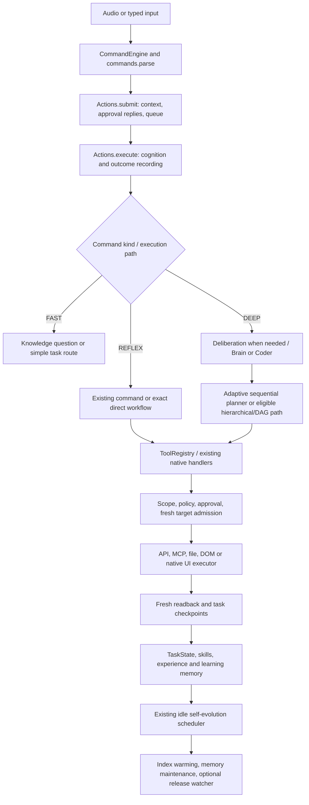

# Unified intelligence integration — 2026-10-21

This is an incremental candidate on `codex/unified-intelligence`, based on
`d5ed6eda72ce439122856a0e34fd5f99f7e5dbe0`. It upgrades existing execution and
discovery, without replacing working subsystems. Full ten-phase acceptance is
still open; see the [cumulative handoff](CLAUDE_HANDOFF.md).

## Diagnosis from implementation and measurements

`commands.parse` already has constant-time reflex entries and extensive native
grammars. Ordinary commands do not all need a model. The expensive path is often
the surrounding preparation and execution, not text classification alone.

1. `capabilities.rank_tools` previously tokenized every registered tool description
   and ran an exact-name expression per tool on every search. Seven warm queries
   over 120 tools measured p50 **13.754 ms**, p95 **14.642 ms**, before this change.
   Immutable token postings now narrow candidates; configuration, scope and
   prerequisites remain freshly checked. Final measurements were **1.335 ms** and
   **2.923 ms**, respectively. This is about a **90.3%** p50 reduction in that
   microbenchmark, not a voice/model/task latency result. Selected names match.
2. `Actions._execute(task)` previously prepared an opinion before trying
   `direct_execution.run` or `fast_workflows.run` for longer requests beginning
   with `fill`, `scroll` or `click`. A wiring detail limits the inference claim:
   production `Brain` exposes `client.request`, whereas Deliberation looks for
   `brain.request`, so this configuration falls back to a heuristic opinion
   after context retrieval. The new selector recognizes the complete enabled
   grammar first and avoids that preparation. Simulated executor tests prove one
   direct attempt and zero opinion callbacks, planner fallback on pre-dispatch
   decline, and no fallback after uncertainty. **No live opinion-model call
   reduction was demonstrated.** Connecting a separate opinion model would add
   inference before planning and needs a measured quality/latency decision.
3. A `ToolRegistry` is frequently reconstructed by Brain planning/validation.
   Search caching now survives these wrappers. A metadata view of registrations
   is reconciled at Actions startup and reused, rather than rediscovering tools
   through model prompts. Unknown MCP servers/tools remain unknown until the
   existing approved discovery path runs.
4. Several preparation systems intentionally coexist: deliberation retrieves
   cognition/skills; BrainClient attaches lessons, memory, live application
   context and capability hints; coding may prepare repository references;
   Knowledge can prepare conversation selection separately. These are traced
   architectural costs, not proof that each retrieval is redundant. This change
   does not remove them without quality measurements.
5. Existing GPU admission may queue and observe resident models before inference.
   Native UI observation, disk checkpoints and outcome journaling also contribute
   to latency. Twenty actual ToolRegistry reads of an owned synthetic file all
   matched exact contents: p50 **15.288 ms**, p95 **18.255 ms** including dispatch
   and journaling. No before/after speedup is claimed for those reads.

The unchanged three-command parser fixture measured p50 0.0013 → 0.0015 ms;
there is no parser speed improvement claim. Concurrent regression load and these
small samples limit interpretation of the latency figures.

One public arithmetic request to the **installed** local `qwen2.5:0.5b`, through
the existing GPU admission wrapper, returned the correct integer in **2.544 s**.
Ollama reported **2.193 s** loading, **0.155 s** prompt evaluation and **0.013 s**
generation ([duration field definitions](https://docs.ollama.com/api/generate)). This single observation demonstrates why avoiding unnecessary model
loading can matter more than shaving microseconds off parsing. It is not a
paired optimization benchmark or a complex-task/voice acceptance result. No
model was downloaded and no tool was dispatched by that probe.

## Actual architecture and task flow



| Request / subsystem | Implementation actually inspected | Behavior and limits |
|---|---|---|
| Simple voice/typed command | `engine.py`, `commands.py`, `actions.py`, `audio.py`, `voice_input.py` | Wake/segment handling, deterministic parsing, queue and existing command handlers. Real microphone latency was not measured here. |
| Question | `knowledge.py`, `context_hub.py`, `hybrid_inference.py` | Current-session context first; optional bounded memory selection, local/privacy-controlled cloud routing. No new paid dependency. |
| Desktop task | `direct_execution.py`, `desktop_actions.py`, `execution_router.py`, `brain.py` | Complete exact grammar can avoid inference; fresh controls and executor postconditions still required. Uncertain input stops. |
| Complex autonomous task | `brain.py`, `adaptive_planning.py`, `hierarchical.py`, `task_state.py`, `task_recovery.py` | Existing progress ledger, accepted criteria, partial progress, fresh observations and final verification. Existing specialized paths keep their separate contracts. |
| Coding | `brain.py`, `repo_learning.py`, `repo_abilities.py` and Coder handoff | Repository knowledge is reference text; generated abilities and core code promotion retain testing/approval boundaries. No ability activated in this task. |
| Capabilities / connectors | `tools.py`, `capabilities.py`, `agent_tools.py`, `mcp_bridge.py`, `execution_strategy.py` | Actual registered tools, task scope and configuration determine eligibility. APIs/structured automation retain precedence. Cached metadata cannot register tools or authorize a connection. |
| Memory / procedures | `cognition.py`, `skill_memory.py`, `experience_memory.py`, `learning_memory.py`, `step_planning.py` | Historical memory remains intact. Exact-goal native navigation recipes require verified traces, fresh fingerprints, bounded eligible controls and final-state matching. General parameterized procedure synthesis is not newly certified. |
| Model / GPU | `brain.py` BrainClient, `hybrid_inference.py`, `gpu_scheduler.py` | Existing leases, role admission, resident-model observations and fallback remain. No model/runtime setting or driver changed. |
| Self-improvement | `self_evolution.py`, `repo_learning.py`, `repo_abilities.py` | Existing backlog, idle/resource checks, checkpoints, isolated testing and explicit source-promotion approval remain. No self-modification activation occurred. |
| Screen / speech / Island | `screen_awareness.py`, `speech.py`, `natural_voice.py`, `island.py` | Existing reports/notifications continue; no new UI layout or claimed screenshot. Physical TTS/DPI/foreground interaction gates remain separate. |

## Integrated behavior

The native navigation cache now consults the same negative-experience gate used
by SkillMemory proposals. A later recorded failure can block an older verified
recipe even if its initial UI fingerprint still matches. The blocked shortcut
dispatches nothing and returns to ordinary fresh planning. The combined
learning/navigation suite passed **147 tests**, including a real persisted
negative-experience fixture; this is not a live model learning-effectiveness score.

The broad run also exposed an intermittent Windows access-denied error while
marking generated MCP registrations drifted. `mcp_synthesis.save_registry` now
uses the existing `checkpoint_io.replace_checkpoint` guard: only known sharing
errors with unchanged source/destination metadata may retry. It preserves pending
metadata on conflict and writes silent repair status through the existing log.
Injected sharing-error tests and the final affected suite passed **303 tests**
with **4 platform skips**. No MCP server/action is replayed by metadata recovery.

`deliberation.execution_path` returns REFLEX, FAST or DEEP plus a categorical
reason. It uses command kind, complete enabled grammars, risk text, ambiguity and
resume state. It makes no model call and grants no permission. A task records its
route in the existing task checkpoint. Unknown/resumed/coding tasks retain the
established planning route. High-risk requests retain deliberation/approval
handling. FAST labels the existing lightweight route; it is not a new model.

`.jarvis-runtime/capabilities.json` is a persisted **reference view** of
ToolRegistry, not another authority registry. It contains registration metadata,
argument summaries, configuration variable names, implementation locations,
registration fingerprints and verification/recovery requirements. Startup
reconciles saved data against host registrations, ignoring forged/removed rows.
Unchanged registrations avoid rewriting disk. Storage failure leaves an in-memory
view and does not retry an external action. Idle maintenance may retry metadata
persistence at the existing ten-minute cadence.

The `runtime_capabilities` tool returns up to sixteen relevant records with fresh
configuration status, explicit **not_probed** connection health and bounded
historical latency/outcome counters from the existing journal. Counters are
adapter-reported, not independently authenticated or revision-bound success
proof. No arguments, credentials, responses, private window titles or environment
values are persisted. Argument summaries do not replace specialized validation
or live MCP schemas. Dependency compatibility and account health remain executor
and launcher responsibilities.

Idle capability maintenance uses the existing SelfEvolution thread and its
CPU/RAM/battery/foreground admission checks. It builds one bounded in-memory
postings index and incrementally reconciles metadata; it does not recursively
scan the repository or load a model. Cancellation before commit keeps the prior
manifest. The short atomic metadata commit is not itself interruptible. No
additional daemon, package, model or runtime-manifest service is introduced.

## Optional technology watcher

Add this top-level section to `config/config.json` to enable it on the next start:

```json
"technology_watch": {
  "enabled": true,
  "sources": ["ollama", "mcp"],
  "interval_seconds": 86400
}
```

It defaults to disabled. Supported source keys are `ollama`, `llama_cpp`, `mcp`,
`transformers`, `vscode`; choose those relevant to active projects. The existing
idle loop checks one due official GitHub latest-release endpoint at a time,
without authentication or inherited proxy/.netrc credentials. It refuses
redirects, caps response bytes, checks cancellation between bytes, bounds socket
waits and the fetch duration, and checkpoints failure backoff. A foreground
request can leave at most the current socket wait before the watcher notices
cancellation. Network latency and OS scheduling are not real-time guarantees.

The first observation seeds quietly. Changed stable tags produce an existing
notice, a source URL/publication date and an explicitly untested compatibility
assessment; package version is included when available in the current worker.
The last twenty findings and per-source cursor survive restart in
`.jarvis-runtime/technology-watch.json`. No change or failed read emits general
news. Nothing is installed, evaluated as code or promoted automatically.

This initial watcher detects release changes, not semantic project suitability,
breaking-change severity or security advisories. Blender/Unreal documentation
feeds and automatic project-to-source selection remain follow-up work.

Firecrawl research checked the official [Ollama FAQ](https://docs.ollama.com/faq)
and [GitHub latest-release API](https://docs.github.com/en/rest/releases/releases#get-the-latest-release)
on 2026-10-21. Ollama documents model residency, memory-dependent concurrency,
context sizing and optional inference memory optimizations. Applying them to
this machine needs a separate live quality/resource comparison; none was changed
based on documentation alone.

## Verification and reproduction

Use the existing `.venv` interpreter. Run commands from the application root.
On this Windows sandbox, selected tests needed an owned writable temporary
folder to avoid atomic-replace access errors. For the complete suite use normal
host temporary storage, or the existing `.jarvis-runtime` scratch area below:
evolution labs intentionally refuse ordinary scratch paths inside production.
Earlier trials under `artifacts/verification-tmp` remain ignored local scratch.

```powershell
New-Item -ItemType Directory -Force .jarvis-runtime/verification-tmp | Out-Null
$env:TEMP = (Resolve-Path .jarvis-runtime/verification-tmp).Path
$env:TMP = $env:TEMP
.venv/Scripts/python.exe -m pytest tests/test_unified_intelligence.py -q
.venv/Scripts/python.exe scripts/verification/unified_intelligence_benchmark.py --output artifacts/unified-after.json
.venv/Scripts/python.exe scripts/verification/unified_intelligence_trace.py artifacts/new-owned-read-trace
.venv/Scripts/python.exe -m jarvis.launcher --check
```

The trace script requires a fresh output directory and preserves earlier traces.
Its first development attempt exposed CRLF fixture expectations; the corrected
fixture writes explicit UTF-8 bytes. That was a harness correction, not a changed
file-reading behavior. Model/API/UI work was not simulated into live acceptance.

See the [dated evidence packet](../artifacts/jarvis-audit/unified-intelligence/2026-10-21/README.md)
for final regression/readiness results and hashes. Restart Jarvis to load code;
Start/Stop, bootstrap, launcher, runtime manifest and recovery interfaces need no
format change. Full voice, complex-task success, quality-preserving GPU tuning,
procedural transfer effectiveness and sustained idle resource acceptance remain
open in the handoff.

Final production-source complete run: **3,889 passed / 150 skipped / 2 native
fixture failures / 1 warning**. The two demonstration cases passed in isolation;
after explicit owned-window foreground/point admission, the complete module
passed **38/38** with recorder assertions unchanged. The affected source suite
passed **303 tests / 4 platform skips**. No complete-suite rerun followed this
test-only readiness correction; a single all-green full-run verdict remains an
unexecuted gate. Host launcher readiness passed independently.
