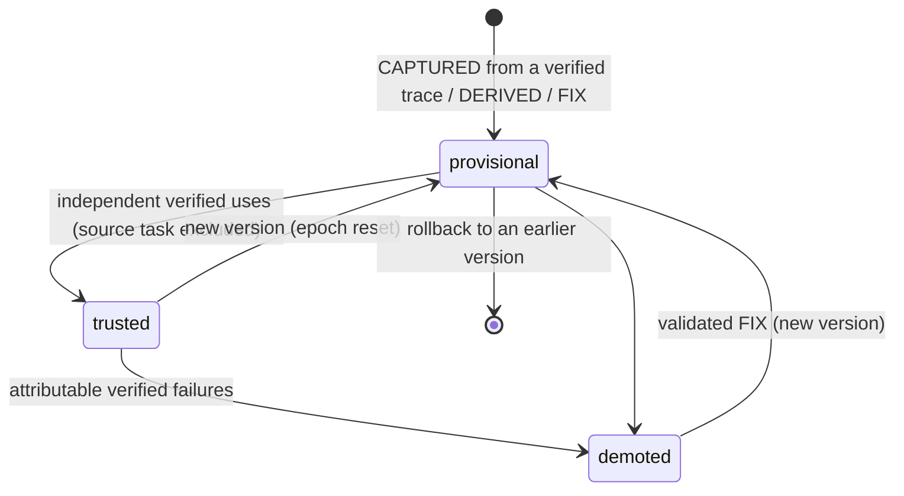
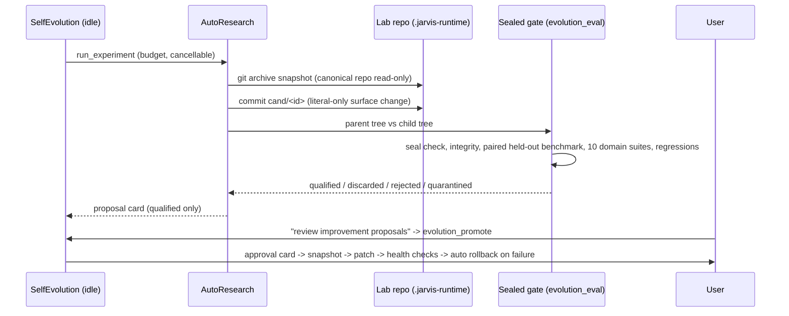

# Jarvis upgrade architecture (Phases 1–8)

Status as verified on 2026-10-19 (branch `claude`). This page documents only what is implemented and tested; see
[the final Codex handoff](../artifacts/jarvis-audit/final-codex-handoff/README.md) for evidence, blocked items and
limitations. The actual import graph is in
[module-dependency-map.json](../artifacts/jarvis-audit/final-codex-handoff/module-dependency-map.json)
(no module-level import cycles; 262 modules).

## 1. Overview

```mermaid
graph TD
  U[User: voice / text / approval cards] --> A[actions.Actions]
  A --> B[brain.Brain planner + recovery]
  B --> TR[tools.ToolRegistry - single execution authority]
  TR --> ES[execution_strategy: API/code first, structured next, GUI last]
  ES --> AD[app_adapters: office/pdf/blender/unreal/vscode workers]
  TR --> DAG[dag_execution.Executor: verified, checkpointed, no effect replay]
  B --> DL[deliberation + FailureRouter]
  DL -->|unknown UI| SMO[demonstration: Show Me Once]
  DL -->|reasoning x3| CA[cloud_architect_consult tool: privacy gate + approval]
  B --> SK[skill_memory + skill_store + skill_evolution: CAPTURED / FIX / DERIVED]
  SK --> MCP[mcp_synthesis: generated MCP servers in a network-less container]
  B --> RB[reasoning_bank lessons]
  B --> OV[viking_memory: OpenViking read-only vault index]
  SE[self_evolution idle loop] --> SK
  SE --> LM[learning_memory: exploration, compaction]
  SE --> AR[autoresearch -> evolution_lab (separate repo) -> evolution_eval gate (sealed)]
  AR --> PR[evolution_promotion: approval, snapshot, health checks, rollback]
  T[offline: build_azr_dataset / train_azr_lora] --> MG[evolution_eval.model_gate] --> REG[model_registry: experimental]
```

## 2. ToolRegistry compatibility

`ToolRegistry.execute` remains the only executor. New capabilities enter as toolkit entries
(`toolkits.TOOLS`: toolkit, description, required environment variables, `external_write`). `external_write=True`
yields `approval: user` metadata, the Brain's explicit-intent check and the never-replay outcome contract.

| Phase | Tools added | Approval |
| --- | --- | --- |
| 2 | `office_xlsx`, `office_docx`, `pdf_document`, `office_automation`, `blender_task`, `unreal_task`, `vscode_cli`, `execution_methods`, `strategy_execute` | writes approve themselves inside the adapter |
| 3 | generated `gen-*` MCP servers (through `mcp_bridge`, after approval) | registration needs approval |
| 6 | `evolution_status` (read-only), `evolution_promote`, `evolution_rollback` | user (card) |
| 8 | `cloud_architect_consult` | user (card shows the exact payload) |

Every dispatch writes a categorical `tool.outcome` row (Phase 1 `execution_contracts`); uncertain external writes are
never replayed automatically.

## 3. Skill and MCP lifecycle (Pillar A)



Telemetry: `.jarvis-runtime/skills/skill_store.sqlite3` (unique event keys; trust is a deterministic function of the
evidence in the active version). Generated MCP code is AST-screened, runs in `jarvis-mcp-runtime:1`
(`--network none`, read-only, `--cap-drop ALL`, non-root, memory/PID limits) and is registered only after approval.

## 4. Memory (Pillar B)

| Store | Location | Schema / version | Writes |
| --- | --- | --- | --- |
| ReasoningBank | `.jarvis-runtime/reasoning_bank/bank.sqlite3` | items, relations, trajectories | strategies only from verified outcomes; anti-patterns from failures |
| OpenViking index | `.jarvis-runtime/openviking/` (owned server, port 19330) | manifest with verified links | the Obsidian vault is read only (staged copies) |
| Skill store | `.jarvis-runtime/skills/skill_store.sqlite3` | living metrics, versions, lineage | evolved skills under `.jarvis-runtime/skills/evolved` |
| Evolution archive | `.jarvis-runtime/evolution/archive.sqlite3` | `schema_version` 1 | candidates, runs |
| AZR datasets | `.jarvis-runtime/azr/datasets/<version>/` | `schema_version` 1 + SHA-256 manifest | append-only versions |
| Model registry | `.jarvis-runtime/models/registry.json` | list of entries | experimental by default |

Migrations: every store is created on first use. Damaged SQLite stores are preserved under a `damaged-*` name and
recreated. No upgrade changes an existing schema in place.

## 5. Self-evolution and evaluation (Pillar C)



Mutation surfaces: `evolution_surfaces.SURFACES` (seven literal dicts). Protected: policy, approval, evaluator,
deployment, tests, configuration (`PROTECTED`).

## 6. Local model training (Pillar D)

Offline and manual: `build_azr_dataset` → `train_azr_lora` (LoRA on checksum-pinned Qwen2.5-Coder-0.5B; preemptible,
cancellable, exact resume, VRAM/RAM/time limits) → `evolution_eval/model_gate.py` (sealed held-out AZR set, paired) →
`model_registry` (experimental; approval needs a qualified gate, ≥95 % export match and a card, and still changes no
configuration). No runtime path loads trained adapters.

## 7. Resources and scheduling

| Setting | Default | Effect |
| --- | --- | --- |
| `gpu_scheduler.enabled` | true | shared lease registry; training checks it between steps and stops when Jarvis needs the GPU |
| `self_evolution.*` | enabled, idle 90 s, ≤4 learning jobs/day | idle-only background work |
| `evolution_lab` | enabled, 1 experiment/day, 2,400 s budget | candidate processes at below-normal priority with memory/time caps |
| `exploration` | enabled for `blender`, 6/day | isolated sandboxes only; desktop exploration disabled |
| `viking_memory` | enabled, port 19330 | ~442 MB RAM for the owned server |
| `cloud_architect` | **disabled** | reached only through `cloud_architect_consult` |
| `demonstration` | enabled, 10 steps | Show Me Once after repeated unknown-UI failures, with consent |

## 8. Security boundaries

* Authorization is never granted by plans, skills, prompts, cloud advice, demonstrations or evolution candidates;
  only the host approval card grants it (`Actions._approve`).
* Untrusted code (generated MCP servers, cloud advice code, induction answers) runs only in the network-less
  container; static screens come first and are not treated as proof of safety.
* Cloud egress needs: enabled config, a free plan, quota, consent through a card, three verified local reasoning
  failures, and a passing refuse-don't-redact privacy gate.
* Self-evolution never writes production without approval; the evaluator is sealed; experiments never touch the
  canonical repository.
* Uncertain external writes are never replayed (DAG executor, task recovery, trainer checkpoints).

## 9. Approval workflows

| Kind | Raised by | Card shows |
| --- | --- | --- |
| `self_modification` (pre-existing) | `SafeEvolutionManager.deploy` | file, rationale, new source |
| `demonstration_recording` | Show Me Once | application, window, what is recorded, step limit |
| `cloud_consultation` | `cloud_architect_consult` | exact payload to be sent, provider |
| `evolution_promotion` / `evolution_rollback` | evolution tools | change, hypothesis, held-out result, domain suites |
| `model_promotion` | `model_registry.approve` | that no configuration or endpoint changes |
| adapter writes (Phase 2) | office/pdf/blender adapters | target and change |

## 10. Rollback and emergency recovery

* **Code:** every phase is a set of commits on `claude`; `git revert` the commits listed in each phase's `commit.txt`.
  The pre-upgrade baseline is `5b52737`.
* **Disable without reverting:** `evolution_lab.enabled=false`, `exploration.enabled=false`, `viking_memory.enabled=false`,
  `demonstration.enabled=false` (`cloud_architect` is already off).
* **Evolution release:** `python -m jarvis.evolution_promotion rollback <release>` (works while Jarvis is stopped;
  refuses to overwrite later edits).
* **Skills:** `SkillEvolution.rollback(skill_id, version)` or disable a skill via the store.
* **Runtime state:** everything under `.jarvis-runtime/` is ignored by Git; deleting a subfolder removes only that
  feature's history (never source or the Obsidian vault).
