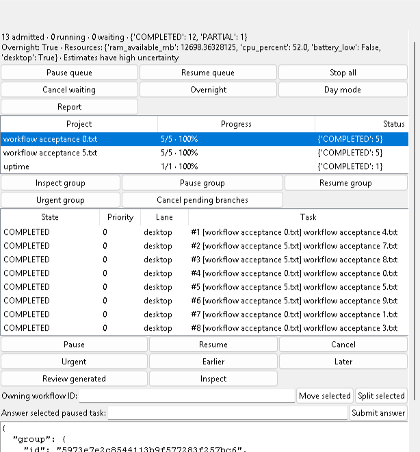

# Context-aware workflows — 2026-10-23 IST

This addendum extends [the durable queue](autonomous-task-queue.md) on `codex/autonomous-task-queue`. It uses the **same SQLite database, inbox, scheduler, Actions/Knowledge workers, ToolRegistry, approval cards, model router, GPU gates, checkpoints, watchdog and Island desk**. There is no second executor, new dependency or new long-running service. Existing voice defaults and Stop/Quit semantics remain unchanged.

## Relationships and ownership

`workflow_graph.TaskRelationshipResolver` matches explicit task numbers, exact quoted project/goal names, project/application references and recorded artifact paths/names. Examples include `Find issues in project "alpha"`, `Now fix those issues in project "alpha"`, `After that, run all tests for project "alpha"`, and `Use results from tasks 12 and 14 to create a comparison`. Matching project context alone does **not** impose an execution dependency. Similar wording alone never merges tasks. Each admission remains a distinct task with one owning workflow, even when it has several contextual relations.

For ambiguous continuations, compatible stage/lineage and project matter; bare recency across competing workflows is insufficient. Already observed application/project context can disambiguate only when it agrees with project references in the current conversation **and** the cached application observation is open, visible and at most 30 seconds old. Unknown, stale, hidden, closed or future-dated context cannot select a referent. This reads existing caches without scanning the desktop, persisting unrelated titles or calling another model. Uncertain links wait as `WAITING_USER`. Use `link task 15 after tasks 12 and 14` to identify the intended producers. Missing named-project/explicit-number producers are reconsidered when new context arrives, so uniquely justified forward relationships can resolve after later admissions. Unscoped pronouns never bind to a future unrelated task. Arbitrary semantic references and implicit real-world prerequisites remain conservative clarification cases; no fuzzy model may silently authorize an edge or action.

Workspace (`local`) → persistent project/goal group → workflow → task → bounded child task → existing TaskState execution checkpoints. Groups store goal, project/application metadata, priority, completion criteria, pause status and timestamps. Snapshots derive actual progress, artifacts and error/recovery history from authoritative task rows. Adding a task to a running workflow preserves its checkpoint and existing side-effect owner. Undispatched tasks can move or split into another workflow without discarding their history or dependencies.

## Persisted graph and result contract

The queue database gains `workflow_groups`, `workflows`, `workflow_nodes`, `workflow_edges`, `task_relationships`, `workflow_results`, `workflow_evaluations` and append-only `workflow_revisions`. Existing queue records are backfilled after owner acquisition, retaining their lifecycle and explicit dependencies. This metadata migration does not execute old work. Each dependency update validates the entire DAG atomically and rejects unknown/self/circular requirements. Started tasks' requirements cannot be rewritten. Mandatory and optional prerequisites, multiple inputs and success/failure/test-pass/test-fail/always conditions are explicit structured fields.

Completion commits a versioned TaskResult in the same transaction as terminal lifecycle state. It contains task ID, outcome, verification status, structured output, actual artifacts/findings, errors/warnings, recorded tests, timestamp, provenance, input-result versions and reusable workflow context. Generic handler prose stays **unverified**. File readback receipts, trusted structured handler evidence, allowlisted read-only observations or the existing adaptive goal verifier can establish the relevant verification status; this is not a claim that arbitrary inferred answers are factually correct. A model's `workflow_expand` proposal cannot assert verification or grant permission.

Readiness checks actual committed results. `requires_result` edges block until a verified, fresh result exists. Test branches additionally require structured `tests: {verified: true, passed: true|false, ...}`; text saying “tests passed” is insufficient. Known opposite conditions cancel only the ineligible pending branch with a recorded conditional-skip reason. Failure of a mandatory prerequisite blocks its dependents; unrelated and optional branches remain eligible. A cancelled or partial task is not treated as a successful prerequisite.

At dispatch, input versions bind to that task's checkpoint. Brain/code planning and Knowledge receive actual results in structured `memory_context.task_results`. Knowledge marks the request as an internal workflow, disables external search and bypasses context-free quick answers, natural-chat shortcuts and unrelated conversation/realtime lookups. Public-looking question wording cannot promote these results to cloud inference or search. Results never become instructions or tool-approval receipts. Parameters are informed at execution time, rather than guessed when admitted. The same completed producer is reused without rerunning it. SHA-256 checks of recorded files (up to 32 MiB each) and transitive input-version checks invalidate stale result chains. Invalidation preserves completed history and never automatically replays writes; request fresh inspection/new remaining work. Unsupported or oversized handoffs defer with a blocker rather than killing a worker.

## Scheduling, expansion and recovery

Group priority and bounded downstream importance/critical-path duration supplement existing individual priority, deadline, estimated duration and unbounded aging. Dependency, approval, desktop-lock, RAM, CPU, battery and per-lane locks remain hard gates before scoring. Independent observation/question branches can overlap. **General code repairs, shared-planner tasks and file/desktop mutations remain serialized**; this addendum does not pretend those workers have isolated workspaces. Conflicting writes therefore cannot run concurrently through the queue. Parallel coding would require the separate isolation work recorded in the handoff.

The registered `workflow_expand` tool proposes child requests in the current durable workflow. Its stable key deduplicates across retries/restarts, and all child creation plus a combined-verification join is one transaction. Limits are **20 children/call, 50/workflow and depth 3**, with **64 prerequisites/node**. Invalid batches roll back both SQLite and scheduler admission state. Children wait for a verified parent result. Generated effectful tasks additionally wait for explicit scope review using **Review generated** in Queue; existing execution-time tool approvals still apply. Generated commands cannot carry an `approved_plan`/resume authorization claim. `TaskIngress.expand(..., join=task_id)` adds the children as prerequisites of an undispatched combined verification task. It creates no worker and bypasses no existing quotas or resource controls.

`TaskIngress.propose_strategies` validates alternative DAGs before offering them through the existing DecisionManager. The timer starts only when the native question is mapped. Automatic choices require sufficient confidence, reversibility and read-only scope. Sensitive choices stay blocked at timeout. Routine alternatives cannot remove existing prerequisite/verification constraints. Graph application and the applied marker commit atomically; a selected decision interrupted before application is recovered once. If a task has started or the graph changed incompatibly, the strategy is recorded as deferred rather than rewriting running work.

The existing watchdog remains responsible for intake workers. Graph state, parent/child nodes, results, evaluations and decisions reconstruct from the same WAL database. In-flight uncertain effects pause for fresh reconciliation, preserving receipts. Only existing bounded read-only retries are automatic; there is no rollback, unsafe effect retry or repeated expansion loop.

## Island and commands

The existing Queue view now includes group/project names, aggregate counts/progress, task ownership, dependency blockers, group inspection, pause/resume/urgency and pending-branch cancellation. Task inspection shows why links exist, conditions, upstream result versions, artifacts and lifecycle history. Existing Pip animations and approval cards stay authoritative. Group pause prevents new dispatch and lets an in-flight cooperative operation reach its boundary.

The real Island panel is compact: queue tables and controls use a vertically scrollable body with wrapped button rows. Routine decisions stay above that body. A mapped parent alone cannot start the timer; the question and all options must fit visibly inside the actual panel. Scrolling task details cannot hide a pending decision. Hidden/clipped decisions wait for a visible presentation.

| Action | Control |
|---|---|
| Add a command to an existing workflow | `add to workflow WORKFLOW_UUID: create file example` |
| Clarify or add dependencies | `link task 15 after tasks 12 and 14` |
| Move an undispatched task | `move task 15 to workflow WORKFLOW_UUID`, or workflow-ID field + Move selected |
| Split an incorrectly grouped task | Select task → Split selected; requirements/history remain |
| Pause/resume/prioritize a group | Native group buttons, or `pause group GROUP_UUID` / `resume group GROUP_UUID` / `urgent group GROUP_UUID` |
| Cancel pending branches | Group button, or `cancel pending group GROUP_UUID` |
| Review generated effectful work | Inspect task, then Review generated; this grants no tool approval |
| Continue a tool clarification | Existing `answer task 15: ...` |

Reports include current-batch group/workflow counts, actual completed/blocked/failed/skipped branches, decisions, artifacts and next actions. Lifetime progress and reused prerequisites from earlier batches are labeled separately. They never invent tests, fixes or files.

## Verification and remaining acceptance

Current complete regression: **4,100 passed / 155 gated skips / zero failures**, one existing COM warning, all **519 source hashes unchanged**. The short actual task batch passed 12/12; actual owned-process crash recovery and local-model structured result handoff passed. Five existing demonstration fixtures remain gated by foreground focus in the latest run, with explicit reasons preserved; they passed in the preceding complete run.

See [dated graph evidence](../artifacts/workflow-graph/README.md) and [cumulative handoff](CLAUDE_HANDOFF.md). Automated graph tests exercise all twenty requested scenario categories, including reordered admission, ambiguity, multiple results, conditional branches, shared-file serialization, expansion bounds, crash recovery, routine/sensitive decisions, stale artifacts and accurate short-batch reports. Those fixtures do not certify a physical all-night workload, arbitrary project repairs, new parallel coding isolation, account effects or the previously open strict speech gates.

No package/model/driver installation is required. Configuration continues to use `task_queue.enabled`. Disabling it selects the previous queue and preserves graph SQLite data/reports. Start/Stop/bootstrap/launcher/recovery entrypoints are unchanged. Do not remove the database to “reset” an uncertain task.
