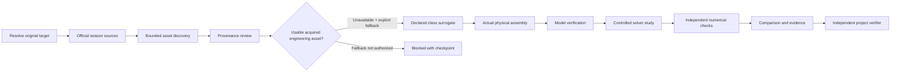
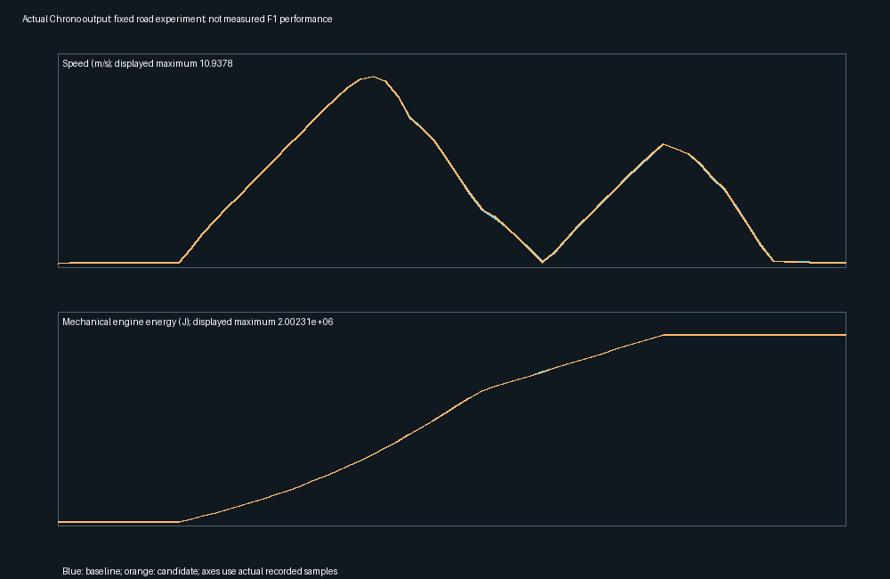

# Scenario A workflow repair — 6 November 2026 IST

This update implements the user's “Root Cause, Technology Selection, and Implementation Assignment.” It replaces open-ended planning **for supported single-season F1 engineering requests** with a registered deterministic workflow in the existing neural brain. Other requests and the legacy rollback remain available. The original exact-team case and an explicitly permitted class surrogate are distinct acceptance scopes.

The document's Chrono planning-only statement was stale: the user subsequently approved the full isolated installation and 50 bounded trusted CPU invocations. That installation is retained. No additional package, model, driver, service, paid API or account write is introduced. Shipped Lab flags remain false; the old application repair campaign remains paused.

## Why the previous runs stalled

The generic planner could repeatedly inspect schemas/catalog entries without producing the physical model required by the goal. Additional progress messages and a final completion guard detected this but did not implement the missing handoffs. Historical attempts also exposed argument-contract mismatch, wrong-season searches, namespace/folder confusion and clipped source indexes.

[Historical episode audit](evidence/a-episode-audit-2026-11-06.json) covers the 14 original terminal A1/A2 runs. Exact retained TaskState arguments and Journal proposals are exported privately. Old traces lack authoritative per-stage state digests/resource accounting; those fields are null, not invented. A rejected repeated proposal is not described as a duplicated side effect.

## Architecture and technology choices

| Concern | Implementation |
|---|---|
| Routing | Existing `Actions → neural.compiler → dispatcher`; two new registered neurons, 50 total Lab descriptors and 43 owned template checks |
| State | Strict versioned `ScenarioAVehicleState`, persisted as immutable artifacts/indexes in the existing Journal; no second database/planner |
| Actions | Closed stage enum and code-generated Pydantic action schemas, `extra=forbid`; deterministic known workflow needs no model-selected tool arguments |
| Recovery | Claim before effects; stable stage/action/argument/artifact fingerprint; preserve every failed attempt; two failed-read admissions maximum; no uncertain-write replay |
| Research | Jarvis discovers the edition-specific official FIA PDF from the public index, retains dates/hashes and extracts supported clauses; one bounded exact-season public model search through the existing source neuron/verifier |
| Acquisition decision | Metadata alone cannot establish engineering identity, inspected geometry or legal binary acquisition. No OAuth/download restriction is bypassed. Surrogate fallback requires explicit permission in the original goal |
| Geometry | Reusable procedural SI envelope geometry, 11 separated mesh components, independently read-back GLB topology/coordinates, three labelled PNG views and physical bindings |
| Physics | Existing approved CPU Chrono::Vehicle 10.0.0; real double-wishbone bodies/joints, rack steering, brakes, drivetrain, engine and TMeasy force/slip model |
| Numerical checks | Actual masses/inertia, four-wheel load balance after settling, steering/acceleration/braking/turning, tire slip, joint residuals, half-step comparison and declared ±10% joint aero envelope |
| Evidence | Native JSON, GLB, CSV, actual-trace PNG, source/license records, manifest hashes, immutable episode trace, independent project verifier and read-only exported-file audit |

LangGraph is unnecessary: the existing dispatcher already supplies typed nodes, durable effects and verifier gates. Ollama's structured-output guidance informs strict schemas, but there is no extra inference call in this deterministic routine. CadQuery/FreeCAD, Fastest-lap and FastF1 remain optional future fidelity/calibration extensions; they were not silently installed or represented as used.



The current path does not implement authenticated model import or reference-photo reconstruction. It reports that limit and generates a permitted surrogate instead of pretending that a catalog record was downloaded. It does not claim an exhaustive search proves no exact engineering asset exists anywhere.

## Stage contracts and evidence

The 13 states are `resolve_target`, `requirements_and_sources`, `discover_assets`, `validate_provenance`, `inspect_asset`, `generate_parametric_surrogate`, `assemble_physical_vehicle`, `validate_model`, `simulate`, `independently_check`, `compare`, `present_evidence`, `completed`.

Every accepted transition records its exact typed arguments, pre/post state digests, artifact references/file hashes, elapsed time, outcome, retry reason and available actual CPU/invocation usage. Source narration, screenshots, planned steps or a bare `passed` flag cannot advance a stage. A claimed/uncertain action stops for reconciliation; a verified stage resumes only after its evidence is rechecked. Progress uses the existing brain report bus and TaskState checkpoints.

The final verifier rechecks every stage; the original request is retained. A nested native `lab …` command cannot manufacture a new natural-language project/fallback permission. Negative surrogate instructions and signed parameter deltas are preserved. Source data never supplies instructions.

## Scientific scope

The model is an **educational, regulation-referenced F1-class surrogate**, not exact McLaren/team CAD, a full FIA legality assessment or a calibrated racing model. The sourced envelope constraints and 2026 mode definitions remain distinct from assumed masses, inertia, suspension, tire and aero parameters. Unknowns and intervals are exported. Native JSON templates retain their actual upstream BSD license text.

The fixed 13-second road experiment settles, accelerates, turns and brakes under prescribed controls. It compares one declared Corner Mode front-flap change with identical road, gravity, air, powertrain and controls. In 2026 the front/rear aero coefficients switch together in spatial Straight Mode zones; Straight Mode coefficients are unchanged by the candidate.

Checks require 5% stationary weight balance, positive-definite actual inertia, nonzero physical joints, actual steering and tire response, maximum joint residual 0.005 in Chrono's mixed generalized constraint coordinates, and 3% timestep sensitivity for reported metrics. Recorded residuals and errors are reported, not rounded into a physical-validation claim. The ±10% aero envelope is not a statistical confidence interval; other declared input intervals are not exhaustively propagated.

“Speed” means maximum observed speed in this experiment, not terminal speed or lap performance. Energy means mechanical engine shaft work, excluding fuel and hybrid conversion/storage losses. These outputs cannot establish real F1 performance or safety.

## Usage and reproduction

With the existing Lab flags and brain mode enabled by the user, give a general text/voice request such as:

> Find a legal 2025 McLaren F1 model and compare a front-wing change using real vehicle dynamics. If no suitable exact engineering asset is usable, use a clearly labelled regulation-referenced class surrogate. Preserve assumptions, licenses, numerical checks and raw results.

For 2026, request the two active-aero modes and a Corner Mode change explicitly. Do not provide a model ID, prepared parameter file or numerical answer to the acceptance run. The diagnostic `--surrogate-scope` switch appends only the fallback permission explicitly authorized by the new assignment; it never supplies engineering data. Original exact-only requests remain separate and may block.

Run files stay under `app/.jarvis-runtime/discovery/scenario-projects/<run_id>/`. From `app/`, audit a retained export without new solver/model calls:

```powershell
.venv/Scripts/python.exe -B -m jarvis.discovery.scenario_verify --manifest ".jarvis-runtime/discovery/scenario-projects/<run_id>/run_manifest.json"
```

Reissue the same goal against the same Journal to resume/revalidate its saved project. A new simulation consumes another approved slot and existing CPU admission; a fresh session cannot reset grants. Changing the goal creates a separate project. No global flag activation is performed by these instructions or tests.

## Verification status — corrected source

Full guarded regression: **5,556 passed / 0 failed / 161 skipped**; source stable. Fresh-process A1 reuse passed in 32.328s, zero model calls and no new solver slots (27→27). Strict configured typing: 79 files. Read-only readiness: ready, no service starts.

The source-selection defect and withdrawn A1 evidence are retained in the [correction record](evidence/scenario-a-season-correction.json). Final source: `6d82f0d7ec8434dea64db5e3ecf5c58ad92552f9d927aeff6a5c2f3dbc35d609`. The earlier interrupted full run is not certified.

| Case | Independent status | Duration | Model calls | Solver slots | Source edition |
|---|---|---:|---:|---|---|
| [A1](evidence/scenario-a1-attempt-19-audit.json) | Conditional surrogate pass | 91.125s | 0 | 23→25 | 2025-04-07, issue 3 |
| [A2](evidence/scenario-a2-attempt-5-audit.json) | Conditional surrogate pass | 123.813s | 0 | 25→27 | 2026-10-19, issue 21 |

Each audit retains the exact submitted input, stage timings, actual solver identity/worker hash, source URL/hash, generated-vs-acquired parts, numerical checks and output hashes. Both generated 11 separated visual components and native physical JSON; neither acquired an engineering asset. No prepared asset IDs, URLs, JSON, physics numbers or code were supplied during execution.

| Case | Maximum observed speed, baseline → candidate (m/s) | Maximum lateral acceleration (m/s²) | Shaft work (J) | Max joint residual | Max timestep metric error |
|---|---|---|---|---|---|
| A1 | 11.133400 → 11.130076 | 6.876072 → 6.905363 | 2001342.905281 → 2001428.849987 | 0.00180554 | 1.8968% |
| A2 | 10.937532 → 10.937785 | 6.804385 → 6.801492 | 2002306.534109 → 2002174.490051 | 0.00130224 | 0.7531% |

Joint residuals use mixed Chrono generalized coordinates. Deltas are small relative to numerical/input uncertainty; they do not establish a real performance improvement. Full precision, parameter intervals and aero-envelope results remain in each actual report. Cross-year performance is not a controlled isolation of regulations: dimensions and declared season models differ.

A1: [actual report](evidence/scenario-a-corrected-2026-11-06/A1/report.md), [native/visual artifact hashes](evidence/scenario-a-corrected-2026-11-06/A1/bundle_manifest.json), [solver inputs](evidence/scenario-a-corrected-2026-11-06/A1/solver_configuration.json), [raw CSV](evidence/scenario-a-corrected-2026-11-06/A1/raw_output.csv), [physical model](evidence/scenario-a-corrected-2026-11-06/A1/physical_model.json), [Chrono license](evidence/scenario-a-corrected-2026-11-06/A1/LICENSE-CHRONO.txt).

A2: [actual report](evidence/scenario-a-corrected-2026-11-06/A2/report.md), [native/visual artifact hashes](evidence/scenario-a-corrected-2026-11-06/A2/bundle_manifest.json), [solver inputs](evidence/scenario-a-corrected-2026-11-06/A2/solver_configuration.json), [raw CSV](evidence/scenario-a-corrected-2026-11-06/A2/raw_output.csv), [physical model](evidence/scenario-a-corrected-2026-11-06/A2/physical_model.json), [Chrono license](evidence/scenario-a-corrected-2026-11-06/A2/LICENSE-CHRONO.txt).

Actual Jarvis-generated 2026 numerical diagnostic, driven by recorded solver traces (not a screenshot or physical validation):



The deterministic route supports a single season, standard road scenario and explicit numeric degree deltas. Unsupported custom environment, named-track, radian or word-valued parameter requests stay with the general brain instead of silently using default constraints. Aero modes switch coefficients instantaneously; actuator travel/lag/energy is not modeled. There is no full animation/workbench or photo reconstruction claim.

Recovery tests cover bounded failed reads, corrupt artifacts, invalid native physics, missing provenance, false completion and uncertain writes without replay. Fresh-process reuse revalidates the retained Journal/files; it is not a new solver result. All A–H, microphone/GUI, production and physical validation remain outside this proof. Shared CPU and invocation limits still stop additional work when exhausted.

Primary implementation references: [official FIA regulation index](https://www.fia.com/regulation/category/110/technical-regulations), [Chrono tire-model documentation](https://api.projectchrono.org/wheeled_tire.html), and [Ollama structured-output documentation](https://docs.ollama.com/capabilities/structured-outputs). Captured edition-specific URLs/hashes are in each actual run's source records.
