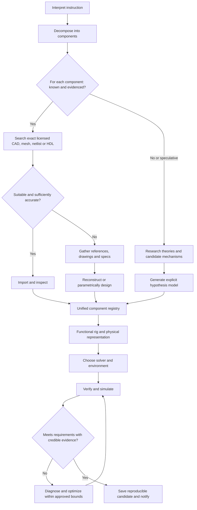

# JARVIS UNIVERSAL DISCOVERY, INVENTION & SIMULATION LAB — v2

**Complete research, tool catalog, architecture, design specification, staged implementation plan, verification framework, and master implementation prompt**  
**Prepared:** 2 November 2026 · **Revised (v2):** 4 November 2026 — every catalogued tool, repo, API and paper re-checked against current sources; outdated items replaced; the Lab re-wired into the existing JARVIS architecture (Neural Execution Brain, unified memory, model router, self-learning skills, agent-desktop PC control).  
**Scope:** Consolidates the full discussion: existing and fictional objects, scientific research, invention, model retrieval/reconstruction, Blender/CAD, functional rigging, physics and electronics, virtual environments, optimization, learning, and autonomous experimentation.  
**Status:** Research and proposed architecture; **not** an assertion that these integrations are installed, validated together, or running in the existing JARVIS repository.

---

## 0. Revision 2 — what changed and why (read this first)

### 0.1 The integration principle

v1 described the Lab as a large new subsystem (`universal_discovery_lab/` with its own director, planner, scheduler bridge, memory graph and approvals). That shape risks building a *second Jarvis inside Jarvis*. v2 changes the rule:

> **The Lab is not a new brain. It is a set of new *capability neurons*, *skills* and *solver adapters* that plug into the brain Jarvis already has.**

Concretely:

| v1 idea | v2 replacement (reuse what exists) |
|---|---|
| `discovery_director.py` as a new top-level planner | Register a **`discovery` capability cluster** in the existing **JARVIS Neural Execution Brain** (capability graph). The brain routes every request; the Lab only adds neurons and edges. See §4A. |
| New research/evidence memory store | Evidence, claims, parts and experiments become **typed node kinds inside the existing unified memory** (files/folders → profile facts with source context). One memory, more node types. See §13.3. |
| Lab-specific model selection | Use the **existing model router**; add routing *hints* per neuron (local small model for parsing/units, stronger model for hypothesis critique; paid/cloud only with approval). |
| Hand-written tool wrappers for every app | Prefer **MCP servers** (Blender, FreeCAD, KiCad) and **Agent Skills** (`SKILL.md` folders) so Jarvis can *learn* and load procedures on demand. GUI-only steps go through the **agent-desktop** PC-control layer already planned for Jarvis. See §4A.4–4A.6. |
| Custom long-job protocol | Use Jarvis's existing durable scheduler; for MCP tools that run long, adopt the **MCP Tasks extension** (task handle + polling) from the 2026-07-28 MCP spec. |
| "Learn new tools" left implicit | Formal **self-learning loop**: unknown solver/tool → research docs → generate adapter + skill → sandbox test against a golden problem → register neuron only after it passes. Matches the existing Jarvis goal of learning unknown tasks once and doing them autonomously next time. See §4A.3. |

### 0.2 Corrections from re-verification (4 Nov 2026)

| Item in v1 | Finding | v2 action |
|---|---|---|
| Blender MCP `ahujasid/mcp-for-blender` described as the Blender integration | Two different servers now exist. **Official Blender Lab MCP server** (projects.blender.org/lab/blender_mcp) — v1.0.0 April 2026, v1.0.3 Sept 2026, requires **Blender 5.1+**, and its maintainers warn it executes LLM-generated code without guards (VM/isolated system recommended). The **community server** renamed itself to **"MCP for Blender"** (repo `ahujasid/mcp-for-blender`, PyPI `mcp-for-blender`) in Sept 2026; it now also bundles paid "Premium"/Meshy/Tripo generation integrations. | Keep whichever Jarvis already uses; evaluate the official server for inspection/scripting; disable paid generation and telemetry in the community one; both talk to Blender over a local TCP socket (default 9876) → loopback only. |
| Blender version unspecified | Blender **5.1** (Mar 2026) moved to **Python 3.13** (compiled add-ons break); **5.2 is the LTS** (July 2026); 5.3 scheduled Nov 2026. | Pin **Blender 5.2 LTS** for the Lab; re-test add-ons after any upgrade. |
| Rigacar for initial vehicle rigs | Reported **broken since Blender 5.0**; only third-party rewrites exist. | Drop Rigacar. Generate vehicle visual rigs with a small Jarvis-owned bpy script driven by the component graph (the physics rig lives in Chrono/MuJoCo anyway). |
| PaperQA2 at `neuracap/paperqa` | That is a fork. Canonical: **`Future-House/paper-qa`** (PyPI `paper-qa`), docs now hosted by Edison Scientific; switched to CalVer tags (e.g. v2025.12.17) in Dec 2025. | Fix link; pin a CalVer tag. |
| Open Co-Scientist at `guy915/Open-Co-Scientist` | Could not confirm that repo. A verifiable, maintained implementation is **`jataware/open-coscientist`** (PyPI `open-coscientist`, LangGraph, MCP literature-review hook). | Replace reference; keep as design reference, not oracle. |
| OpenAlex "API terms and rate limits" | Since **13 Feb 2026 an API key is required for all requests**; usage-based pricing with a **free allowance of $1/day per key**; single lookups by ID/DOI stay free; full CC0 snapshot still free on S3. | Add key + budget meter; batch DOI lookups; use snapshot for bulk. |
| Semantic Scholar "API quotas" | Unauthenticated calls share a global pool; a personal key gives **1 request/second**, and key requests are approved for **institutional (non-free-domain) emails**. | Default to unauthenticated + caching; apply for a key only with an institutional address. |
| Sketchfab Download API | Sketchfab Store closed when Epic's **Fab** launched; Sketchfab says the Download API keeps serving free content **until Fab has an equivalent public API**, and free licensing on Sketchfab is planned to end. | Treat downloads as perishable: cache file + license + hash at first retrieval; add a Fab adapter slot. |
| KiCad MCP (Seeed / MJP-Sys) | **KiCad 10** exposes an official **IPC API** (Protobuf over local socket, Python `kicad-python`/`kipy`) — board editing is deterministic; schematic IPC is slated for **KiCad 11**. Seeed server supports KiCad 9/10 with `kicad-cli` fallback. MJP-Sys alternative not re-verified. | Prefer IPC API for PCB, `kicad-cli` for ERC/DRC/netlist export; schematic edits stay "assisted + re-open + re-check". |
| OpenLane | Efabless shut down; OpenLane 2 continues as **LibreLane** under the FOSSi Foundation (macOS/Linux; Windows via WSL2). | Replace OpenLane with LibreLane. |
| cocotb (unversioned) | **cocotb 2.0** is a breaking release (generator coroutines removed); supports **Verilator 5.036+**. | Pin cocotb ≥2.0, Verilator ≥5.036; write tests in async style only. |
| EinsteinPy as the GR workhorse | Last upstream push June 2024; Debian package flagged for autoremoval in 2026. | Demote to optional cross-check; primary path = SymPy tensors + SciPy geodesic integration with Jarvis-owned tests. |
| TRELLIS.2 "confirm hardware" | Full pipeline ~24 GB; low-VRAM mode needs ~8 GB. | Remote-only for this PC. Local fallbacks: TripoSR / Stable Fast 3D (shape proposals only). |
| MuJoCo, Chrono, FreeCAD, ROS/Gazebo, Isaac versions | MuJoCo **3.12** (Aug 2026), **MuJoCo Warp** officially released and a **system-identification toolbox** added (3.6); **Chrono 10.0** with Windows PyChrono conda builds; **FreeCAD 1.1** (Mar 2026, big FEM changes; 1.1.1 Apr 2026); **ROS 2 Lyrical Luth** LTS (May 2026, Windows 11 Tier 1, but Gazebo **Jetty not available on Windows**); **Isaac Lab 3.0** adds kit-less Newton mode but full Isaac Sim still needs **16 GB+ VRAM**. | Versions pinned in the catalog; MuJoCo sysid added for calibration; Gazebo/ROS routed to WSL2. |
| F1 front-wing test case | **2026 F1 regulations** replaced DRS with **active aero**: front *and* rear wings switch between FIA-defined **Corner Mode** and **Straight Mode** positions; front wing 100 mm narrower with a two-element flap. | Test A now distinguishes 2025 (fixed wing, ground-effect era) from 2026 (two-state active aero) and models the mode switch as a control input, not just a static angle. FastF1 **3.8.x** supports 2026 sessions. |
| New since v1 | **MCP 2026-07-28 spec** (stateless core, **Tasks** extension for long-running work, MCP Apps); **Agent Skills** open standard (`SKILL.md`, progressive disclosure; agentskills.io); **AlphaEvolve-style program evolution** open implementations (**OpenEvolve**, **ShinkaEvolve**); **Newton 1.x** physics (Linux Foundation, GPU/Warp); **Hunyuan3D-Part** (part segmentation) and **SAM 3D Objects**; **K-Dense scientific skills** collection; **Windows 11 native MCP** (on-device registry, preview). | Added where they genuinely help; each is behind the same verify-on-install gate. |

---

## Table of contents

0. [Revision 2 — what changed and why](#0-revision-2--what-changed-and-why-read-this-first)
1. [Executive vision and non-negotiable requirements](#1-executive-vision-and-non-negotiable-requirements)
2. [Two example commands and the unified result](#2-two-example-commands-and-the-unified-result)
3. [Scientific reality classification and component decomposition](#3-scientific-reality-classification-and-component-decomposition)
4. [End-to-end processing architecture](#4-end-to-end-processing-architecture)  
   4A. [Plugging the Lab into the existing JARVIS brain](#4a-plugging-the-lab-into-the-existing-jarvis-brain)
5. [Complete research repository and website catalog](#5-complete-research-repository-and-website-catalog)
6. [Research papers, scientific foundations and standards](#6-research-papers-scientific-foundations-and-standards)
7. [Universal model search, acquisition and reconstruction](#7-universal-model-search-acquisition-and-reconstruction)
8. [Functional rigging, simulation-ready models and the semantic graph](#8-functional-rigging-simulation-ready-models-and-the-semantic-graph)
9. [Environment, physical laws and coupled simulation](#9-environment-physical-laws-and-coupled-simulation)
10. [Autonomous scientist and invention workflows](#10-autonomous-scientist-and-invention-workflows)
11. [Autonomous constrained optimization and approvals](#11-autonomous-constrained-optimization-and-approvals)
12. [JARVIS architecture and module contracts](#12-jarvis-architecture-and-module-contracts)
13. [Interactive experience, notifications and memory](#13-interactive-experience-notifications-and-memory)
14. [Hardware, operating system, security and costs](#14-hardware-operating-system-security-and-costs)
15. [Phased implementation roadmap](#15-phased-implementation-roadmap)
16. [Live, end-to-end tests and acceptance rubric](#16-live-end-to-end-tests-and-acceptance-rubric)
17. [Complete copy-paste master implementation prompt](#17-complete-copy-paste-master-implementation-prompt)
18. [Example user commands](#18-example-user-commands)
19. [Known limitations, claims to avoid and open decisions](#19-known-limitations-claims-to-avoid-and-open-decisions)
20. [Key source bibliography and verification notes](#20-key-source-bibliography-and-verification-notes)

---

## 1. Executive vision and non-negotiable requirements

### 1.1 Mission

Build **one coherent, general-purpose, natural-language-controlled scientific discovery and engineering laboratory inside the existing JARVIS**. It must work for:

- **Known, existing objects:** specific F1 cars, robots, engines, machines, aircraft, buildings, electrical circuits, chips, electronics, mechanisms and materials.
- **Partly documented objects:** real systems without publicly available exact meshes, schematics, hidden geometry, proprietary tuning or measured performance parameters.
- **Existing components in new assemblies:** a flying car assembled from available motors, batteries, actuators, chassis and newly designed mechanisms.
- **Research-stage hypotheses:** proposed materials, propulsion systems, computing architectures, new mechanical designs and mathematical models.
- **Imaginary, fictional, or scientifically speculative concepts:** time machines, hypothetical spacetime geometries, fictional propulsion, alternative gravity worlds, or other ideas the user imagines.
- **Entirely new combinations:** take known parts, invent missing parts, test interactions and propose better approaches.

### 1.2 Desired interaction

The user communicates through existing voice/text JARVIS interfaces, e.g.:

> “Jarvis, take the 2025 McLaren F1 car. Find a free model; if none is suitable, reconstruct it from angled images, technical drawings and published dimensions. Separate and rig its working components, put it into an appropriate test environment, and test the effects of different front wing and suspension parameters. Keep the promising versions.”

or:

> “Jarvis, imagine whether a time machine could exist. Research existing physics and proposals; source realistic components, create missing theoretical components, build a configurable environment, test models under explicitly stated assumptions, report progress, and tell me what is proven, theoretical, impossible under a model, or unknown.”

### 1.3 Hard requirements

1. **Do not separate reality and imagination into disconnected products.** Use a *single recursive component resolver*, but label every component and governing claim according to evidence.
2. **Always search and reuse first.** Exact, suitable, permitted asset -> import. Partial asset -> reconstruct missing parts. No suitable asset -> reference-guided reconstruction or invention.
3. **Treat visual geometry, functional topology and physical simulation as distinct but linked representations.** No decorative animation may masquerade as a physics result.
4. **Rig every simulation-relevant object appropriately.** Mechanical objects need bodies/constraints/joints/actuation; flexible objects need FEM/deformation; electronics need nets/models; chips need logic/timing/transistor representations; field phenomena need equations/meshes/BCs.
5. **Automatic, traceable decomposition.** Identify subassemblies, origin, source accuracy, connection interfaces, parameters and design assumptions.
6. **Natural-language parameter control.** Resolve a spoken instruction to exact parameters and units, propagate dependent changes, rerun impacted solvers, show numerical and visual differences.
7. **Autonomous research and experimentation.** Search literature, generate competing hypotheses, implement simulations or custom solver code, run bounded trials, analyze failures and iterate.
8. **Environment configurability.** Gravity, temperature, pressure, wind, humidity, terrain, friction, fluids, electrical fields, radiation, noise, etc., but only if the chosen physics model supports the interaction.
9. **Approval-aware autonomy.** Auto-execute routine experiments within allowed bounds; ask before relaxing safety constraints, spending paid credits, fabricating/ordering physical items, using unknown code, or changing the goal.
10. **Evidence, repeatability and uncertainty.** Source citations, licensing, input files, hashes, solver versions, mesh settings, raw results, uncertainty and acceptance tests per design.
11. **Long-running durable jobs.** Multiple investigations, dependency DAGs, queue, checkpoints, cancel/resume, notifications, persistent history, user-interruptible.
12. **Existing JARVIS integration, not rewrite.** Preserve existing Blender control, model router, speech, Dynamic Island, tool registry, approval system, persistence, project memory and scheduler where compatible. **The Neural Execution Brain remains the single router**: every Lab capability is registered as neurons/edges in that capability graph (§4A), never as a parallel planner.
13. **No universal simulation claims.** A visual 3D animation is not sufficient to establish that an invention would work in real life. Arbitrary imaginary physics cannot be validated without assumptions and external evidence.
14. **Work on current PC as far as practical.** Windows 11, Ryzen 7 8-core, 32 GB RAM, RTX 3050 4 GB VRAM; heavier workloads opt-in cloud/remote execution, never silent spending.
15. **One memory.** Claims, sources, parts, simulations and experiments are typed nodes in Jarvis's existing unified memory (with source context and fuzzy name resolution), not a separate database.
16. **Learn once, reuse forever.** When Jarvis meets a tool, solver, file format or workflow it cannot yet handle, it researches it, writes an adapter + Agent Skill, proves it on a golden test in a sandbox, then registers it as a new neuron. Next time it runs without re-learning. Failed attempts are stored too.
17. **No regressions.** Every Lab feature sits behind a feature flag; the existing Jarvis regression suite (including the browser/PC-control accuracy and ~10 s/task latency targets) must still pass after each stage.

### 1.4 Success definition

JARVIS completes a valid research and design workflow with minimum hand-holding: source or produce assets; build native editable source representations; check geometry/electronics/physics; choose appropriate simulation; respond correctly to environment and design changes; compare trials; communicate assumptions; save a reproducible candidate. For speculative science, a scientifically justified **“unknown/not supported”** is an acceptable—and often correct—outcome.

---

## 2. Two example commands and the unified result

### 2.1 Existing: Formula 1 car

- Resolve target: team/model/year/variant, distinguishing a replica, concept, livery-only mesh and authoritative design.
- Search license-compatible engineering CAD and downloadable mesh repositories, then published photos, technical drawings and dimensions.
- If a suitable model exists, import/inspect it. If not, gather orthographic/top/side/front/back and overlapping reference pictures where lawful, infer scale and reconstruct with Blender/FreeCAD/CadQuery.
- Separate wheels, chassis, steering, wings, suspension, drivetrain, brakes, cockpit and moving aero parts **only to the degree supported by the available reference/model**.
- Create vehicle *functional rig* and a separate physical vehicle dynamics model: joint topology, suspension laws, tire model, masses, inertia, steering/actuation, powertrain, braking, aerodynamic coefficients.
- Run tire/vehicle dynamics with Project Chrono or suitable solver; compute aerodynamic behavior with appropriate CFD or validated surrogate models; calibrate against public FastF1 telemetry when feasible.
- Change the front-wing angle, regenerate geometry/mesh where needed, recalculate aero coefficients, propagate to the vehicle model and quantify cornering vs drag trade-offs.
- **Regulation era matters (v2).** A 2025 car (e.g. McLaren MCL39) has a fixed-geometry front wing set per session plus rear-wing DRS. A **2026-regulation car** has **active aero**: front and rear wing elements switch between two FIA-defined positions, **Corner Mode** (high downforce, default) and **Straight Mode** (low drag, in designated zones), with a race-control "partial" mode (front in Straight, rear in Corner) for wet conditions. Model this as *two coefficient sets + a mode signal driven by track zones*, and let the user tune the two flap angles separately. Never mix 2025 telemetry with 2026 aero assumptions without labelling the mismatch.
- Separate published facts from unmeasured proprietary specs and model assumptions. Preserve versioned candidate and report.

### 2.2 Imaginary or speculative: time machine

- Research and distinguish **measured relativistic time dilation** from **hypothetical backward time travel**. Do not treat them as equivalent.
- Collect and compare papers on relativity, wormholes, closed timelike curves, quantum-field constraints, chronology protection and feasibility issues.
- Decompose a *proposed* machine: existing support electronics, magnetic/cryogenic/structural systems if germane, plus an explicitly hypothetical spacetime-generating mechanism.
- Search for real models of known subsystems and create only missing geometry. Build symbolic/numerical models of theoretical fields and geodesics with SymPy tensors + SciPy integrators (EinsteinPy as an independent cross-check), and advanced codes only if well-posed.
- Produce separate visual rendering vs theoretical numerical output; display which physical laws/energy conditions are assumed and what cannot be simulated.
- Let the user change a theoretical parameter and rerun calculations; note if a chosen value violates conditions, needs unobserved matter, or is numerically unstable.
- Report: established, mathematical under assumptions, contradicted under model, or unsupported/unknown. No fabricated “working time machine.”

### 2.3 Hybrid: flying vehicle or futuristic robot

- Source real battery, motor, chassis, bearings and sensors; create custom wings/folding mechanisms; model propulsion and attitude controls; separately investigate any speculative reactionless levitation or impossible energy premise.
- Real components remain physically credible only if modeled with credible data. A fantasy component is simulated under an explicit fictional or test-hypothesis law, never smuggled into normal real-world physics.

---

## 3. Scientific reality classification and component decomposition

### 3.1 Classification must occur at the **claim, subsystem and entire-project levels**

| Code | Classification | Evidence standard | Recommended behavior |
|---|---|---|---|
| R1 | Existing and experimentally verified | Measured physical object/principle with reliable sources | Acquire actual model/specs, simulate with appropriate solver |
| R2 | Existing but incomplete/proprietary | Real object, missing CAD/specs | Reconstruct; identify measured vs inferred parameters |
| P1 | Proposed engineering concept | Physically plausible but not demonstrated in this implementation | Design, simulate, evaluate feasibility barriers |
| T1 | Theoretical hypothesis | Equations/theory under explicit assumptions | Formal/numerical test, competing hypotheses, uncertainty |
| S1 | Speculative/unverified physics | No confirmed mechanism/empirical evidence | Explore in isolated theoretical models; no validation claims |
| F1 | Fictional/alternate-law system | Invented governing rules | Label as fictional world, ensure internal consistency |
| H1 | Hybrid assembly | Contains multiple statuses | Classify every subsystem; warn where hypothetical links invalidate real-world conclusions |

Never “prove” physical truth merely by finding a solution to equations selected by the designer. Record provenance, evidence, and gaps.

### 3.2 Recursive decomposition procedure

1. Parse requested **goal, target object, reference identity, success metrics** and constraints.
2. Build a hierarchical assembly: system -> subsystem -> components -> interfaces -> physical principles.
3. For each node, classify evidence level and select `reuse_exact`, `reuse_similar_with_approval`, `reconstruct_from_reference`, `parametric_generate`, or `hypothesis_generate`.
4. Track geometry, connections, materials, mass/inertia, kinematics, circuit nets, control and firmware, physics models, uncertainties, and external dependencies.
5. Search adjacent and cross-domain components as needed; document whether models are interchangeable or merely visually similar.
6. Repeat decomposition if any missing component is itself an assembly.
7. Generate a **constraint graph** and a **physics dependency DAG** for affected computations.

### 3.3 Decision tree



---

## 4. End-to-end processing architecture

```text
VOICE / TEXT / DYNAMIC ISLAND / PROJECT COPILOT
                |
          REQUEST INTERPRETER
                |
    SCIENTIFIC REALITY + EVIDENCE CLASSIFIER
                |
   RESEARCH DIRECTOR + COMPONENT DECOMPOSER
          /                    \
   KNOWN/AVAILABLE            NOVEL/UNVERIFIED
   Asset and spec search      Literature + hypothesis generation
   CAD/mesh/netlist/RTL       Mathematical principle and test plan
   Reference reconstruction   Solver/model authoring
          \                    /
           UNIVERSAL MODEL FACTORY
                 |
     SEMANTIC PART + INTERFACE GRAPH
        |          |          |
  Visual mesh  Functional rig  Physical/math model
        \          |          /
       SIMULATION ADAPTER & COUPLING LAYER
                 |
        VIRTUAL TEST ENVIRONMENT
                 |
     EXPERIMENT + OPTIMIZATION ORCHESTRATOR
                 |
      V&V / EVIDENCE / UNCERTAINTY GATES
                 |
      VERSIONED DESIGN + RESEARCH MEMORY
                 |
    EXPLANATION / NOTIFICATION / APPROVAL
                 |
          RE-RUN / CONTINUE RESEARCH
```

**Key separation:** Blender/visualizer displays geometry and physical results; it is not inherently the authoritative engine for CFD, electronic circuit simulation, digital chip logic, structural stress, or general relativity. For each problem, pick a compatible specialist solver.

**v2 reading of the diagram:** every box above is a *cluster of neurons in the existing Neural Execution Brain*, not a new service. The brain already decides which capabilities fire for a request; the Lab adds the neurons, their contracts and their tests (§4A).

---

## 4A. Plugging the Lab into the existing JARVIS brain

> Interfaces below are **contracts to reconcile with the real repository during the Stage 0 audit**. Names such as `capability_graph`, `unified_memory`, `model_router` stand for whatever the existing Jarvis modules are actually called.

### 4A.1 What to reuse vs. what is new

| Lab function | Must reuse in existing Jarvis | Genuinely new |
|---|---|---|
| Understanding the request, choosing steps | Neural Execution Brain (capability graph routing) | `discovery.*` neurons + edges; intent signatures for science/engineering phrasing |
| Remembering sources, parts, results | Unified memory (files/folders → facts with source context; fuzzy name resolution) | Node kinds: `Claim`, `Source`, `Hypothesis`, `Component`, `Scenario`, `Experiment`, `RunArtifact`; edge kinds from §13.3 |
| Picking which LLM | Model router | Per-neuron routing hints (§4A.7); "numbers never from an LLM" rule |
| Approvals, notifications | Existing approval system, Dynamic Island, notification bus | New approval *types*: paid compute, heavy install, relaxed constraint, physical action |
| Long jobs | Existing scheduler/queue with checkpoints | Experiment DAG job type; MCP Tasks polling adapter |
| Talking to desktop apps | PC-control layer (agent-desktop rework) and existing Blender connection | MCP clients for FreeCAD/KiCad; vendor-tool GUI skills |
| Learning unknown tasks | Existing "research it, then do it autonomously next time" behaviour | Golden-test gate before a learned tool becomes a trusted neuron (§4A.3) |

### 4A.2 Capability-neuron contract

Each Lab capability is one neuron. Neurons are small, typed and testable so the brain can compose them:

```yaml
neuron_id: discovery.vehicle.chrono_dynamics
cluster: discovery.simulation
intents: ["simulate vehicle handling", "lap sim", "suspension response"]
requires: [component_graph.vehicle_assembly, scenario.track, aero.coefficients]
produces: [run.trajectory, run.wheel_loads, metrics.lap_time]
entrypoint:
  kind: python            # python | cli | mcp_tool | skill | agent_desktop
  ref: "adapters/chrono_vehicle.py:run"
preconditions: ["pychrono>=10.0 importable", "license_ok"]
cost: {cpu_s_estimate: 120, vram_mb: 0, money: 0}
risk_tier: low            # low=auto, medium=notify, high=ask, blocked
model_hint: none          # numeric solver: no LLM in the loop
golden_test: "tests/golden/chrono_vehicle_skidpad.py"
status: VERIFIED          # LEARNED_UNVERIFIED | VERIFIED | DEGRADED | RETIRED
emits_evidence: SIMULATION_PASSED_WITH_ASSUMPTIONS
learned_from: null        # or memory id of the learning episode
```

Edge types in the capability graph: `requires`, `produces`, `verifies`, `fallback_for`, `invalidates` (geometry change → mass/inertia/mesh/aero), `costs_approval`.

**Example firing path** — "Jarvis, open the front-wing flap 3° more and rerun the same track":

`intent.parse` → `units.resolve (pint)` → `memory.resolve_part("front wing")` → `parameter.set(delta=+3 deg)` → `dag.invalidate` → `cad.regenerate (CadQuery/FreeCAD)` → `mesh.surface (Gmsh)` → `aero.coefficients (surrogate or CFD, per approval)` → `discovery.vehicle.chrono_dynamics` → `verification.evidence_gate` → `memory.write(Experiment)` → `notify(diff vs baseline)`.

Only neurons downstream of the change fire; everything else is reused from cache.

### 4A.3 Self-learning loop for unknown tools and tasks

When the brain finds a `requires` edge no verified neuron can satisfy (e.g. "simulate this battery pack" and PyBaMM is not yet integrated):

1. **Detect gap** → create a `LearningEpisode` in memory.
2. **Research** with existing web/literature neurons: official docs, README, examples, license, OS support, version.
3. **Security & license gate**: reject or ask on non-permissive licenses, unsigned binaries, network-calling installers, or anything needing admin rights.
4. **Isolated install** in a per-tool environment (`uv` venv or `pixi`/conda env; WSL2 for Linux-only tools). Heavy downloads (>1 GB) or paid services → ask first.
5. **Write the adapter + an Agent Skill** (§4A.4): typed inputs/outputs, unit handling, error mapping, cancellation.
6. **Golden test**: run a problem with a known answer (analytic solution, published benchmark, vendor example). Compare within tolerance.
7. **Register** the neuron as `LEARNED_UNVERIFIED`; promote to `VERIFIED` only after the golden test plus N successful real uses pass *code-checked* acceptance (not an LLM's opinion).
8. **Remember** the episode (what worked, what failed, versions) so the next session skips straight to step 7.

### 4A.4 Packaging procedures as Agent Skills

Use the open **Agent Skills** format (a folder with `SKILL.md` + optional `scripts/`, `references/`, `assets/`). Only each skill's name and description sit in context until it is needed, which matters for small local models with short contexts.

```text
jarvis/skills/discovery/
  model-sourcing/            SKILL.md, scripts/score_asset.py, references/licenses.md
  reference-reconstruction/  SKILL.md, scripts/graybox.py, scripts/silhouette_check.py
  mujoco-rigging/            SKILL.md, scripts/mjcf_from_graph.py, tests/
  chrono-vehicle/            SKILL.md, scripts/build_vehicle.py, tests/
  f1-active-aero/            SKILL.md (2025 vs 2026 rules), scripts/mode_schedule.py
  kicad-erc-spice/           SKILL.md, scripts/netlist_to_ngspice.py
  hdl-cocotb-testbench/      SKILL.md, templates/
  literature-review/         SKILL.md (OpenAlex/S2/arXiv/PaperQA, budgets)
  hypothesis-tournament/     SKILL.md (generate → critique → rank → evolve)
  gr-metric-explorer/        SKILL.md, scripts/geodesics.py, tests/
  optuna-study/              SKILL.md, scripts/study.py
  evidence-report/           SKILL.md, templates/report.md
```

Third-party skill packs (e.g. Blender Agent Studio's skills, K-Dense scientific skills) are **imported only after a human-readable review of every file**; their scripts run in the sandbox like any untrusted code.

### 4A.5 Tool-access tiers (fastest and most reliable first)

| Tier | Mechanism | Use for | Notes |
|---|---|---|---|
| 1 | Headless Python API / CLI | CadQuery, build123d, MuJoCo, PyChrono, ngspice, `kicad-cli`, Gmsh, Optuna, SymPy/SciPy | Deterministic, fast, testable — default |
| 2 | MCP server against a running app | Blender (existing connection / Blender Lab MCP), FreeCAD MCP, KiCad 10 IPC-based MCP | Live scene state; validate by re-reading saved files |
| 3 | **agent-desktop** (accessibility-tree desktop control) | GUI-only steps: dialogs, vendor tools, workbenches with no API | Same layer as the Jarvis PC-control rework; confirm Windows capability table (`agent-desktop skills get platform`) before relying on a feature; always verify by output file |
| 4 | Screenshot-based computer use | Last resort | Slow; never the sole evidence of success |

### 4A.6 Long jobs, checkpoints and the 4 GB VRAM budget

- Experiments are jobs in the **existing durable scheduler**; each trial checkpoints inputs, seed, solver version and outputs.
- MCP servers that run long operations should use the **MCP Tasks extension** (call returns a durable task id; client polls `tasks/get`). Where a server predates it, wrap the call in a Jarvis job with a timeout and heartbeat.
- **VRAM arbitration**: the local LLM, Blender viewport and any GPU solver compete for 4 GB. Before a GPU step, the router checks free VRAM; if short it (a) unloads/offloads the local model, (b) switches the solver to CPU, or (c) asks to use remote compute. Record which choice was made in the run record.

### 4A.7 Model-routing hints per neuron family

| Neuron family | Default route | Rule |
|---|---|---|
| Intent parsing, unit extraction, part-name resolution | Small local model via existing router (e.g. Ollama) | Output always re-validated by `pint`/schema |
| Adapter/solver code generation | Strongest available coding model | Paid/cloud use needs approval; code runs sandboxed |
| Hypothesis generation | Strong reasoning model | Produce ≥3 distinct hypotheses incl. a null |
| Skeptical review / critique | Strong reasoning model, **different model family from the generator** when available | Independence reduces shared blind spots |
| Literature synthesis | PaperQA2 with the router's LiteLLM-compatible model | Citations required; unverifiable claims dropped |
| Any number in a result | **No LLM** — solver or deterministic code only | LLM may explain numbers, never produce them |

---

## 5. Complete research repository and website catalog

> Catalog convention: **P0** = start early; **P1** = add when needed; **P2** = specialist or demanding. URLs are project/official entry points, not guaranteed universal integration APIs. **v2 marks:** ✔ = re-checked against current sources on 4 Nov 2026 (version/status noted); ↻ = replaced or corrected in v2; ○ = carried over from v1, not re-checked — verify at install. Every entry still passes the install-time license/security/OS/benchmark gate (§4A.3) before it becomes a neuron.

### 5.1 Literature, scientific discovery and automated research

| Project | Link | JARVIS use | Priority / caveats |
|---|---|---|---|
| ✔ AI-Scientist v3 / "The Agentic Scientist" | https://github.com/SakanaAI/AI-Scientist-v3 | Stage-based orchestration of coding agents (ideation → sandboxed experiments → ablations → analysis → report) with a meta-controller checking each stage against a rubric | P0 **design reference**; Apache-2.0; released Oct 2026; orchestrates external coding agents (Claude, Codex, Cursor, Gemini, etc.) — every agent call is a paid/approved action; run in containers |
| ○ Original AI Scientist | https://github.com/SakanaAI/AI-Scientist | Historical template-based pipeline | P2 history only |
| ↻ Open Coscientist (Jataware) | https://github.com/jataware/open-coscientist · PyPI `open-coscientist` | LangGraph multi-agent hypothesis generate → review → rank → evolve; MCP hook for literature review | P0 reference for the `hypothesis-tournament` skill; replaces the unverified `guy915/Open-Co-Scientist` link; an independent adaptation, not Google's system |
| ✔ Kosmos (Edison Scientific) | https://edisonscientific.com/ · paper arXiv:2511.02824 | Reference design: long runs of parallel literature + data-analysis agents around a **structured world model**, every statement traced to code or a source | P2 **design reference only**; hosted, credit-based; biology/chemistry focus. Its "world model" idea maps onto Jarvis's unified memory + evidence graph |
| ○ Robin (FutureHouse) | https://github.com/Future-House/robin | Earlier research-agent architecture | P2; paid API dependencies; biology-oriented |
| ↻ PaperQA2 | https://github.com/Future-House/paper-qa · docs https://docs.edisonscientific.com/paperqa | Citation-grounded literature QA, contradiction detection, retraction-aware metadata | P0; Apache-2.0; CalVer tags since Dec 2025 (e.g. `v2025.12.17`) — pin one; any LiteLLM model → route through Jarvis's model router; v1 link pointed at a fork |
| ✔ OpenAlex | https://openalex.org/ · https://developers.openalex.org/ | Works/authors/citations metadata; DOI batch lookup | P0; **API key required since 13 Feb 2026**; usage-based pricing with **$1/day free allowance per key**; ID/DOI lookups free; batch up to 100 DOIs per call; full **CC0 snapshot** on S3 for bulk work |
| ✔ Semantic Scholar API | https://www.semanticscholar.org/product/api | Citation graph, recommendations, SPECTER2 embeddings | P0; unauthenticated = shared global pool (may throttle); personal key = **1 RPS**, issued to institutional (non-free-domain) emails; cache everything |
| ○ arXiv API | https://info.arxiv.org/help/api/index.html | Preprints with category/date filters | P0; preprints ≠ peer review |
| ○ Crossref REST | https://www.crossref.org/documentation/retrieve-metadata/rest-api/ | DOI normalization, retraction/update notices | P1 |
| ○ OpenCitations | https://opencitations.net/ | Open citation data | P1 |
| ○ Europe PMC | https://europepmc.org/RestfulWebService | Biomedical literature | P2 field-specific |
| ○ Google Patents / Lens | https://patents.google.com/ · https://www.lens.org/ | Prior art | P1/P2; check automation terms |
| ✔ OpenEvolve | https://github.com/algorithmicsuperintelligence/openevolve · `pip install openevolve` | Open implementation of AlphaEvolve-style **program evolution**: an LLM proposes code variants, an evaluator scores them, MAP-Elites keeps diversity | P1 for `custom_solver_factory` and heuristic/controller discovery **when a numeric evaluator exists**; Apache-2.0; LLM costs external |
| ✔ ShinkaEvolve | https://github.com/SakanaAI/ShinkaEvolve | Sample-efficient program evolution (novelty rejection sampling) | P1 alternative to OpenEvolve when LLM budget is tight; Apache-2.0 |
| ✔ K-Dense scientific skills | https://github.com/K-Dense-AI/claude-scientific-skills | 140+ Agent Skills for scientific Python libraries and databases (SymPy, NetworkX, statsmodels, etc.) | P1 **skill source**; review every file before import; mostly bio/chem/data-science — cherry-pick |

### 5.2 Model discovery, CAD/asset search and reference capture

| Project | Link | Use | Priority / caveats |
|---|---|---|---|
| ✔ Sketchfab Download API | https://sketchfab.com/developers/download-api | Search/download CC-licensed models | P0 but **perishable**: Store closed at Fab launch; Download API continues for free content until Fab ships an equivalent public API; free licensing on Sketchfab is planned to end → cache file + license + creator + SHA-256 on first fetch |
| ✔ Fab (Epic) | https://www.fab.com/ | Successor marketplace for downloadable assets | P1 adapter slot; add when a public download API is available; check per-asset license |
| ○ Poly Haven API | https://github.com/Poly-Haven/Public-API · https://polyhaven.com/ | CC0 HDRIs, textures, some models | P0; observe API credit terms |
| ↻ **Blender Lab MCP server (official)** | https://www.blender.org/lab/mcp-server/ · https://projects.blender.org/lab/blender_mcp | Scene inspection, datablock summaries, debugging and scripting | P0 **evaluate**; v1.0.3 (Sept 2026); **requires Blender 5.1+**; maintainers warn it runs LLM-generated code without guards → VM/isolated user, loopback socket |
| ↻ **MCP for Blender** (community; formerly `blender-mcp`) | https://github.com/ahujasid/mcp-for-blender · PyPI `mcp-for-blender` | Scene creation/manipulation; Poly Haven/Sketchfab helpers | P0 **if already in Jarvis**; renamed Sept 2026 (old `blender-mcp` package is a wrapper); optional "safe mode" for code execution (Sept 2026) — enable it; telemetry opt-in; disable paid Premium/Meshy/Tripo generation unless approved; TCP port 9876 loopback only |
| ✔ Blender Agent Studio | https://github.com/ifBars/blender-agent-studio | Skill-based reference-guided modeling workflows, multi-angle inspection, saves `.blend` + Python source | P0 **mine for skills**; MIT; built for Claude Code/Codex-style agents — import its skills into `jarvis/skills/` after review |
| ✔ Blender | https://www.blender.org/ · API https://docs.blender.org/api/current/ | Modeling, UVs, visualization, animation, Python pipeline | P0; **pin 5.2 LTS** (July 2026); 5.1 moved to Python 3.13 (compiled add-ons break); 5.3 due Nov 2026 |
| ○ COLMAP | https://github.com/colmap/colmap | Camera poses / SfM from overlapping photos | P1; unrelated internet images are poor input |
| ○ OpenMVG / OpenMVS | https://github.com/openMVG/openMVG · https://github.com/cdcseacave/openMVS | Alternative multi-view reconstruction | P2 |
| ✔ TripoSR / Stable Fast 3D | https://github.com/VAST-AI-Research/TripoSR · https://github.com/Stability-AI/stable-fast-3d (verify URL/license) | Fast single-image shape proposals that fit small GPUs | P1 local fallback; **visual estimate only** |
| ✔ TRELLIS.2 (Microsoft) | https://github.com/microsoft/TRELLIS.2 | Highest-quality open image-to-3D with PBR textures (Dec 2025, MIT) | P2 **remote only**: ~24 GB full pipeline, ~8 GB minimum in low-VRAM mode |
| ✔ Hunyuan3D-2.1 / Hunyuan3D-Part | https://github.com/Tencent-Hunyuan | Image-to-3D; **Part** = native 3D part segmentation + part generation | P2; Tencent community licenses exclude EU/UK/South Korea (India not excluded — re-read before use); Part is useful as a *proposal* for functional separation, never as engineering truth |
| ✔ SAM 3D Objects (Meta) | https://github.com/facebookresearch/sam-3d-objects (verify URL) | Single-photo object reconstruction | P2; SAM License; visual only |
| ↻ ~~Rigacar~~ | — | — | **Dropped**: reported broken since Blender 5.0. Visual vehicle rigs come from a Jarvis-owned bpy script generated from the component graph; physics rigs live in Chrono/MuJoCo |
| ○ GrabCAD / Thingiverse / NASA 3D / Onshape public | https://grabcad.com/library · https://www.thingiverse.com/ · https://nasa3d.arc.nasa.gov/ · https://www.onshape.com/ | CAD/mesh sources | P1/P2; per-object license and accuracy checks |

### 5.3 CAD, exact geometry, assemblies and manufacturing

| Project | Link | Use | Priority |
|---|---|---|---|
| ✔ FreeCAD | https://www.freecad.org/ · https://github.com/FreeCAD/FreeCAD | Parametric design, STEP/BREP, Assembly, FEM | P0; **1.1** released 24 Mar 2026 (major FEM and Assembly changes), 1.1.1 Apr 2026; files saved in 1.1 may not open in 1.0 — standardize on 1.1.x |
| ○ FreeCAD MCP | https://github.com/neka-nat/freecad-mcp | AI control of FreeCAD incl. code execution | P0; re-test against FreeCAD 1.1; RPC on loopback; sandbox |
| ○ CadQuery / build123d | https://github.com/CadQuery/cadquery · https://github.com/gumyr/build123d | Headless parametric CAD-as-code | P0 (CadQuery) / P1 (build123d) — Tier 1 default for generated geometry |
| ○ Open CASCADE | https://dev.opencascade.org/ | Kernel / STEP processing | P1 |
| ○ Gmsh | https://gitlab.onelab.info/gmsh/gmsh | CAD-to-FEM/CFD meshing | P1 |
| ○ OpenSCAD | https://github.com/openscad/openscad | Script-defined solids | P2 |
| ○ OpenUSD + USD Physics | https://openusd.org/ · https://openusd.org/release/api/usd_physics_page_front.html | Scene interchange; rigid bodies/joints/colliders | P1; MuJoCo 3.12 and Newton read/write USD physics attributes — good interchange target |
| ○ glTF | https://www.khronos.org/gltf/ | Portable visual assets | P1; no physical semantics |

### 5.4 Robotics, mechanics and vehicles

| Project | Link | Use | Priority |
|---|---|---|---|
| ✔ MuJoCo | https://github.com/google-deepmind/mujoco · docs https://mujoco.readthedocs.io/ | Contact-rich articulated physics, sensors, Python | P0; **3.12.0** (20 Aug 2026; breaking changes incl. texture formats); **System Identification toolbox** (since 3.6) → use it to calibrate masses/damping/friction against measurements |
| ✔ MuJoCo Warp | (in MuJoCo repo/docs) | GPU-parallel MuJoCo | P2 here; officially released 2026, but 4 GB VRAM limits batch sizes — CPU MuJoCo stays default |
| ○ MuJoCo Menagerie | https://github.com/google-deepmind/mujoco_menagerie | Verified robot models for golden tests | P0; per-model licenses |
| ✔ Project Chrono / PyChrono | https://github.com/projectchrono/chrono · https://api.projectchrono.org/ | Multibody, **Chrono::Vehicle**, tires, terrain, FSI | P0 for vehicles; **10.0.0** released with win-64 PyChrono conda packages (`release` label) — install via conda/pixi, not from source |
| ✔ Newton | https://github.com/newton-physics/newton · PyPI `newton` | GPU physics on NVIDIA Warp (MuJoCo Warp, Kamino, VBD, XPBD solvers), Linux Foundation, Apache-2.0 | P2; 1.0 GA Mar 2026, 1.3.x on PyPI; GPU-heavy → remote or tiny local scenes; future-proof interchange via USD |
| ○ Webots | https://github.com/cyberbotics/webots | Visual robot worlds and sensors | P1; native Windows |
| ✔ ROS 2 Lyrical Luth | https://docs.ros.org/en/lyrical/ | Robot messaging/control | P1; LTS May 2026 → May 2031; Windows 11 is Tier 1 for ROS itself |
| ✔ Gazebo Jetty | https://github.com/gazebosim/gz-sim | ROS-paired simulation | P1 **via WSL2/Ubuntu 26.04** — Gazebo is listed N/A on Windows for Lyrical |
| ○ PyBullet | https://github.com/bulletphysics/bullet3 | Lightweight alternative | P1 |
| ○ SOFA | https://github.com/sofa-framework/sofa | Deformables/soft robotics | P2 |
| ○ Stable-Baselines3 / LeRobot | https://github.com/DLR-RM/stable-baselines3 · https://github.com/huggingface/lerobot | Policy learning | P1; small policies only locally |
| ✔ FastF1 | https://github.com/theOehrly/Fast-F1 · https://docs.fastf1.dev/ | Public F1 timing/telemetry for calibration | P0 for F1; **3.8.x** (2026-season support since 3.8.1); telemetry ≠ aero/suspension internals |
| ✔ Isaac Lab | https://github.com/isaac-sim/IsaacLab | High-end robot learning | P2 **not local**: 3.0 adds a kit-less Newton mode, but full Isaac Sim workflows require **32 GB RAM + 16 GB VRAM**; Windows support still maturing |

### 5.5 Electronics, PCB, digital and analog chips

| Project | Link | Use | Priority |
|---|---|---|---|
| ✔ KiCad 10 | https://www.kicad.org/ | Schematics, PCB, netlists, ERC/DRC | P0; **IPC API** (Protobuf over local socket; Python `kicad-python`/`kipy`) enables deterministic **board** automation; **schematic IPC API arrives in KiCad 11** (which also removes SWIG). Enable it under Preferences → Plugins/Scripting |
| ✔ `kicad-cli` | bundled with KiCad | Headless ERC, DRC, netlist/BOM/Gerber export | P0 Tier 1 path for verification — always re-run ERC/DRC from the CLI after any AI edit |
| ✔ Seeed KiCad MCP | https://github.com/Seeed-Studio/kicad-mcp-server | Analysis/validation/tracing, embedded code generation | P0; supports KiCad 9/10; best run with KiCad's bundled Python; falls back to text parsing otherwise; authors recommend GUI for design, MCP for analysis |
| ↻ kicad-mcp-kipy | https://github.com/mnori0211/kicad-mcp-kipy · PyPI `kicad-mcp-kipy` | Thin MCP wrapper over the KiCad 10 IPC API | P1 alternative (young project, v0.1.x); replaces the unverified MJP-Sys entry |
| ○ ngspice / Qucs-S | https://github.com/ngspice/ngspice · https://github.com/ra3xdh/qucs_s | Analog/transient SPICE | P0 / P1 |
| ○ Yosys | https://github.com/YosysHQ/yosys | RTL synthesis | P1 |
| ✔ Verilator | https://github.com/verilator/verilator | Fast HDL simulation | P1; **≥5.036** required by cocotb 2.x; 5.042+ can emit SAIF activity for power estimates |
| ✔ cocotb | https://github.com/cocotb/cocotb · https://docs.cocotb.org/ | Python HDL testbenches | P1; **2.0.x** is API-breaking (no `yield` coroutines; async only; new `set()` / Force/Release semantics) |
| ↻ LibreLane (successor to OpenLane) | https://github.com/librelane/librelane | RTL-to-GDSII flows on OpenROAD/Yosys/Magic/KLayout | P2; FOSSi Foundation; OpenLane config compatible; macOS/Linux, **Windows via WSL2** |
| ○ OpenROAD flow scripts | https://github.com/The-OpenROAD-Project/OpenROAD-flow-scripts | Alternative digital flow | P2 |
| ○ SkyWater SKY130 / GF180MCU / IHP SG13G2 PDKs | https://github.com/google/skywater-pdk · https://github.com/google/gf180mcu-pdk · https://github.com/IHP-GmbH/IHP-Open-PDK | Open PDKs | P2; SKY130 still labelled experimental; LibreLane 3.x targets first-class IHP support |
| ○ gdsfactory / KLayout | https://github.com/gdsfactory/gdsfactory · https://www.klayout.de/ | Parametric layout / inspection | P2 |

### 5.6 Structural, fluid, thermal, electromagnetic, battery and coupled physics

| Project | Link | Use | Priority |
|---|---|---|---|
| ○ CalculiX | https://www.calculix.de/ | Structural FEA (also FreeCAD FEM backend) | P1 |
| ○ Elmer FEM | https://github.com/ElmerCSC/elmerfem | Multiphysics FEM | P1 |
| ○ OpenFOAM | https://github.com/OpenFOAM/OpenFOAM-dev | CFD | P2; CPU-heavy; run under WSL2 |
| ○ OpenModelica | https://github.com/OpenModelica/OpenModelica | Equation-based system models, powertrains | P1 |
| ○ openEMS | https://github.com/thliebig/openEMS | RF/EM | P2 |
| ○ PyBaMM | https://github.com/pybamm-team/PyBaMM | Battery electrochemistry | P1 (good first target for the self-learning loop: clear golden tests) |
| ○ FEniCSx / dolfinx | https://github.com/FEniCS/dolfinx | Custom PDEs via FEM | P1; conda/WSL2 |
| ○ FMPy / FMI | https://github.com/CATIA-Systems/FMPy · https://fmi-standard.org/ | FMU exchange/co-simulation | P1 |
| ○ PyVista / trame / VTK / ParaView | https://github.com/pyvista/pyvista · https://github.com/Kitware/trame · https://github.com/Kitware/VTK · https://www.paraview.org/ | Scientific visualization | P0 (PyVista) / P1 others |

### 5.7 Mathematics, speculative physics, optimization and AI

| Project | Link | Use | Priority |
|---|---|---|---|
| ○ SymPy | https://github.com/sympy/sympy | Symbolic math, tensors, units checks; **primary GR symbolic path in v2** | P0 |
| ○ SciPy / NumPy | https://github.com/scipy/scipy · https://github.com/numpy/numpy | ODEs (geodesics), optimization, statistics | P0 |
| ○ pint | https://github.com/hgrecco/pint | Units and dimensional analysis | P0 |
| ○ NetworkX | https://github.com/networkx/networkx | Component, constraint and physics-dependency graphs | P0 (or reuse whatever graph library the Neural Execution Brain already uses) |
| ○ Pydantic | https://github.com/pydantic/pydantic | Typed contracts | P0 |
| ○ Optuna | https://github.com/optuna/optuna | Bounded parameter search, study history | P0 |
| ○ OpenMDAO | https://github.com/OpenMDAO/OpenMDAO | Multidisciplinary optimization | P1 |
| ○ ModelingToolkit.jl | https://github.com/SciML/ModelingToolkit.jl | Equation-driven systems | P1; Julia |
| ○ PySR | https://github.com/MilesCranmer/PySR | Symbolic regression | P1; correlation ≠ new physics |
| ○ Lean 4 | https://github.com/leanprover/lean4 | Formal proofs under explicit axioms | P2 |
| ↻ EinsteinPy | https://github.com/einsteinpy/einsteinpy | GR geodesics/tensors | **P2 cross-check only**: last upstream push June 2024; keep as an independent second implementation against Jarvis's SymPy/SciPy code |
| ○ GRChombo / Einstein Toolkit | https://github.com/GRTLCollaboration/GRChombo · https://einsteintoolkit.org/ | Numerical relativity | P2 HPC-only |

### 5.8 Agent infrastructure (new in v2)

| Item | Link | Why it matters for Jarvis |
|---|---|---|
| ✔ MCP specification 2026-07-28 | https://modelcontextprotocol.io/ | Largest revision so far: stateless core (no mandatory session handshake), versioned extensions, **Tasks** extension for long-running work (durable task id + `tasks/get` polling), MCP Apps. Older servers still speak 2025-11-25 — the Jarvis MCP client should negotiate both |
| ✔ Agent Skills open standard | https://agentskills.io/ | `SKILL.md` folders with progressive disclosure; the packaging format for Lab procedures and anything Jarvis learns (§4A.4) |
| ✔ agent-desktop | https://github.com/vercel-labs/agent-desktop · npm `agent-desktop` | Accessibility-tree desktop control with stable element refs instead of pixel matching; Apache-2.0; ships its own skills (`agent-desktop skills get desktop`/`platform`). Already the planned PC-control layer — Lab GUI steps reuse it |
| ✔ Windows 11 native MCP (preview) | Windows Insider build 26220.7344 notes: https://blogs.windows.com/windows-insider/2025/12/05/announcing-windows-11-insider-preview-build-26220.7344-dev-beta-channels/ | On-device registry of "agent connectors" behind an OS MCP proxy, packaged as MSIX or MCP Bundles (`.mcpb`). Optional future way to register Lab servers; still preview — don't depend on it |
| ○ uv / pixi | https://github.com/astral-sh/uv · https://pixi.sh/ | One isolated environment per tool (uv for pure-Python, pixi/conda-forge for FreeCAD, PyChrono, FEniCSx, ngspice) — keeps the Lab from breaking Jarvis's own environment |

### 5.9 The truly essential starting stack (revised)

**First integration group (all Tier 1 or already in Jarvis):** existing Blender connection on **Blender 5.2 LTS** + CadQuery + FreeCAD 1.1 (headless) + Gmsh + MuJoCo 3.12 (CPU) + PyVista + SymPy/SciPy/pint + Pydantic + Optuna + PaperQA2 + OpenAlex (keyed, budget-metered) + arXiv + Semantic Scholar (unauthenticated, cached).

**Second group for the first acceptance tests:** PyChrono 10 + FastF1 3.8 (Test A); KiCad 10 (`kicad-cli` + IPC) + ngspice (Test E); Verilator ≥5.036 + cocotb 2.x (Test E digital).

**Learned on demand through §4A.3:** everything else in this catalog. This keeps Jarvis from running dozens of always-on MCP servers and lets each tool earn its neuron.

---

## 6. Research papers, scientific foundations and standards

These are **reading and method references**, not claims that one paper proves a universal autonomous inventor.

| Paper / standard | Authors / year | Link | Application to JARVIS |
|---|---|---|---|
| **The AI Scientist: Towards Fully Automated Open-Ended Scientific Discovery** | Lu et al., 2024 | https://arxiv.org/abs/2408.06292 | Programmatic ideation → coding → experiments → report/review; limitations in scientific validity must be respected |
| **The Agentic Scientist: Orchestrating Coding Agents for Automated Scientific (Co-)Discovery** | Lange et al., Oct 2026 | https://arxiv.org/abs/2610.18933 | Multi-agent orchestration, experimental rubrics, baseline/ablation, sandboxes, reproducibility |
| **Towards an AI co-scientist** | Gottweis et al., 2025 | https://arxiv.org/abs/2502.18864 | Hypothesis generation, debate, critique, evolution and ranking; reference for research-agent design |
| **Language agents achieve superhuman synthesis of scientific knowledge** | Skarlinski et al., 2024 | https://arxiv.org/abs/2409.13740 | PaperQA2 approach; grounded literature synthesis and contradiction checking |
| **An autonomous laboratory for the accelerated synthesis of inorganic materials** | Szymanski et al., Nature 2023 | https://www.nature.com/articles/s41586-023-06734-w | Closed-loop experiment design, active learning, measured physical feedback |
| **Wormholes, Time Machines, and the Weak Energy Condition** | Morris, Thorne & Yurtsever, PRL 1988 | https://doi.org/10.1103/PhysRevLett.61.1446 | Conditional time-travel theory, exotic assumptions and energy conditions—not a construction blueprint |
| **Chronology protection conjecture** | Hawking, 1992 | https://doi.org/10.1103/PhysRevD.46.603 | Fundamental constraints and debate around closed timelike curves |
| **NASA-STD-7009B, Standard for Models and Simulations** | NASA, 2024 | https://standards.nasa.gov/standard/NASA/NASA-STD-7009 | Modeling credibility, verification, validation, acceptance criteria and uncertainty |
| **ASME V&V 40: Assessing Credibility of Computational Modeling Through Verification and Validation** | ASME | https://www.asme.org/codes-standards/find-codes-standards/v-v-40-assessing-credibility-computational-modeling-through-verification-validation-application-medical-devices | Risk-informed model credibility; field-specific but sound methodology |
| **USD Physics Schema** | OpenUSD | https://openusd.org/release/api/usd_physics_page_front.html | Common rigid-body/joint/collision interchange concepts |
| **FMI Standard** | Modelica Association | https://fmi-standard.org/ | Model exchange and co-simulation of compatible physics systems |
| **MuJoCo documentation** | Google DeepMind | https://mujoco.readthedocs.io/ | Rigid-body, collision, actuation and dynamic modeling conventions |
| **Chrono vehicle reference** | Project Chrono | https://api.projectchrono.org/ | Vehicle model subsystem architecture and validation samples |
| **AlphaEvolve: A coding agent for scientific and algorithmic discovery** *(new v2)* | Novikov et al., Google DeepMind, 2025 | https://arxiv.org/abs/2506.13131 | Evolve code against an automatic evaluator; the template for `custom_solver_factory` when a numeric score exists |
| **ShinkaEvolve: Towards Open-Ended and Sample-Efficient Program Evolution** *(new v2)* | Lange, Imajuku & Cetin, Sakana AI, ICLR 2026 | https://arxiv.org/abs/2509.19349 | Fewer LLM samples per improvement — relevant to Jarvis's API budget |
| **Kosmos: An AI Scientist for Autonomous Discovery** *(new v2)* | Mitchener et al., Edison Scientific, 2025 | https://arxiv.org/abs/2511.02824 | Structured world model shared by parallel agents; every statement traced to code or literature — model for the unified-memory evidence graph |
| **MCP specification 2026-07-28 / Tasks extension** *(new v2)* | MCP maintainers, 2026 | https://modelcontextprotocol.io/ | Standard handling of long-running tool calls (durable task id, polling) |
| **Agent Skills specification** *(new v2)* | agentskills.io (originated at Anthropic, Dec 2025) | https://agentskills.io/ | Portable packaging of learned procedures |

> The AI-Scientist v3 entry above (arXiv:2610.18933, submitted 13 Oct 2026) was confirmed in v2; its authors argue reliability depends on the cross-agent orchestration layer, not just base-model capability — a direct argument for keeping orchestration in Jarvis's brain and testing it.

### 6.1 Critical methodological distinction

- **Verification:** Is the numerical implementation solving the *intended equations* correctly? Check units, convergence, conserved quantities, grid/time-step sensitivity and regression against canonical problems.
- **Validation:** Do the modeled equations and parameters represent *observed reality* sufficiently for the proposed purpose? Compare with independent measured data; record uncertainty.
- **Uncertainty quantification:** Which inputs, missing geometry, theoretical assumptions and numerical approximations dominate the result? Propagate reasonable ranges; run sensitivity analyses.
- **Scientific truth:** A mathematical result conditional on chosen axioms is not evidence the physical world obeys those assumptions.
- **Production readiness:** Design-rule success, a simulation pass, or an animated rig does not authorize claims of safety, manufacturability, or physical reliability.

### 6.2 Evidence status vocabulary

`EXPERIMENTALLY_SUPPORTED`, `ESTABLISHED_THEORY`, `MODEL_CONSISTENT`, `SIMULATION_PASSED_WITH_ASSUMPTIONS`, `UNVERIFIED_SPECULATION`, `CONTRADICTED_IN_TESTED_MODEL`, `INSUFFICIENT_EVIDENCE`, `FICTIONAL_WORLD_RULES`. Every displayed result must include one status and a short justification.

---

## 7. Universal model search, acquisition and reconstruction

### 7.1 Search priority

1. Exact source CAD/URDF/MJCF/netlist/HDL with published origin and permissible license.
2. Exact downloadable 3D mesh or scanned geometry with identifiable variant/year and adequate topology.
3. Physically comparable engineering models with verifiable dimensions (approval for substitution).
4. Multi-angle reference pictures and orthographic drawings, published dimensions, manuals and parts catalogs.
5. Generated approximate geometry (single-image generative mesh for **shape proposal only**, not physical truth).
6. Fully new parametric design or explicitly speculative component design.

Search terms should include model/year/manufacturer, synonyms, format (STEP/STL/GLB/FBX/BLEND/URDF/MJCF/KiCad/Verilog), part names, licensing, and known dimensions. Cache source URL, creator, retrieval timestamp, license, attribution, file checksum and modification lineage. Do not scrape behind paywalls or bypass restrictions.

**v2 additions:**
- **Assume sources are perishable.** Sketchfab's free-download licensing is being wound down in favour of Fab; store the downloaded file, license text and hash in Jarvis's asset cache the first time, and record it as a `Source` node in unified memory.
- **Regulation/variant identity.** For vehicles, record the rule-set era (e.g. F1 2025 ground-effect vs 2026 active-aero) as part of identity; a 2025-style wing on a "2026" model is an identity mismatch, not a detail.
- **User-supplied files first.** If the user has given Jarvis CAD files, drawings or papers before, unified memory already knows them (with source context) — search memory before the web.

### 7.2 Model suitability scoring

Use a transparent 0–100 *engineering suitability* score (weights may adapt by domain): identity and revision match 20; evidence/provenance 20; dimensional/geometry quality 20; functional separation 15; permitted license 10; convertible format 10; performance/size feasibility 5. Any forbidden license or missing mandatory origin requirement is a **hard reject**, not a low score.

**Example:** A visually impressive McLaren-liveried fan concept is not an exact McLaren chassis model. A high-detail visual mesh may be excellent for rendering yet poor for engineering simulation. Do not mislabel it.

### 7.3 Reference-to-model pipeline

- Gather several **independent** views: ideally front, rear, left/right, top, perspective and close-ups. Avoid mismatched variant-year photos.
- Recover camera intrinsics/pose where possible. COLMAP can estimate camera poses from overlapping photos; unrelated promotional images are not guaranteed photogrammetry-ready.
- Use published real dimensions to fix scale; photogrammetry alone can have arbitrary scale.
- Build a low-poly parametric graybox first; compare silhouettes and landmarks, then add detailed geometry.
- Segment functional pieces according to actual joint/rig behavior, not visual seams alone. (v2: a 3D part-segmentation model such as Hunyuan3D-Part may *propose* a split; accept it only after joint-behaviour checks.)
- Validate watertightness/manifold status, bounding-box measurements, normals, collisions, part count and coordinate frames.
- Export a native authoring file (`.blend`, `.FCStd`, STEP) and simulation-specific representations separately; retain the editable source/build script.
- For hidden components, do not infer internal mechanics solely from exterior photos. Seek technical specs, diagrams and analogous known designs; mark unknowns.

### 7.4 Asset states

`FOUND_EXACT`, `FOUND_VISUAL_ONLY`, `FOUND_COMPARABLE`, `RECONSTRUCTED_FROM_REFERENCES`, `PARAMETRICALLY_GENERATED`, `SPECULATIVELY_GENERATED`, `UNRESOLVED`. Asset state is independent of scientific evidence status.

---

## 8. Functional rigging, simulation-ready models and the semantic graph

### 8.1 Three linked representations (mandatory)

1. **Visual layer:** topology, materials, textures, render cameras, Blender hierarchy and scene assets.
2. **Functional/structural layer:** part graph, degrees of freedom, joints, nets, controllers, actuators, sensor wiring, load paths, ports and allowable connections.
3. **Physical/mathematical layer:** mass/inertia, constitutive properties, aerodynamic/thermal/electrical models, equations, boundary/initial conditions, solvers and uncertainty.

Maintain stable component UUIDs across layers. A geometry change invalidates dependent mass/inertia, contact, CFD mesh or stiffness estimates. A material change invalidates density, thermal conductivity, stiffness, resistance and any relevant derived quantities. Build a recalculation DAG; do not blindly rerun unrelated solvers.

### 8.2 Domain-specific “rigging”

| Domain | Simulation-ready representation | What an animation skeleton alone misses |
|---|---|---|
| Rigid mechanisms / robots | Joint tree or graph, collision geometries, masses, inertia tensors, actuators, sensors, limits and dynamics | Real forces, torque requirements, stability, contact laws |
| Vehicles / F1 | Chassis, wheel/suspension kinematics, steering, tire model, aero coefficients, powertrain, driver controls, terrain | Tire behavior, suspension load transfer, drag/downforce |
| Characters/biomechanics | Bones/weights plus anatomical constraints and appropriate mass/inertia/soft-tissue model | Physical biomechanics and deformation |
| Flexible/deformable bodies | FEM mesh, material model, boundary conditions and force laws | Stress/strain, buckling, fatigue |
| Electrical PCB | Schematic netlist, component models, power rails, circuit conditions, SPICE + ERC/DRC | Current/voltage behavior and circuit connectivity |
| Digital chip | RTL, gate topology, timing, testbenches, placement/layout where relevant | Hardware semantics; exterior chip 3D mesh means nothing functionally |
| Fluid/field physics | Computational domain, mesh, BCs, governing equations, sources/sinks | Pressure, temperature, EM field behavior |
| Hypothetical spacetime | Metric/fields, assumptions, constraints, integration and conservation checks | No physical evidence without external validation |

### 8.3 Minimum component specification

```yaml
component_id: "uuid"
name: "front_left_suspension"
reality_class: R2
asset_state: RECONSTRUCTED_FROM_REFERENCES
source:
  urls: []
  author: null
  license: null
  retrieved_at: null
  sha256: null
  attribution_required: false
geometry:
  native_file: "models/suspension.FCStd"
  visual_file: "view/suspension.glb"
  coordinate_frame: "vehicle_chassis"
  length_unit: "m"
  scale_confidence: 0.7
functional:
  parent_component: "chassis"
  joints: [{type: "revolute", limits: [-0.2, 0.2], unit: "rad"}]
  actuators: []
physical:
  mass: {value: 0.0, unit: "kg", status: "UNKNOWN"}
  inertia_tensor: {status: "NOT_COMPUTED"}
  material: {name: null, status: "UNKNOWN"}
  dependencies: ["vehicle_dynamics", "structural_fem"]
uncertainty:
  missing: ["exact_internal_geometry", "verified_material"]
validation:
  shape_checks: []
  physics_checks: []
  source_evidence: []
```

In production, use strict typed schemas (`Pydantic`/JSON Schema), controlled enums, and unit-validated parameters rather than untyped free-form dictionaries. Missing values must remain missing rather than silently be set to zero.

---
## 9. Environment, physical laws and coupled simulation

### 9.1 World and test-case design

The **environment** is an explicit, versioned object. Distinguish stable environmental constants, time-varying signals, spatial fields, and uncertain distributions. Typical fields:

- Gravity vector and frame; ambient air temperature, pressure, density, humidity, wind direction/speed/turbulence.
- Terrain elevation, road surface material, friction and roughness; fluid properties and flow fields.
- External loads, vibration, thermal radiation, local electrical/magnetic fields, contact properties.
- Time interval, initial conditions, perturbations, realistic sensor errors, delays and actuator limits.
- Alternative-world *hypotheses*: modified constants/equations must appear as **explicit fictional/theoretical branch**; comparisons against normal physics must not be conflated.

### 9.2 Parameter command mapping

**User:** “Increase front wing angle by 3 degrees; test at several speeds; suggest the best setting.”

**Resolved operation:** `set_parameter(component="front_wing", path="geometry.flap_angle", delta=+3, unit="deg")`.

**Validation:** Check units, min/max, design/operational limits, exact target, linked constraints and permissions. **Dependency propagation:** wing geometry -> aero mesh/coefficient solver -> vehicle dynamics -> lap or handling scenario -> plots/report. **Artifact:** immutable simulation run metadata; comparison to baseline; recommendation with confidence/uncertainty and possible approval request.

**Do not:** change wind, mass, terrain or physics law to make a design pass unless the user explicitly authorizes a new *scenario*. Different design candidates must be compared under equivalent conditions unless sensitivity testing is intended.

### 9.3 Multi-solver architecture

- **Mechanical/robotics:** MuJoCo, Chrono, Webots, Gazebo according to required features.
- **Stress/deformation:** CalculiX, Elmer, FEniCSx; Gmsh for meshing.
- **Electronics:** ngspice with a `kicad-cli`-exported KiCad netlist; timing/logic with Verilator ≥5.036 + cocotb 2.x; chip layout via LibreLane/OpenROAD/gdsfactory (WSL2).
- **Fluid/aero:** OpenFOAM; inspect surface loads and convert into coefficients where assumptions valid.
- **Systems/control:** OpenModelica/SciPy; systems with compatible FMUs via FMPy/FMI.
- **Speculative physics:** Symbolic equations (SymPy tensors; EinsteinPy only as a cross-check), custom numerical solvers with independent checks; advanced GR only if justified.
- **Viewing:** Blender animations; PyVista/trame/ParaView for numerical fields, traces, iso-surfaces, stress maps and simulation diagnostics.

### 9.4 Coupling contract

Every compatible solver adapter declares:

```yaml
solver_id: "chrono_vehicle"
version: "resolved-at-runtime"
kind: "vehicle_dynamics"
accepted_inputs: ["vehicle_assembly", "environment", "control_signals"]
outputs: ["trajectory", "wheel_loads", "suspension_forces", "metrics"]
units: "SI"
time_base: "seconds"
capabilities: ["rigid_bodies", "suspension", "tires", "powertrain"]
platform_support: ["verify-on-install"]
resources: {gpu_required: false, ram_estimate_mb: null}
security: {sandbox_required: true, network_allowed: false}
validation_suite: "tests/solver_adapters/chrono_vehicle"
```

For coupled physics, formalize port units, sign conventions, interpolation and time stepping (including substeps), causality, numerical tolerances, iterative convergence and conservation checks. FMI can bridge compatible models, but **is not an automatic universal simulation converter**. Disallow a connection with unresolved units, incompatible states or unsupported physical coupling.

### 9.5 Credibility indicators per run

- Mesh/solver convergence data, residuals/time-step dependence and reference benchmarks.
- Geometry simplification and missing physical effects.
- Data quality, parameter priors/ranges and measured-vs-estimated provenance.
- Domain of applicability, bounds and out-of-distribution warnings.
- Physical validation coverage and test evidence if a real prototype was measured.
- A clear “simulation under assumptions” notice for unverified theoretical proposals.
- **Calibration record (v2):** where measurements exist, fit uncertain parameters with a proper identification step (e.g. MuJoCo's System Identification toolbox for masses/damping/friction; FastF1 speed traces for coarse vehicle drag/power checks) and store the fitted values with their confidence intervals and the data they came from.

---

## 10. Autonomous scientist and invention workflows

### 10.1 Scientific director process

1. **Question framing:** Identify the scientific claim, real-world goal, task scope, measurable objective and falsifiable predictions.
2. **Literature discovery:** Search OpenAlex, Semantic Scholar, arXiv, Crossref and relevant specialist databases; deduplicate DOIs, check retractions/version dates, follow important citation chains.
3. **Evidence review:** PaperQA-style source-grounded summaries, contradiction detection and knowledge gaps. Separate peer-reviewed articles from unpublished preprints and opinions.
4. **Hypothesis generation:** Produce multiple meaningfully different mechanistic explanations, including null/baseline hypotheses.
5. **Skeptical review:** Critique each proposed mechanism for energy, conservation, dimensions, stability, causal contradictions, required materials and falsifiability; compare alternatives.
6. **Model construction:** Derive explicit equations and boundary conditions or select a validated existing model. Generate code only when no suitable trusted solver exists.
7. **Experiment plan:** Rank experiment value, predicted discriminatory power, cost, runtime and feasibility. Include negative controls and baseline.
8. **Execution:** Run under sandbox and compute/time budget; capture logs, metrics, configurations and raw results.
9. **Analysis:** Explain outcome, uncertainty, artifacts and likely failure causes; prefer independent checks rather than LLM assertions.
10. **Iterate:** Generate targeted next tests or propose changes. Branch into alternatives when a line of work is exhausted or contradicted.
11. **Decision:** Save *candidate hypothesis*, *verified numerical result*, *physically validated claim* or *unresolved question* as different types.
12. **Report/notify:** Surface useful discoveries, meaningful negative results, blocker/approval requests and the next proposed experiments.

### 10.2 Custom solver generation

When no suitable library exists, JARVIS can synthesize scientific code (Python/Julia/C++), but must also:

- Write the governing equations and identify assumptions explicitly before writing code.
- Check dimensional consistency and test solvable special cases.
- Create deterministic tests for stable reference problems.
- Verify conservation constraints and numerical convergence where applicable.
- Compare against alternate solver implementations or analytical solutions when possible.
- Label the result **unvalidated** if no physical benchmark exists.
- Sandbox and gate generated code; reject hidden network/file access and uncontrolled package execution.
- **(v2) Evolve, don't just write, when a score exists.** If the problem has an automatic evaluator (error vs analytic solution, energy drift, lap time under fixed physics), use an AlphaEvolve-style loop (OpenEvolve or ShinkaEvolve) to search over solver/controller code. The evaluator — not the LLM — decides which variant survives, and the evaluator itself must be reviewed so the search cannot "win" by exploiting it (e.g. by shortening the time step until the test stops measuring anything).
- **(v2) Save the winner as a skill.** A generated solver that passes its golden tests is packaged as an Agent Skill + neuron through the §4A.3 loop, so Jarvis reuses it instead of regenerating it.

### 10.3 Example: time-travel investigation

Branches:

**Established relativistic effects:** calculate proper-time differences for observers moving at different velocities and/or gravitational potentials. Compare with relativity and published clock measurements; label experimentally supported phenomenon.

**Closed timelike curves / traversable wormholes:** examine known mathematical proposals, metric tensors, energy conditions, causality, global properties and stability. Model a specified metric conditionally and display geodesic outcomes. Do **not** interpret conditional solutions as evidence a wormhole exists or can be constructed.

**Alternative hypotheses:** only if equations are sufficiently specified to be testable; otherwise represent them as research gaps, not executable “truth.”

### 10.4 Example: novel computing technology

For a proposed processor architecture, separate (a) existing logical gates and RTL building blocks, (b) standard foundry and PDK process assumptions, (c) unverified materials and devices. Validate logical behavior with Verilator/cocotb and estimated implementation with Yosys/OpenROAD where warranted. A new transistor/device still requires valid physical/device-level models and likely prototype measurements; do not claim chip-level verification proves a novel semiconductor device works.

### 10.5 Example: new AI or robot

Investigate architecture/control options with research sources, reuse existing robot URDF/MJCF and control algorithms, generate a new mechanical body or controller only as required, train or tune policies in MuJoCo/Webots when hardware permits, test on randomized environments and compare success rate, energy, latency and robustness. Simulation-to-real transfer still needs physical calibration and independent hardware safety tests.

---

## 11. Autonomous constrained optimization and approvals

### 11.1 Optimization engine

Optuna for bounded trials, OpenMDAO for engineering dependencies/multi-objective problems, and specialized optimizers where justified. The AI chooses **what to investigate**, but numeric optimizers choose candidate parameter values under explicit bounds. Maintain Pareto fronts for conflicting goals. **(v2)** When the search space is *code* (a controller, a heuristic, a mesh strategy) rather than numbers, use program evolution (OpenEvolve/ShinkaEvolve) with the same fixed-scenario, hard-constraint and budget rules.

```text
Given: baseline design, immutable scenario, objectives, hard constraints,
       controllable parameters with units/bounds, compute budget.
Loop:
    propose candidate(s)
    validate schema + physical constraints + authorization
    derive affected components + impacted solver DAG
    execute sandboxed, repeatable simulation
    check solver quality/convergence
    evaluate objective and hard constraints
    record full evidence and confidence
    if failed: diagnose; update search space without hiding failures
    if promising: retest other scenarios, sensitivity, worst cases
    stop if thresholds met / budget exhausted / stalled / invalid model
Return: winning *credible* candidate, Pareto alternatives, uncertainties,
        rejected options, recommendation and approval request if necessary.
```

### 11.2 Approval boundaries

| Action | Default policy |
|---|---|
| Read public research/metadata and user-approved local projects | Allowed within configured permissions |
| Import and inspect licensed assets | Allowed within policy; obey attribution/license |
| Edit generated sandbox copies of designs | Allowed; checkpoint and retain original |
| Run bounded local low-risk simulations | Allowed automatically |
| Change an approved, bounded experimental design parameter | Allowed automatically if user authorized autonomous optimization |
| Change real-world environmental target, relax hard safety limits or reinterpret goal | **Ask** |
| Deploy code to hardware, order/fabricate objects, energize a physical device | **Ask, require appropriate checks** |
| Spend money, use paid cloud inference/compute, exceed quota, download huge assets | **Ask** |
| Run arbitrary untrusted scripts/plugins or grant broad host permissions | **Block or sandbox; ask for explicit permission** |
| *(v2)* Learn a new tool: small pure-Python package from a reputable index into an isolated env | Allowed automatically; notify on completion |
| *(v2)* Learn a new tool: >1 GB download, system-wide install, WSL2 distro change, admin rights, or non-permissive license | **Ask** |
| *(v2)* Promote a learned neuron to `VERIFIED` | Automatic only via code-checked golden test + N successful uses; never on LLM judgement |
| *(v2)* Import a third-party skill pack | **Ask**, after a file-by-file review summary |
| Report a speculative simulation as physical proof | **Never** |

### 11.3 Version and outcome states

`DRAFT`, `REFERENCE_ONLY`, `MODEL_VALID`, `SIMULATION_VERIFIED`, `SIMULATION_PASSED_ASSUMPTIONS`, `PHYSICALLY_BENCHMARKED`, `PROTOTYPE_VALIDATED`, `PRODUCTION_QUALIFIED_BY_EXTERNAL_PROCESS`, `REJECTED`, `UNKNOWN`.

Promote status only by code-enforced evidence gates, not an LLM's subjective evaluation. Retain failed and rejected runs as valuable discovery memory.

---

## 12. JARVIS architecture and module contracts

### 12.1 Preserve the existing system

Before any coding: inspect the *actual* JARVIS repository, architecture, installed Blender connection, model router, local model configuration, MCP APIs, PC/browser automation, persistent queue, memory, project intelligence, approval UI, voice, and regression harness. Treat previously discussed configurations as **context, not verified runtime state**. Map interfaces and tests before adding new code. Do not overwrite ongoing user work or assume tools are available.

### 12.2 Proposed folder/module structure (v2 — slots into existing Jarvis)

v1 proposed a self-contained `universal_discovery_lab/` package with its own director, scheduler bridge, approvals and memory. v2 keeps only what is genuinely new and hangs it off the existing modules:

```text
jarvis/
  brain/                         # EXISTING Neural Execution Brain (capability graph)
    neurons/discovery/           # NEW: neuron manifests (YAML, §4A.2), one per capability
      intent.yaml  units.yaml  decompose.yaml  reality_classify.yaml
      asset_search.yaml  reconstruct.yaml  rig_mechanical.yaml  rig_electrical.yaml
      sim_mujoco.yaml  sim_chrono_vehicle.yaml  sim_ngspice.yaml  sim_cocotb.yaml
      lit_search.yaml  lit_qa.yaml  hypothesis_tournament.yaml  skeptic.yaml
      optimize_optuna.yaml  evolve_program.yaml  evidence_gate.yaml  report.yaml
    learning/                    # EXISTING self-learning; NEW golden-test gate + LearningEpisode
  memory/                        # EXISTING unified memory
    schemas/discovery/           # NEW node/edge kinds: Claim, Source, Hypothesis, Component,
                                 #   Scenario, Experiment, RunArtifact (+ edges §13.3)
  router/                        # EXISTING model router — NEW per-neuron hints only (§4A.7)
  pc_control/                    # EXISTING / reworked agent-desktop layer — reused for GUI-only steps
  scheduler/                     # EXISTING durable queue — NEW job type: experiment_trial
  approvals/                     # EXISTING — NEW approval types: paid_compute, heavy_install,
                                 #   relax_constraint, physical_action, untrusted_code
  skills/discovery/              # NEW Agent Skills (§4A.4)
  discovery/                     # NEW: only domain logic with no existing home
    model/        component_graph.py  parameter_registry.py  units.py  provenance.py  uncertainty.py
    adapters/     blender_bridge.py  freecad_mcp.py  cadquery_gen.py  gmsh_mesh.py
                  mujoco_adapter.py  chrono_vehicle.py  kicad_ipc.py  kicad_cli.py
                  ngspice_adapter.py  cocotb_runner.py  paperqa_adapter.py  openalex.py
                  semantic_scholar.py  arxiv.py  mcp_tasks_client.py
    verification/ geometry_checks.py  electronic_checks.py  physics_checks.py
                  convergence_checks.py  evidence_gates.py
    visualization/ pyvista_bridge.py  comparison_views.py
    sandbox/      env_manager.py (uv/pixi/WSL2)  policy.py  budget.py (API $, VRAM, CPU-time)
    tests/        unit/  integration/  golden_numerical/  end_to_end/  regression/
```

**Rule:** if a v1 module name (`discovery_director`, `scheduler_bridge`, `notifications`, `checkpoint_store`, `approvals`) duplicates something Jarvis already has, it is **not created** — the existing module gets a small extension instead.

### 12.3 Key contracts and invariants

**Project contract:** goal, project status, scientific evidence classification, target environment, constraints, uncertainty policy, resources, notification policy, artifact location.

**Component graph:** stable IDs and parent/connection edges, exact identity/variant, provenance, role, native/visual/physics representations, ports/joints, dimensioned parameter values and confidence.

**Simulator adapter:** declared platform, units, supported physics, input/output schemas, solver version, resource estimate, validation suite, execution wrapper, error conditions, cancellation behavior.

**Experiment:** immutable source/design revision, environment hash, parameter diffs, solver settings, seed, raw outputs, metrics, uncertainty, validation state, decision, parent trial ID.

**Evidence claim:** text, source DOI/URL, publication date, excerpt/locator, independent corroboration, evidence status, uncertainty, retraction marker, relevant experiment IDs.

**Scheduler job:** project ID, dependencies, priority, cpu/gpu/ram budget, escalation/approval state, checkpoint, status, retry policy, generation and timestamps.

**Capability neuron (v2):** see §4A.2 — intents, requires/produces, entrypoint kind (python/cli/mcp_tool/skill/agent_desktop), preconditions, cost, risk tier, model hint, golden test, status, provenance of how it was learned.

**Learning episode (v2):** gap description, candidate tools considered, license/security verdicts, environment created, adapter + skill paths, golden-test result, promotion decision, timestamps — kept on success *and* failure.

### 12.4 Example experiment record

```json
{
  "experiment_id": "exp-000123",
  "project_id": "f1-test-01",
  "design_revision": "sha256:example-not-a-real-hash",
  "scenario_revision": "test-track-dry-v2",
  "evidence_status": "SIMULATION_PASSED_WITH_ASSUMPTIONS",
  "changed_parameters": [{
    "component_id": "front-wing",
    "parameter": "flap_angle",
    "old_value": 12.0,
    "new_value": 15.0,
    "unit": "degree"
  }],
  "solvers": [
    {"name": "aero_adapter", "version": "runtime-resolved"},
    {"name": "vehicle_dynamics_adapter", "version": "runtime-resolved"}
  ],
  "metrics": {},
  "numerical_checks": [],
  "input_sources": [],
  "uncertainty": {"unmeasured_proprietary_parameters": true},
  "artifacts": [],
  "approval_state": "APPROVED_AUTOMATION_BOUNDS"
}
```

### 12.5 Safe interoperability

- Preserve the existing Blender connection; inspect whether it supports visual inspection, scene mutation, reference images and existing assets. Reuse its safe commands, not duplicate arbitrary Python entry points. **(v2)** Identify which server Jarvis actually runs: the community **MCP for Blender** (renamed from `blender-mcp` in Sept 2026; enable its safe mode, keep telemetry off, leave paid generators disabled) or the official **Blender Lab MCP server** (Blender 5.1+, unguarded code execution by design). Never run both against the same Blender instance on the same port.
- Add FreeCAD/engineering adapters behind the capability graph (each adapter = a neuron with a contract), not direct LLM-to-executable unrestricted calls.
- **(v2) MCP version handling:** the Jarvis MCP client should accept both 2025-11-25 servers and 2026-07-28 servers (stateless core; Tasks extension for long calls) and record which protocol each server spoke in the run record.
- Cache research and assets; use provider-specific rate caps and attribution requirements.
- All generated source code and plugins run with least privilege. Distinguish trusted solvers from untrusted downloaded asset contents/macros/scripts.
- Versioned event bus publishes `research.started`, `asset.found`, `asset.rejected`, `model.updated`, `experiment.completed`, `evidence.changed`, `approval.required`, `resource.limit`, `simulation.failed`, `result.saved`.

---

## 13. Interactive experience, notifications and memory

### 13.1 Real-time JARVIS workbench

An interactive application/embedded panel combining:

- 3D scene and scientific field overlays; selectable parts and joints.
- Natural-language command bar/voice input: “Increase motor torque 10%,” “What fails under 50°C?”, “Show the source for this assumption.”
- Parameter explorer: grouped by object/component, editable values, SI units, bounds, derived quantities, unknown property badges.
- World parameter controller: gravity, wind, temperature, pressure, terrain, fluid properties; scenario presets and timeline.
- Multiple synchronized views: beauty render, wireframe/rig, scientific stress/force fields, charts and animation.
- Research graph: hypotheses, supporting and contradicting evidence, publication source, test outcome and confidence.
- Experiment board: baseline vs candidates, Pareto comparisons, costs, trial log and status.
- Approvals and notifications in existing Dynamic Island/reply cards, with optional iPhone companion notifications if implemented/authenticated.

### 13.2 Notification policy

Send event-based milestone updates rather than noisy updates every few seconds. Typical user-facing events:

- Found exact model / only approximate model / nothing suitable.
- Reconstructed missing components and verified geometry checks.
- First numerical test completed; what assumption matters most.
- Hypothesis contradicted or new competing explanation found.
- Design improves objective but violates a hard limit.
- Cloud compute or paid API approval required.
- Research stopped for budget, numerical instability, missing data or physical validation need.

### 13.3 Persistent scientific memory

Maintain **claims**, **sources**, **hypotheses**, **parts**, **simulations**, **experiments**, **outcomes**, **uncertainty**, and **artifact versions** as typed nodes. Edges: `derived_from`, `supports`, `contradicts`, `assumes`, `requires`, `affects`, `simulated_by`, `tested_in`, `supersedes`.

The existing graph/Obsidian-like view should be a **visualization of this executable, authoritative graph**, not a pretty but disconnected network. Tasks/signals must flow over real typed dependency edges; solver outputs update dependent artifact states. Persist incomplete work across restarts.

**(v2) This is not a second memory.** These node and edge kinds are added to Jarvis's **existing unified memory**, inheriting what it already does:

- **Source context:** a CAD file, PDF or folder the user hands Jarvis becomes `Source` + `Component`/`Claim` nodes that keep the original path, hash and excerpt locator.
- **Fuzzy name resolution:** "front wing", "FW", "front wng" and "main plane" resolve to the same `Component` through memory aliases, exactly like misspelled names elsewhere in Jarvis.
- **Learning episodes:** every §4A.3 attempt (success or failure) is a node linked to the neuron it produced or failed to produce.
- **Cross-project reuse:** a motor, battery or verified solver adapter found for one project is visible to the next one, with its evidence status intact.
- **Separation of fact types:** user-stated preferences, fetched literature, simulated results and physically measured results are different node kinds, so a simulated number can never be shown as a measured one.

---

## 14. Hardware, operating system, security and costs

### 14.1 Existing hardware baseline

- Windows 11; AMD Ryzen 7 8-core; 32 GB system RAM; NVIDIA RTX 3050 with **4 GB VRAM**.
- Retain existing local AI models, router, voice and coding agents; measure model residency and actual remaining VRAM during simulation.
- Good first-pass targets: Blender modeling scripts, FreeCAD/CadQuery small-to-medium assets, ngspice, small MuJoCo worlds, modest Python numerical workloads, relatively small electronics and software verification.
- Feasible but sometimes slow: structured FEA, complicated vehicle dynamics, larger meshing and CFD; use budgeted CPU tasks and coarse-to-fine strategies.
- Not appropriate as local baseline: high-end image-to-3D neural reconstruction (TRELLIS.2 needs ~8 GB even in low-VRAM mode, ~24 GB full), large robotics-policy training, GPU-batched MuJoCo Warp/Newton training, and Isaac Sim workflows, which still document **32 GB RAM + 16 GB VRAM** for Isaac Lab 3.0 with Isaac Sim (https://docs.nvidia.com/isaaclab/isaac-lab/installation). Isaac Lab 3.0's kit-less Newton mode lowers the floor but is GPU-bound and its Windows support is still maturing.
- **(v2) VRAM is shared.** The local LLM used by Jarvis's router, the Blender viewport (Vulkan by default since 5.1) and any GPU solver compete for the same 4 GB. The brain's VRAM arbitration rule (§4A.6) runs before every GPU-using neuron.
- **(v2) Recommended local environment layout:** native Windows for Blender, FreeCAD, KiCad, ngspice, MuJoCo, PyChrono (conda/pixi `win-64` builds) and the Jarvis core; **WSL2 Ubuntu** for Gazebo Jetty, OpenFOAM, LibreLane/OpenROAD and FEniCSx. Each tool gets its own uv/pixi environment so a solver upgrade cannot break Jarvis.

### 14.2 Resource routing

`local_cpu`, `local_gpu_small`, `wsl2_linux_solver`, `remote_cpu_approved`, `remote_gpu_approved`. Use measured available memory, solver dependency/OS constraints, expected runtime and budget limits; never assume that installing a repo makes it practical on this machine.

### 14.3 Cost and licensing

Many core tools are open source, but **the system as a whole is not automatically free**. Cloud compute, coding agents/LLM APIs, external scientific APIs, paid 3D model libraries, commercial EDA engines, vendor data, and hosted multi-agent services may charge. Check current pricing, data terms, model/file licenses and export restrictions before use. Use CC0/CC BY assets with appropriate compliance; do not assume all “free to view” models are free to download or modify.

**(v2) Known metered or paid points as of Nov 2026:**

| Service | Cost behaviour | Jarvis rule |
|---|---|---|
| OpenAlex API | Key required; **$1/day free usage per key**, then usage-based; ID/DOI lookups free; full-text PDFs priced per file | Budget meter in `sandbox/budget.py`; prefer DOI batch lookups and the free CC0 snapshot |
| Semantic Scholar | Free; key = 1 RPS, institutional email required | Cache; unauthenticated by default |
| AI-Scientist v3 / coding-agent orchestration | Each orchestrated agent call is billed by its provider | Ask before any run; show estimated calls |
| Kosmos (Edison) | Hosted, per-run credits | Reference only unless explicitly approved |
| MCP for Blender "Premium", Meshy, Tripo, Hyper3D | Paid generation services | Disabled by default |
| TRELLIS.2 / large image-to-3D on cloud GPUs | GPU-hour billing | `remote_gpu_approved` only |
| Tencent Hunyuan3D open weights | Free, but community license with territorial exclusions | License check per release |

### 14.4 Security rules

- Untrusted downloaded Blender/Python scripts, macros, embedded executables, model converter tools and third-party MCP code should not run unsandboxed.
- Keep local Blender MCP network ports loopback-only (default TCP 9876 for both the community and official servers). The community README warns the socket can execute Python and lacks authenticated/encrypted transport by default; the official Blender Lab server's maintainers likewise warn it executes LLM-generated code without guards and recommend a VM or isolated system. **(v2)** Run Lab-driven Blender sessions under a separate low-privilege Windows user or in Windows Sandbox where practical.
- **(v2) KiCad IPC API** listens on a local socket while an editor is open; treat it like the Blender socket (local only, one controlling client at a time, re-run `kicad-cli` ERC/DRC after every automated change).
- **(v2) Imported skills and evolved code** are untrusted until reviewed: read every file of a third-party skill pack before adding it; run OpenEvolve/ShinkaEvolve candidates only inside the sandbox with no network and a CPU-time cap.
- Use isolated temporary project workspaces, package provenance checks, hash pinning, permission whitelists and logs.
- Never automatically order, fabricate, energize, flash firmware or operate a physical robot without explicit scoped approval and appropriate supervision.
- Do not run indefinite CPU/GPU loops, consume cloud credits or install heavy dependencies without a resource and authorization gate.
- Physical high-stakes design (medical, aircraft, safety-critical) needs field-specific professional review and real testing before deployment.

---

## 15. Phased implementation roadmap

| Stage | Scope | Deliverable and acceptance gate |
|---|---|---|
| 0 — Repository audit | Inventory existing JARVIS modules: **Neural Execution Brain/capability graph**, unified memory, model router, PC-control layer (agent-desktop rework status), Blender connection (which MCP server, which Blender version), scheduler, approvals, tools/tests, hardware, licenses | Architecture map + **mapping of every §4A.1 row to a real module** + baseline regression (incl. PC-control accuracy/latency), no behaviour changes |
| 1 — Shared ontology in unified memory | New node/edge kinds, typed parameters (Pydantic + pint), provenance, scenario objects, DAG invalidation; neuron manifest schema (§4A.2) | Deterministic unit/schema tests; a dummy neuron registers, fires and is removable without side effects |
| 2 — Skills + learning gate | `jarvis/skills/discovery/` skeleton, golden-test harness, `LearningEpisode`, per-tool uv/pixi env manager, budget meter | One tool (e.g. PyBaMM or ngspice) learned end-to-end through §4A.3 and promoted only after its golden test passes |
| 3 — Model resolver | Licensed asset search, exact vs fan-made vs approximate; perishable-source caching; attribution | Exact/approx/reconstruct branches tested and explained |
| 4 — Reconstruction | Blender 5.2 LTS + reviewed Blender Agent Studio skills, CadQuery/FreeCAD 1.1, multi-angle geometry checks | Editable model regenerated from source and checked from multiple views |
| 5 — Functional rigging | Mechanical joints/colliders/mass, KiCad 10 netlists via `kicad-cli`, cocotb 2.x testbenches, uncertainty flags | Mechanics moves under a real solver; electrical tests run independently |
| 6 — Initial physics lab | MuJoCo 3.12 (CPU) + sysid calibration, PyVista, small FEM/SPICE, environment controls, VRAM arbitration | Repeatable tests with controlled parameter changes and correctly affected outputs |
| 7 — Scientific investigator | OpenAlex (keyed) / arXiv / Semantic Scholar, PaperQA2, hypothesis tournament, SymPy/SciPy | Citation-grounded survey and competing falsifiable hypotheses; API spend within budget |
| 8 — Autonomous experiments | Optuna/OpenMDAO; program evolution (OpenEvolve/ShinkaEvolve) for code search; checkpoints; approvals; MCP Tasks for long calls | Objective improves without cheating physics/constraints; failed trials retained; resume after kill |
| 9 — Vehicles and chip expansion | PyChrono 10 / FastF1 3.8 incl. 2026 active-aero mode model; KiCad IPC; Yosys/Verilator; LibreLane (WSL2) optional | F1 and circuit E2E validation against available references |
| 10 — Advanced multiphysics | FEM/CFD/thermal/EM, FMI co-simulation, GR metric explorer (SymPy primary, EinsteinPy cross-check) | Verified adapters, convergence and interface conservation tests |
| 11 — Durable autonomous science | Long investigations across restarts, notifications, replay, alternate hypotheses, cross-project reuse from memory | Resumable research with an evidence audit; no regression in non-Lab Jarvis features |

At every stage: unit → integration → real GUI/CLI/solver acceptance → regression → performance/cost baseline. Roll out behind feature flags. A checkpoint should preserve a stable, usable JARVIS after each stage. Do not block other JARVIS features or overwrite unrelated tasks.

---

## 16. Live, end-to-end tests and acceptance rubric

### 16.1 Test A — Existing exact/approx F1 model (2025 and 2026 rule sets)

**User task (A1, 2025):** “Find a legal downloadable 2025 McLaren F1 model. If it is only a concept or visual replica, say so. Build a simulation-ready vehicle model, change a front-wing angle and compare performance under the same environment.”

**User task (A2, 2026 — new in v2):** “Now do the same for a 2026-regulation car. Model active aero: Corner Mode and Straight Mode for front and rear wings, switching in designated straight-mode zones. Change the Corner Mode front-flap angle by 2° and show the effect on cornering, top speed and energy use, keeping the track and power-unit model fixed.”

**Pass criteria:** Real asset search; license and identity audit (incl. **rule-set era** — a 2025-style wing on a model sold as “2026” is flagged); native editable asset; separated moving components; vehicle physics data with marked assumptions; required solver called (PyChrono, not merely Blender animation); for A2, the aero model has **two coefficient sets + a zone-driven mode signal**, and the report says which values are guessed; controlled baseline/candidate comparison; saved report and raw data; truthful confidence. FastF1 (3.8.x) data may calibrate coarse speed traces only — it cannot reveal aero or suspension internals.

**Known example asset:** https://sketchfab.com/3d-models/f1-2025-mclaren-mcl39-c6194270002b401bb25be7e35ab56e34 was discussed as a creator's MCL39-inspired concept, **not** exact F1 engineering chassis. Use as a provenance/classification test, subject to current availability/license verification (Sketchfab downloads are being wound down — cache on first fetch).

**Other model example:** https://sketchfab.com/3d-models/formula-1-car-e89589184eac42c08028db5cba3f6499 — described as a Mercedes W10-inspired model and **not exactly to scale**; verify current details before downloading.

### 16.2 Test B — No usable model, reconstruct from references

**User task:** Pick a mechanism or robot with sufficient lawful multi-angle photos/drawings but no suitable downloadable model. Find references, reconstruct an editable asset, separate articulated parts and run a gravity/load test.

**Pass:** Documented sources and scale; multi-view silhouette/dimension checks; source `.blend`/CAD/build script; joint topology, colliders, mass/inertia; numerically repeatable motion under load; uncertainties identified.

### 16.3 Test C — Hybrid imaginary invention

**User task:** “Design a flying car using real electric motors and batteries plus a new foldable-wing mechanism; investigate a separate hypothetical levitation alternative.”

**Pass:** Source real components, parametric custom wings, structural/dynamics checks, feasible vs unsupported separation; realistic energy/power constraints; speculative levitation labeled speculative and never used to claim real-world feasibility.

### 16.4 Test D — Theory-led investigation (time travel)

**User task:** “Research forward time dilation and theoretical backward time travel; find genuine sources, build a configurable numerical/visual model, test changed parameters, tell me what's actually supported.”

**Pass:** Cited research; at least two distinct hypothesis branches and baseline; equations/assumptions displayed; SymPy/SciPy implementation cross-checked against EinsteinPy or an analytic special case (e.g. Schwarzschild proper time, GPS-style clock offsets); numerical checks; visual model driven by actual numerical values; no claim that backward time travel is experimentally realized.

### 16.5 Test E — Electronics/chip functional representation

**User task:** “Create a small controller circuit or hardware logic block, find existing components first, simulate its responses under changed voltage/temperature where models allow, and verify logic.”

**Pass:** Actual schematic/netlist or HDL, KiCad ERC or simulator testbench, documented electrical assumptions and constraints, valid input-output traces, native source files; no dependence on a decorative 3D board for the electrical result.

### 16.6 Test F — Autonomous optimize/resume/approval

Seed a deliberately underperforming design; ask JARVIS to improve performance with fixed scenario and parameter bounds. Interrupt the application and resume; induce a resource approval threshold. Check full trace, no hidden goal/environment change, hard constraint enforcement, budget stop, and preserved historical failed candidates.

### 16.6A Test G — Learn an unknown tool, then reuse it (new in v2)

**User task:** “Jarvis, estimate how long this 4S Li-ion pack lasts under this drone's hover current, and how it changes at 5 °C.” — with **no battery neuron installed**.

**Pass:** Jarvis detects the capability gap, researches candidate tools (e.g. PyBaMM), passes the license/security gate, installs into an isolated environment (asking first if the download is large), writes an adapter + `SKILL.md`, runs a golden test against a published reference discharge curve, registers the neuron as `LEARNED_UNVERIFIED`, answers with the evidence status shown, and stores the `LearningEpisode`. **In a fresh session**, the same question runs without re-research and in clearly less time. A failed attempt must also be stored and must not register a neuron.

### 16.6B Test H — No regressions in the rest of Jarvis (new in v2)

With all Lab feature flags **on**, re-run Jarvis's existing regression suite, including the browser/PC-control benchmark (accuracy and average time per task). **Pass:** no statistically meaningful drop against the pre-Lab baseline; idle Lab adds no always-on MCP servers and no measurable VRAM residency.

### 16.7 Scored rubric (100 points)

| Category | Weight |
|---|---:|
| Accurate real/speculative classification and cited evidence | 15 |
| Retrieval quality, provenance and licenses | 10 |
| Editable geometry and faithful functional decomposition | 15 |
| Correct physics/electronics representation and solver choice | 20 |
| Numerical verification, uncertainty and reproducibility | 15 |
| Natural-language control and parameter dependency handling | 10 |
| Autonomous experiments with constraints and safe approvals | 10 |
| Persistence, notifications and no JARVIS regressions | 5 |

**(v2) Gates outside the score:** Test G (learn-and-reuse) and Test H (no regressions) are pass/fail gates — the Lab is not "done" if either fails, whatever the score.

Target **≥90/100 across the selected end-to-end cases**, **with zero critical failures** (unsafe execution, fabricated physics claims, silently overridden constraints, wrong units, unreproducible “success,” unapproved spend, or a learned neuron promoted without passing its golden test). A numerical score is an internal acceptance rubric, **not** a verified success rate for present software.

---
## 17. Complete copy-paste master implementation prompt

> **Usage:** Provide this section to the coding agent that has access to the *existing* JARVIS repository. The agent must inspect the actual codebase, tools, machine and dependencies and reconcile this research plan with reality. This is a **build specification**, not a promise that the agent can complete or scientifically validate every requested field with current resources. Do not run a one-shot unreviewed installer that changes unrelated modules.

### MASTER IMPLEMENTATION PROMPT — BEGIN

**Role:** You are the principal systems architect, scientific software engineer, computational physics integration engineer, CAD/robotics developer, reliability engineer and verification lead for my *existing* JARVIS. Implement one coherent, extensible capability named **Universal Discovery, Invention & Simulation Lab** (spec v2, 4 Nov 2026). Do not create a second assistant or replace the working architecture. **The Lab is a set of new capability neurons, Agent Skills and solver adapters registered in Jarvis's existing Neural Execution Brain (capability graph) and stored in its existing unified memory — not a new planner, scheduler or database.** You are accountable for actual implementation, tool compatibility, executable simulations, numerical checks, live end-to-end tests, reproducible artifacts and regression safety—not merely writing docs or visually convincing demos.

**My intent:** I must be able to ask JARVIS for a known model (e.g. 2025 McLaren F1, a robot, engine, circuit or chip), an unknown but plausible technology, an entirely imaginary invention (e.g. time machine), or a hybrid combination of real and novel parts. JARVIS must independently research the idea, recursively understand its components and physical principles, acquire existing models when possible, reconstruct existing objects from lawful technical drawings and multi-angle references if no suitable source exists, create novel components as needed, and construct *functional simulation-ready assemblies* that respond correctly to relevant environment/design parameters. It must explain its uncertainty, propose improvements, autonomously conduct approved bounded experiments, preserve every source/result and notify me at meaningful points.

#### 0. Non-negotiable guardrails

- **Audit before modifying:** Inspect project layout, architecture/docs, models, adapters, permission model, Blender integration, source files, test framework, task scheduler, current regression history, hardware capacity and unfinished tasks. Do not rely on prior chat descriptions as proof of installed capabilities.
- **Keep existing JARVIS functional:** No replacement of scheduler/model router, tool system, voice, Dynamic Island, memory, approvals or existing projects unless a minimal, proven interface refactor is essential. Use feature flags, adapters, versioned migrations, backups and rollback points. Respect ongoing task progress.
- **One brain, one memory, one router:** Register every Lab capability as a neuron (manifest with intents, requires/produces, entrypoint, cost, risk tier, model hint, golden test, status) in the existing Neural Execution Brain. Add Lab node/edge kinds to the existing unified memory, reusing its source-context and fuzzy-name resolution. Add per-neuron routing hints to the existing model router. Do not create `discovery_director`, a second scheduler, a second approval system or a second memory store.
- **Prefer the fastest reliable access tier:** headless Python/CLI first; MCP server against a running app second; the agent-desktop accessibility-tree PC-control layer (Jarvis's reworked PC control) for GUI-only steps third; screenshot-based control only as a last resort. Verify every GUI action by reading the saved output file.
- **Learn once, reuse forever:** When no verified neuron satisfies a requirement, run the learning loop — research → license/security gate → isolated install (uv/pixi; WSL2 for Linux-only) → adapter + `SKILL.md` → golden test → register as `LEARNED_UNVERIFIED` → promote to `VERIFIED` only after code-checked passes. Store every learning episode, including failures.
- **Differentiate physical reality from assumptions:** Classify every scientific claim, component and entire design as existing verified / existing incomplete / proposed / theoretical / speculative / fictional / hybrid. Label assumptions and sources. No simulation image may be represented as physical proof.
- **Reuse before generating:** Search for exact and licensed models/design files/specifications first. Check model identity, actual availability, usage rights and fitness for engineering. If no suitable model, gather lawful reference photos, orthographic drawings, technical specs and dimensions; reconstruct an editable model, compare multiple views and annotate unknown internals.
- **Functional rigging, not animation-only:** Every mechanically relevant simulated object gets rigid/flexible bodies, joints, actuation, constraints, colliders, mass/inertia, sensors and control as applicable. For circuits, create circuit/netlist/SPICE; for digital chips, HDL, timing, testbench and implementation abstraction; for fields, equations/meshes/BCs; for hypothetical mechanisms, explicitly assumed equations. Do not attach a fake skeleton to everything.
- **Real solver-backed results:** Choose validated specialist physics engines and ensure native numeric outputs drive visualization. Blender is a visualization and modeling tool, not a substitute for specialized structural, electrical, fluid or relativistic solvers.
- **Approval limits:** Auto-run bounded local tests and authorized parameter searches. Ask before paid usage, dangerous host actions, untrusted tool execution, changing hard constraints, physical fabrication/deployment or modifying the user's scientific objective.
- **Resource budgets:** My PC is Windows 11, Ryzen 7 8-core, 32 GB RAM, RTX 3050 4 GB VRAM. Use CPU/local-first tools, measure free resources, use WSL2 when beneficial, ask before approved cloud cost. Never assume Isaac Lab/Isaac Sim (16 GB+ VRAM), GPU-batched MuJoCo Warp/Newton training, or TRELLIS.2-class image-to-3D (≥8 GB) runs locally. Before any GPU step, arbitrate VRAM between the local LLM, Blender and the solver, and record the decision. Meter metered APIs (OpenAlex keyed usage, coding-agent calls) against a daily budget.
- **Verification:** Every solver has baseline tests, unit checks, stable seeds/configs, numerical convergence or analytic comparison where possible, and artifact provenance. Preserve negative results.

#### 1. Establish baseline and integration plan

1. Create a source-of-truth inventory of running JARVIS tools/services/models, queue, Blender integration (which MCP server — community *MCP for Blender* or the official *Blender Lab* server — and which Blender version), the Neural Execution Brain's neuron/edge format, unified memory schema, model router config, PC-control layer status (agent-desktop), security settings, test suite and performance limitations (including the PC-control accuracy/latency baseline).
2. Run and capture existing targeted and whole-project regressions; distinguish prior harness errors from actual failures.
3. Produce a concise architecture compatibility matrix showing modules reused, adapters required, dependency risks, external license/API considerations and optional features.
4. Recommend a minimum viable stack, then implement in the existing conventions. Don't install all catalogued projects at once.
5. Add explicit fallback for unavailable, proprietary or unsuited solvers and assets. Fail transparently.

#### 2. Core data architecture

Implement a persisted, typed, versioned **Scientific Component and Evidence Graph** with:

- Project requirements, scope, objective metrics, scenario and resource limits.
- Hierarchical components with stable IDs and relationships, native CAD/visual files, source identity and license.
- Independent evidence/reality classification at claim/component/project levels.
- Geometry, functional rig, physical/mathematical model, parameters, units, constraints and unknowns.
- Dependency DAGs for geometry, meshing, mass/inertia, mechanics, aero, circuits, thermal and visualization.
- Publication/source claims, contradictions, evidence tiers and uncertainty ranges.
- Native project data and immutable experiment/run records with checksums, solver versions and design revisions.
- Human approvals and provenance of auto-generated vs user-selected values.

Use typed contracts and **SI-unit discipline** with explicit conversions for user interfaces. Unknown properties remain null/unresolved, not fabricated defaults.

#### 3. Intent, classification and recursive decomposition

Given any command, identify its goal, exact known object/version if present, success criteria, experiment type and uncertainty status. Build a recursive parts/mechanism graph and select a strategy **per component**:

`REUSE_EXACT` → `REUSE_SIMILAR_WITH_APPROVAL` → `RECONSTRUCT_FROM_REFERENCES` → `GENERATE_PARAMETRIC` → `GENERATE_SCIENTIFIC_HYPOTHESIS`.

Do not classify an entire fictional invention as “no usable parts”; reuse real batteries, motors, bearings, electronic boards and other valid subassemblies. Conversely, do not mistake a fictional prop model for a validated engineering design. Detect unsupported combination mechanisms.

#### 4. Universal asset sourcing and reconstruction

Create a secure search adapter for appropriate model repositories and licensed downloads (Sketchfab Download API, Poly Haven, approved CAD catalogs), technical references and component documents. Search exact variants, detect concept vs replica vs original CAD, log licensing and provenance. Verify downloaded file safety, topology, dimensions, units and practical size.

If no acceptable exact model exists:

1. Search at least available front/rear/side/top/3/4 references plus actual dimensions/specs. Validate source identity and consistency; don't confuse photos of different versions.
2. Choose COLMAP only where image overlap/camera assumptions support photogrammetry; otherwise reference-guided Blender Python/FreeCAD/CadQuery construction.
3. Produce rough graybox, project silhouettes against reference angles, repair geometry, scale and optimize topology, segment actual moving parts.
4. Generate editable `.blend`, `.FCStd`/STEP where useful and replayable Python/build instructions; export visual and simulation geometry separately.
5. Label inferred internal components and parameters as uncertain. Never infer proprietary exact mechanical internals from visual shells.

Evaluate Blender Agent Studio (MIT, skill-based) as a source of reusable workflows — import its skills into `jarvis/skills/` only after reviewing every file — but adapt to current JARVIS; retain and protect existing Blender integration. Standardize on **Blender 5.2 LTS** (Python 3.13; re-test compiled add-ons). Treat Sketchfab downloads as perishable (cache file + license + hash on first fetch). Image-to-3D generators (TripoSR/Stable Fast 3D locally; TRELLIS.2/Hunyuan3D remotely with approval) produce *shape proposals only*.

#### 5. Universal functional rig and physics model

Create domain-specific functional rig factories:

- **Rigid mechanisms/robots:** joints, DOFs, constraints, collision meshes, masses, COM, inertia, actuator and controller models, sensors.
- **Vehicles/F1:** wheel/suspension/steering/powertrain/tires/brakes, aero effect, road-contact and environment. Animation rigs are not enough (and Rigacar no longer works on Blender 5.x — generate any visual rig from the component graph with your own bpy script). Use PyChrono 10 (Chrono::Vehicle) or MuJoCo per capability and verify model conversions. Record the rule-set era: 2026 F1 cars have **active aero** (front and rear wings switching between FIA-defined Corner Mode and Straight Mode), so model two coefficient sets plus a zone-driven mode signal.
- **Flexible parts:** meshed structural representation and validated material/constitutive model.
- **Circuits:** connectivity/netlist, component models, supply/bias/temperature, SPICE and ERC/DRC.
- **Digital hardware:** HDL, unit tests, simulation/testbenches and physical design where appropriate.
- **Theoretical physics:** explicit mathematical variables, axioms, governing equations, source terms, constraints, numerics and limits.

Build synchronization between visual, functional and physical representations via stable IDs. Changing part dimensions/materials must invalidate/recompute dependent properties. Provide geometry/rig checks and truthful missing-parameter reports.

#### 6. Solver adapter and world layer

The adapter registry **is** the set of neuron manifests in the brain (inputs/outputs/units/platform/resources/accuracy/cancel/golden test). Start with an actual usable small set: Blender 5.2/PyVista, MuJoCo 3.12 (CPU), FreeCAD 1.1/CadQuery, Gmsh, SymPy/SciPy/pint, KiCad 10 (`kicad-cli` for ERC/DRC/netlists; IPC API for board edits) + ngspice, Verilator ≥5.036 + cocotb 2.x, optional PyChrono 10 for F1. Everything else (OpenFOAM, CalculiX, Elmer, OpenModelica, PyBaMM, LibreLane, FEniCSx, FMPy, EinsteinPy as a GR cross-check, Newton) is acquired through the learning loop when first needed. For MCP servers with long-running calls, support the MCP 2026-07-28 **Tasks** extension and still accept 2025-11-25 servers. Never claim a particular solver's integration is complete until a real numerical test passes.

Implement versioned worlds/scenarios containing gravity, temperature, wind, pressure, terrain, friction, humidity, load, EM fields and other *relevant* inputs. Physically unsupported interactions are unavailable or “not modeled.” Couple compatible solver outputs using explicit signals/units/time synchronization; FMI where supported, otherwise transparent adapters with numerical and conservation checks. Show which scenario variables changed and which stayed fixed.

#### 7. Scientific research and speculative invention

Integrate evidence-grounded literature search via APIs (OpenAlex — API key required since Feb 2026, $1/day free allowance, batch DOI lookups, CC0 snapshot for bulk; Semantic Scholar — unauthenticated shared pool or 1 RPS key; arXiv; Crossref DOI resolution), paper-index retrieval/QA with PaperQA2 (`Future-House/paper-qa`, pinned CalVer tag, LLM via the existing router) and source validation. Use multi-agent or structured passes for:

- Literature retrieval and contradiction checking.
- Several competing hypotheses and reference baselines.
- Explicit assumptions, conservation/energy/dimensional checks and mathematical derivation.
- Falsifiable numerical or physical predictions and experiment design.
- Code/solver creation when needed, with deterministic unit tests, analytic special cases, convergence and independent comparison.
- Research reports with DOI/source and experimental proof level.

Use AI-Scientist v3 (Sakana, Apache-2.0, Oct 2026), Jataware's Open Coscientist and Edison's Kosmos paper as **design references and selected reusable components**, not as unquestioned correctness oracles. Where a numeric evaluator exists, AlphaEvolve-style program evolution (OpenEvolve or ShinkaEvolve) may search solver/controller code — the evaluator decides, it must be reviewed against gaming, and winners are saved as skills. Custom generated scientific solvers can produce valid *conditional* results, not automatic new laws of nature.

For “time machine” questions, explicitly separate experimental relativistic time dilation and unverified backward time travel. Test mathematical models if well-specified, but do not fabricate a working physical machine or treat visual wormholes as engineering evidence.

#### 8. Autonomous experimentation and optimization

Build trial scheduler on existing durable grouped dependency DAGs. All tasks retain resources, priority, dependencies, parent hypothesis and checkpoint state. Use Optuna for bounded parameter search and OpenMDAO for coupled discipline optimization when appropriate.

- Register baseline design, immutable target scenarios, objective functions and hard constraints.
- Propose candidates, enforce units/bounds, execute and record outputs, check numerical quality, evaluate metric and confidence, diagnose failures, generate alternatives and repeat within approved budget.
- Branch to new hypotheses rather than endlessly changing random values after model limitations appear.
- Do not secretly change environmental baselines, constraint definitions, or physics assumptions to achieve “success.”
- Recheck winners across varied environments, uncertain inputs and worst cases; compare against baseline and Pareto alternatives.
- Ask the user before relaxing a hard limit or spending money. Save failing and inconclusive runs, not only wins.
- When the search space is code (controllers, heuristics, custom solvers) and a reviewed numeric evaluator exists, use OpenEvolve or ShinkaEvolve under the same fixed-scenario, constraint and budget rules; candidates run sandboxed with no network.
- Use MuJoCo's System Identification toolbox (or an equivalent fit) whenever measured data exists, and store fitted parameters with confidence intervals and their source data.

#### 9. User interface, memory and notifications

Connect to current voice/text and Dynamic Island. Support commands such as:

- “Jarvis, build the real car model and show the rig.”
- “Change the front wing by three degrees and rerun the same environment.”
- “Show which parameters are estimated.”
- “Increase gravity to 12 m/s² in a separate scenario; don't modify the actual design.”
- “Use this existing motor; invent the missing joint.”
- “Research another mechanism if this one relies on unsupported physics.”
- “Stop the expensive trial, checkpoint, and continue the cheap tests.”
- “Use the 2026 rules: lower the Corner Mode front-flap angle by 2° and keep Straight Mode as is.”
- “You don't know how to simulate this battery — learn it, show me the test you used, then answer.”

Provide a 3D world viewer synchronized with geometry/rig, scientific field views, environment sliders, comparison graphs, research status, uncertainty and source evidence. Notify key milestone/approval/blocker events. Persist work through app or PC restarts; ensure that the visual knowledge graph is driven by real task/evidence dependencies. Store all Lab data (claims, sources, components, scenarios, experiments, learning episodes) as typed nodes in the existing unified memory so part names resolve through its fuzzy matching and every fact keeps its source context.

#### 10. Safety, scientific integrity and deployment policy

Run untrusted downloaded/generated code in controlled sandbox; deny open-ended shell access and arbitrary Windows filesystem/network permissions to third-party MCP tools. Verify versions and licenses. Default Blender MCP host to loopback (port 9876); enable the community server's safe mode, keep its telemetry off and paid generators disabled; remember the official Blender Lab server executes generated code without guards. Treat the KiCad IPC socket the same way. Review every file of any imported skill pack before use. Make paid APIs opt-in and monitor provider quotas. Protect project data and existing files with backups. Never auto-execute physical-hardware actuation, fabrication or purchases. Treat simulation-backed designs as **hypotheses** until independent validation justifies stronger claims.

#### 11. Implement in independently testable phases

**Phase 0:** Baseline repository and tool audit (brain, memory, router, PC-control, Blender server/version), feature flag, current regression incl. PC-control benchmark, stable checkpoint.  
**Phase 1:** Lab node/edge kinds in unified memory, typed schema, units, component decomposition, parameter DAG, neuron manifest format.  
**Phase 2:** Skills folder, golden-test harness, learning loop, per-tool environments, budget meter — prove it by learning one tool end-to-end.  
**Phase 3:** Licensed asset search and exact/approximate classification; perishable-source caching; native import.  
**Phase 4:** Reference-driven reconstruction, geometry QA and source preservation.  
**Phase 5:** Functional rig/physics preparation and initial validated simulators.  
**Phase 6:** Environment controller and spoken parameter changes with test replay.  
**Phase 7:** Scientific research/hypothesis/model-generation workflow.  
**Phase 8:** Autonomous bounded optimization (incl. program evolution), durable trials, MCP Tasks, evidence gates, notifications.  
**Phase 9:** F1 (2025 + 2026 active aero)/robot/circuit/speculative acceptance cases, learn-and-reuse test, full regressions; advanced solvers optional.

At each phase, make small commits/checkpoints and ensure JARVIS still performs previous tasks. If compatibility/blocker makes a component infeasible, report accurately, retain the stable checkpoint and implement an honest fallback; do not fabricate successes.

#### 12. Mandatory live acceptance scenarios

1. **Existing vehicle:** Search real free downloadable F1 model, differentiate exact vs concept, build functioning vehicle physics, make parameter change and produce reproducible comparative results. Real solver output must drive the displayed change.
2. **References only:** Find a known object with no usable model, lawfully gather multi-angle references, reconstruct Blender/CAD, rig mechanically and verify actual load/motion.
3. **Hybrid invention:** Mix sourced real modules with newly created modules; expose and test connection assumptions.
4. **Speculative theory:** Research time-travel-related theories and establish the difference between observed relativistic effects vs unverified past travel; create numerical models under explicit assumptions, show clear evidence tiers and reject unjustified certainty.
5. **Electronics/chip:** Run actual schematic/netlist/SPICE or HDL/testbench checks; don't substitute Blender for electrical behavior.
6. **Autonomous optimization:** Improve a controlled model within approved parameter bounds; preserve failures, stop or request approval at limits, resume checkpoints.
7. **Learn and reuse:** Ask for something no neuron can do yet (e.g. a battery discharge estimate); Jarvis must learn the tool through the gated loop, answer with evidence status, and answer the same question in a fresh session without re-learning.
8. **No regressions:** With all Lab flags on, the existing Jarvis regression suite and PC-control benchmark show no meaningful drop, and the idle Lab holds no VRAM and runs no always-on servers.

Each live case needs source/asset files, logs, solver input/output, tests, screenshot or rendered diagnostic, numerical metric and independent reproducibility command. Do not treat manually supporting JARVIS or hand-coding the answer to the case as autonomous success. Fix the integration until JARVIS itself can execute the case within its intended permissions; otherwise mark it blocked/unmet.

#### 13. Acceptance metrics

Score 100 points total: evidence classification 15, asset provenance 10, editable geometry/rig 15, appropriate solver/model 20, V&V/reproducibility 15, parameter changes 10, bounded autonomy 10, durability/regressions 5. Scenarios 7 and 8 are pass/fail gates outside the score. Aim for ≥90 points across selected cases, **zero critical integrity/safety failures** (including promoting a learned neuron that did not pass its golden test), and compare performance with baseline. This score is a *target rubric*, not a guaranteed accuracy number. Measure real latency and compute cost rather than promising arbitrary milliseconds for full scientific simulations.

#### 14. Required final delivery after actual implementation

- Updated architecture map, active capabilities and integration table, including the list of registered Lab neurons with their status (`VERIFIED` / `LEARNED_UNVERIFIED` / `DEGRADED`) and the skills folder contents.
- Source code changes and tests with commits/checkpoints.
- Installation and Windows/WSL instructions; exact repo/package versions and license notes.
- Verified solver/asset/routing results and unavailable components.
- Example complete projects: F1 vehicle, reconstructed mechanism, hybrid invention, speculative time-travel mathematical investigation, circuit.
- Reproducible experiment records, representative native `.blend`/CAD/electrical source, rendered/simulation previews and result comparison reports.
- Full real-world regression report with passes/failures, known risks, measured resource usage, cloud costs and evidence limitations.
- Instructions for using JARVIS in voice/text, changing parameters, approvals, resuming tasks and reading confidence levels.

**Primary operating principle:** Reuse what is real and verifiable, recreate what exists but is missing, research and invent what is new, use physically appropriate rigs and numerical models, and retain scientific integrity. No fabricated confirmation of speculative physics. Build a genuinely usable engineering/scientific workflow rather than a set of disconnected demos.

### MASTER IMPLEMENTATION PROMPT — END

---

## 18. Example user commands

**Known model and exactness**

> “Jarvis, find a model of [manufacturer/model/year]. Verify that it is an actual version rather than just a livery. If only a visual model is available, reconstruct missing working parts and explicitly label your approximations.”

**Reference reconstruction**

> “Jarvis, no CAD file exists for this mechanism. Find multiple-angle images and published dimensions, recreate it in Blender/FreeCAD, verify its outline and scale, add a mechanical functional rig and run a gravity/load simulation.”

**F1 tuning**

> “Jarvis, simulate this F1 car under the same track conditions at front-wing settings of 10°, 12° and 15°. Show aero, cornering and straight-line trade-offs and identify all guessed parameters.”

> *(v2, 2026 rules)* “Jarvis, this is a 2026-regulation car. Keep Straight Mode fixed, sweep the Corner Mode front-flap angle in 1° steps, and show where the balance shift costs more in the slow corners than it gains on the straights.”

**Learning something new (v2)**

> “Jarvis, you can't simulate battery ageing yet. Find a trustworthy open tool, test it against a published curve, show me the test, then use it for this pack — and remember it for next time.”

**Reusing memory (v2)**

> “Jarvis, use the motor we verified for the drone project last month in this arm design — and tell me if its evidence status still holds for the higher duty cycle.”

**Robot optimization**

> “Jarvis, design a two-joint arm with 0.5 m reach and 1 kg payload. Search available motors first, build mechanical and electronic models, test in MuJoCo and recommend a lower-mass design that still satisfies torque and strength constraints.”

**New chip or circuit**

> “Jarvis, search existing controller circuitry and HDL. Reuse trustworthy components, draw the missing circuit, run ERC/SPICE or digital testbench, and show the differences when the supply voltage or clock changes.”

**Hypothetical time travel**

> “Jarvis, research physically established forward time dilation and theoretical proposals for backward time travel. Compare evidence, derive valid equations for each branch, generate numerical and visual models, and tell me which assumptions cannot be verified.”

**Hybrid/fictional invention**

> “Jarvis, build a fictional gravity-control craft. Use real materials/motors/batteries where applicable; create a separate hypothetical gravity model for the unknown mechanism, test internal consistency and explain why that does not establish feasibility in reality.”

**Long-running research**

> “Jarvis, keep investigating the most promising physically grounded design variants within my local resource budget, checkpoint after each trial, notify me for a major result or approval request, and stop when the constraints are met or the budget is exhausted.”

**Interactive environment**

> “Jarvis, clone the current scenario, double gravity and increase wind to 30 m/s. Don't alter the original environment. Recompute only solvers affected by the changes and compare all results.”

---

## 19. Known limitations, claims to avoid and open decisions

1. **No single universal physics engine.** Mechanics, fields, ICs, molecules, general relativity, heat and fluids demand specialized representations and solvers.
2. **A rig is domain-specific.** A chip does not need a skeleton; it needs functional electrical/logic models.
3. **No perfect simulation of reality.** Numerical, material, boundary-condition, turbulence, sensing and manufacturing uncertainties remain. Real-world validation is required.
4. **Image-to-3D does not reveal internal engineering truth.** It creates geometry estimates, not reliable material properties, wiring, suspensions or mechanical design.
5. **No guaranteed autonomous discoveries.** LLMs can propose invalid physics and hallucinate citations; independent verification and falsification are mandatory.
6. **Unknown science cannot be simulated without a meaningful explicit hypothesis.** Where equations or calibration data do not exist, create a transparent fictional/conditional model or identify an unresolved research question.
7. **Source licensing matters.** Free browsing does not equal download, modification or commercial rights. Include credits/terms and secure user authentication where needed.
8. **Manufacturing/production confidence is separate from design quality.** Experimental PDKs, visually faithful replicas and high-scoring simulations are not production qualification.
9. **Compute budget matters.** Large multi-physics and 3D generative systems may require remote accelerators; cloud services can impose costs and privacy requirements.
10. **Potential hardware/physical hazards need gating.** Simulation workflows must not directly deploy uncontrolled changes to real vehicles, aircraft, power electronics or robots.
11. **Rapidly changing repositories:** versions, maintainers, endpoints, features and pricing may change. Revalidate at installation date.
12. **Research v3 agent orchestration can execute generated code.** Scope filesystem, package installation, network, shell and GPU/credit permissions carefully.
13. **Precise F1 internals are often proprietary.** Even public telemetry does not recover exact aero/suspension/tires or private engineering data; calibrate and annotate.
14. **Graph UI is not a reasoning engine.** Actual typed edges, update propagation and scheduler integration are required for operational behavior.
15. **Open issues to settle via repository audit:** compatible Blender version and addons; CAD/meshing portability on Windows; WSL2 availability; existing queue/DB schema; per-provider quotas; preferred local/cloud cost caps; storage capacity for meshes and experiment outputs.
16. **(v2) Learned ≠ verified.** A tool Jarvis taught itself is only as good as its golden test. Keep `LEARNED_UNVERIFIED` visible in every answer that relies on it until it is promoted.
17. **(v2) Upstream churn is now the main maintenance cost.** In the six months to Nov 2026 alone: Blender changed Python versions, the most popular Blender MCP server renamed itself and added paid services, an official Blender server appeared, OpenAlex introduced keys and pricing, MCP shipped a breaking spec revision, cocotb 2.0 broke testbenches, and OpenLane was succeeded by LibreLane. Pin versions per neuron and re-run golden tests on every upgrade.
18. **(v2) Program evolution can game its evaluator.** OpenEvolve/ShinkaEvolve optimize whatever the score measures; review the evaluator as carefully as the result.
19. **(v2) Open decisions for Adi:** (a) which Blender MCP server Jarvis standardizes on; (b) daily API budget (OpenAlex keyed usage, coding-agent calls); (c) whether any remote GPU provider is acceptable, and its monthly cap; (d) whether Lab-driven Blender/FreeCAD sessions run under a separate Windows user; (e) whether to apply for a Semantic Scholar key (requires an institutional email).

---

## 20. Key source bibliography and verification notes

### v2 re-verification (4 November 2026)

Pages and package indexes checked for this revision (status as of that date):

- **AI-Scientist v3 / The Agentic Scientist** — https://github.com/SakanaAI/AI-Scientist-v3 and https://arxiv.org/abs/2610.18933 — confirmed: Apache-2.0, submitted 13 Oct 2026, orchestrates external coding agents.
- **PaperQA2** — canonical repo https://github.com/Future-House/paper-qa; docs https://docs.edisonscientific.com/paperqa — CalVer since Dec 2025. (v1's `neuracap/paperqa` is a fork.)
- **Open Coscientist (Jataware)** — https://pypi.org/project/open-coscientist/ (source `jataware/open-coscientist`). v1's `guy915/Open-Co-Scientist` could not be confirmed.
- **Kosmos** — https://arxiv.org/abs/2511.02824; Edison Scientific (FutureHouse spin-out); hosted, credit-based.
- **OpenAlex API changes** — https://developers.openalex.org/ and changelog https://help.openalex.org/hc/en-us/articles/38868153578263-Changelog — keys required from 13 Feb 2026; $1/day free usage.
- **Semantic Scholar API** — https://www.semanticscholar.org/product/api — shared unauthenticated pool; key = 1 RPS.
- **Blender Lab MCP server (official)** — https://www.blender.org/lab/mcp-server/ and https://projects.blender.org/lab/blender_mcp — v1.0.3, Blender 5.1+.
- **MCP for Blender (community, renamed)** — https://github.com/ahujasid/mcp-for-blender — renamed from `blender-mcp` Sept 2026.
- **Blender 5.1 Python API notes** — https://developer.blender.org/docs/release_notes/5.1/python_api/ — Python 3.13.
- **Blender Agent Studio** — https://github.com/ifBars/blender-agent-studio — MIT, skills-based.
- **Sketchfab/Fab** — https://sketchfab.com/blogs/community/sketchfab-update-what-you-need-to-know-now-that-fabs-live/ — Download API continues for free content until Fab provides an equivalent.
- **TRELLIS.2** — https://github.com/microsoft/TRELLIS.2 — MIT, Dec 2025; ~24 GB full / ~8 GB low-VRAM (community-reported).
- **FreeCAD 1.1** — https://blog.freecad.org/2026/03/25/freecad-version-1-1-released/ — released 24–25 Mar 2026; 1.1.1 Apr 2026.
- **MuJoCo** — https://github.com/google-deepmind/mujoco/releases — 3.12.0 (20 Aug 2026); MuJoCo Warp and sysid toolbox since 3.5/3.6.
- **Project Chrono 10.0** — https://groups.google.com/g/projectchrono/c/OGb3bWbCjbc and https://anaconda.org/projectchrono/pychrono — win-64 PyChrono builds.
- **Newton** — https://pypi.org/project/newton/ (repo `newton-physics/newton`) — 1.0 GA Mar 2026; Linux Foundation.
- **Isaac Lab 3.0 requirements** — https://docs.nvidia.com/isaaclab/isaac-lab/installation — Isaac Sim workflows: 32 GB RAM, 16 GB VRAM.
- **ROS 2 Lyrical Luth** — https://docs.ros.org/en/lyrical/Releases/Release-Lyrical-Luth.html — LTS to May 2031; Gazebo Jetty N/A on Windows.
- **FastF1** — https://github.com/theOehrly/Fast-F1/releases — 3.8.x, 2026 support.
- **2026 F1 active aero** — e.g. https://www.the-race.com/formula-1/boost-overtake-mode-active-aero-recharge-key-2026-terms-explained — Corner/Straight Mode front and rear; partial mode for wet.
- **KiCad 10 IPC API** — https://pypi.org/project/kicad-mcp-kipy/ (IPC-based server) and Seeed server https://github.com/Seeed-Studio/kicad-mcp-server — board automation now; schematic IPC in KiCad 11.
- **LibreLane** — https://fossi-foundation.org/blog/2025-08-17-librelane and https://github.com/librelane/librelane — OpenLane successor.
- **cocotb 2.0** — https://docs.cocotb.org/en/stable/release_notes.html — breaking; Verilator ≥5.036.
- **EinsteinPy** — https://github.com/einsteinpy/einsteinpy — last push June 2024 (low activity).
- **OpenEvolve / ShinkaEvolve / AlphaEvolve** — https://github.com/algorithmicsuperintelligence/openevolve · https://github.com/SakanaAI/ShinkaEvolve · https://arxiv.org/abs/2506.13131.
- **MCP 2026-07-28 spec & Tasks** — https://modelcontextprotocol.io/ ; overview https://aaif.io/blog/mcp-2026-07-28-whats-changing-and-how-to-migrate.
- **Agent Skills** — https://agentskills.io/.
- **agent-desktop** — https://github.com/vercel-labs/agent-desktop — Apache-2.0; accessibility-tree desktop control.
- **Windows native MCP (preview)** — https://blogs.windows.com/windows-insider/2025/12/05/announcing-windows-11-insider-preview-build-26220.7344-dev-beta-channels/.
- **K-Dense scientific skills** — https://github.com/K-Dense-AI/claude-scientific-skills.

### Carried over from v1 (2 November 2026 list, corrected)

- **Original AI Scientist paper:** https://arxiv.org/abs/2408.06292.
- **AI co-scientist paper:** https://arxiv.org/abs/2502.18864.
- **Robin:** https://github.com/Future-House/robin — paid API dependencies; biology-specific.
- **PaperQA2 paper:** https://arxiv.org/abs/2409.13740.
- **FreeCAD MCP:** https://github.com/neka-nat/freecad-mcp — re-test against FreeCAD 1.1.
- **Poly Haven API:** https://github.com/Poly-Haven/Public-API.
- **MuJoCo Menagerie:** https://github.com/google-deepmind/mujoco_menagerie.
- **FMPy:** https://github.com/CATIA-Systems/FMPy.
- **SkyWater PDK:** https://github.com/google/skywater-pdk — still an experimental preview.
- **GRChombo:** https://github.com/GRTLCollaboration/GRChombo.
- **USD Physics:** https://openusd.org/release/api/usd_physics_page_front.html.
- **NASA-STD-7009:** https://standards.nasa.gov/standard/NASA/NASA-STD-7009.
- **Morris–Thorne–Yurtsever 1988:** https://doi.org/10.1103/PhysRevLett.61.1446.
- **Nature A-Lab:** https://www.nature.com/articles/s41586-023-06734-w.

### Research quality notes

- Repository links are entry points, **not** endorsements or proof all tools interoperate. An implementation engineer must run a per-tool license/security/API/OS/benchmark compatibility matrix.
- “Exact likeness,” “editable CAD,” “kinematic rig,” “physically calibrated model,” “simulation checked,” and “physically validated” are distinct statuses.
- Papers are paraphrased for architecture; full papers and legal/reuse terms remain with their publishers.
- The quoted F1 asset examples in Section 16 were previously identified in discussion; source identity and permission should be independently reverified before use.
- v2 items marked ○ in §5 were not re-checked in this revision; ✔ items reflect 4 Nov 2026 sources and will drift — the per-neuron golden tests are the real compatibility check.
- This file includes an **implementation prompt and a research specification**, not runnable integrations or a claim that live tests have already passed.

---

## Final principle

**JARVIS must be capable of asking: “Which parts already exist and are supported by evidence? Which must I find, reconstruct or design? What mathematical and physical rules actually connect them? Which parts are hypothetical? What is testable, and what would count as proof?”**

Then it should create an editable functional representation, select the right numerical engines, simulate within a well-defined environment, respond to natural-language changes, safely optimize, and save a scientifically honest, reproducible history — **through the same brain, memory and router that run the rest of Jarvis, learning each new tool once and keeping it.** A successful *conditional model* should be celebrated as a modeling result; a real-world feasibility conclusion requires significantly stronger evidence.