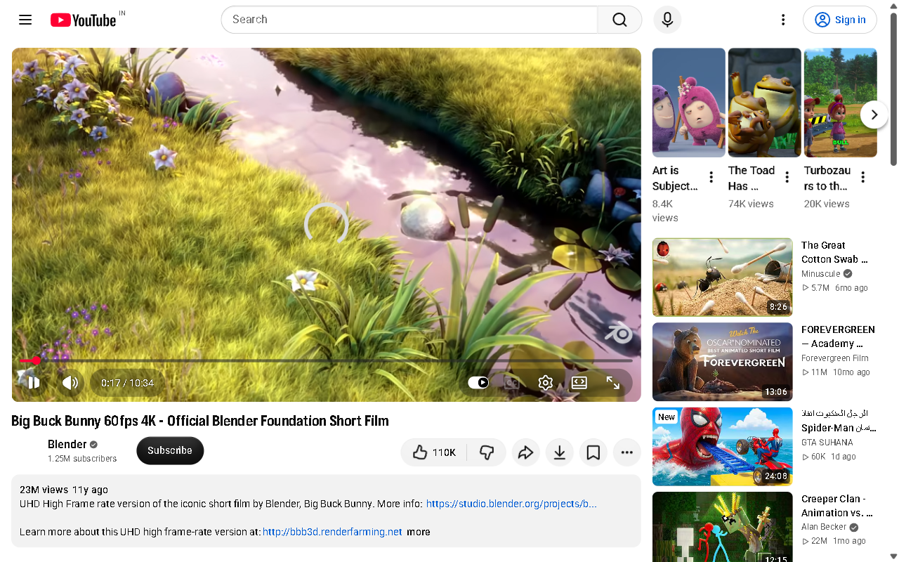

# YouTube v2 and required Chrome profile — 2026-10-21 IST

**Profile routing is implemented; the 103-tool migration is NOT accepted or enabled.**
The desktop shortcut `Comedy with - Chrome.lnk` resolves to installed Chrome with `--profile-directory="Default"`. The tracked configuration now explicitly selects that profile and enables `media.youtube_profile_only`. Search/play failures stop instead of opening another profile. Explicit YouTube URLs, planner `browser_navigate`, ordinary browse, Windows command 88 and project-open YouTube launches respect this preference. Owned browser requests for YouTube are fenced. Existing five-tool YouTube MCP registration, Spotify and Blender registrations remain unchanged.

## Evidence and separate counts

| Check | Result | Evidence |
|---|---|---|
| Unchanged full Jarvis + installed connectors baseline | 3,835 passed, 152 skipped, 1 warning; 1,235.40 s | [Baseline log](baseline-pytest.log), [baseline map/defects](baseline.md) |
| Supplied package baseline | 91 passed, 1 live skip (92 total) | [Log](supplied-baseline.log) |
| Supplied live test using its own launcher | Setup error: downloaded Chromium absent | [Log](supplied-live-gate-a.log) |
| Supplied controller injected into installed Chrome, before profile-only instruction | Public video opened; DOM transport/property observations captured. Not full Gate A acceptance: initial ready_state=0, volume later reset to 100 after setting 35, screenshot shows buffering | [Observations](supplied-injected-live.json), [public DOM text](gate-a-public-page.txt), [image](gate-a-public-page.png) |
| Profile lock and old media regressions | 107 passed; 1 existing COM warning | [Log](profile-regression.log) |
| Real user-confirmed Chrome session, text parser → ToolRegistry → Actions → Windows media session | Pause/resume/status verified; initial playing state restored. Private title omitted | [Redacted readbacks](profile-current-controls-live.json) |
| Staged adapter tests | 102 passed, 1 opt-in live skip (103 total); includes 103 distinct typed dispatch subtests | [Log](candidate-tests.log), [additional tests](candidate/tests/test_hardening.py) |
| Staged actual BaseConnector / built-in stdio | 108 unique names: 5 installed + 103 supplied; queue add/list verified; unknown approval argument rejected; browser and account effects fail closed | [Wire receipt](candidate-wire.json), [typed catalog](candidate-contract-elevated.json) |
| Launcher readiness | ready; required dependencies and configured services available. This is not live feature acceptance | [Log](launcher-check.log) |
| Post-change full regression | 3,851 passed, 152 skipped, 1 warning; 1,222.18 s | [Log](post-pytest.log) |
| Dedicated lint/type checker | Not run: ruff, mypy, pyright absent; no repository-wide configuration found for these tools; none installed | Existing Python compilation and typed MCP contracts are separate checks |

Implemented supplied handlers: **103 staged**, plus **5 retained installed handlers**. Discoverable via staged real stdio: **108**. Supplied typed dispatch contracts checked: **103**, with additional selected behavior and transport tests; this is not 103 independent live effect assertions. Candidate live accepted: **0**. Candidate post-integration live accepted: **0**. Existing profile route live verified: **3 distinct control intents** (pause, resume, status), not prefixed MCP calls. Physical microphone/running GUI acceptance has not run.

## Repairs and architecture limits

The [staged server](candidate/server.py) derives from the installed YouTube child and thus the actual centralized BaseConnector. It retains the five installed names and all nine supplied legacy names. The supplied FastMCP wrapper is preserved separately as `upstream_server.py` for comparison; simulation tests still test that wrapper, and new tests independently test the real-parent adapter. This is not registered in `.jarvis/mcp.json` or exposed to the planner.

Staged repairs retain queue/history entries after uncertain navigation or unverified playback; remove fallback clicks after uncertain media/click errors; reject URL userinfo and nonstandard ports; add embed-ID support; refuse API redirects and proxy credential forwarding; restrict endpoint names; bound response size; classify HTTP 400/401/403/404/429/500/quota without reflecting API message text; avoid home lookup with an explicit token path; block ad media changes except status/pause; require readiness and advancing media time before playback confirmation. No account mutations or credentials were used in live tests. Default account callback remains fail-closed. The staged candidate refuses to launch a separate browser when no accepted Page is injected.

**Internal work still required:** implement and verify an adapter for expanded controls in the required Default Chrome profile, rather than installing a second browser/profile; map browser-only discovery onto the installed lookup path without navigating the playing tab; migrate discovery beyond the host's ordinary 100-tool limit with a provider-specific policy; bind account operations to fresh trusted approvals and verified scopes; complete session ownership/cancellation/recovery/performance checks. The default Chrome profile is not a supported Playwright persistent automation target. Do not bypass that restriction by copying cookies, changing remote-debugging flags, or closing the user's Chrome.

Read-only [native accessibility probe](profile-accessibility-readiness.json) observed the YouTube window but no recognized player buttons or volume/seek sliders. Expanded UI actions were not attempted on unidentified controls. This reports the observed limitation, not proof of its cause. Existing Chrome media sessions independently supported the verified transport path.

**Unexecuted gates:** complete Gate A (playlist first/next/previous IDs and boundaries, selectors, consent/ad/Shorts/live restrictions, verified UI modes, concurrent and restart/recovery cases); then integration, full Gate B through the expanded connector, cross-provider tasks and fault/resource/leak testing. Optional API/OAuth live requests require locally configured credentials and appropriate grants; account write E2E additionally requires separately approved disposable account/playlist. No automatic comments, account deletion, playlist creation, or library changes occurred. Mock API failures do not certify real quota/credentials behavior.

## Measured latency scope

Default-profile opening dispatch: **233.992 ms**, one sample into an already running Chrome; playback was not verified by this launch. User-confirmed legacy transport harness: pause **654.056 / 443.531 ms**, resume **451.479 / 449.490 ms**; five warm status calls p50 **18.509 ms**, nearest-rank p95 **20.677 ms**. These measure the recorded text/registry/media-session path, not voice, browser cold start or v2 MCP dispatch. Final staged stdio batch (initialize, ping, discovery and five calls) **682.073 ms**; not a per-command percentile. Owned browser/process RSS, CPU and leak acceptance remain unmeasured; shared user Chrome memory is not attributed to Jarvis.

## Migration and rollback

No new MCP registration is enabled. Do not copy the candidate registration into production before the two gates pass. [Original source hashes](upstream-sha256.json), [inventory](command-inventory.json), [full matrix](coverage.md) and [review patch](source.patch) support review. The candidate preparation script refuses to overwrite repaired staged files.

To roll back only the profile preference, restore the four `media` values in `app/config/config.json` from the pre-change revision `3bb40b3`; the prior automatic fallback behavior remains available when `youtube_profile_only` is false. Review the patch before reverting source changes. Profiles, memories, existing connector config and credentials are preserved; do not delete or reset them. Restart Jarvis to load the saved configuration and code. Existing Chrome windows stay open.

Official authorization boundary verified using Firecrawl: [YouTube Data API reference](https://developers.google.com/youtube/data/reference/rest#call-the-api) requires OAuth for private data and insert/update/delete operations. No claims of API playback support derive from that page.

The following is an actual public-page screenshot from the earlier isolated Gate A probe, **not evidence of the user's Default profile or an accepted v2 integration**. Film credit: Blender Foundation, Big Buck Bunny; page provided by YouTube.

